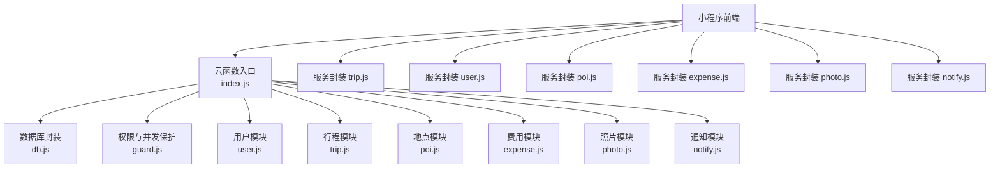
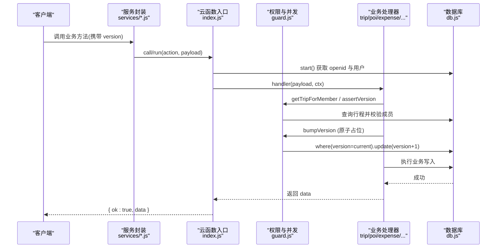
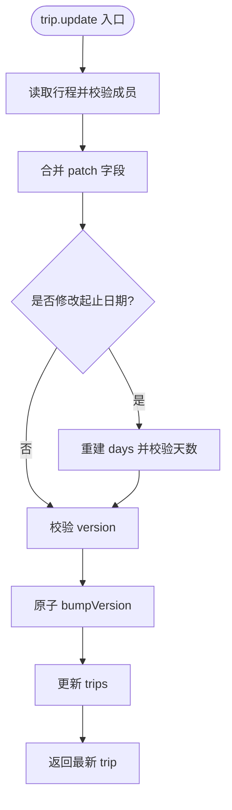
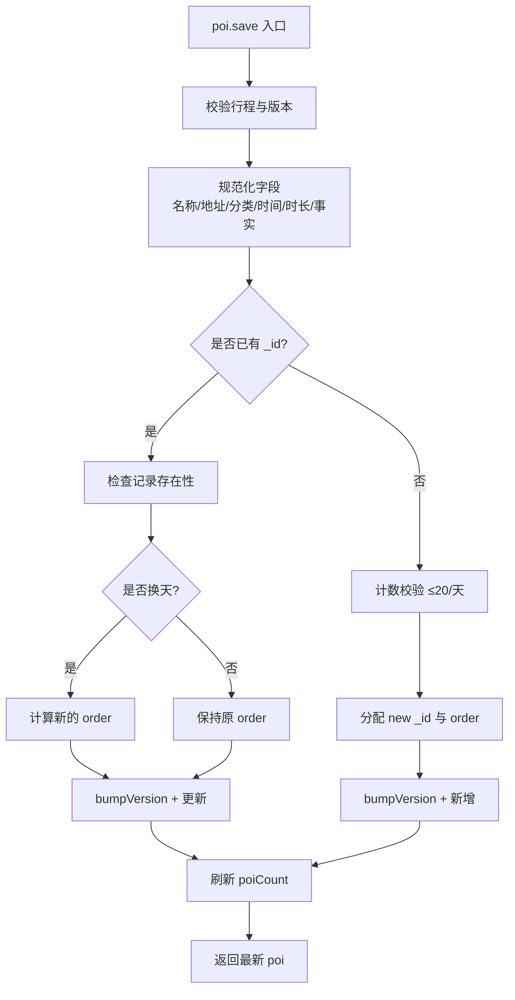
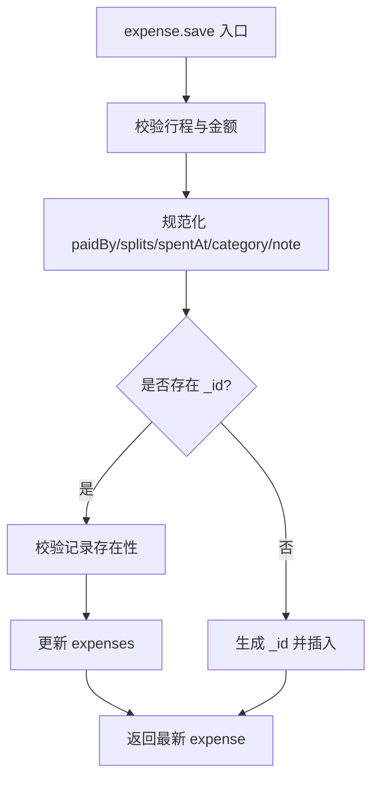
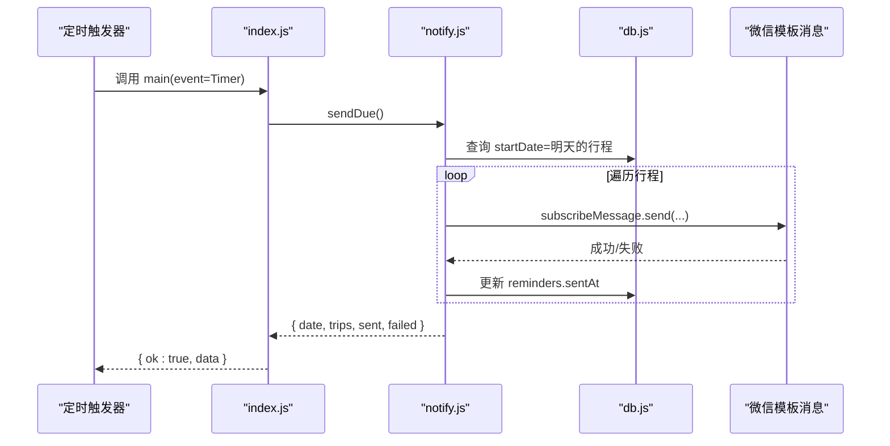
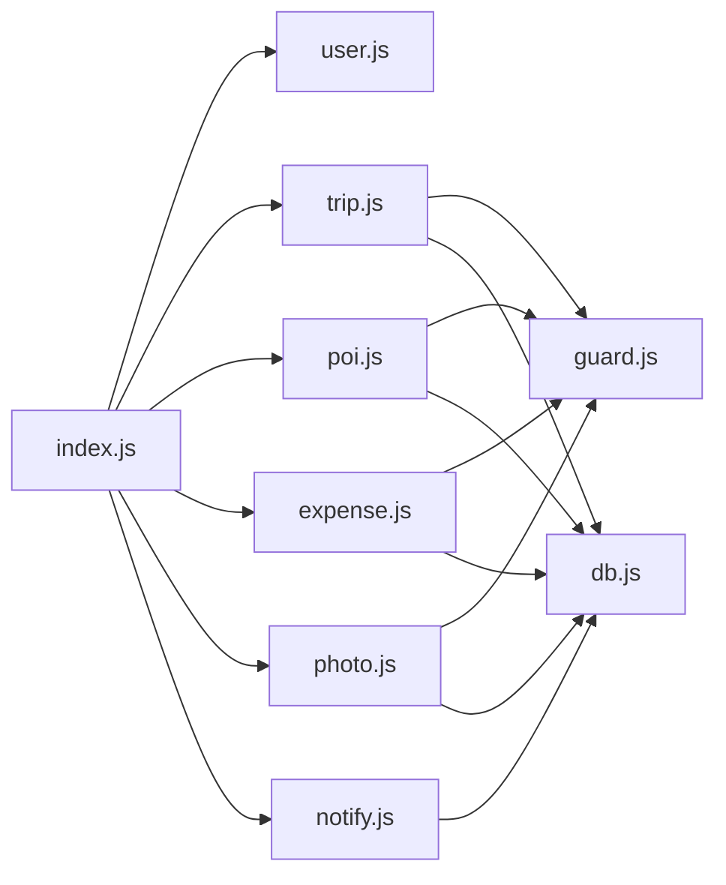

# API参考文档

<cite>
**本文引用的文件**   
- [index.js](file://cloudfunctions/api/index.js)
- [db.js](file://cloudfunctions/api/db.js)
- [guard.js](file://cloudfunctions/api/guard.js)
- [util.js](file://cloudfunctions/api/util.js)
- [user.js](file://cloudfunctions/api/user.js)
- [trip.js](file://cloudfunctions/api/trip.js)
- [poi.js](file://cloudfunctions/api/poi.js)
- [expense.js](file://cloudfunctions/api/expense.js)
- [photo.js](file://cloudfunctions/api/photo.js)
- [notify.js](file://cloudfunctions/api/notify.js)
- [services/trip.js](file://services/trip.js)
- [services/user.js](file://services/user.js)
- [services/poi.js](file://services/poi.js)
- [services/expense.js](file://services/expense.js)
- [services/photo.js](file://services/photo.js)
- [services/notify.js](file://services/notify.js)
</cite>

## 目录
1. [简介](#简介)
2. [项目结构](#项目结构)
3. [核心组件](#核心组件)
4. [架构总览](#架构总览)
5. [详细接口说明](#详细接口说明)
6. [依赖关系分析](#依赖关系分析)
7. [性能与容量限制](#性能与容量限制)
8. [错误处理与调试](#错误处理与调试)
9. [安全与合规](#安全与合规)
10. [版本与兼容性](#版本与兼容性)
11. [客户端实现指南](#客户端实现指南)
12. [常见问题排查](#常见问题排查)
13. [结论](#结论)

## 简介
本文件为云函数统一入口的API参考文档，覆盖用户、行程、地点、费用、照片与通知六大域。所有业务通过单一云函数按 action 路由分发，集中进行身份校验、权限控制、乐观锁与数据规范化。文档包含HTTP语义映射、请求/响应模式、认证方式、错误策略、速率与容量限制、版本信息、常见用例、客户端实现建议与监控方法。

## 项目结构
后端采用“单云函数 + action 路由”的结构：
- 入口 index.js 负责解析 action、初始化数据库连接、获取服务端 openid、调用对应处理器并统一返回格式。
- 各业务模块 user.js、trip.js、poi.js、expense.js、photo.js、notify.js 分别实现领域逻辑。
- guard.js 提供成员判断、角色判断、所有者校验、乐观锁断言与原子版本号递增。
- db.js 封装云数据库初始化、集合创建、用户身份获取与懒加载。
- util.js 提供日期、金额、截断、ID生成等通用工具。
- services/* 是小程序端对云函数的封装层，将 action 与参数包装成统一调用。

**图示来源**
- [index.js:10-41](file://cloudfunctions/api/index.js#L10-L41)
- [db.js:46-53](file://cloudfunctions/api/db.js#L46-L53)
- [guard.js:3-18](file://cloudfunctions/api/guard.js#L3-L18)

**章节来源**
- [index.js:10-77](file://cloudfunctions/api/index.js#L10-L77)
- [db.js:1-61](file://cloudfunctions/api/db.js#L1-L61)
- [guard.js:1-76](file://cloudfunctions/api/guard.js#L1-L76)

## 核心组件
- 统一入口与路由：根据 event.action 分派到具体处理器；定时触发器走独立分支。
- 身份与会话：从微信服务端上下文取 openid，拒绝前端传入的 openid。
- 权限模型：成员（editor）与创建者（owner），部分操作要求 owner。
- 乐观锁：version 字段配合 assertVersion/bumpVersion 防止并发覆盖。
- 数据规范化：金额以“分”存储，日期严格校验，文本长度截断，枚举值白名单过滤。
- 软删除：trips/pois/expenses/files 使用 deletedAt 标记，保留历史便于回放与恢复。

**章节来源**
- [index.js:43-76](file://cloudfunctions/api/index.js#L43-L76)
- [db.js:46-53](file://cloudfunctions/api/db.js#L46-L53)
- [guard.js:26-42](file://cloudfunctions/api/guard.js#L26-L42)
- [util.js:15-49](file://cloudfunctions/api/util.js#L15-L49)

## 架构总览
下图展示一次典型写操作的调用链与并发保护机制。

**图示来源**
- [index.js:43-76](file://cloudfunctions/api/index.js#L43-L76)
- [guard.js:26-42](file://cloudfunctions/api/guard.js#L26-L42)
- [db.js:46-53](file://cloudfunctions/api/db.js#L46-L53)

## 详细接口说明

### 通用约定
- 调用方式：小程序通过 services/* 调用云函数 action。
- 认证方式：基于微信服务端上下文 openid，禁止前端传 openid。
- 返回格式：
  - 成功：{ ok: true, data }
  - 失败：{ ok: false, code?, message }
- 版本字段：version 由服务端维护，客户端在写操作需带上读取到的 version。
- 金额单位：服务端统一以“分”存储，前端以元输入输出。
- 时间格式：YYYY-MM-DD。
- 分页与上限：多数列表默认 limit，见各接口说明。

**章节来源**
- [index.js:43-76](file://cloudfunctions/api/index.js#L43-L76)
- [util.js:44-49](file://cloudfunctions/api/util.js#L44-L49)

### 用户管理
- user.me
  - 作用：获取当前用户基本信息。
  - 请求：payload 为空对象或省略。
  - 响应：data.openid、data.user.nickname、data.user.defaultCurrency。
  - 权限：已登录用户。

**章节来源**
- [user.js:1-12](file://cloudfunctions/api/user.js#L1-L12)
- [services/user.js:1-8](file://services/user.js#L1-L8)

### 行程管理
- trip.list
  - 作用：列出当前用户参与的行程。
  - 请求：空 payload。
  - 响应：data.items 数组。
  - 排序：按 updatedAt 倒序，最多50条。
- trip.get
  - 作用：获取单个行程详情。
  - 请求：tripId。
  - 响应：data.trip。
- trip.create
  - 作用：创建新行程。
  - 请求关键字段：title、destination、startDate、endDate、mode、transport、budget。
  - 约束：标题≤20字、目的地≤30字、天数≤15天、预算非负。
  - 响应：data.trip。
- trip.update
  - 作用：更新行程（patch）。
  - 请求关键字段：tripId、patch、version。
  - 约束：若修改起止日期会重建 days；减少天数时需确保后续无地点。
  - 并发：需要正确 version，否则冲突。
  - 响应：data.trip（最新）。
- trip.remove
  - 作用：软删除行程及其地点、账目。
  - 请求关键字段：tripId、version。
  - 权限：仅创建者可删。
  - 响应：data.tripId。
- trip.copy
  - 作用：复制行程，日期从今天起算，地点迁移，成员仅自己。
  - 请求关键字段：tripId。
  - 响应：data.trip。
- trip.invite
  - 作用：生成邀请码（7天有效）。
  - 请求关键字段：tripId。
  - 权限：仅创建者可生成。
  - 响应：data.inviteCode、data.inviteExpireAt、data.trip。
- trip.join
  - 作用：通过 tripId 或 inviteCode 加入行程。
  - 请求关键字段：tripId 或 code。
  - 行为：首次加入后转为 group 模式。
  - 响应：data.trip、data.joined。
- trip.leave
  - 作用：成员退出行程（创建者不可退）。
  - 请求关键字段：tripId。
  - 响应：data.tripId。
- trip.removeMember
  - 作用：移除同行成员（创建者不可移除自己或创建者）。
  - 请求关键字段：tripId、openid。
  - 权限：仅创建者可执行。
  - 响应：data.trip、data.openid。

**图示来源**
- [trip.js:90-132](file://cloudfunctions/api/trip.js#L90-L132)
- [guard.js:26-42](file://cloudfunctions/api/guard.js#L26-L42)

**章节来源**
- [trip.js:35-369](file://cloudfunctions/api/trip.js#L35-L369)
- [services/trip.js:1-47](file://services/trip.js#L1-L47)

### 地点管理
- poi.list
  - 作用：获取行程下所有地点（同时返回 trip，减少往返）。
  - 请求关键字段：tripId。
  - 响应：data.trip、data.items（按 order 升序，最多300条）。
- poi.save
  - 作用：新增或更新地点。
  - 请求关键字段：tripId、poi、version。
  - 约束：名称必填且≤30字；地址≤60字；备注≤200字；分类白名单；计划时间 HH:mm；时长固定选项；一天最多20个地点。
  - 并发：需要正确 version。
  - 响应：data.poi。
- poi.remove
  - 作用：软删除地点。
  - 请求关键字段：tripId、poiId、version。
  - 响应：data.poiId。
- poi.reorder
  - 作用：批量重排地点顺序与时间（避免部分成功）。
  - 请求关键字段：tripId、items、version。
  - items 元素：_id、dayIndex、plannedTime。
  - 响应：data.updated（实际更新数量）。

**图示来源**
- [poi.js:73-144](file://cloudfunctions/api/poi.js#L73-L144)
- [poi.js:162-191](file://cloudfunctions/api/poi.js#L162-L191)

**章节来源**
- [poi.js:1-199](file://cloudfunctions/api/poi.js#L1-L199)
- [services/poi.js:1-22](file://services/poi.js#L1-L22)

### 费用管理
- expense.list
  - 作用：获取行程内费用明细与汇总。
  - 请求关键字段：tripId。
  - 响应：data.trip、data.items、data.summary（totalCents、count、byCategory）。
- expense.overview
  - 作用：聚合当前用户参与的所有行程花费合计（用于记账Tab）。
  - 请求：空 payload。
  - 响应：data.items（tripId、totalCents、count）。
- expense.save
  - 作用：新增或更新费用记录。
  - 请求关键字段：tripId、expense。
  - 约束：金额>0；category白名单；paidBy必须是成员；splits合计必须等于amount；spentAt为YYYY-MM-DD。
  - 响应：data.expense。
- expense.remove
  - 作用：软删除费用记录。
  - 请求关键字段：tripId、expenseId。
  - 响应：data.expenseId。
- expense.settle
  - 作用：AA结算，计算每人实付/应摊/差额与转账建议。
  - 请求关键字段：tripId。
  - 响应：data.tripId、data.memberCount、data.totalCents、data.members、data.transfers。

**图示来源**
- [expense.js:132-184](file://cloudfunctions/api/expense.js#L132-L184)

**章节来源**
- [expense.js:1-329](file://cloudfunctions/api/expense.js#L1-L329)
- [services/expense.js:1-26](file://services/expense.js#L1-L26)

### 照片管理
- photo.list
  - 作用：获取行程下的照片清单（只存 fileID）。
  - 请求关键字段：tripId。
  - 响应：data.trip、data.items（按 createdAt 升序，最多100张）。
- photo.add
  - 作用：添加照片记录（不上传文件，文件由小程序端直连云存储）。
  - 请求关键字段：tripId、fileID、可选 poiId/dayIndex。
  - 约束：每趟行程最多100张照片。
  - 响应：data.file。
- photo.remove
  - 作用：软删除照片记录（不删云存储原图）。
  - 请求关键字段：tripId、fileId。
  - 响应：data.fileId。

**章节来源**
- [photo.js:1-65](file://cloudfunctions/api/photo.js#L1-L65)
- [services/photo.js:1-16](file://services/photo.js#L1-L16)

### 通知管理
- notify.subscribe
  - 作用：订阅出发提醒模板消息，绑定 templateId。
  - 请求关键字段：tripId、templateId。
  - 行为：去重保存 reminders，每次点击授权仅留一条。
  - 响应：data.count。
- 定时任务 sendDue（非 action 路由）
  - 触发：定时触发器每天20:00调用。
  - 行为：查找明天出发的行程，向未发送过的成员推送模板消息，无论成功失败都标记 sentAt。
  - 返回：date、trips、sent、failed。

**图示来源**
- [index.js:43-54](file://cloudfunctions/api/index.js#L43-L54)
- [notify.js:47-96](file://cloudfunctions/api/notify.js#L47-L96)

**章节来源**
- [notify.js:1-102](file://cloudfunctions/api/notify.js#L1-L102)
- [services/notify.js:1-8](file://services/notify.js#L1-L8)

## 依赖关系分析
- index.js 依赖 db.js、guard.js 与各业务模块。
- trip.js、poi.js、expense.js、photo.js 依赖 guard.js 做成员与权限校验。
- notify.js 依赖 db.js 与微信开放能力 wx-server-sdk。
- services/* 是对云函数 action 的薄封装，屏蔽 action 命名细节。

**图示来源**
- [index.js:1-41](file://cloudfunctions/api/index.js#L1-L41)
- [trip.js:1-4](file://cloudfunctions/api/trip.js#L1-L4)
- [poi.js:1-3](file://cloudfunctions/api/poi.js#L1-L3)
- [expense.js:1-3](file://cloudfunctions/api/expense.js#L1-L3)
- [photo.js:1-3](file://cloudfunctions/api/photo.js#L1-L3)
- [notify.js:1-4](file://cloudfunctions/api/notify.js#L1-L4)

**章节来源**
- [index.js:1-41](file://cloudfunctions/api/index.js#L1-L41)

## 性能与容量限制
- 列表上限：
  - 行程列表：50条。
  - 地点列表：300条。
  - 费用明细：300条。
  - 照片清单：100张。
- 并发控制：
  - 使用 version 乐观锁与 bumpVersion 原子更新，避免并发覆盖。
- 聚合优化：
  - expense.overview 使用聚合管道一次性统计各行程总额。
- 索引建议：
  - pois(tripId, dayIndex, order)
  - expenses(tripId, spentAt)
  - trips(memberOpenids)、trips(inviteCode)
- 批处理：
  - poi.reorder 使用 Promise.all 并行更新多条记录。

**章节来源**
- [trip.js:35-43](file://cloudfunctions/api/trip.js#L35-L43)
- [poi.js:42-59](file://cloudfunctions/api/poi.js#L42-L59)
- [expense.js:105-130](file://cloudfunctions/api/expense.js#L105-L130)
- [db.js:13-15](file://cloudfunctions/api/db.js#L13-L15)

## 错误处理与调试
- 统一返回：
  - 成功：ok=true，data 可为 null。
  - 失败：ok=false，code 可用于客户端分流（如 conflict），message 描述原因。
- 常见错误：
  - 缺少必要字段：如“缺少行程 id”“缺少地点 id”。
  - 权限不足：如“你没有这份行程的权限”“只有创建者可以做这个操作”。
  - 并发冲突：conflict，提示刷新后再试。
  - 业务校验失败：如“日期不合法”“金额不大于0”“分摊合计和金额不一致”。
- 调试建议：
  - 查看云函数日志中的 [api] 与 [notify] 前缀。
  - 对于模板消息失败，关注 errCode 与 errMsg，常见为字段名不匹配或授权额度耗尽。
  - 在小程序端捕获 code=conflict 时自动刷新页面数据。

**章节来源**
- [index.js:62-75](file://cloudfunctions/api/index.js#L62-L75)
- [guard.js:20-24](file://cloudfunctions/api/guard.js#L20-L24)
- [notify.js:77-90](file://cloudfunctions/api/notify.js#L77-L90)

## 安全与合规
- 身份安全：
  - openid 仅从服务端上下文获取，拒绝前端传入。
- 权限控制：
  - 成员访问校验 requireOwner 与 isMember。
- 数据完整性：
  - 金额以“分”存储，避免浮点误差。
  - 文本长度截断 cut，枚举值白名单过滤。
- 隐私与最小化：
  - 返回 myRole 仅给调用方，不写库。
  - 软删除保留历史，避免误删无法恢复。
- 通知合规：
  - 模板消息字段与公众平台模板一一对应，失败不重试打扰用户。

**章节来源**
- [db.js:46-53](file://cloudfunctions/api/db.js#L46-L53)
- [guard.js:3-18](file://cloudfunctions/api/guard.js#L3-L18)
- [util.js:39-49](file://cloudfunctions/api/util.js#L39-L49)
- [notify.js:6-25](file://cloudfunctions/api/notify.js#L6-L25)

## 版本与兼容性
- 乐观锁版本：
  - trips.version 用于并发控制，旧数据缺失时会补0。
- 向后兼容：
  - expense.splitWith 保留给老数据，新逻辑优先使用 splits。
  - roleOf 兼容老数据中无 role 的情况。
- 弃用与迁移：
  - 建议客户端逐步使用 splits 替代 splitWith。
  - 模板消息字段名变更时仅需调整 notify.js 中 FIELDS 映射。

**章节来源**
- [guard.js:56-64](file://cloudfunctions/api/guard.js#L56-L64)
- [expense.js:152-156](file://cloudfunctions/api/expense.js#L152-L156)
- [notify.js:6-8](file://cloudfunctions/api/notify.js#L6-L8)

## 客户端实现指南
- 调用封装：
  - 使用 services/* 提供的函数，避免直接拼接 action。
- 乐观锁：
  - 读到的 trip.version 在写操作中透传；收到 conflict 后刷新数据并重试。
- 金额处理：
  - 前端以元为单位输入输出，后端以分为单位存储。
- 列表与分页：
  - 注意各接口的默认上限，必要时在前端做二次分页或滚动加载。
- 照片上传：
  - 先通过小程序云存储上传获得 fileID，再调用 photo.add 登记记录。
- 通知订阅：
  - 调用 notify.subscribe 绑定模板消息，成功后由定时任务在出发前一天推送。

**章节来源**
- [services/trip.js:16-19](file://services/trip.js#L16-L19)
- [services/poi.js:8-11](file://services/poi.js#L8-L11)
- [photo.js:19-41](file://cloudfunctions/api/photo.js#L19-L41)
- [notify.js:27-45](file://cloudfunctions/api/notify.js#L27-L45)

## 常见问题排查
- 报错“未知操作”：
  - 检查 action 是否在 routes 中注册。
- 报错“没有获取到用户身份”：
  - 确认在微信环境中打开小程序，且云函数环境配置正确。
- 频繁出现 conflict：
  - 检查客户端是否正确传递 version，并在冲突后刷新数据。
- 模板消息发送失败：
  - 核对模板字段名与 FIELDS 映射一致；检查授权次数与errMsg。
- 地点无法重排或部分成功：
  - 使用 poi.reorder 一次性提交完整 items，避免多次往返。

**章节来源**
- [index.js:56-60](file://cloudfunctions/api/index.js#L56-L60)
- [db.js:46-51](file://cloudfunctions/api/db.js#L46-L51)
- [guard.js:26-42](file://cloudfunctions/api/guard.js#L26-L42)
- [notify.js:77-90](file://cloudfunctions/api/notify.js#L77-L90)
- [poi.js:162-191](file://cloudfunctions/api/poi.js#L162-L191)

## 结论
该API体系通过单一云函数集中路由、统一鉴权与乐观锁，实现了高内聚、低耦合的业务模块划分。建议在客户端侧严格遵循版本控制、金额单位与字段规范，结合聚合与索引优化，提升整体性能与稳定性。通知模块与软删除设计兼顾了用户体验与数据安全，适合旅行协作场景的多端协同需求。