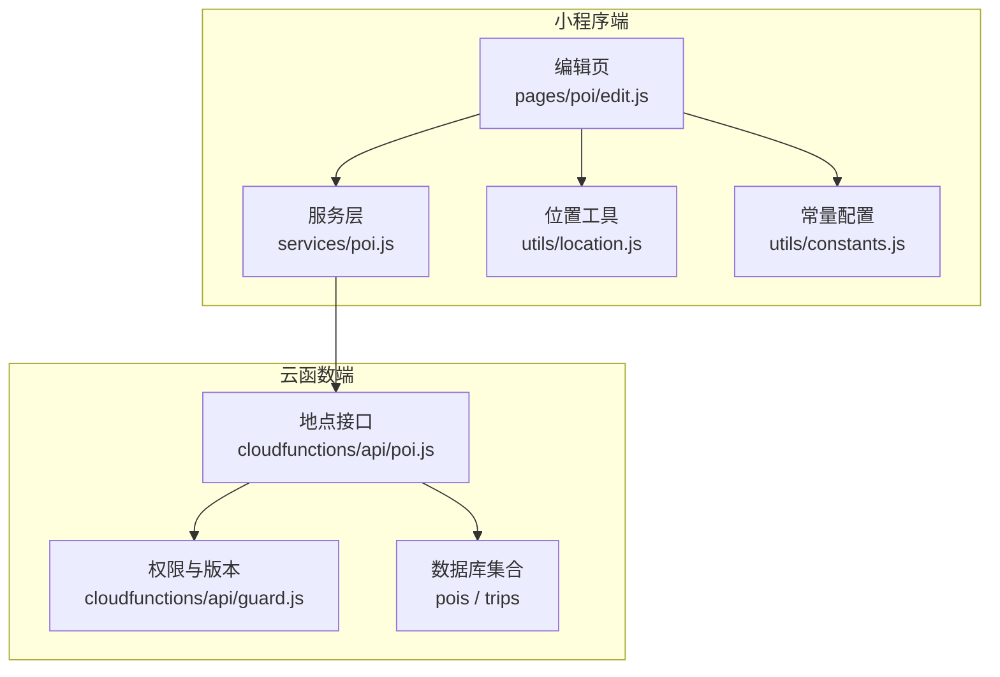
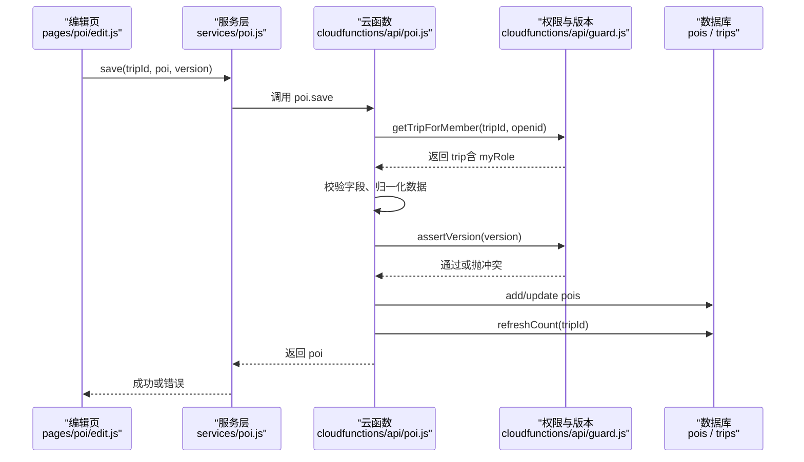
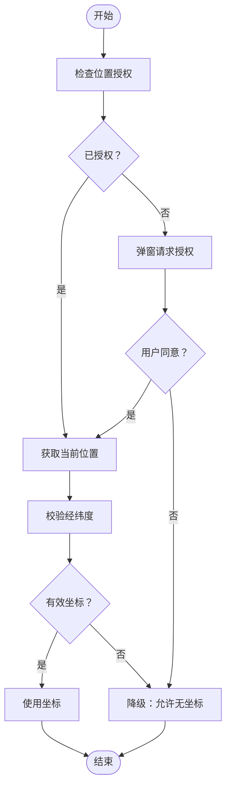
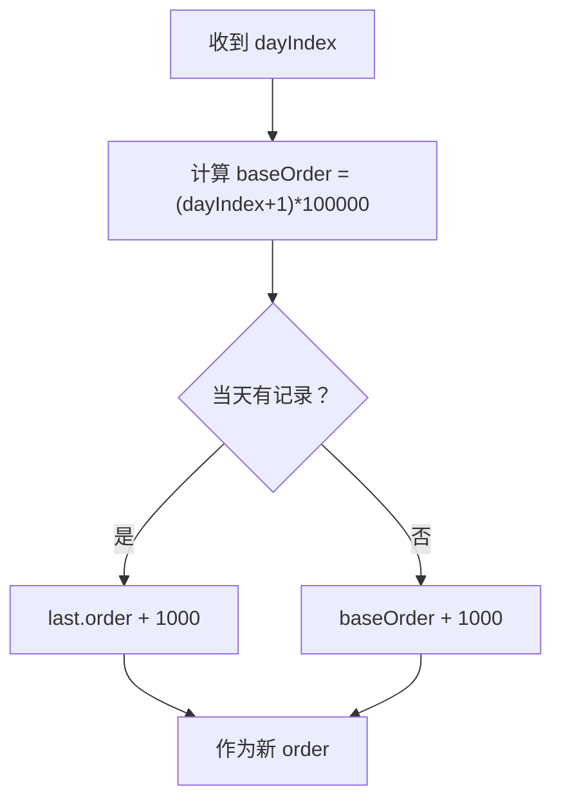
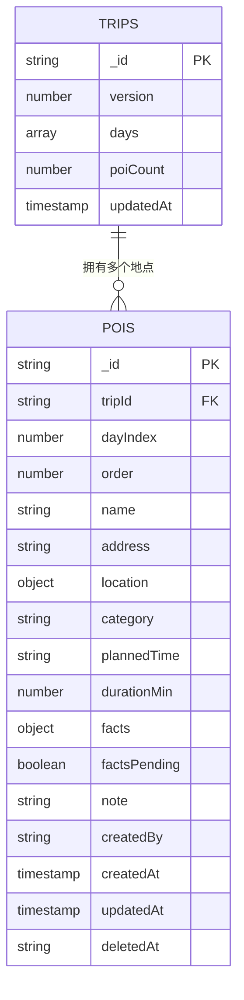
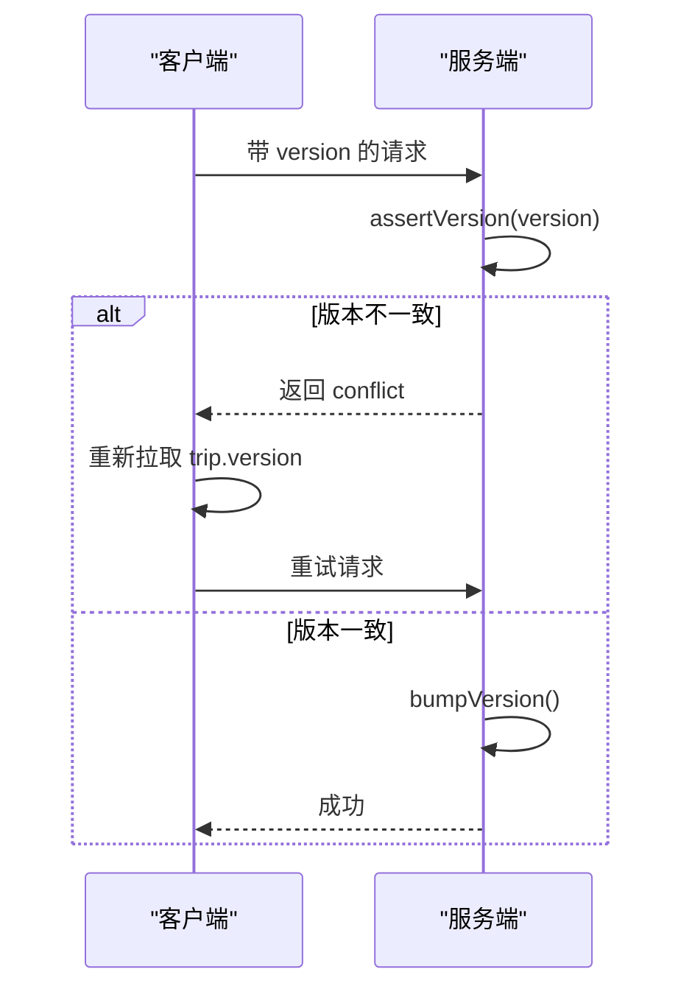

# 地点管理API

<cite>
**本文引用的文件**   
- [cloudfunctions/api/poi.js](file://cloudfunctions/api/poi.js)
- [services/poi.js](file://services/poi.js)
- [pages/poi/edit.js](file://pages/poi/edit.js)
- [utils/location.js](file://utils/location.js)
- [utils/constants.js](file://utils/constants.js)
- [cloudfunctions/api/guard.js](file://cloudfunctions/api/guard.js)
</cite>

## 目录
1. [简介](#简介)
2. [项目结构](#项目结构)
3. [核心组件](#核心组件)
4. [架构总览](#架构总览)
5. [详细接口说明](#详细接口说明)
6. [数据模型与校验规则](#数据模型与校验规则)
7. [地理位置处理](#地理位置处理)
8. [分类管理与排序算法](#分类管理与排序算法)
9. [与行程的关联关系](#与行程的关联关系)
10. [并发控制与冲突处理](#并发控制与冲突处理)
11. [性能优化策略](#性能优化策略)
12. [调用示例与最佳实践](#调用示例与最佳实践)
13. [故障排查指南](#故障排查指南)
14. [结论](#结论)

## 简介
本文件为“地点管理API”的完整技术文档，覆盖地点的增删改查、排序调整、地理位置处理、分类管理、排序算法、与行程的关联关系、数据验证规则以及性能优化策略。读者可据此实现小程序端对地点数据的稳定调用，并理解服务端在权限、版本控制、并发安全方面的设计。

## 项目结构
地点相关能力由三层组成：
- 云函数层：提供地点业务接口，负责权限校验、数据校验、排序计算、并发控制与数据库操作。
- 小程序服务层：封装云函数调用，统一错误提示与加载状态。
- 页面与工具层：负责表单交互、位置授权、选点回填、城市匹配等前端逻辑。

**图表来源**
- [cloudfunctions/api/poi.js:1-199](file://cloudfunctions/api/poi.js#L1-L199)
- [services/poi.js:1-22](file://services/poi.js#L1-L22)
- [pages/poi/edit.js:1-360](file://pages/poi/edit.js#L1-L360)
- [utils/location.js:1-139](file://utils/location.js#L1-L139)
- [utils/constants.js:1-48](file://utils/constants.js#L1-L48)
- [cloudfunctions/api/guard.js:1-76](file://cloudfunctions/api/guard.js#L1-L76)

**章节来源**
- [cloudfunctions/api/poi.js:1-199](file://cloudfunctions/api/poi.js#L1-L199)
- [services/poi.js:1-22](file://services/poi.js#L1-L22)
- [pages/poi/edit.js:1-360](file://pages/poi/edit.js#L1-L360)
- [utils/location.js:1-139](file://utils/location.js#L1-L139)
- [utils/constants.js:1-48](file://utils/constants.js#L1-L48)
- [cloudfunctions/api/guard.js:1-76](file://cloudfunctions/api/guard.js#L1-L76)

## 核心组件
- 地点云函数接口：提供 list、save、remove、reorder 四个方法，完成地点的查询、新增/更新、删除与批量重排。
- 小程序服务封装：对外暴露 poi.list、poi.save、poi.remove、poi.reorder，统一错误提示与加载文案。
- 编辑页：负责地点表单、地图选点、城市选择、保存与删除流程，并处理冲突重试。
- 位置工具：统一位置授权、当前位置获取、选点名称有效性判断。
- 常量配置：集中定义地点分类、停留时长选项、限制值等。
- 权限与版本：校验成员身份、版本一致性，原子递增版本号防止并发写冲突。

**章节来源**
- [cloudfunctions/api/poi.js:1-199](file://cloudfunctions/api/poi.js#L1-L199)
- [services/poi.js:1-22](file://services/poi.js#L1-L22)
- [pages/poi/edit.js:1-360](file://pages/poi/edit.js#L1-L360)
- [utils/location.js:1-139](file://utils/location.js#L1-L139)
- [utils/constants.js:1-48](file://utils/constants.js#L1-L48)
- [cloudfunctions/api/guard.js:1-76](file://cloudfunctions/api/guard.js#L1-L76)

## 架构总览
下图展示一次“保存地点”的端到端调用链，包括前端校验、服务层调用、云函数权限与版本检查、数据库写入与计数刷新。

**图表来源**
- [pages/poi/edit.js:272-324](file://pages/poi/edit.js#L272-L324)
- [services/poi.js:8-11](file://services/poi.js#L8-L11)
- [cloudfunctions/api/poi.js:73-144](file://cloudfunctions/api/poi.js#L73-L144)
- [cloudfunctions/api/guard.js:26-42](file://cloudfunctions/api/guard.js#L26-L42)

## 详细接口说明

### 列表接口：poi.list
- 功能：获取某份行程下的所有地点，并按 order 升序返回；同时返回 trip 对象以减少往返。
- 入参：tripId
- 出参：{ trip, items }
- 行为要点：
  - 校验调用者是否为行程成员。
  - 仅返回未删除的地点。
  - 按 order 升序排序，最多返回 300 条。
- 适用场景：地点详情页、地图页、编辑页初始化。

**章节来源**
- [cloudfunctions/api/poi.js:62-71](file://cloudfunctions/api/poi.js#L62-L71)
- [services/poi.js:4-6](file://services/poi.js#L4-L6)

### 保存接口：poi.save
- 功能：新增或更新地点。
- 入参：tripId、poi、version
- 出参：{ poi }
- 行为要点：
  - 校验行程存在且包含可选天数。
  - 必填 name，其他字段进行长度裁剪与格式归一化。
  - 若传入 _id 则更新，否则新增。
  - 新增时校验当天地点数量上限。
  - 换天更新时会重新计算 order。
  - 使用版本断言与原子 bumpVersion 保证并发安全。
  - 成功后刷新行程的 poiCount。
- 错误：
  - 缺少地点 id、地点不存在或已被删除、一天地点过多、行程无可用天数等。

**章节来源**
- [cloudfunctions/api/poi.js:73-144](file://cloudfunctions/api/poi.js#L73-L144)
- [services/poi.js:8-11](file://services/poi.js#L8-L11)

### 删除接口：poi.remove
- 功能：软删除地点。
- 入参：tripId、poiId、version
- 出参：{ poiId }
- 行为要点：
  - 校验 poiId 存在。
  - 版本断言与原子 bumpVersion。
  - 设置 deletedAt 与 updatedAt。
  - 刷新行程 poiCount。

**章节来源**
- [cloudfunctions/api/poi.js:146-160](file://cloudfunctions/api/poi.js#L146-L160)
- [services/poi.js:13-15](file://services/poi.js#L13-L15)

### 重排接口：poi.reorder
- 功能：一次性提交本天全部地点的顺序与计划时间，避免部分成功。
- 入参：tripId、items、version
- 出参：{ updated }
- 行为要点：
  - items 为客户端期望的最终顺序数组，每项至少包含 _id、dayIndex、plannedTime。
  - 限制最多 300 项。
  - 根据 dayIndex 计算 baseOrder，并在同天内按提交顺序分配递增 order。
  - 支持更新 plannedTime。
  - 使用 Promise.all 并行更新，提升吞吐。

**章节来源**
- [cloudfunctions/api/poi.js:162-191](file://cloudfunctions/api/poi.js#L162-L191)
- [services/poi.js:17-20](file://services/poi.js#L17-L20)

## 数据模型与校验规则

### 地点数据模型
- 标识与归属：_id、tripId、createdBy、createdAt、deletedAt、updatedAt
- 日程信息：dayIndex、order、plannedTime、durationMin
- 基本信息：name、address、location、category、note
- 事实信息：facts.open、facts.reserve、facts.fee、factsPending

关键字段约束与默认值：
- name：必填，最大长度 30。
- address：最大长度 60。
- location：经纬度需为有限数值，否则置空。
- category：限定于预设分类，非法值回退到“其它”。
- plannedTime：必须为 HH:mm 格式，否则清空。
- durationMin：限定于预设分钟数，非法值回退到 60。
- facts.*：各字段最大长度 40。
- note：最大长度 200。
- factsPending：用户手填信息默认待核实。

**章节来源**
- [cloudfunctions/api/poi.js:15-40](file://cloudfunctions/api/poi.js#L15-L40)
- [cloudfunctions/api/poi.js:83-97](file://cloudfunctions/api/poi.js#L83-L97)
- [utils/constants.js:12-24](file://utils/constants.js#L12-L24)

### 分类与时长
- 分类：景点、餐饮、住宿、交通、购物、其它
- 停留时长（分钟）：30、60、90、120、180

**章节来源**
- [cloudfunctions/api/poi.js:5-6](file://cloudfunctions/api/poi.js#L5-L6)
- [utils/constants.js:12-24](file://utils/constants.js#L12-L24)

## 地理位置处理
- 坐标来源：
  - 用户手动输入或地图选点。
  - 当前定位（gcj02 坐标系，与地图组件一致）。
- 坐标校验：
  - 经纬度必须为有限数值且非零，否则视为无效坐标。
- 选点名称质检：
  - 当微信选点返回的名称仅为行政区划或城市名时，判定为“模糊名称”，需要用户手动填写具体地点名。
- 授权流程：
  - 已授权直接使用；未询问过则弹窗请求；拒绝过则引导去系统设置开启。

**图表来源**
- [utils/location.js:50-132](file://utils/location.js#L50-L132)
- [cloudfunctions/api/poi.js:15-21](file://cloudfunctions/api/poi.js#L15-L21)

**章节来源**
- [utils/location.js:1-139](file://utils/location.js#L1-L139)
- [cloudfunctions/api/poi.js:15-21](file://cloudfunctions/api/poi.js#L15-L21)

## 分类管理与排序算法

### 分类管理
- 分类枚举固定，前端下拉选择与服务端白名单校验保持一致。
- 非法分类自动归入“其它”，确保数据一致性。

**章节来源**
- [cloudfunctions/api/poi.js:5](file://cloudfunctions/api/poi.js#L5)
- [utils/constants.js:12-13](file://utils/constants.js#L12-L13)

### 排序算法
- 目标：单字段 order 即可实现“按天 + 按序”排序。
- 设计：
  - baseOrder(dayIndex) = (dayIndex + 1) * 100000
  - nextOrder：在同一天内取最后一个 order + 1000；若无记录则从 baseOrder + 1000 起。
  - reorder：按 dayIndex 分组，组内按提交顺序依次 +1000。
- 优势：
  - 无需复合索引，单字段 order 即可满足排序需求。
  - 换天时自动落到新天末尾，避免跨天冲突。

**图表来源**
- [cloudfunctions/api/poi.js:9-13](file://cloudfunctions/api/poi.js#L9-L13)
- [cloudfunctions/api/poi.js:42-51](file://cloudfunctions/api/poi.js#L42-L51)
- [cloudfunctions/api/poi.js:172-186](file://cloudfunctions/api/poi.js#L172-L186)

**章节来源**
- [cloudfunctions/api/poi.js:9-13](file://cloudfunctions/api/poi.js#L9-L13)
- [cloudfunctions/api/poi.js:42-51](file://cloudfunctions/api/poi.js#L42-L51)
- [cloudfunctions/api/poi.js:162-191](file://cloudfunctions/api/poi.js#L162-L191)

## 与行程的关联关系
- 每个地点属于一份行程（tripId），并通过 dayIndex 归属到具体某天。
- 列表接口在一次请求中返回 trip 与 items，减少往返。
- 每次地点变更都会刷新行程的 poiCount 与 updatedAt，便于前端展示统计与更新时间。

**图表来源**
- [cloudfunctions/api/poi.js:53-59](file://cloudfunctions/api/poi.js#L53-L59)
- [cloudfunctions/api/poi.js:62-71](file://cloudfunctions/api/poi.js#L62-L71)

**章节来源**
- [cloudfunctions/api/poi.js:53-59](file://cloudfunctions/api/poi.js#L53-L59)
- [cloudfunctions/api/poi.js:62-71](file://cloudfunctions/api/poi.js#L62-L71)

## 并发控制与冲突处理
- 版本断言：客户端携带 trip.version，服务端比较不一致即拒绝。
- 原子占位：bumpVersion 使用 where version=current 条件更新，仅一个请求能成功。
- 前端处理：
  - 保存失败且 code=conflict 时，提示用户并重新拉取最新 trip.version 后重试。
  - 删除失败同样支持一次自动重试。

**图表来源**
- [cloudfunctions/api/guard.js:26-42](file://cloudfunctions/api/guard.js#L26-L42)
- [pages/poi/edit.js:302-324](file://pages/poi/edit.js#L302-L324)

**章节来源**
- [cloudfunctions/api/guard.js:26-42](file://cloudfunctions/api/guard.js#L26-L42)
- [pages/poi/edit.js:302-324](file://pages/poi/edit.js#L302-L324)

## 性能优化策略
- 单次返回 trip 与 items：减少一次网络往返。
- 批量重排：reorder 接口一次提交整天的顺序与时间，避免多次半成功。
- 并行更新：reorder 内部使用 Promise.all 并行更新多条记录。
- 限制读取规模：list 限制最多 300 条，避免大数据量拖慢渲染。
- 计数缓存：poiCount 随地点变更刷新，列表页可直接展示统计。

**章节来源**
- [cloudfunctions/api/poi.js:62-71](file://cloudfunctions/api/poi.js#L62-L71)
- [cloudfunctions/api/poi.js:162-191](file://cloudfunctions/api/poi.js#L162-L191)
- [cloudfunctions/api/poi.js:53-59](file://cloudfunctions/api/poi.js#L53-L59)

## 调用示例与最佳实践

### 基本调用流程
- 列表：调用 poi.list(tripId)，拿到 trip 与 items，用于渲染地点列表与地图。
- 新增：准备 poi 对象，带上 tripId 与当前 version，调用 poi.save。
- 更新：在 poi 中带上 _id，其余字段同上。
- 删除：调用 poi.remove(tripId, poiId, version)。
- 重排：收集当天所有地点的 [{ _id, dayIndex, plannedTime }]，调用 poi.reorder。

### 最佳实践
- 始终携带 trip.version，避免并发覆盖。
- 重排时提交整天的完整顺序，不要分多次提交。
- 选点后若名称为行政区划或城市名，应提示用户手动补充具体地点名。
- 对于无坐标的地点，明确告知不会显示在地图页。
- 保存前在前端做基础校验（如名称必填），减少无效请求。

**章节来源**
- [services/poi.js:4-20](file://services/poi.js#L4-L20)
- [pages/poi/edit.js:183-243](file://pages/poi/edit.js#L183-L243)
- [pages/poi/edit.js:272-324](file://pages/poi/edit.js#L272-L324)

## 故障排查指南
- “缺少行程 id”：检查 tripId 是否传递正确。
- “你没有这份行程的权限”：确认当前用户是否为行程成员。
- “地点不存在或已被删除”：检查 poiId 是否有效且未被软删除。
- “一天最多放 N 个地点”：达到 MAX_PER_DAY 上限，需先删除或调整。
- “这趟行程刚被别人改过”：code=conflict，重新拉取 trip.version 后重试。
- “没能打开地图”：检查位置授权与系统权限设置。

**章节来源**
- [cloudfunctions/api/guard.js:44-64](file://cloudfunctions/api/guard.js#L44-L64)
- [cloudfunctions/api/poi.js:73-160](file://cloudfunctions/api/poi.js#L73-L160)
- [pages/poi/edit.js:245-266](file://pages/poi/edit.js#L245-L266)

## 结论
该地点管理API以简洁的四个接口覆盖了地点全生命周期管理，并通过版本断言与原子占位保障并发安全；通过 baseOrder 与 nextOrder 的排序设计，用单一 order 字段实现“按天+按序”的高效排序；结合位置授权与选点名称质检，提升了用户体验与数据质量。建议在实际使用中遵循本文的最佳实践，以获得稳定、高效、易维护的地点管理能力。