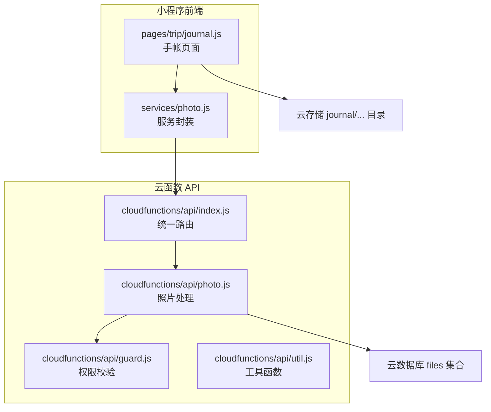
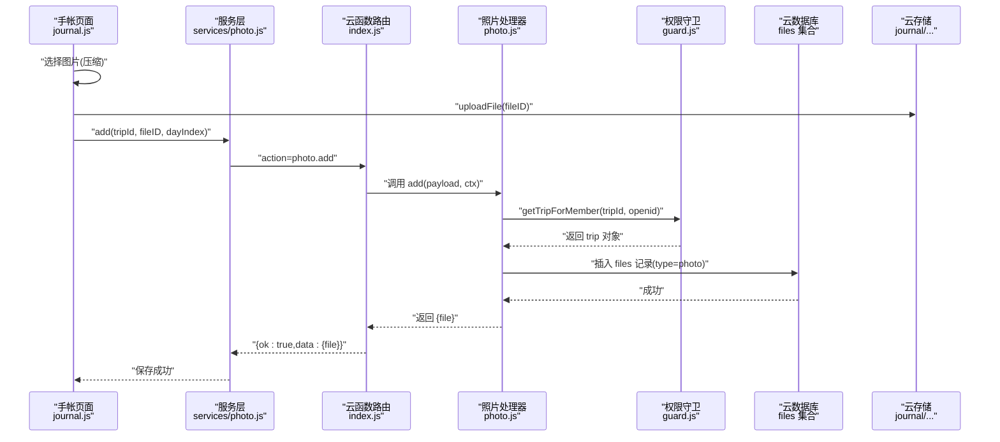
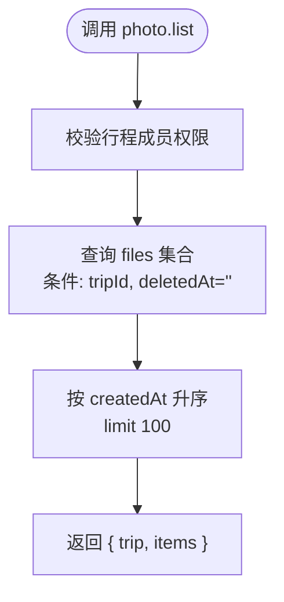
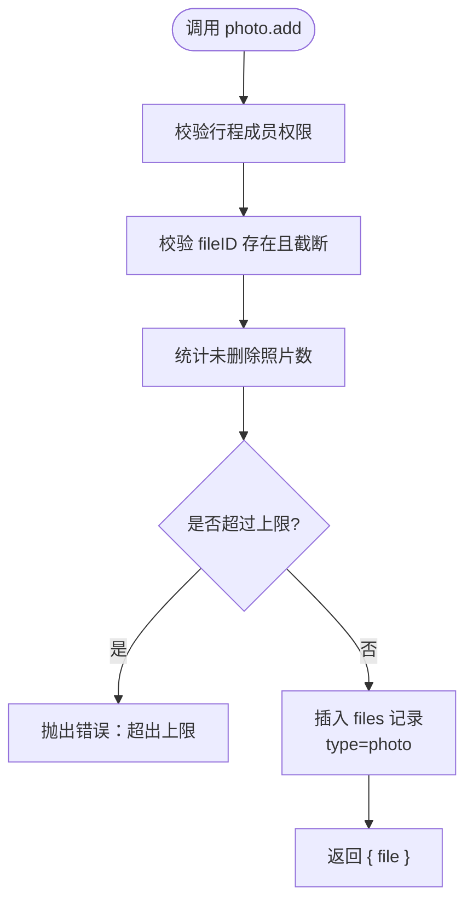
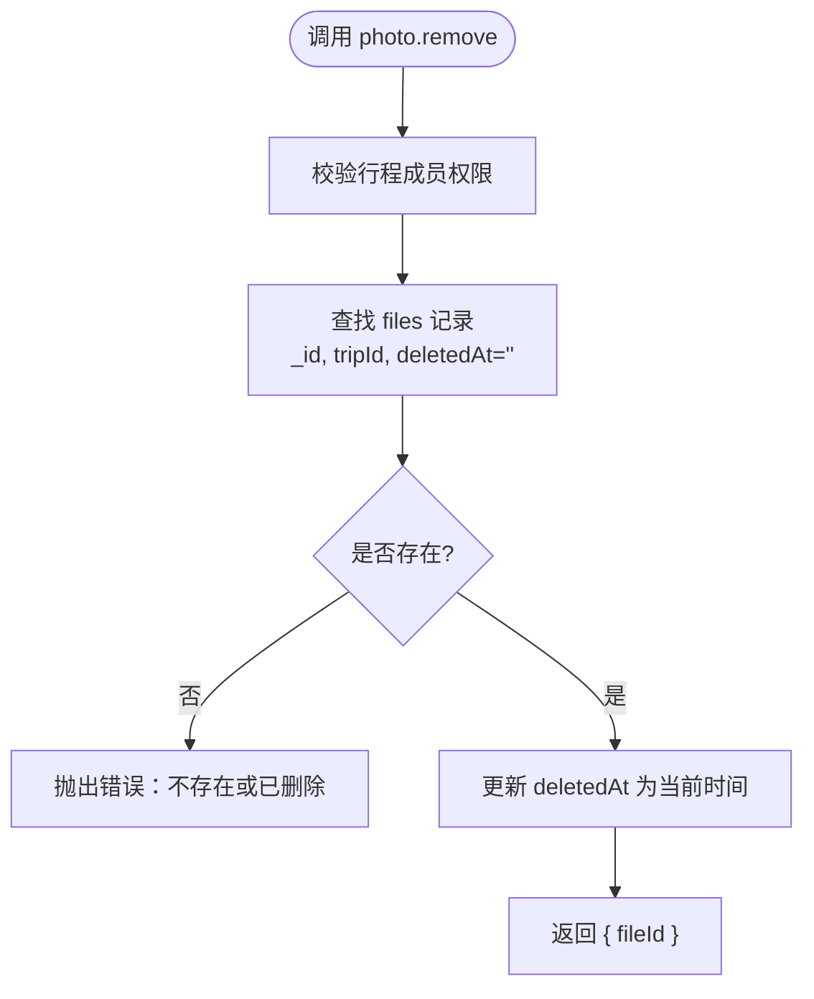
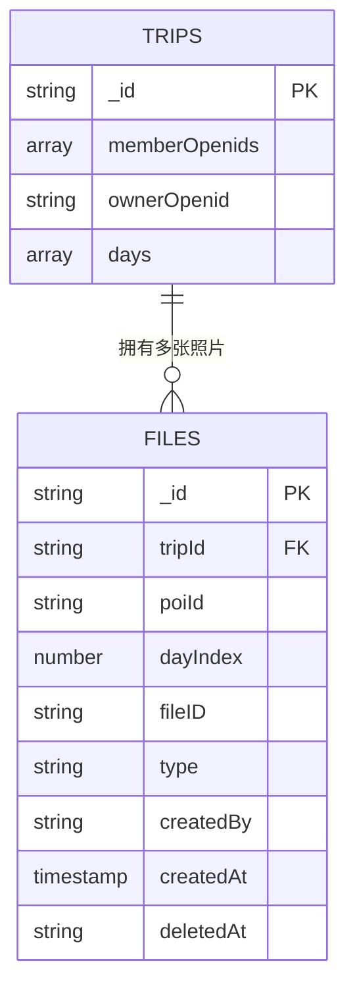
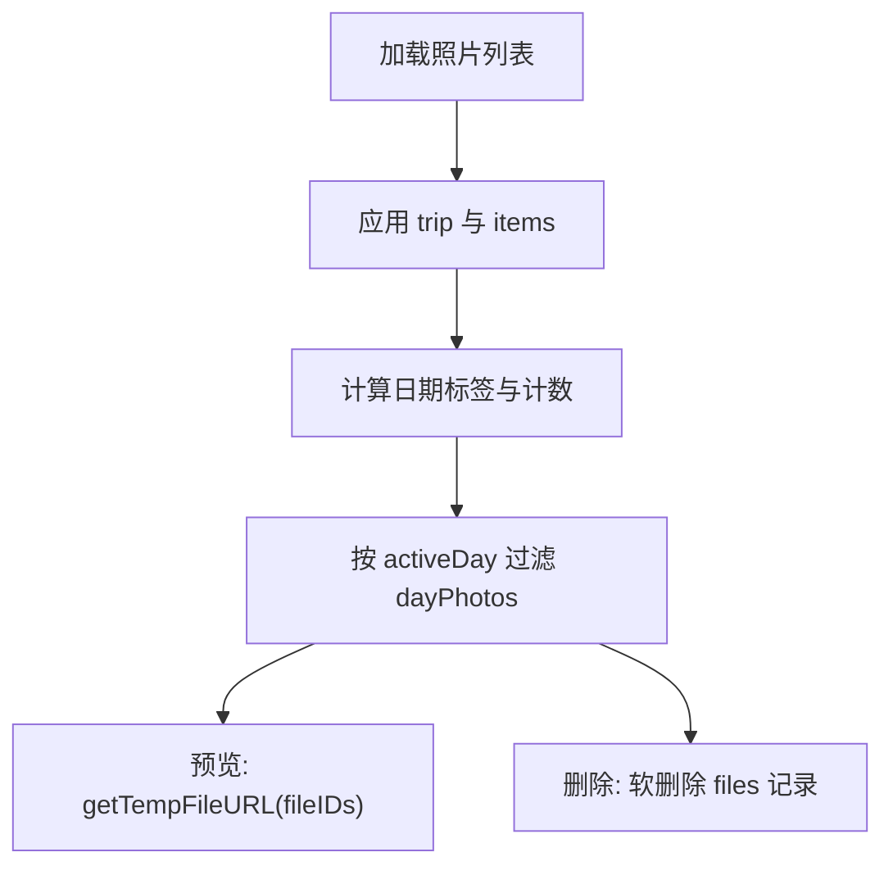
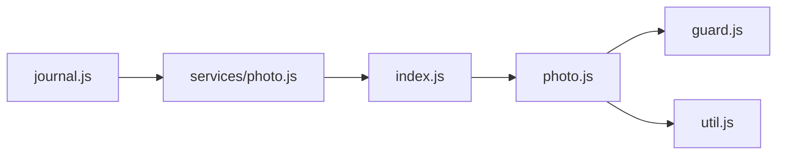

# 照片管理API

<cite>
**本文引用的文件**   
- [cloudfunctions/api/photo.js](file://cloudfunctions/api/photo.js)
- [cloudfunctions/api/index.js](file://cloudfunctions/api/index.js)
- [cloudfunctions/api/guard.js](file://cloudfunctions/api/guard.js)
- [cloudfunctions/api/util.js](file://cloudfunctions/api/util.js)
- [services/photo.js](file://services/photo.js)
- [pages/trip/journal.js](file://pages/trip/journal.js)
</cite>

## 目录
1. [简介](#简介)
2. [项目结构](#项目结构)
3. [核心组件](#核心组件)
4. [架构总览](#架构总览)
5. [详细接口说明](#详细接口说明)
6. [数据模型与存储结构](#数据模型与存储结构)
7. [按天分组与手帐集成](#按天分组与手帐集成)
8. [依赖关系分析](#依赖关系分析)
9. [性能与优化建议](#性能与优化建议)
10. [故障排查指南](#故障排查指南)
11. [结论](#结论)

## 简介
本文件为“照片管理API”的完整技术文档，覆盖照片上传、列表查询、删除等所有与照片相关的接口。系统采用小程序前端 + 云函数后端的方式：前端负责图片选择、压缩上传和预览；云函数负责权限校验、记录写入与软删除。照片以“云存储 fileID”形式持久化，数据库仅保存元数据，便于在小程序端直接渲染并生成临时链接进行大图预览。

## 项目结构
照片相关代码分布在以下位置：
- 云函数路由与处理器：`cloudfunctions/api/index.js`、`cloudfunctions/api/photo.js`
- 权限与工具：`cloudfunctions/api/guard.js`、`cloudfunctions/api/util.js`
- 小程序服务层：`services/photo.js`
- 手帐页面（照片入口）：`pages/trip/journal.js`

**图表来源**
- [cloudfunctions/api/index.js:10-41](file://cloudfunctions/api/index.js#L10-L41)
- [cloudfunctions/api/photo.js:1-64](file://cloudfunctions/api/photo.js#L1-L64)
- [cloudfunctions/api/guard.js:44-65](file://cloudfunctions/api/guard.js#L44-L65)
- [cloudfunctions/api/util.js:33-42](file://cloudfunctions/api/util.js#L33-L42)
- [services/photo.js:3-15](file://services/photo.js#L3-L15)
- [pages/trip/journal.js:98-141](file://pages/trip/journal.js#L98-L141)

**章节来源**
- [cloudfunctions/api/index.js:10-41](file://cloudfunctions/api/index.js#L10-L41)
- [cloudfunctions/api/photo.js:1-64](file://cloudfunctions/api/photo.js#L1-L64)
- [services/photo.js:3-15](file://services/photo.js#L3-L15)
- [pages/trip/journal.js:98-141](file://pages/trip/journal.js#L98-L141)

## 核心组件
- 云函数路由：统一接收 action 请求，分发到具体处理器，集中处理异常与上下文。
- 照片处理器：实现 list/add/remove 三个能力，包含权限校验、数量限制、软删除。
- 权限守卫：基于行程成员身份校验，返回当前用户角色，支持版本冲突控制。
- 工具函数：提供 uuid、cut 等通用方法。
- 小程序服务层：封装 photo.list/add/remove 调用，统一错误提示。
- 手帐页面：负责图片选择、压缩上传、按天分组展示、预览与删除。

**章节来源**
- [cloudfunctions/api/index.js:43-76](file://cloudfunctions/api/index.js#L43-L76)
- [cloudfunctions/api/photo.js:8-58](file://cloudfunctions/api/photo.js#L8-L58)
- [cloudfunctions/api/guard.js:44-65](file://cloudfunctions/api/guard.js#L44-L65)
- [cloudfunctions/api/util.js:33-42](file://cloudfunctions/api/util.js#L33-L42)
- [services/photo.js:3-15](file://services/photo.js#L3-L15)
- [pages/trip/journal.js:46-86](file://pages/trip/journal.js#L46-L86)

## 架构总览
照片管理的端到端流程如下：
- 前端通过 `wx.chooseMedia` 选择图片，并使用 `sizeType: ['compressed']` 启用压缩。
- 前端使用 `wx.cloud.uploadFile` 将图片上传至云存储，路径形如 `journal/{tripId}/{name}`。
- 前端调用 `photoService.add`，云函数校验权限后在 `files` 集合中插入一条 type=photo 的记录。
- 列表接口返回该行程下未删除的照片，前端按 dayIndex 分组显示。
- 删除接口对记录进行软删除，不立即删除云存储原图，避免误删无法恢复。

**图表来源**
- [pages/trip/journal.js:98-141](file://pages/trip/journal.js#L98-L141)
- [services/photo.js:8-10](file://services/photo.js#L8-L10)
- [cloudfunctions/api/index.js:56-66](file://cloudfunctions/api/index.js#L56-L66)
- [cloudfunctions/api/photo.js:19-41](file://cloudfunctions/api/photo.js#L19-L41)
- [cloudfunctions/api/guard.js:44-65](file://cloudfunctions/api/guard.js#L44-L65)

## 详细接口说明

### 通用约定
- 调用方式：小程序通过 `services/photo.js` 调用云函数，由 `cloudfunctions/api/index.js` 统一路由分发。
- 身份来源：openid 从云函数服务端上下文获取，前端不可伪造。
- 权限模型：必须为行程成员才能访问照片；非成员或已删除行程会拒绝。
- 错误格式：云函数统一返回 `{ ok, code?, message }`，前端通过 `run(...)` 弹出提示。

**章节来源**
- [cloudfunctions/api/index.js:56-76](file://cloudfunctions/api/index.js#L56-L76)
- [cloudfunctions/api/guard.js:44-65](file://cloudfunctions/api/guard.js#L44-L65)
- [services/photo.js:3-15](file://services/photo.js#L3-L15)

### 接口一：列出照片
- 功能：获取指定行程下的所有未删除照片，并按创建时间升序返回。
- 输入参数：
  - tripId：字符串，必填。
- 输出结果：
  - trip：行程对象，用于前端构建日期标签。
  - items：照片数组，每条记录包含 _id、tripId、poiId、dayIndex、fileID、type、createdBy、createdAt、deletedAt。
- 限制：
  - 最多返回 MAX_PHOTOS（100）条。
- 权限：
  - 调用者必须是行程成员。
- 典型用途：
  - 手帐页面加载时拉取全部照片，并在前端按 dayIndex 分组展示。

**图表来源**
- [cloudfunctions/api/photo.js:8-17](file://cloudfunctions/api/photo.js#L8-L17)
- [cloudfunctions/api/guard.js:44-65](file://cloudfunctions/api/guard.js#L44-L65)

**章节来源**
- [cloudfunctions/api/photo.js:8-17](file://cloudfunctions/api/photo.js#L8-L17)
- [services/photo.js:4-6](file://services/photo.js#L4-L6)
- [pages/trip/journal.js:46-54](file://pages/trip/journal.js#L46-L54)

### 接口二：添加照片
- 功能：将一张已上传至云存储的图片关联到行程，并记录其所属天数索引。
- 输入参数：
  - tripId：字符串，必填。
  - fileID：字符串，必填，来自 `wx.cloud.uploadFile` 返回值。
  - poiId：可选，最大长度 32。
  - dayIndex：数字，默认 0，表示第几天。
- 输出结果：
  - file：新增的 files 记录。
- 限制：
  - 每趟行程最多存放 MAX_PHOTOS（100）张未删除照片。
  - 字段会被截断保护（例如 fileID 最长 300）。
- 权限：
  - 调用者必须是行程成员。
- 最佳实践：
  - 前端先上传云存储拿到 fileID，再调用此接口写库。
  - 批量上传时逐张处理，失败继续下一张。

**图表来源**
- [cloudfunctions/api/photo.js:19-41](file://cloudfunctions/api/photo.js#L19-L41)
- [cloudfunctions/api/util.js:33-42](file://cloudfunctions/api/util.js#L33-L42)

**章节来源**
- [cloudfunctions/api/photo.js:19-41](file://cloudfunctions/api/photo.js#L19-L41)
- [services/photo.js:8-10](file://services/photo.js#L8-L10)
- [pages/trip/journal.js:111-141](file://pages/trip/journal.js#L111-L141)

### 接口三：删除照片
- 功能：对照片记录进行软删除，不删除云存储中的原图。
- 输入参数：
  - tripId：字符串，必填。
  - fileId：字符串，必填，对应 files 记录的 _id。
- 输出结果：
  - fileId：被软删除的文件 id。
- 行为：
  - 将 deletedAt 设置为当前时间戳。
  - 若记录不存在或已被删除，则报错。
- 权限：
  - 调用者必须是行程成员。
- 设计动机：
  - 防止误删导致原图丢失，后续可恢复或清理。

**图表来源**
- [cloudfunctions/api/photo.js:44-58](file://cloudfunctions/api/photo.js#L44-L58)

**章节来源**
- [cloudfunctions/api/photo.js:44-58](file://cloudfunctions/api/photo.js#L44-L58)
- [services/photo.js:12-14](file://services/photo.js#L12-L14)
- [pages/trip/journal.js:163-183](file://pages/trip/journal.js#L163-L183)

## 数据模型与存储结构
- 云数据库集合：files
  - 关键字段：
    - _id：唯一标识，使用工具函数生成。
    - tripId：归属行程。
    - poiId：可选，关联地点。
    - dayIndex：第几天索引，用于按天分组。
    - fileID：云存储文件标识，可直接用于小程序渲染。
    - type：固定为 'photo'。
    - createdBy：创建者 openid。
    - createdAt：创建时间戳。
    - deletedAt：软删除标记，空字符串表示未删除。
- 云存储目录：journal/{tripId}/
  - 文件名示例：时间戳+序号+扩展名。
  - 图片由小程序端上传，云函数只存 fileID。

**图表来源**
- [cloudfunctions/api/photo.js:28-40](file://cloudfunctions/api/photo.js#L28-L40)
- [cloudfunctions/api/guard.js:44-65](file://cloudfunctions/api/guard.js#L44-L65)

**章节来源**
- [cloudfunctions/api/photo.js:28-40](file://cloudfunctions/api/photo.js#L28-L40)
- [pages/trip/journal.js:121-128](file://pages/trip/journal.js#L121-L128)

## 按天分组与手帐集成
- 前端在 `journal.js` 中将照片按 dayIndex 过滤，形成每日相册视图。
- 每个日期标签上显示该天的照片数量，提升浏览效率。
- 预览大图时使用 `wx.cloud.getTempFileURL` 将 fileID 转换为临时链接。
- 删除照片时给出明确提示：仅从手帐移除，云存储原图保留。

**图表来源**
- [pages/trip/journal.js:60-86](file://pages/trip/journal.js#L60-L86)
- [pages/trip/journal.js:143-161](file://pages/trip/journal.js#L143-L161)
- [pages/trip/journal.js:163-183](file://pages/trip/journal.js#L163-L183)

**章节来源**
- [pages/trip/journal.js:60-86](file://pages/trip/journal.js#L60-L86)
- [pages/trip/journal.js:143-161](file://pages/trip/journal.js#L143-L161)
- [pages/trip/journal.js:163-183](file://pages/trip/journal.js#L163-L183)

## 依赖关系分析
- 路由层：`index.js` 将 action 映射到处理器，确保权限与校验集中。
- 权限层：`guard.js` 提供 `getTripForMember`，保证只有成员能操作。
- 工具层：`util.js` 提供 `uuid`、`cut` 等基础能力。
- 业务层：`photo.js` 组合以上能力完成照片 CRUD。
- 前端层：`services/photo.js` 封装调用，`journal.js` 组织交互流程。

**图表来源**
- [cloudfunctions/api/index.js:3-8](file://cloudfunctions/api/index.js#L3-L8)
- [cloudfunctions/api/photo.js:1-3](file://cloudfunctions/api/photo.js#L1-L3)
- [services/photo.js:1-15](file://services/photo.js#L1-L15)
- [pages/trip/journal.js:1-2](file://pages/trip/journal.js#L1-L2)

**章节来源**
- [cloudfunctions/api/index.js:3-8](file://cloudfunctions/api/index.js#L3-L8)
- [cloudfunctions/api/photo.js:1-3](file://cloudfunctions/api/photo.js#L1-L3)
- [services/photo.js:1-15](file://services/photo.js#L1-L15)
- [pages/trip/journal.js:1-2](file://pages/trip/journal.js#L1-L2)

## 性能与优化建议
- 图片压缩：前端使用 `sizeType: ['compressed']` 减少传输体积，提高上传成功率与速度。
- 分批上传：逐张上传并实时反馈进度，避免一次性阻塞。
- 列表分页：当前 limit 100，适合手帐场景；如需更多，可考虑分页或懒加载。
- 预览优化：批量获取临时链接以减少多次网络往返。
- 存储优化：云存储仅保留原图，数据库只存 fileID，降低数据库压力。
- 访问控制：通过 `getTripForMember` 确保只有成员可访问，避免越权。
- 隐私保护：删除为软删除，避免误删；如需彻底清理，可在后台任务中定期清理长期未访问的云存储文件。

[本节为通用指导，不直接分析具体文件]

## 故障排查指南
- 常见错误：
  - “缺少文件”：上传失败或未拿到 fileID。
  - “一趟行程最多放 X 张照片”：达到上限，需清理旧照片后再加。
  - “缺少照片 id”：删除时 fileId 为空或无效。
  - “照片不存在或已被删除”：记录已被软删除或不存在。
  - “你没有这份行程的权限”：非成员或行程不存在。
- 定位步骤：
  - 检查前端是否正确调用 `wx.cloud.uploadFile` 并拿到 fileID。
  - 检查 `services/photo.js` 的调用参数是否齐全。
  - 查看云函数日志，确认 action 路由与权限校验是否通过。
  - 核对 `files` 集合中是否存在对应记录及 deletedAt 状态。

**章节来源**
- [cloudfunctions/api/photo.js:21-25](file://cloudfunctions/api/photo.js#L21-L25)
- [cloudfunctions/api/photo.js:46-54](file://cloudfunctions/api/photo.js#L46-L54)
- [cloudfunctions/api/guard.js:44-54](file://cloudfunctions/api/guard.js#L44-L54)
- [cloudfunctions/api/index.js:67-74](file://cloudfunctions/api/index.js#L67-L74)

## 结论
本照片管理API以“云存储 fileID + 数据库元数据”的结构实现了轻量、安全、易维护的照片管理能力。通过统一的云函数路由、严格的权限校验、软删除策略以及前端的压缩上传与按天分组，满足了手帐场景下的照片组织与展示需求。建议在后续迭代中关注分页、预览缓存与后台清理策略，进一步提升性能与用户体验。