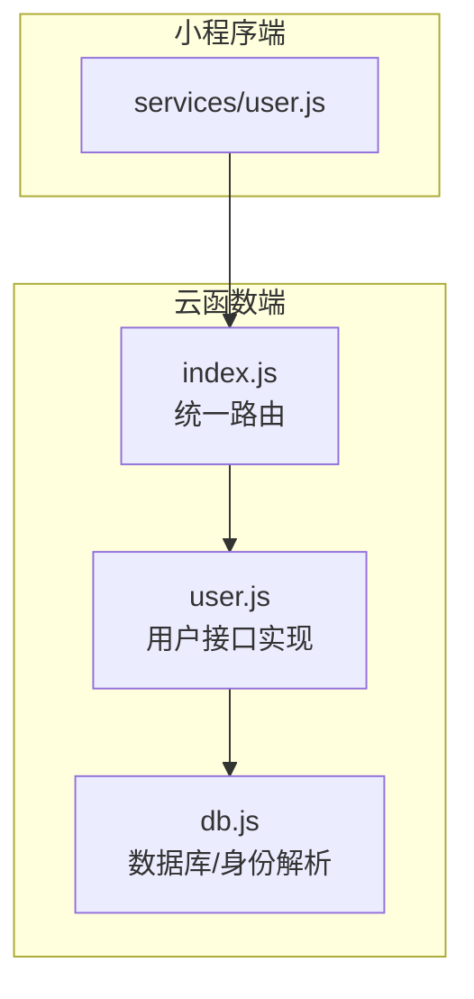
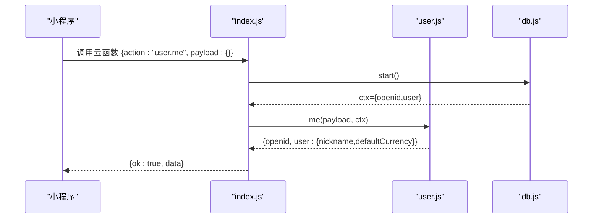
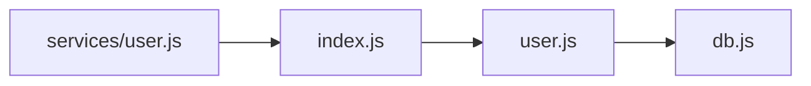

# 用户管理API

<cite>
**本文引用的文件**   
- [cloudfunctions/api/index.js](file://cloudfunctions/api/index.js)
- [cloudfunctions/api/user.js](file://cloudfunctions/api/user.js)
- [cloudfunctions/api/db.js](file://cloudfunctions/api/db.js)
- [services/user.js](file://services/user.js)
- [cloudfunctions/api/config.json](file://cloudfunctions/api/config.json)
</cite>

## 目录
1. [简介](#简介)
2. [项目结构](#项目结构)
3. [核心组件](#核心组件)
4. [架构总览](#架构总览)
5. [详细接口说明](#详细接口说明)
6. [依赖关系分析](#依赖关系分析)
7. [性能与一致性](#性能与一致性)
8. [故障排查指南](#故障排查指南)
9. [结论](#结论)
10. [附录：调用示例与常见场景](#附录调用示例与常见场景)

## 简介
本文件为用户管理相关云函数接口的权威文档，聚焦于“获取当前用户信息”的接口。该能力由单一云函数入口统一路由，通过服务端上下文自动完成身份识别与用户资料初始化，前端无需自行传递敏感身份信息。

## 项目结构
- 云函数入口集中暴露一个统一的 action 路由，所有业务动作（包括用户、行程、地点、费用、照片、通知）均通过该入口分发。
- 用户相关逻辑位于 user.js；数据库连接、集合初始化与用户身份解析在 db.js；小程序侧的服务封装在 services/user.js。

图表来源
- [cloudfunctions/api/index.js:1-77](file://cloudfunctions/api/index.js#L1-L77)
- [cloudfunctions/api/user.js:1-12](file://cloudfunctions/api/user.js#L1-L12)
- [cloudfunctions/api/db.js:1-61](file://cloudfunctions/api/db.js#L1-L61)
- [services/user.js:1-8](file://services/user.js#L1-L8)

章节来源
- [cloudfunctions/api/index.js:1-77](file://cloudfunctions/api/index.js#L1-L77)
- [cloudfunctions/api/user.js:1-12](file://cloudfunctions/api/user.js#L1-L12)
- [cloudfunctions/api/db.js:1-61](file://cloudfunctions/api/db.js#L1-L61)
- [services/user.js:1-8](file://services/user.js#L1-L8)

## 核心组件
- 统一入口 index.js：负责 action 路由、异常捕获、返回格式标准化，以及定时任务分支处理。
- 用户模块 user.js：提供 me 接口，返回当前用户的 openid 与用户资料摘要。
- 数据库与身份 db.js：确保集合存在、从微信服务端上下文安全获取 openid、按需创建用户记录并返回 ctx。
- 小程序服务层 services/user.js：封装 call('user.me') 调用，供页面或业务模块使用。

章节来源
- [cloudfunctions/api/index.js:1-77](file://cloudfunctions/api/index.js#L1-L77)
- [cloudfunctions/api/user.js:1-12](file://cloudfunctions/api/user.js#L1-L12)
- [cloudfunctions/api/db.js:1-61](file://cloudfunctions/api/db.js#L1-L61)
- [services/user.js:1-8](file://services/user.js#L1-L8)

## 架构总览
下图展示一次“获取当前用户信息”的完整调用链：小程序调用云函数 → 统一入口解析 action → 调用用户处理器 → 通过 db.start 获取可信身份与用户对象 → 返回数据。

图表来源
- [cloudfunctions/api/index.js:43-76](file://cloudfunctions/api/index.js#L43-L76)
- [cloudfunctions/api/user.js:1-12](file://cloudfunctions/api/user.js#L1-L12)
- [cloudfunctions/api/db.js:46-53](file://cloudfunctions/api/db.js#L46-L53)

## 详细接口说明

### 接口：user.me（获取当前用户信息）
- 功能概述
  - 返回当前登录用户的 openid 与用户资料摘要（昵称、默认币种）。
  - 若用户不存在，会在服务端自动创建基础用户记录，保证后续业务可用。
- 触发方式
  - 云函数 action：user.me
- 请求参数
  - action：固定为 user.me
  - payload：可为空对象 {}
- 响应格式
  - 成功时：{ ok: true, data: { openid, user: { nickname, defaultCurrency } } }
  - 失败时：{ ok: false, code?, message }
- 错误码与消息
  - code 为空字符串时，表示普通异常；当 code 非空时，客户端可据此做差异化提示（例如冲突、权限等）。
  - 常见 message：
    - “没有获取到用户身份，请在微信中打开小程序”
    - “未知操作：xxx”
    - “服务异常，请稍后重试”
- 权限与安全
  - openid 仅从服务端上下文获取，不信任前端传入值。
  - 用户资料字段来自服务端维护的用户记录，避免越权读取他人数据。
- 幂等性
  - 重复调用不会重复创建用户记录，已存在则直接复用。
- 适用场景
  - 首次进入应用时加载用户昵称与默认币种。
  - 需要显示当前用户标识（脱敏展示）的场景。

章节来源
- [cloudfunctions/api/user.js:1-12](file://cloudfunctions/api/user.js#L1-L12)
- [cloudfunctions/api/index.js:43-76](file://cloudfunctions/api/index.js#L43-L76)
- [cloudfunctions/api/db.js:29-53](file://cloudfunctions/api/db.js#L29-L53)

## 依赖关系分析
- 路由依赖
  - index.js 将 'user.me' 映射到 userHandler.me。
- 身份与数据依赖
  - user.js 依赖 db.js 提供的 ctx（包含 openid 与 user 对象）。
- 小程序侧依赖
  - services/user.js 依赖 cloud.call 封装，调用 'user.me'。

图表来源
- [cloudfunctions/api/index.js:1-41](file://cloudfunctions/api/index.js#L1-L41)
- [cloudfunctions/api/user.js:1-12](file://cloudfunctions/api/user.js#L1-L12)
- [cloudfunctions/api/db.js:1-61](file://cloudfunctions/api/db.js#L1-L61)
- [services/user.js:1-8](file://services/user.js#L1-L8)

章节来源
- [cloudfunctions/api/index.js:1-41](file://cloudfunctions/api/index.js#L1-L41)
- [cloudfunctions/api/user.js:1-12](file://cloudfunctions/api/user.js#L1-L12)
- [cloudfunctions/api/db.js:1-61](file://cloudfunctions/api/db.js#L1-L61)
- [services/user.js:1-8](file://services/user.js#L1-L8)

## 性能与一致性
- 集合懒创建
  - 首次调用会确保 users/trips/pois/expenses/files 等集合存在，后续复用 Promise，减少重复开销。
- 用户记录惰性初始化
  - 仅在首次访问时创建用户记录，避免无谓写入。
- 单入口统一异常处理
  - 所有 action 统一 try/catch，降低分散的错误处理成本，便于集中监控与日志。

章节来源
- [cloudfunctions/api/db.js:15-27](file://cloudfunctions/api/db.js#L15-L27)
- [cloudfunctions/api/db.js:29-44](file://cloudfunctions/api/db.js#L29-L44)
- [cloudfunctions/api/index.js:62-75](file://cloudfunctions/api/index.js#L62-L75)

## 故障排查指南
- 常见问题
  - 未从微信环境调用：会抛出“没有获取到用户身份，请在微信中打开小程序”。
  - 传入未知 action：返回“未知操作：xxx”。
  - 网络或服务异常：返回“服务异常，请稍后重试”，并附带 code（如有）。
- 定位建议
  - 检查小程序是否通过云开发 SDK 正确调用云函数。
  - 确认 action 名称拼写为 user.me。
  - 查看云函数日志中的 [api] 前缀输出，定位具体异常堆栈。
- 权限问题
  - 本接口不校验业务权限，但依赖微信登录态；若无法获取 openid，请检查小程序登录流程与环境配置。

章节来源
- [cloudfunctions/api/index.js:56-75](file://cloudfunctions/api/index.js#L56-L75)
- [cloudfunctions/api/db.js:46-53](file://cloudfunctions/api/db.js#L46-L53)

## 结论
用户管理 API 采用“单入口 + 上下文鉴权”的设计，最小化前端对敏感身份的感知，同时通过惰性初始化与统一异常处理提升稳定性与可维护性。当前阶段仅提供“获取当前用户信息”的能力，后续可扩展用户资料更新、头像上传、偏好设置等接口，沿用同一鉴权与路由模式即可。

## 附录：调用示例与常见场景
- 调用示例（概念性描述）
  - 小程序侧调用 services.user.me()，内部发起云函数调用 action=user.me，payload 为空对象。
  - 云函数返回 { ok: true, data: { openid, user: { nickname, defaultCurrency } } }。
- 常见使用场景
  - 首次启动应用时，拉取用户昵称与默认币种，用于界面个性化与金额显示。
  - 在需要显示当前用户标识的地方，使用返回的 openid 进行脱敏展示或埋点统计。
  - 作为其他业务接口的前置步骤，确保用户资料已初始化后再执行更复杂的业务操作。

[本节为概念性说明，不直接分析具体代码文件]