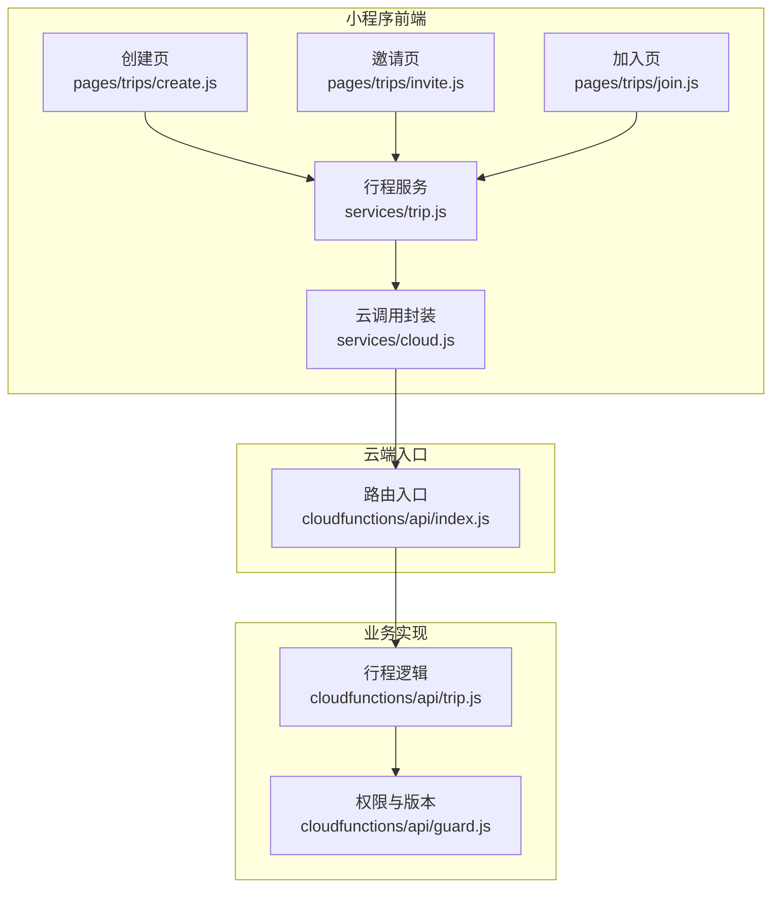
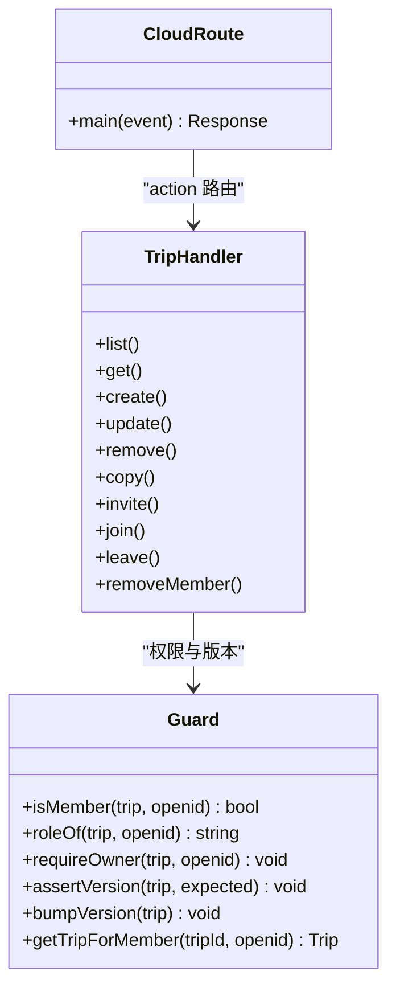
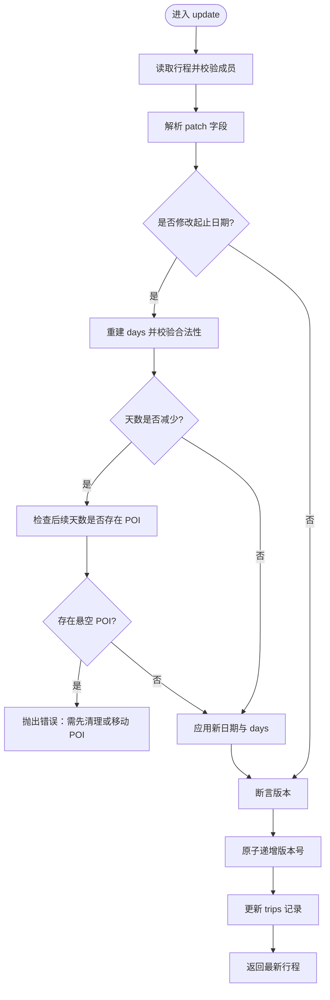
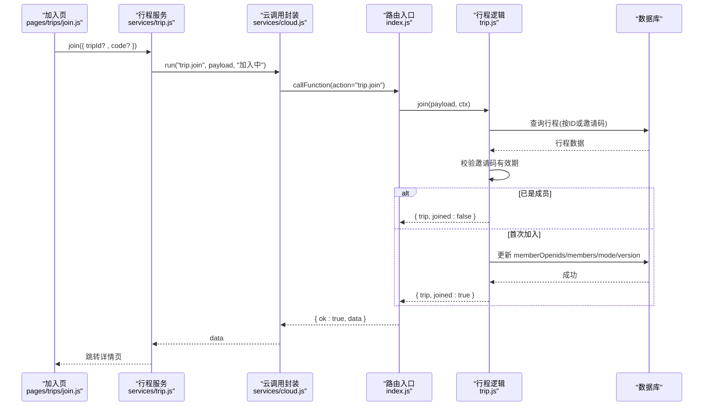
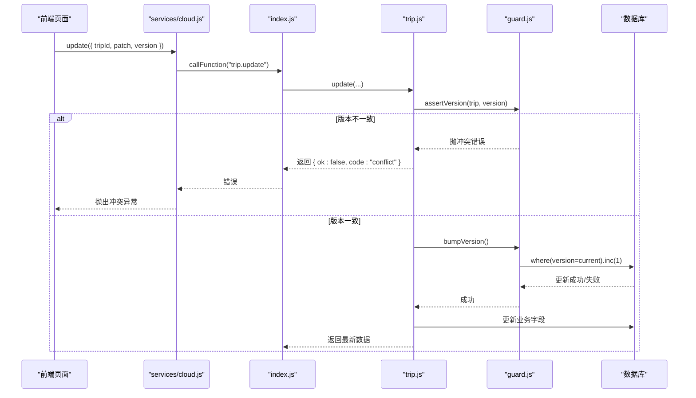
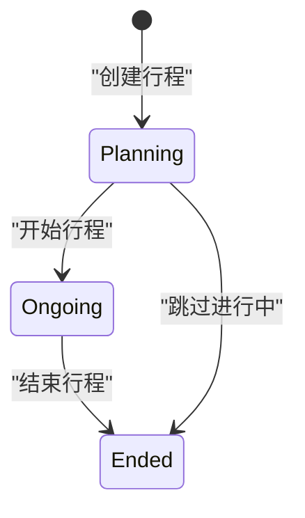
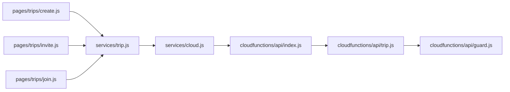
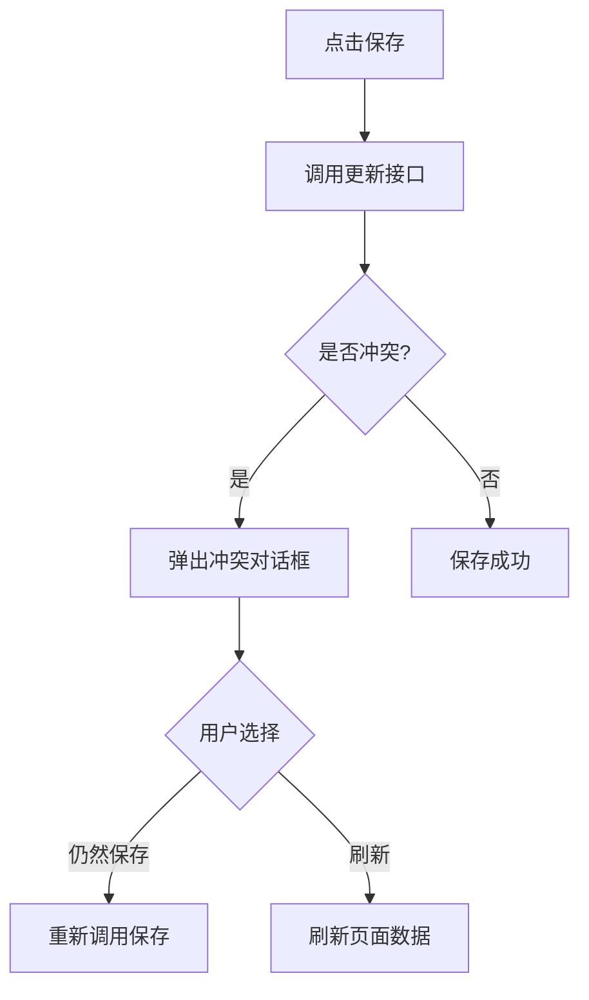

# 行程管理API

<cite>
**本文引用的文件**   
- [cloudfunctions/api/index.js](file://cloudfunctions/api/index.js)
- [cloudfunctions/api/trip.js](file://cloudfunctions/api/trip.js)
- [cloudfunctions/api/guard.js](file://cloudfunctions/api/guard.js)
- [services/cloud.js](file://services/cloud.js)
- [services/trip.js](file://services/trip.js)
- [utils/conflict.js](file://utils/conflict.js)
- [pages/trips/create.js](file://pages/trips/create.js)
- [pages/trips/invite.js](file://pages/trips/invite.js)
- [pages/trips/join.js](file://pages/trips/join.js)
</cite>

## 目录
1. [简介](#简介)
2. [项目结构与调用路径](#项目结构与调用路径)
3. [核心接口总览](#核心接口总览)
4. [架构与权限模型](#架构与权限模型)
5. [详细接口说明](#详细接口说明)
6. [并发控制、状态流转与一致性](#并发控制状态流转与一致性)
7. [依赖关系分析](#依赖关系分析)
8. [性能与扩展建议](#性能与扩展建议)
9. [故障排查指南](#故障排查指南)
10. [结论](#结论)

## 简介
本文件为“行程管理”相关接口的完整技术文档，覆盖行程的创建、读取、更新、删除、复制，以及成员邀请、加入、离开、移除等协作能力。文档重点说明每个接口的业务规则、权限控制、并发处理、数据一致性保证、错误码与交互流程，并提供面向前端和服务端的调用示例与排错建议。

## 项目结构与调用路径
小程序前端通过统一的云函数入口分发 action，后端按模块拆分实现；服务层封装了带 loading 和统一错误处理的调用方式。

**图表来源**
- [cloudfunctions/api/index.js:10-41](file://cloudfunctions/api/index.js#L10-L41)
- [services/trip.js:3-45](file://services/trip.js#L3-L45)
- [services/cloud.js:5-47](file://services/cloud.js#L5-L47)
- [cloudfunctions/api/trip.js:358-369](file://cloudfunctions/api/trip.js#L358-L369)

**章节来源**
- [cloudfunctions/api/index.js:10-41](file://cloudfunctions/api/index.js#L10-L41)
- [services/trip.js:3-45](file://services/trip.js#L3-L45)
- [services/cloud.js:5-47](file://services/cloud.js#L5-L47)

## 核心接口总览
以下接口均通过云函数 action 暴露，参数以 payload 形式传递，返回结构由服务端统一包装。

| 接口 | 云函数 action | 主要用途 | 权限要求 | 关键输入字段 | 关键输出字段 |
|---|---|---|---|---|---|
| 列出我的行程 | `trip.list` | 获取当前用户参与的行程列表 | 已登录用户 | 无 | `{ items }` |
| 获取行程详情 | `trip.get` | 获取单个行程详情（含 myRole） | 成员或创建者 | `{ tripId }` | `{ trip }` |
| 创建行程 | `trip.create` | 新建单人行程，默认 solo | 已登录用户 | `{ destination, title?, startDate, endDate, transport[], budget? }` | `{ trip }` |
| 更新行程 | `trip.update` | 更新行程基本信息、日期、预算、状态等 | 成员或创建者 | `{ tripId, patch, version }` | `{ trip }` |
| 删除行程 | `trip.remove` | 软删除行程及其 POI、账目 | 仅创建者 | `{ tripId, version }` | `{ tripId }` |
| 复制行程 | `trip.copy` | 复制行程并迁移 POI，成员只留自己 | 成员或创建者 | `{ tripId }` | `{ trip }` |
| 生成邀请码 | `trip.invite` | 为行程生成 7 天有效邀请码 | 仅创建者 | `{ tripId }` | `{ inviteCode, inviteExpireAt, trip }` |
| 加入行程 | `trip.join` | 通过分享链接或邀请码加入 | 未登录也可（但需 openid） | `{ tripId? , code? }` | `{ trip, joined }` |
| 退出行程 | `trip.leave` | 同行成员主动退出 | 非创建者成员 | `{ tripId }` | `{ tripId }` |
| 移除成员 | `trip.removeMember` | 创建者移除其他成员 | 仅创建者 | `{ tripId, openid }` | `{ trip, openid }` |

**章节来源**
- [cloudfunctions/api/index.js:14-23](file://cloudfunctions/api/index.js#L14-L23)
- [cloudfunctions/api/trip.js:35-369](file://cloudfunctions/api/trip.js#L35-L369)
- [services/trip.js:3-45](file://services/trip.js#L3-L45)

## 架构与权限模型
- 路由层：所有写操作统一走 `api/index.js`，根据 `action` 分派到对应处理器。
- 权限层：`guard.js` 提供成员判断、角色推导、创建者校验、版本断言与原子版本号递增。
- 数据层：使用云数据库集合 `trips`、`pois`、`expenses`，采用软删除标记 `deletedAt`。
- 并发控制：客户端携带 `version`，服务端先断言再原子递增，避免覆盖写入。
- 协作机制：通过 `memberOpenids` 与 `members` 数组维护成员；多人时自动切换 `mode=group`。

**图表来源**
- [cloudfunctions/api/index.js:10-41](file://cloudfunctions/api/index.js#L10-L41)
- [cloudfunctions/api/trip.js:358-369](file://cloudfunctions/api/trip.js#L358-L369)
- [cloudfunctions/api/guard.js:3-74](file://cloudfunctions/api/guard.js#L3-L74)

**章节来源**
- [cloudfunctions/api/index.js:43-76](file://cloudfunctions/api/index.js#L43-L76)
- [cloudfunctions/api/guard.js:3-74](file://cloudfunctions/api/guard.js#L3-L74)

## 详细接口说明

### 列出我的行程
- 功能：返回当前用户参与的所有行程，按更新时间倒序，最多 50 条。
- 权限：已登录用户。
- 输入：无。
- 输出：`{ items: Trip[] }`。
- 行为：过滤 `memberOpenids` 包含当前用户且未删除的记录。

**章节来源**
- [cloudfunctions/api/trip.js:35-43](file://cloudfunctions/api/trip.js#L35-L43)

### 获取行程详情
- 功能：返回单个行程详情，并在返回对象中附加 `myRole`，便于前端区分创建者与同行。
- 权限：必须是行程成员或创建者。
- 输入：`{ tripId }`。
- 输出：`{ trip }`。
- 行为：若不存在、已删除或非成员则报错。

**章节来源**
- [cloudfunctions/api/trip.js:45-48](file://cloudfunctions/api/trip.js#L45-L48)
- [cloudfunctions/api/guard.js:44-64](file://cloudfunctions/api/guard.js#L44-L64)

### 创建行程
- 功能：创建单人行程，自动生成 ID、初始成员、邀请码占位、初始状态 `planning`。
- 权限：已登录用户。
- 输入：
  - `destination`：目的地（必填，最大长度限制）。
  - `title`：标题（可选，默认回退目的地）。
  - `startDate`、`endDate`：起止日期（必须合法，结束不早于开始，最多 15 天）。
  - `transport[]`：交通方式（`drive`、`transit`）。
  - `budget`：预算（转换为分存储）。
- 输出：`{ trip }`。
- 行为：
  - 校验标题与日期范围。
  - 生成天数数组 `days`。
  - 初始化 `memberOpenids`、`members`、`status=planning`、`version=0`。
  - 插入 `trips` 集合。

**章节来源**
- [cloudfunctions/api/trip.js:50-88](file://cloudfunctions/api/trip.js#L50-L88)

### 更新行程
- 功能：更新行程标题、目的地、交通方式、预算、状态、起止日期等。
- 权限：成员或创建者可更新；修改日期会触发天数重建与悬空点位检查。
- 输入：
  - `tripId`
  - `patch`：可更新的字段集合。
  - `version`：乐观锁版本号。
- 输出：`{ trip }`。
- 行为：
  - 校验标题非空、日期合法、状态枚举。
  - 若修改起止日期，重新计算 `days`；减少天数时需确认后续天数无 POI，否则拒绝。
  - 断言 `version`，原子递增版本号后更新。
  - 返回最新行。

**图表来源**
- [cloudfunctions/api/trip.js:90-132](file://cloudfunctions/api/trip.js#L90-L132)
- [cloudfunctions/api/guard.js:26-42](file://cloudfunctions/api/guard.js#L26-L42)

**章节来源**
- [cloudfunctions/api/trip.js:90-132](file://cloudfunctions/api/trip.js#L90-L132)
- [cloudfunctions/api/guard.js:26-42](file://cloudfunctions/api/guard.js#L26-L42)

### 删除行程
- 功能：软删除行程，同时标记其 POI 与 expenses。
- 权限：仅创建者。
- 输入：`{ tripId, version }`。
- 输出：`{ tripId }`。
- 行为：
  - 校验成员与创建者身份。
  - 断言版本并原子递增。
  - 将 `trips`、`pois`、`expenses` 中对应记录的 `deletedAt` 设置为当前时间。

**章节来源**
- [cloudfunctions/api/trip.js:134-147](file://cloudfunctions/api/trip.js#L134-L147)
- [cloudfunctions/api/guard.js:16-42](file://cloudfunctions/api/guard.js#L16-L42)

### 复制行程
- 功能：复制行程，日期从今天起算，POI 整份迁移，成员重置为仅自己。
- 权限：成员或创建者。
- 输入：`{ tripId }`。
- 输出：`{ trip }`。
- 行为：
  - 读取源行程，计算新起止日期与 `days`。
  - 新建行程记录，清空邀请码与过期时间。
  - 批量复制 POI，重算 `order`，统计 `poiCount`。
  - 若源行程有 POI，更新副本的 `poiCount`。

**章节来源**
- [cloudfunctions/api/trip.js:280-356](file://cloudfunctions/api/trip.js#L280-L356)

### 生成邀请码
- 功能：为行程生成 7 天有效的邀请码；若已有且未过期则直接返回。
- 权限：仅创建者。
- 输入：`{ tripId }`。
- 输出：`{ inviteCode, inviteExpireAt, trip }`。
- 行为：
  - 校验成员与创建者身份。
  - 若已有邀请码且未过期，直接返回。
  - 否则生成唯一邀请码并设置过期时间，更新行程。

**章节来源**
- [cloudfunctions/api/trip.js:149-169](file://cloudfunctions/api/trip.js#L149-L169)

### 加入行程
- 功能：通过分享链接中的 `tripId` 或手动输入的 6 位邀请码加入行程。
- 权限：无需额外权限，但需能识别当前用户。
- 输入：`{ tripId? , code? }`（至少一个）。
- 输出：`{ trip, joined }`。
- 行为：
  - 校验邀请信息；查询行程（支持按 ID 或邀请码）。
  - 校验邀请码有效期。
  - 若已是成员，返回 `joined=false`。
  - 否则添加成员、追加 members 条目、模式改为 `group`、版本号自增。

**图表来源**
- [pages/trips/join.js:31-44](file://pages/trips/join.js#L31-L44)
- [services/trip.js:34-36](file://services/trip.js#L34-L36)
- [services/cloud.js:33-47](file://services/cloud.js#L33-L47)
- [cloudfunctions/api/index.js:56-76](file://cloudfunctions/api/index.js#L56-L76)
- [cloudfunctions/api/trip.js:171-204](file://cloudfunctions/api/trip.js#L171-L204)

**章节来源**
- [cloudfunctions/api/trip.js:171-204](file://cloudfunctions/api/trip.js#L171-L204)
- [pages/trips/join.js:11-44](file://pages/trips/join.js#L11-L44)

### 退出行程
- 功能：同行成员主动退出；创建者不能退出，只能删除行程。
- 权限：非创建者成员。
- 输入：`{ tripId }`。
- 输出：`{ tripId }`。
- 行为：
  - 校验成员身份与角色。
  - 从 `memberOpenids`、`members`、`reminders` 中移除当前用户。
  - 若成员数小于等于 1，模式切回 `solo`，版本号自增。

**章节来源**
- [cloudfunctions/api/trip.js:240-272](file://cloudfunctions/api/trip.js#L240-L272)

### 移除成员
- 功能：创建者移除其他成员；被移除者不再看到该行程。
- 权限：仅创建者。
- 输入：`{ tripId, openid }`。
- 输出：`{ trip, openid }`。
- 行为：
  - 校验目标 openid 非自身、非创建者。
  - 从成员数组中移除目标，调整 `mode` 与 `version`。

**章节来源**
- [cloudfunctions/api/trip.js:206-238](file://cloudfunctions/api/trip.js#L206-L238)

## 并发控制、状态流转与一致性

### 乐观锁与冲突处理
- 客户端在更新或删除时携带 `version`。
- 服务端先断言版本，再原子递增版本号，确保同一时刻只有一个写操作落地。
- 冲突时返回 `code='conflict'`，前端可选择刷新并重试。

**图表来源**
- [cloudfunctions/api/guard.js:26-42](file://cloudfunctions/api/guard.js#L26-L42)
- [cloudfunctions/api/trip.js:90-132](file://cloudfunctions/api/trip.js#L90-L132)
- [services/cloud.js:33-47](file://services/cloud.js#L33-L47)

**章节来源**
- [cloudfunctions/api/guard.js:20-42](file://cloudfunctions/api/guard.js#L20-L42)
- [services/cloud.js:33-47](file://services/cloud.js#L33-L47)

### 行程状态流转
- 初始状态：`planning`。
- 可能状态：`planning`、`ongoing`、`ended`。
- 状态变更通过 `update.patch.status` 进行，服务端校验枚举值。
- 实际业务中可由前端根据日期或用户操作驱动状态变化。

**图表来源**
- [cloudfunctions/api/trip.js:7](file://cloudfunctions/api/trip.js#L7)
- [cloudfunctions/api/trip.js:103](file://cloudfunctions/api/trip.js#L103)

### 协作机制与成员模式
- 单人模式：`mode=solo`，成员只有创建者。
- 多人模式：`mode=group`，当成员数大于 1 时自动切换。
- 成员列表：`memberOpenids` 用于快速判断权限；`members` 用于展示角色与加入时间。
- 邀请码：7 天有效，重复生成时去重。

**章节来源**
- [cloudfunctions/api/trip.js:61-84](file://cloudfunctions/api/trip.js#L61-L84)
- [cloudfunctions/api/trip.js:149-169](file://cloudfunctions/api/trip.js#L149-L169)
- [cloudfunctions/api/trip.js:187-203](file://cloudfunctions/api/trip.js#L187-L203)
- [cloudfunctions/api/trip.js:223-237](file://cloudfunctions/api/trip.js#L223-L237)

## 依赖关系分析

**图表来源**
- [pages/trips/create.js:1-139](file://pages/trips/create.js#L1-L139)
- [pages/trips/invite.js:1-127](file://pages/trips/invite.js#L1-L127)
- [pages/trips/join.js:1-56](file://pages/trips/join.js#L1-L56)
- [services/trip.js:3-45](file://services/trip.js#L3-L45)
- [services/cloud.js:5-47](file://services/cloud.js#L5-L47)
- [cloudfunctions/api/index.js:10-41](file://cloudfunctions/api/index.js#L10-L41)
- [cloudfunctions/api/trip.js:358-369](file://cloudfunctions/api/trip.js#L358-L369)
- [cloudfunctions/api/guard.js:3-74](file://cloudfunctions/api/guard.js#L3-L74)

**章节来源**
- [services/trip.js:3-45](file://services/trip.js#L3-L45)
- [services/cloud.js:5-47](file://services/cloud.js#L5-L47)
- [cloudfunctions/api/index.js:10-41](file://cloudfunctions/api/index.js#L10-L41)

## 性能与扩展建议
- 列表分页：当前 `list` 固定取 50 条，建议在大数据量场景增加分页参数与游标。
- 复制优化：复制 POI 时逐条插入，可在高并发下考虑批量写入或事务（若平台支持）。
- 邀请码去重：当前重试 5 次生成唯一码，建议引入索引或分布式唯一键提升效率。
- 软删除查询：大量软删除数据会影响查询性能，建议定期归档或物理清理。
- 缓存策略：对高频读接口（如 `trip.get`）可增加短期缓存，注意失效策略与版本同步。

[本节为通用建议，不直接分析具体文件]

## 故障排查指南

### 常见错误与处理
- 网络异常：前端收到“网络异常，请检查网络后重试”。
  - 检查网络连接与云函数部署状态。
- 未知操作：返回 `ok:false, message="未知操作"`。
  - 检查 `action` 名称是否与路由表一致。
- 权限不足：提示“你没有这份行程的权限”或“只有创建者可以做这个操作”。
  - 确认当前用户是否为成员或创建者。
- 版本冲突：返回 `code='conflict'`。
  - 前端应刷新数据并提示用户重试保存。
- 邀请码无效或过期：提示“缺少邀请信息”或“邀请码已过期”。
  - 让创建者重新生成邀请码。

**章节来源**
- [services/cloud.js:13-27](file://services/cloud.js#L13-L27)
- [cloudfunctions/api/index.js:56-76](file://cloudfunctions/api/index.js#L56-L76)
- [cloudfunctions/api/guard.js:16-30](file://cloudfunctions/api/guard.js#L16-L30)
- [cloudfunctions/api/trip.js:171-183](file://cloudfunctions/api/trip.js#L171-L183)

### 前端冲突处理最佳实践
- 使用统一冲突处理工具：弹出对话框让用户选择“仍然保存”或“刷新”，刷新后重试保存。
- 在冲突恢复后重新加载页面数据，确保版本号与服务器一致。

**图表来源**
- [utils/conflict.js:1-20](file://utils/conflict.js#L1-L20)
- [pages/trips/create.js:117-137](file://pages/trips/create.js#L117-L137)

**章节来源**
- [utils/conflict.js:1-20](file://utils/conflict.js#L1-L20)
- [pages/trips/create.js:117-137](file://pages/trips/create.js#L117-L137)

## 结论
行程管理 API 通过统一云函数路由、集中权限与版本控制，提供了完整的行程 CRUD、复制与协作能力。系统采用乐观锁与原子版本号递增保障并发安全，结合软删除与成员模式切换满足多场景协作需求。前端通过服务层封装获得一致的 loading 与错误体验，配合冲突处理工具形成稳健的用户交互闭环。建议在数据规模增长后引入分页、缓存与批量写入优化，进一步提升性能与可扩展性。