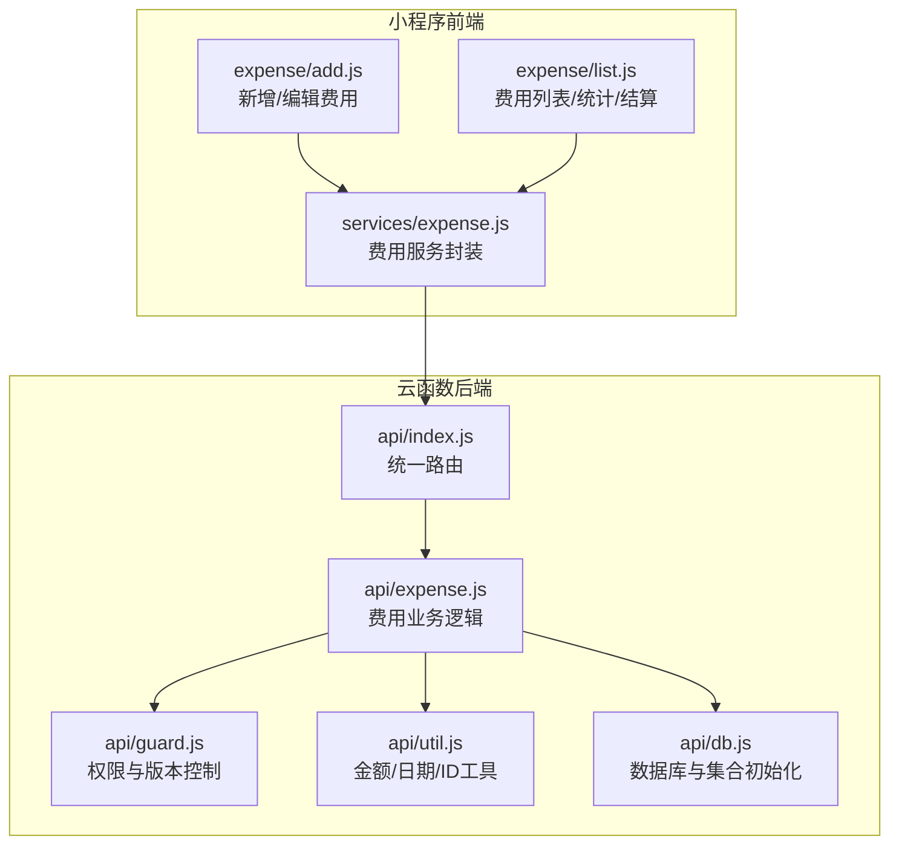
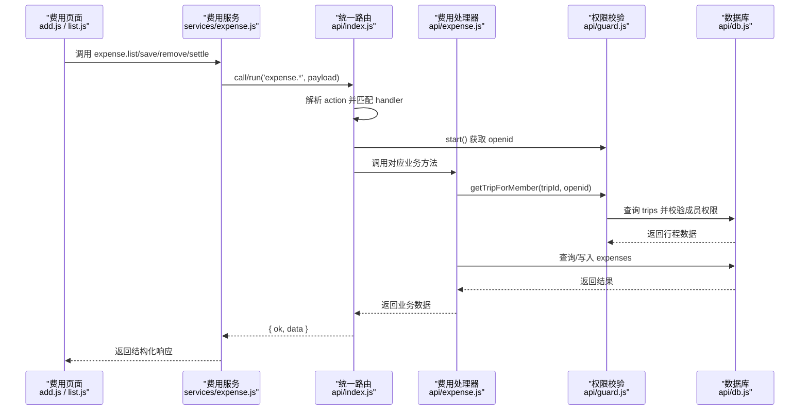
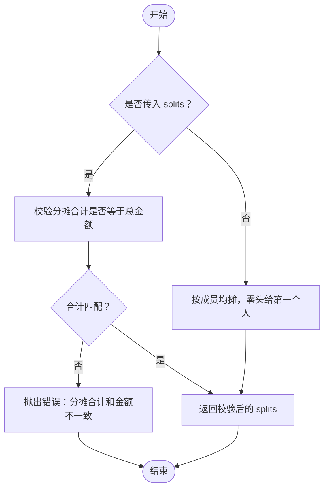
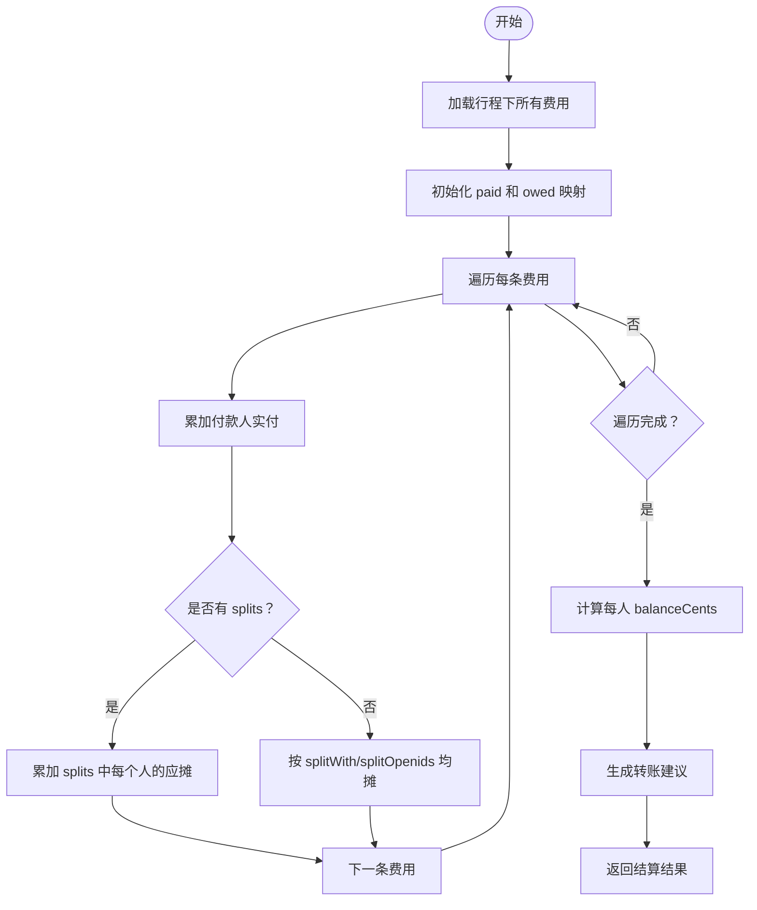
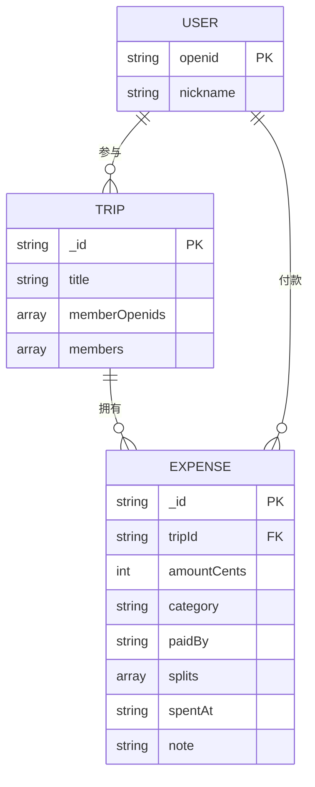
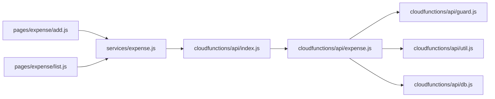

# 费用管理API

<cite>
**本文引用的文件**   
- [cloudfunctions/api/index.js](file://cloudfunctions/api/index.js)
- [cloudfunctions/api/expense.js](file://cloudfunctions/api/expense.js)
- [cloudfunctions/api/guard.js](file://cloudfunctions/api/guard.js)
- [cloudfunctions/api/util.js](file://cloudfunctions/api/util.js)
- [cloudfunctions/api/db.js](file://cloudfunctions/api/db.js)
- [services/expense.js](file://services/expense.js)
- [pages/expense/add.js](file://pages/expense/add.js)
- [pages/expense/list.js](file://pages/expense/list.js)
- [utils/constants.js](file://utils/constants.js)
- [utils/format.js](file://utils/format.js)
</cite>

## 目录
1. [简介](#简介)
2. [项目结构](#项目结构)
3. [核心接口总览](#核心接口总览)
4. [架构总览](#架构总览)
5. [详细接口说明](#详细接口说明)
6. [费用分类与金额规范](#费用分类与金额规范)
7. [分摊算法与AA结算逻辑](#分摊算法与aa结算逻辑)
8. [数据模型与关系](#数据模型与关系)
9. [依赖关系分析](#依赖关系分析)
10. [性能与一致性设计](#性能与一致性设计)
11. [调用示例](#调用示例)
12. [故障排查](#故障排查)
13. [结论](#结论)

## 简介
本文件为费用管理模块的完整接口文档，覆盖费用的增删改查、统计分析、AA分账结算等全部能力。文档重点说明：
- 费用与行程、成员之间的关联关系
- 金额计算、分摊算法和统计报表生成方式
- 数据一致性与财务准确性保证机制
- 前端页面与服务端云函数的协作流程
- 完整的调用示例与分账计算逻辑说明

该模块采用“小程序页面 → 服务层 → 统一云函数路由 → 业务处理”的分层结构，所有费用相关操作均通过统一的 `api` 云函数入口分发到 `expense` 处理器。

## 项目结构
费用相关代码主要分布在以下位置：
- 云函数后端：`cloudfunctions/api/expense.js` 实现费用业务逻辑，`index.js` 提供统一路由，`guard.js` 负责权限校验，`util.js` 提供金额、日期、ID等工具方法，`db.js` 初始化数据库与集合。
- 小程序前端：`services/expense.js` 封装费用接口调用；`pages/expense/add.js` 负责新增与编辑费用；`pages/expense/list.js` 负责费用列表、统计展示与AA结算结果展示。
- 公共常量与格式化工具：`utils/constants.js` 定义费用分类；`utils/format.js` 提供金额、日期格式化。



**图表来源**
- [cloudfunctions/api/index.js:10-41](file://cloudfunctions/api/index.js#L10-L41)
- [cloudfunctions/api/expense.js:1-329](file://cloudfunctions/api/expense.js#L1-L329)
- [cloudfunctions/api/guard.js:1-76](file://cloudfunctions/api/guard.js#L1-L76)
- [cloudfunctions/api/util.js:1-60](file://cloudfunctions/api/util.js#L1-L60)
- [cloudfunctions/api/db.js:1-61](file://cloudfunctions/api/db.js#L1-L61)
- [services/expense.js:1-26](file://services/expense.js#L1-L26)
- [pages/expense/add.js:1-264](file://pages/expense/add.js#L1-L264)
- [pages/expense/list.js:1-176](file://pages/expense/list.js#L1-L176)

**章节来源**
- [cloudfunctions/api/index.js:10-41](file://cloudfunctions/api/index.js#L10-L41)
- [cloudfunctions/api/expense.js:1-329](file://cloudfunctions/api/expense.js#L1-L329)
- [services/expense.js:1-26](file://services/expense.js#L1-L26)
- [pages/expense/add.js:1-264](file://pages/expense/add.js#L1-L264)
- [pages/expense/list.js:1-176](file://pages/expense/list.js#L1-L176)

## 核心接口总览
费用模块对外暴露以下接口（action）：
- `expense.list`：查询某行程的费用明细与汇总
- `expense.overview`：记账Tab聚合，返回用户参与的所有行程花费合计
- `expense.save`：新增或更新一笔费用
- `expense.remove`：删除一笔费用（软删除）
- `expense.settle`：AA结算，计算每人实付、应摊、差额并给出转账建议

所有接口统一通过 `api/index.js` 的 `main` 函数路由分发，服务端上下文中的 `openid` 由 `db/start` 获取，不信任前端传入的身份信息。

**章节来源**
- [cloudfunctions/api/index.js:10-41](file://cloudfunctions/api/index.js#L10-L41)
- [cloudfunctions/api/index.js:43-76](file://cloudfunctions/api/index.js#L43-L76)
- [cloudfunctions/api/db.js:46-53](file://cloudfunctions/api/db.js#L46-L53)

## 架构总览
费用管理的整体调用链路如下：



**图表来源**
- [cloudfunctions/api/index.js:43-76](file://cloudfunctions/api/index.js#L43-L76)
- [cloudfunctions/api/expense.js:88-329](file://cloudfunctions/api/expense.js#L88-L329)
- [cloudfunctions/api/guard.js:44-65](file://cloudfunctions/api/guard.js#L44-L65)
- [cloudfunctions/api/db.js:46-53](file://cloudfunctions/api/db.js#L46-L53)

## 详细接口说明

### expense.list
- **作用**：查询指定行程的费用明细，并按消费时间倒序返回，同时返回按类别汇总的统计摘要。
- **请求参数**：
  - `tripId`：行程ID（必填）
- **返回字段**：
  - `trip`：行程基本信息
  - `items`：费用明细数组
  - `summary`：汇总信息，包含 `totalCents`、`count`、`byCategory`
- **权限要求**：调用者必须是行程成员
- **排序规则**：先按 `spentAt` 倒序，同一天内按创建时间倒序
- **限制**：最多返回300条记录

**章节来源**
- [cloudfunctions/api/expense.js:88-103](file://cloudfunctions/api/expense.js#L88-L103)
- [cloudfunctions/api/expense.js:14-33](file://cloudfunctions/api/expense.js#L14-L33)
- [cloudfunctions/api/guard.js:44-65](file://cloudfunctions/api/guard.js#L44-L65)

### expense.overview
- **作用**：记账Tab使用，一次聚合用户参与的所有行程的花费合计，避免逐条拉取明细。
- **请求参数**：无
- **返回字段**：
  - `items`：每个行程的 `tripId`、`totalCents`、`count`
- **权限要求**：调用者必须是行程成员
- **实现方式**：先查询用户参与的行程ID，再对 `expenses` 表进行聚合分组

**章节来源**
- [cloudfunctions/api/expense.js:105-130](file://cloudfunctions/api/expense.js#L105-L130)

### expense.save
- **作用**：新增或更新一笔费用。若传入 `_id` 且存在则更新，否则新增。
- **请求参数**：
  - `tripId`：行程ID（必填）
  - `expense`：费用对象，包含：
    - `_id`：可选，编辑时传入
    - `amount`：金额（元，字符串或数字）
    - `category`：费用分类
    - `spentAt`：消费日期（YYYY-MM-DD）
    - `note`：备注
    - `paidBy`：付款人openid（可选，默认当前用户）
    - `splits`：分摊明细数组，每项含 `openid`、`amount`（元）
- **返回字段**：
  - `expense`：保存后的费用记录
- **权限要求**：调用者必须是行程成员
- **校验规则**：
  - 金额必须大于0
  - 分摊合计必须等于总金额
  - 付款人必须是行程成员
  - 分类必须在允许列表中，否则归为“其它”

**章节来源**
- [cloudfunctions/api/expense.js:132-184](file://cloudfunctions/api/expense.js#L132-L184)
- [cloudfunctions/api/expense.js:51-86](file://cloudfunctions/api/expense.js#L51-L86)
- [cloudfunctions/api/expense.js:35-49](file://cloudfunctions/api/expense.js#L35-L49)

### expense.remove
- **作用**：删除一笔费用（软删除，设置 `deletedAt`）。
- **请求参数**：
  - `tripId`：行程ID（必填）
  - `expenseId`：费用ID（必填）
- **返回字段**：
  - `expenseId`：被删除的费用ID
- **权限要求**：调用者必须是行程成员

**章节来源**
- [cloudfunctions/api/expense.js:186-197](file://cloudfunctions/api/expense.js#L186-L197)

### expense.settle
- **作用**：AA结算，计算每人实付、应摊、差额，并给出最少笔数的转账建议。
- **请求参数**：
  - `tripId`：行程ID（必填）
- **返回字段**：
  - `tripId`：行程ID
  - `memberCount`：成员数
  - `totalCents`：总花费
  - `members`：每人统计，包含 `openid`、`label`、`paidCents`、`owedCents`、`balanceCents`
  - `transfers`：转账建议数组，包含 `fromLabel`、`toLabel`、`amountCents`
- **权限要求**：调用者必须是行程成员

**章节来源**
- [cloudfunctions/api/expense.js:199-320](file://cloudfunctions/api/expense.js#L199-L320)

## 费用分类与金额规范
- **费用分类**：固定为 `交通`、`餐饮`、`门票`、`住宿`、`购物`、`其它`。若传入分类不在列表中，服务端会归为“其它”。
- **金额存储**：所有金额以“分”为单位存储，字段名为 `amountCents`。前端输入单位为“元”，服务端通过 `toCents` 转换为“分”，避免浮点误差。
- **货币类型**：固定为 `CNY`。
- **日期格式**：消费日期使用 `YYYY-MM-DD` 格式，服务端会校验并标准化。

**章节来源**
- [cloudfunctions/api/expense.js:5-6](file://cloudfunctions/api/expense.js#L5-L6)
- [cloudfunctions/api/expense.js:132-184](file://cloudfunctions/api/expense.js#L132-L184)
- [cloudfunctions/api/util.js:44-49](file://cloudfunctions/api/util.js#L44-L49)
- [utils/constants.js:15-16](file://utils/constants.js#L15-L16)

## 分摊算法与AA结算逻辑

### 分摊算法
分摊支持两种模式：
1. **客户端指定分摊**：前端传入 `splits` 数组，每项包含 `openid` 和 `amount`（元）。服务端校验分摊合计是否等于总金额，不一致则报错。
2. **自动均摊**：若未传 `splits`，则按行程成员均摊。除不尽的零头给第一个成员，确保合计精确等于总金额。



**图表来源**
- [cloudfunctions/api/expense.js:51-86](file://cloudfunctions/api/expense.js#L51-L86)

### AA结算逻辑
AA结算的核心是计算每人的“实付 - 应摊 = 差额”，然后生成最少笔数的转账建议。

- **实付计算**：遍历所有费用，累加每人的 `paidBy` 对应的金额。
- **应摊计算**：优先使用新数据的 `splits`，若不存在则回退到老数据的 `splitWith` 或 `splitOpenids`，按人数均摊。
- **差额计算**：`balanceCents = paidCents - owedCents`
- **转账建议**：将差额为负的人作为债务人，差额为正的人作为债权人，贪心匹配生成转账建议。



**图表来源**
- [cloudfunctions/api/expense.js:217-320](file://cloudfunctions/api/expense.js#L217-L320)

**章节来源**
- [cloudfunctions/api/expense.js:51-86](file://cloudfunctions/api/expense.js#L51-L86)
- [cloudfunctions/api/expense.js:217-320](file://cloudfunctions/api/expense.js#L217-L320)

## 数据模型与关系

### 费用记录关键字段
- `_id`：费用ID
- `tripId`：所属行程ID
- `amountCents`：金额（分）
- `currency`：货币类型（固定 CNY）
- `category`：费用分类
- `paidBy`：付款人openid
- `paidByName`：付款人显示名
- `splits`：分摊明细数组，每项含 `openid`、`amountCents`
- `splitWith`：老数据兼容字段，分摊成员openid数组
- `spentAt`：消费日期
- `note`：备注
- `createdBy`、`createdAt`、`updatedAt`、`deletedAt`：审计字段

### 费用与行程、成员的关系
- 一条费用属于一个行程（`tripId`）
- 付款人必须是行程成员
- 分摊成员也必须是行程成员
- 行程成员列表用于生成显示名和默认排序



**图表来源**
- [cloudfunctions/api/expense.js:132-184](file://cloudfunctions/api/expense.js#L132-L184)
- [cloudfunctions/api/guard.js:44-65](file://cloudfunctions/api/guard.js#L44-L65)

**章节来源**
- [cloudfunctions/api/expense.js:132-184](file://cloudfunctions/api/expense.js#L132-L184)
- [cloudfunctions/api/guard.js:44-65](file://cloudfunctions/api/guard.js#L44-L65)

## 依赖关系分析



**图表来源**
- [pages/expense/add.js:1-264](file://pages/expense/add.js#L1-L264)
- [pages/expense/list.js:1-176](file://pages/expense/list.js#L1-L176)
- [services/expense.js:1-26](file://services/expense.js#L1-L26)
- [cloudfunctions/api/index.js:10-41](file://cloudfunctions/api/index.js#L10-L41)
- [cloudfunctions/api/expense.js:1-329](file://cloudfunctions/api/expense.js#L1-L329)
- [cloudfunctions/api/guard.js:1-76](file://cloudfunctions/api/guard.js#L1-L76)
- [cloudfunctions/api/util.js:1-60](file://cloudfunctions/api/util.js#L1-L60)
- [cloudfunctions/api/db.js:1-61](file://cloudfunctions/api/db.js#L1-L61)

**章节来源**
- [cloudfunctions/api/index.js:10-41](file://cloudfunctions/api/index.js#L10-L41)
- [cloudfunctions/api/expense.js:1-329](file://cloudfunctions/api/expense.js#L1-L329)

## 性能与一致性设计
- **汇总在服务端计算**：`list` 接口返回的 `summary` 由服务端根据明细重新计算，确保前端展示的统计与明细永远一致。
- **聚合优化**：`overview` 使用数据库聚合功能一次性计算多个行程的花费合计，减少网络往返。
- **软删除**：删除操作不物理删除记录，而是设置 `deletedAt`，便于审计和恢复。
- **权限校验集中化**：所有涉及行程的操作都通过 `getTripForMember` 校验成员权限，防止越权访问。
- **金额精度保障**：所有金额以“分”存储，避免浮点误差；前端输入经 `toCents` 转换后再入库。
- **分摊一致性**：服务端强制校验分摊合计等于总金额，防止数据不一致。

**章节来源**
- [cloudfunctions/api/expense.js:14-33](file://cloudfunctions/api/expense.js#L14-L33)
- [cloudfunctions/api/expense.js:105-130](file://cloudfunctions/api/expense.js#L105-L130)
- [cloudfunctions/api/expense.js:186-197](file://cloudfunctions/api/expense.js#L186-L197)
- [cloudfunctions/api/guard.js:44-65](file://cloudfunctions/api/guard.js#L44-L65)
- [cloudfunctions/api/util.js:44-49](file://cloudfunctions/api/util.js#L44-L49)

## 调用示例

### 新增费用
- **前端调用**：`expenseService.save(tripId, expense)`
- **payload 示例**：
  ```json
  {
    "tripId": "trip_001",
    "expense": {
      "amount": "50.00",
      "category": "餐饮",
      "spentAt": "2024-01-01",
      "note": "午餐",
      "paidBy": "user_openid_1",
      "splits": [
        {"openid": "user_openid_1", "amount": "25.00"},
        {"openid": "user_openid_2", "amount": "25.00"}
      ]
    }
  }
  ```
- **返回**：保存后的费用记录

**章节来源**
- [services/expense.js:13-15](file://services/expense.js#L13-L15)
- [cloudfunctions/api/expense.js:132-184](file://cloudfunctions/api/expense.js#L132-L184)

### 查询费用列表
- **前端调用**：`expenseService.list(tripId)`
- **payload 示例**：
  ```json
  {
    "tripId": "trip_001"
  }
  ```
- **返回**：行程信息、费用明细、汇总统计

**章节来源**
- [services/expense.js:4-6](file://services/expense.js#L4-L6)
- [cloudfunctions/api/expense.js:88-103](file://cloudfunctions/api/expense.js#L88-L103)

### AA结算
- **前端调用**：`expenseService.settle(tripId)`
- **payload 示例**：
  ```json
  {
    "tripId": "trip_001"
  }
  ```
- **返回**：成员统计、转账建议

**章节来源**
- [services/expense.js:22-24](file://services/expense.js#L22-L24)
- [cloudfunctions/api/expense.js:199-320](file://cloudfunctions/api/expense.js#L199-L320)

## 故障排查
- **权限错误**：提示“你没有这份行程的权限”，检查调用者是否为行程成员
- **行程不存在**：提示“行程不存在或已被删除”，检查 `tripId` 是否正确
- **分摊合计不一致**：提示“分摊合计和金额不一致”，检查 `splits` 总和是否等于 `amount`
- **金额无效**：提示“请填写大于 0 的金额”，检查 `amount` 是否为正数
- **未知操作**：提示“未知操作：xxx”，检查 `action` 是否正确

**章节来源**
- [cloudfunctions/api/guard.js:44-65](file://cloudfunctions/api/guard.js#L44-L65)
- [cloudfunctions/api/expense.js:132-184](file://cloudfunctions/api/expense.js#L132-L184)
- [cloudfunctions/api/index.js:56-76](file://cloudfunctions/api/index.js#L56-L76)

## 结论
费用管理API通过清晰的分层架构、严格的权限校验、精确的金额处理和可靠的分摊算法，提供了完整的费用增删改查、统计分析和AA结算能力。系统在设计上注重数据一致性和财务准确性，适合旅行场景下的多人费用管理与结算需求。前端页面与服务端云函数协作良好，调用流程简洁明了，便于扩展和维护。