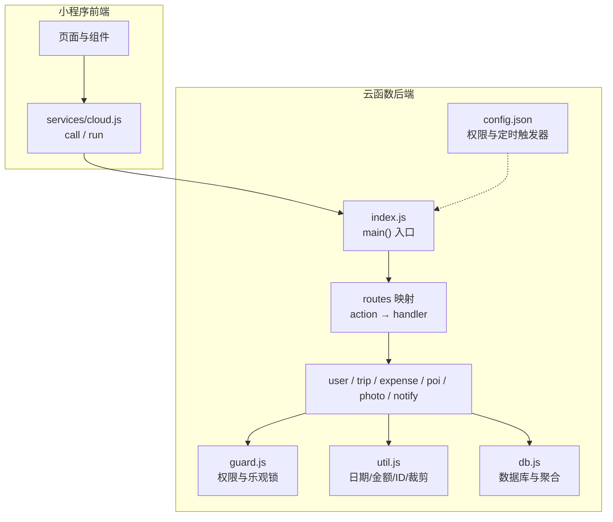
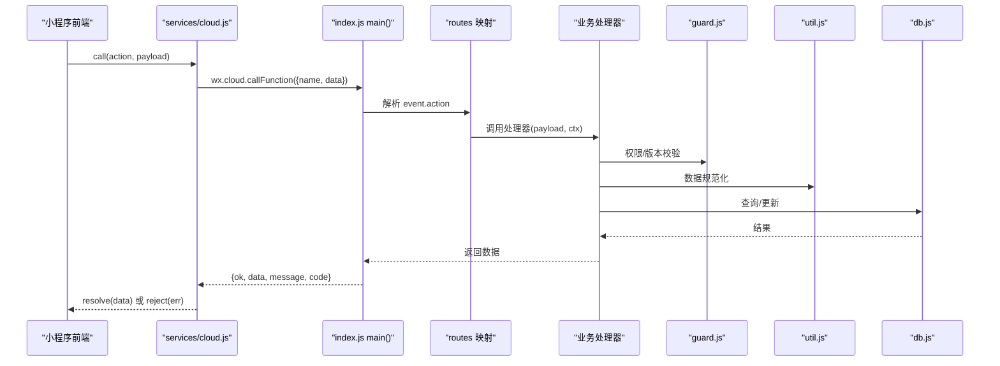
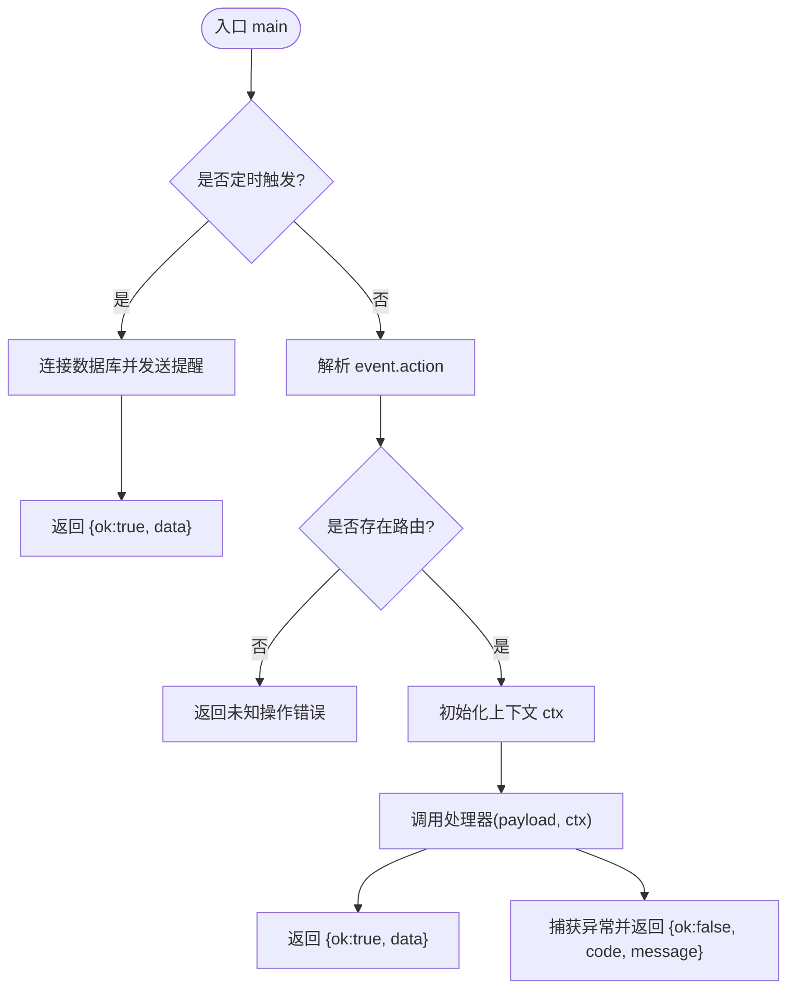
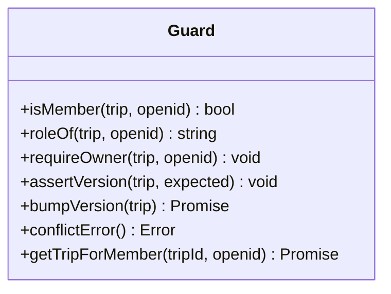
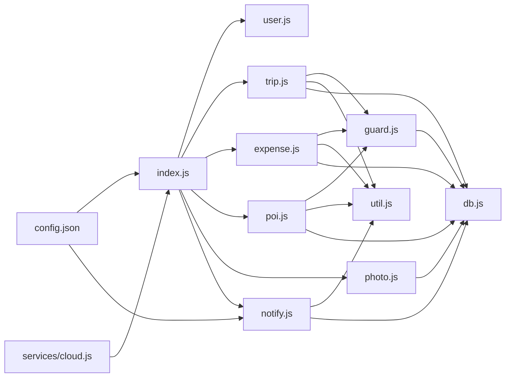
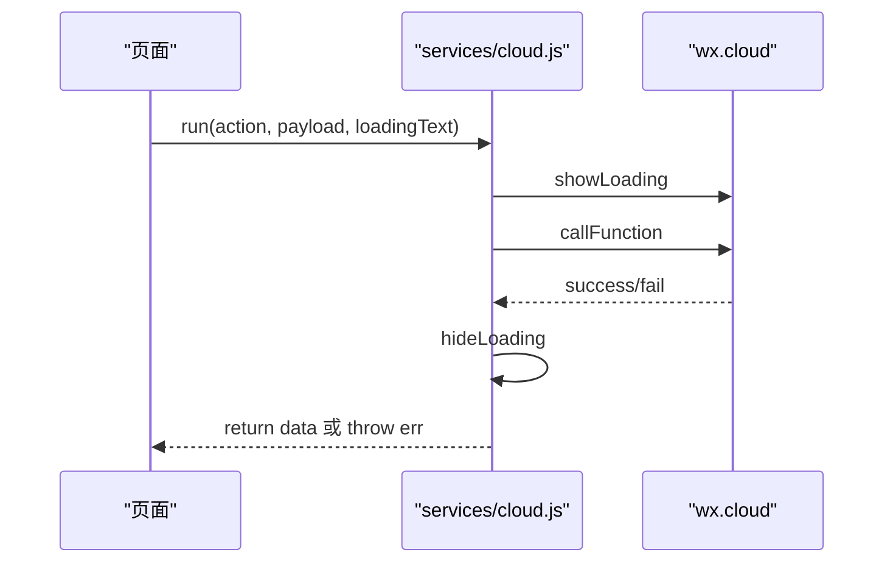

# 通用API规范

<cite>
**本文引用的文件**   
- [cloudfunctions/api/index.js](file://cloudfunctions/api/index.js)
- [cloudfunctions/api/guard.js](file://cloudfunctions/api/guard.js)
- [cloudfunctions/api/util.js](file://cloudfunctions/api/util.js)
- [cloudfunctions/api/config.json](file://cloudfunctions/api/config.json)
- [cloudfunctions/api/user.js](file://cloudfunctions/api/user.js)
- [cloudfunctions/api/trip.js](file://cloudfunctions/api/trip.js)
- [cloudfunctions/api/expense.js](file://cloudfunctions/api/expense.js)
- [cloudfunctions/api/poi.js](file://cloudfunctions/api/poi.js)
- [cloudfunctions/api/photo.js](file://cloudfunctions/api/photo.js)
- [cloudfunctions/api/notify.js](file://cloudfunctions/api/notify.js)
- [services/cloud.js](file://services/cloud.js)
</cite>

## 目录
1. [引言](#引言)
2. [项目结构](#项目结构)
3. [核心组件](#核心组件)
4. [架构总览](#架构总览)
5. [详细组件分析](#详细组件分析)
6. [依赖关系分析](#依赖关系分析)
7. [性能与扩展性](#性能与扩展性)
8. [错误处理与最佳实践](#错误处理与最佳实践)
9. [版本管理与兼容性](#版本管理与兼容性)
10. [日志、监控与告警](#日志监控与告警)
11. [客户端调用封装指南](#客户端调用封装指南)
12. [常见问题排查](#常见问题排查)
13. [结论](#结论)

## 引言
本规范定义了一套统一的云函数 API 标准，适用于小程序前端通过单一云函数入口访问后端业务。其目标包括：
- 统一入口与路由分发：所有请求通过一个云函数，按 action 路由到具体处理器。
- 统一请求响应格式：客户端与服务端使用一致的 ok、data、message、code 约定。
- 统一权限验证框架：基于 openid 的上下文与守卫机制，实现成员、创建者等角色校验。
- 统一错误处理标准：服务端抛出结构化异常，客户端按 code 做差异化处理。
- 统一数据与工具能力：日期、金额、ID、裁剪等公共逻辑集中管理。
- 统一定时任务与通知：支持订阅消息与定时触发器。
- 提供客户端封装与最佳实践：简化调用、统一 loading、统一错误提示。

该规范以“单入口 + action 路由”为核心，配合 guard 守卫、util 工具集和 services/cloud.js 客户端封装，形成前后端一致、可维护、可扩展的 API 体系。

## 项目结构
本项目采用“云函数模块 + 小程序服务层”的分层组织方式：
- cloudfunctions/api：后端云函数集合，包含入口、路由、领域处理器、守卫、工具、配置等。
- services/cloud.js：小程序侧统一调用云函数的封装。
- utils/constants：常量（如云函数名称）由 services/cloud.js 引用。

**图表来源**
- [cloudfunctions/api/index.js:10-41](file://cloudfunctions/api/index.js#L10-L41)
- [cloudfunctions/api/index.js:43-76](file://cloudfunctions/api/index.js#L43-L76)
- [cloudfunctions/api/guard.js:1-75](file://cloudfunctions/api/guard.js#L1-L75)
- [cloudfunctions/api/util.js:1-59](file://cloudfunctions/api/util.js#L1-L59)
- [cloudfunctions/api/config.json:1-15](file://cloudfunctions/api/config.json#L1-L15)
- [services/cloud.js:1-50](file://services/cloud.js#L1-L50)

**章节来源**
- [cloudfunctions/api/index.js:10-76](file://cloudfunctions/api/index.js#L10-L76)
- [services/cloud.js:1-50](file://services/cloud.js#L1-L50)

## 核心组件
- 统一入口与路由：index.js 暴露 main 函数，根据 event.action 查找 routes 映射并调用对应处理器。
- 领域处理器：user、trip、expense、poi、photo、notify 分别负责各自业务。
- 守卫机制：guard.js 提供成员校验、角色判断、版本断言、原子版本号提升、冲突错误构造、行程读取等能力。
- 工具库：util.js 提供日期解析/格式化、天数构建、UUID、文本裁剪、金额分转换等。
- 配置：config.json 声明 openapi 权限与定时触发器。
- 客户端封装：services/cloud.js 提供 call 与 run，统一包装 wx.cloud.callFunction，处理成功/失败与 loading。

**章节来源**
- [cloudfunctions/api/index.js:10-76](file://cloudfunctions/api/index.js#L10-L76)
- [cloudfunctions/api/guard.js:1-75](file://cloudfunctions/api/guard.js#L1-L75)
- [cloudfunctions/api/util.js:1-59](file://cloudfunctions/api/util.js#L1-L59)
- [cloudfunctions/api/config.json:1-15](file://cloudfunctions/api/config.json#L1-L15)
- [services/cloud.js:1-50](file://services/cloud.js#L1-L50)

## 架构总览
整体流程如下：
- 小程序通过 services/cloud.js 调用云函数，传入 action 与 payload。
- 云函数 index.js 的 main 接收事件，区分定时触发与普通请求。
- 普通请求从 event.action 查路由表，找到处理器后执行。
- 处理器通过 guard 进行权限与版本控制，通过 util 做数据规范化，通过 db 读写数据。
- 返回统一结果 { ok, data, message, code }，客户端根据 ok 与 code 分支处理。

**图表来源**
- [cloudfunctions/api/index.js:43-76](file://cloudfunctions/api/index.js#L43-L76)
- [services/cloud.js:5-30](file://services/cloud.js#L5-L30)

## 详细组件分析

### 统一入口与路由分发（index.js）
- 入口函数 main 接收 event，优先处理定时触发场景（Type=Timer 或存在 TriggerName），直接调用 notify.sendDue。
- 普通请求从 event.action 查找 routes 映射，未命中则返回未知操作错误。
- 成功路径：初始化上下文 ctx，调用处理器，返回 { ok: true, data }。
- 异常路径：捕获异常，返回 { ok: false, code, message }，code 用于客户端特殊分支（如 conflict）。

**图表来源**
- [cloudfunctions/api/index.js:43-76](file://cloudfunctions/api/index.js#L43-L76)

**章节来源**
- [cloudfunctions/api/index.js:10-76](file://cloudfunctions/api/index.js#L10-L76)

### 权限与守卫机制（guard.js）
- isMember：检查 openid 是否在 memberOpenids 中。
- roleOf：计算用户在行程中的角色（owner/editor），兼容老数据。
- requireOwner：非 owner 抛错。
- assertVersion：比较客户端传入的版本号与当前版本，不一致抛冲突错误。
- bumpVersion：原子更新版本号，防止并发覆盖。
- conflictError：构造带 code='conflict' 的错误对象。
- getTripForMember：按 tripId 与 openid 获取行程，校验成员权限，补齐 version 字段，附加 myRole。

**图表来源**
- [cloudfunctions/api/guard.js:1-75](file://cloudfunctions/api/guard.js#L1-L75)

**章节来源**
- [cloudfunctions/api/guard.js:1-75](file://cloudfunctions/api/guard.js#L1-L75)

### 工具库（util.js）
- pad：数字补零。
- parseDate/formatDate：日期解析与格式化。
- buildDays：根据起止日期生成 days 数组，限制最大天数。
- uuid：简易 ID 生成。
- cut：字符串裁剪。
- toCents：金额元转分，保证精度。

**章节来源**
- [cloudfunctions/api/util.js:1-59](file://cloudfunctions/api/util.js#L1-L59)

### 用户接口（user.js）
- me：返回当前用户的 openid 与用户信息（昵称、默认币种）。

**章节来源**
- [cloudfunctions/api/user.js:1-12](file://cloudfunctions/api/user.js#L1-L12)

### 行程接口（trip.js）
- list：列出当前用户参与的行程。
- get：获取单个行程详情。
- create：创建行程，校验标题、日期、天数上限，生成 inviteCode/version 等。
- update：更新行程，支持标题、目的地、交通方式、预算、状态、日期；日期变更时重建 days 并校验悬空地点。
- remove：软删除行程及其关联 POI、账目。
- invite：生成邀请码，有效期 7 天。
- join：通过 tripId 或邀请码加入行程。
- leave：成员退出行程。
- removeMember：创建者移除其他成员。
- copy：复制行程，重新计算日期，拷贝 POI，成员仅保留自己。

关键约束：
- 金额存储为分（budgetCents）。
- 使用 optimistic locking（version + bumpVersion）避免并发覆盖。
- 成员角色与权限由 guard 控制。

**章节来源**
- [cloudfunctions/api/trip.js:1-370](file://cloudfunctions/api/trip.js#L1-L370)

### 账目接口（expense.js）
- list：列出行程内账目，附带汇总 summary。
- overview：汇总用户参与的所有行程花费。
- save：新增或更新账目，校验金额、分类、分摊 splits。
- remove：软删除账目。
- settle：AA 结算，计算每人应付/实付差额，给出转账建议。

关键约束：
- 金额统一用分存储。
- 分摊校验：若客户端传 splits，合计必须等于金额。
- 成员标签显示友好化，避免昵称歧义。

**章节来源**
- [cloudfunctions/api/expense.js:1-329](file://cloudfunctions/api/expense.js#L1-L329)

### 地点接口（poi.js）
- list：获取行程内 POI 列表，附带 trip 信息。
- save：新增或更新 POI，校验名称、天数、时间、时长、事实信息。
- remove：软删除 POI。
- reorder：批量重排 POI（换天、排序、调整计划时间），原子更新 order。

关键约束：
- 每天最多 MAX_PER_DAY 个地点。
- order 设计按天进位，便于单字段排序。
- 使用 assertVersion/bumpVersion 保证并发安全。

**章节来源**
- [cloudfunctions/api/poi.js:1-199](file://cloudfunctions/api/poi.js#L1-L199)

### 照片接口（photo.js）
- list：列出行程内照片记录（仅存 fileID）。
- add：添加照片记录，限制每趟行程最多 MAX_PHOTOS。
- remove：软删照片记录，不删原图。

**章节来源**
- [cloudfunctions/api/photo.js:1-65](file://cloudfunctions/api/photo.js#L1-L65)

### 通知接口（notify.js）
- subscribe：订阅出发提醒，记录模板信息与授权时间。
- sendDue：定时任务，每日 20:00 向明天出发的行程成员发送订阅消息。

关键约束：
- 模板字段名需与公众平台模板一致。
- 每次授权只发一条，失败也标记 sentAt 避免重复打扰。

**章节来源**
- [cloudfunctions/api/notify.js:1-102](file://cloudfunctions/api/notify.js#L1-L102)

## 依赖关系分析
- index.js 依赖 db、各业务处理器。
- 各处理器依赖 guard、util、db。
- guard 依赖 db。
- config.json 声明 openapi 权限与定时触发器，影响 notify 与入口行为。
- services/cloud.js 依赖 constants（云函数名称），封装 wx.cloud.callFunction。

**图表来源**
- [cloudfunctions/api/index.js:1-41](file://cloudfunctions/api/index.js#L1-L41)
- [cloudfunctions/api/guard.js:1-75](file://cloudfunctions/api/guard.js#L1-L75)
- [cloudfunctions/api/util.js:1-59](file://cloudfunctions/api/util.js#L1-L59)
- [cloudfunctions/api/config.json:1-15](file://cloudfunctions/api/config.json#L1-L15)
- [services/cloud.js:1-50](file://services/cloud.js#L1-L50)

**章节来源**
- [cloudfunctions/api/index.js:1-76](file://cloudfunctions/api/index.js#L1-L76)
- [cloudfunctions/api/guard.js:1-75](file://cloudfunctions/api/guard.js#L1-L75)
- [cloudfunctions/api/util.js:1-59](file://cloudfunctions/api/util.js#L1-L59)
- [cloudfunctions/api/config.json:1-15](file://cloudfunctions/api/config.json#L1-L15)
- [services/cloud.js:1-50](file://services/cloud.js#L1-L50)

## 性能与扩展性
- 单入口减少部署与维护成本，路由表集中管理，新增 action 只需在 index.js 注册。
- 使用聚合与索引优化查询（如 expense.overview 使用 aggregate）。
- 乐观锁（version + bumpVersion）降低并发写冲突风险。
- 批量更新（poi.reorder）减少往返次数。
- 限制数据规模（MAX_DAYS、MAX_ITEMS、MAX_PER_DAY、MAX_PHOTOS）避免大查询。
- 金额以分存储，避免浮点误差。

[本节为通用指导，无需特定文件引用]

## 错误处理与最佳实践
- 服务端错误：
  - 常规错误：throw new Error('message')，被 index.js 捕获后返回 { ok: false, message }。
  - 冲突错误：使用 guard.conflictError() 设置 err.code = 'conflict'，客户端可做特殊处理（如弹窗刷新）。
- 客户端错误：
  - services/cloud.js 将 result.message 转为 Error.message，并将 code 透传到 err.code。
  - run 方法统一显示 loading，对非 conflict 错误弹出 toast，但仍向上抛出错误供页面处理。

最佳实践：
- 前端调用优先使用 run，自动处理 loading 与常见错误提示。
- 对 conflict 错误做差异化处理（例如提示用户刷新数据）。
- 后端处理器始终校验输入参数，使用 util.cut/toCents 等工具规范化数据。
- 敏感字段（如 openid）只从服务端上下文获取，不信任前端传入。

**章节来源**
- [cloudfunctions/api/index.js:62-76](file://cloudfunctions/api/index.js#L62-L76)
- [cloudfunctions/api/guard.js:20-30](file://cloudfunctions/api/guard.js#L20-L30)
- [services/cloud.js:5-47](file://services/cloud.js#L5-L47)

## 版本管理与兼容性
- 版本字段：trip.version 用于乐观锁，客户端需在更新/删除/重排等操作时携带 version。
- 版本断言：assertVersion 比较客户端版本与服务器版本，不一致抛冲突错误。
- 原子占位：bumpVersion 使用 where version=current 更新，确保只有一个请求能成功。
- 兼容旧数据：getTripForMember 会补齐缺失的 version 字段。
- 历史兼容：expense.settle 同时支持新 splits 与旧 splitWith/splitOpenids。

**章节来源**
- [cloudfunctions/api/guard.js:26-42](file://cloudfunctions/api/guard.js#L26-L42)
- [cloudfunctions/api/guard.js:56-64](file://cloudfunctions/api/guard.js#L56-L64)
- [cloudfunctions/api/expense.js:253-261](file://cloudfunctions/api/expense.js#L253-L261)

## 日志、监控与告警
- 定时任务日志：index.js 在定时触发路径记录错误日志。
- 通知发送失败：notify.js 记录发送失败的 errCode/errMsg，避免重复打扰。
- 建议扩展：
  - 增加结构化日志（action、openid、tripId、耗时、错误堆栈）。
  - 接入外部监控平台（如云监控、Sentry）上报异常。
  - 对高频失败动作设置告警阈值。

**章节来源**
- [cloudfunctions/api/index.js:46-53](file://cloudfunctions/api/index.js#L46-L53)
- [cloudfunctions/api/notify.js:77-90](file://cloudfunctions/api/notify.js#L77-L90)

## 客户端调用封装指南
- 统一调用：
  - call(action, payload)：返回 Promise，成功 resolve(data)，失败 reject(Error)。
  - run(action, payload, loadingText)：带 loading 的便捷方法，统一隐藏 loading 与错误提示。
- 错误处理：
  - 捕获 err.code === 'conflict' 的特殊分支。
  - 其他错误统一 showToast。
- 推荐模式：
  - 页面中优先使用 run，减少样板代码。
  - 对需要自定义处理的错误，catch 后根据 err.code 分支。

**图表来源**
- [services/cloud.js:32-47](file://services/cloud.js#L32-L47)

**章节来源**
- [services/cloud.js:1-50](file://services/cloud.js#L1-L50)

## 常见问题排查
- 未知操作：
  - 现象：返回 message 包含“未知操作”。
  - 原因：event.action 未在 routes 中注册。
  - 解决：在 index.js 的 routes 中添加映射。
- 权限不足：
  - 现象：返回“你没有这份行程的权限”或“只有创建者可以做这个操作”。
  - 原因：用户不是成员或不是 owner。
  - 解决：确认用户已加入行程或具备 owner 角色。
- 版本冲突：
  - 现象：err.code === 'conflict'。
  - 原因：客户端传入的 version 与服务器不一致。
  - 解决：提示用户刷新数据后重试。
- 金额错误：
  - 现象：返回“请填写大于 0 的金额”或“分摊合计和金额不一致”。
  - 原因：amountCents 校验失败或 splits 合计不等于 amount。
  - 解决：修正金额或分摊明细。
- 地点数量超限：
  - 现象：返回“一天最多放 N 个地点”。
  - 原因：超过 MAX_PER_DAY。
  - 解决：合并或拆分地点。
- 照片数量超限：
  - 现象：返回“一趟行程最多放 N 张照片”。
  - 原因：超过 MAX_PHOTOS。
  - 解决：清理旧照片或分批上传。

**章节来源**
- [cloudfunctions/api/index.js:56-60](file://cloudfunctions/api/index.js#L56-L60)
- [cloudfunctions/api/guard.js:44-54](file://cloudfunctions/api/guard.js#L44-L54)
- [cloudfunctions/api/guard.js:16-18](file://cloudfunctions/api/guard.js#L16-L18)
- [cloudfunctions/api/expense.js:132-143](file://cloudfunctions/api/expense.js#L132-L143)
- [cloudfunctions/api/poi.js:121-124](file://cloudfunctions/api/poi.js#L121-L124)
- [cloudfunctions/api/photo.js:24-26](file://cloudfunctions/api/photo.js#L24-L26)

## 结论
本规范通过“单入口 + action 路由 + 守卫 + 工具 + 客户端封装”的方式，构建了统一、稳定、易扩展的 API 体系。它明确了请求响应格式、错误处理标准、权限验证框架与版本管理机制，并为日志、监控与告警提供了基础。遵循本规范，可在保持前后端一致性的同时，快速迭代业务功能，降低维护成本与出错概率。