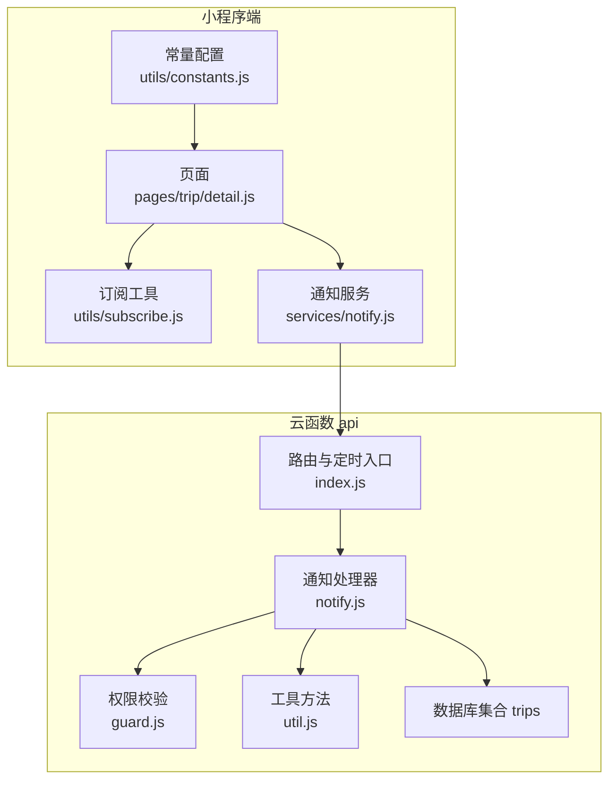
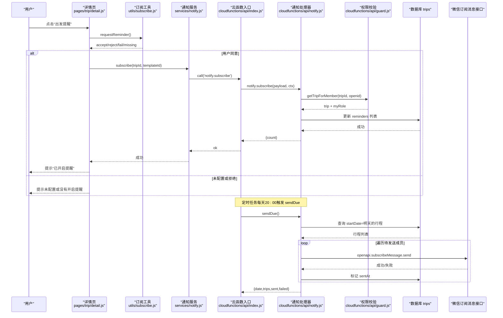
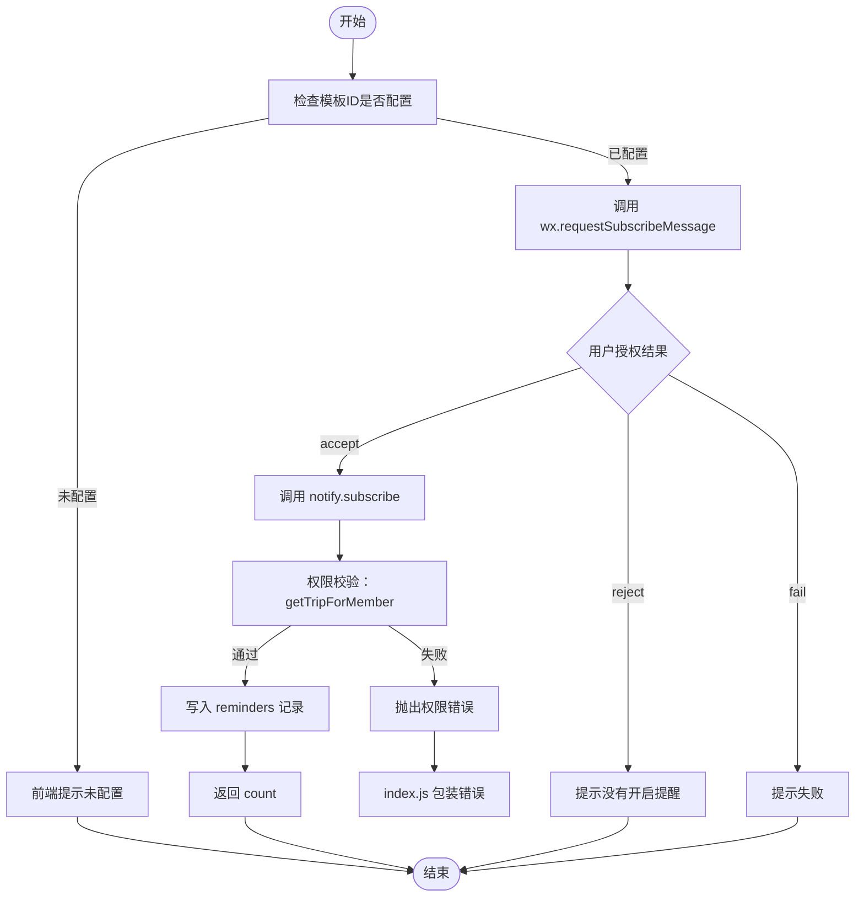
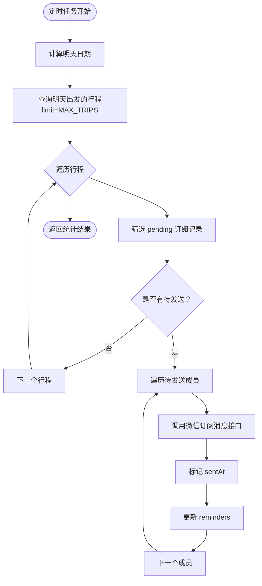
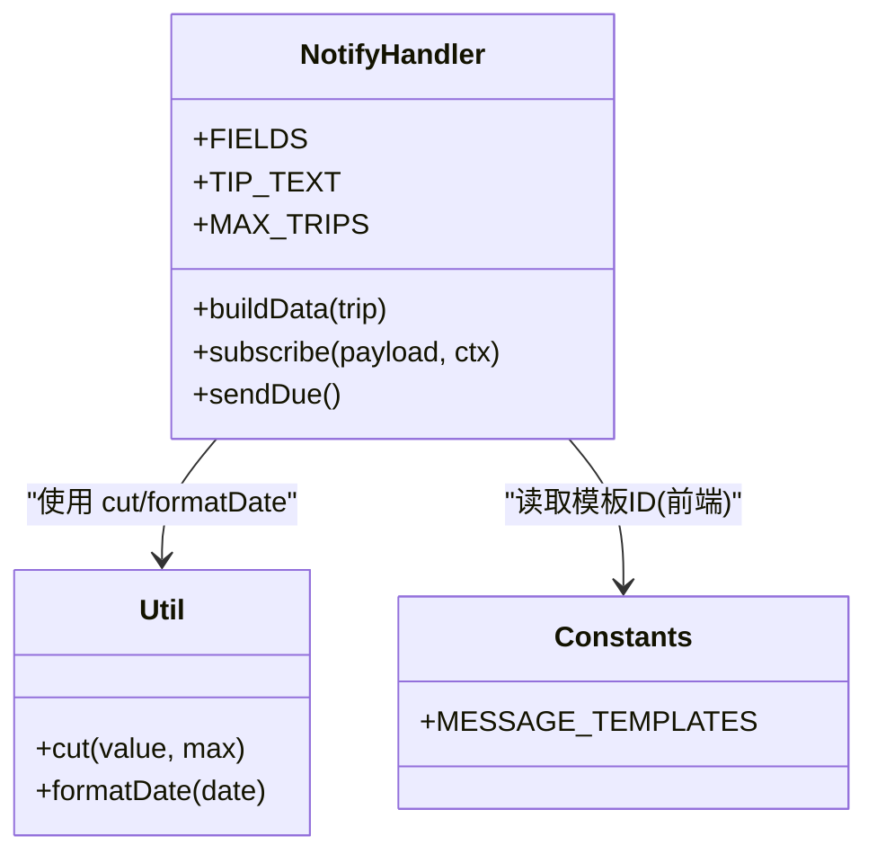
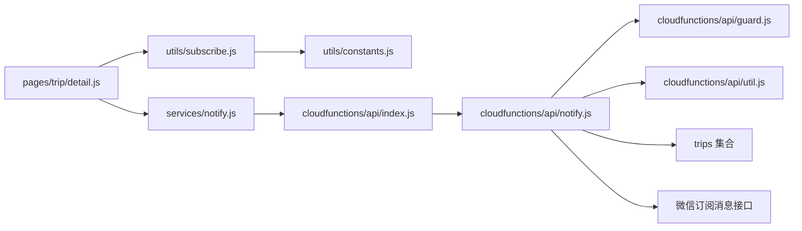

# 通知管理API

<cite>
**本文引用的文件**   
- [cloudfunctions/api/notify.js](file://cloudfunctions/api/notify.js)
- [cloudfunctions/api/index.js](file://cloudfunctions/api/index.js)
- [services/notify.js](file://services/notify.js)
- [utils/subscribe.js](file://utils/subscribe.js)
- [utils/constants.js](file://utils/constants.js)
- [pages/trip/detail.js](file://pages/trip/detail.js)
- [cloudfunctions/api/guard.js](file://cloudfunctions/api/guard.js)
- [cloudfunctions/api/util.js](file://cloudfunctions/api/util.js)
</cite>

## 目录
1. [简介](#简介)
2. [项目结构](#项目结构)
3. [核心组件](#核心组件)
4. [架构总览](#架构总览)
5. [详细接口说明](#详细接口说明)
6. [依赖关系分析](#依赖关系分析)
7. [性能与可靠性](#性能与可靠性)
8. [故障排查指南](#故障排查指南)
9. [结论](#结论)
10. [附录：配置与示例](#附录配置与示例)

## 简介
本文件为“通知管理API”的完整技术文档，覆盖以下能力：
- 微信订阅消息机制与模板字段映射
- 用户订阅授权流程与前端交互
- 定时任务触发“出发提醒”的通知发送策略
- 数据模型、权限校验、错误处理与重试策略
- 订阅消息配置与定时任务部署要点

该功能面向旅行行程场景，在用户点击“出发提醒”后，系统记录其订阅授权；每日定时任务扫描“明天出发”的行程，向已订阅且尚未发送的成员推送一条微信订阅消息。

## 项目结构
通知相关代码分布在小程序端与服务端两部分：
- 小程序端
  - utils/subscribe.js：封装订阅消息授权弹窗
  - services/notify.js：调用云函数 notify.subscribe
  - pages/trip/detail.js：触发订阅入口
  - utils/constants.js：集中存放订阅消息模板ID
- 服务端（云函数）
  - cloudfunctions/api/index.js：统一路由与定时任务入口
  - cloudfunctions/api/notify.js：订阅记录与定时发送逻辑
  - cloudfunctions/api/guard.js：行程成员权限校验
  - cloudfunctions/api/util.js：日期、截断等工具方法

**图表来源**
- [pages/trip/detail.js:186-204](file://pages/trip/detail.js#L186-L204)
- [utils/subscribe.js:1-31](file://utils/subscribe.js#L1-L31)
- [services/notify.js:1-7](file://services/notify.js#L1-L7)
- [cloudfunctions/api/index.js:40-54](file://cloudfunctions/api/index.js#L40-L54)
- [cloudfunctions/api/notify.js:28-96](file://cloudfunctions/api/notify.js#L28-L96)
- [cloudfunctions/api/guard.js:44-65](file://cloudfunctions/api/guard.js#L44-L65)
- [cloudfunctions/api/util.js:11-42](file://cloudfunctions/api/util.js#L11-L42)
- [utils/constants.js:18-21](file://utils/constants.js#L18-L21)

**章节来源**
- [pages/trip/detail.js:186-204](file://pages/trip/detail.js#L186-L204)
- [utils/subscribe.js:1-31](file://utils/subscribe.js#L1-L31)
- [services/notify.js:1-7](file://services/notify.js#L1-L7)
- [cloudfunctions/api/index.js:40-54](file://cloudfunctions/api/index.js#L40-L54)
- [cloudfunctions/api/notify.js:28-96](file://cloudfunctions/api/notify.js#L28-L96)
- [cloudfunctions/api/guard.js:44-65](file://cloudfunctions/api/guard.js#L44-L65)
- [cloudfunctions/api/util.js:11-42](file://cloudfunctions/api/util.js#L11-L42)
- [utils/constants.js:18-21](file://utils/constants.js#L18-L21)

## 核心组件
- 订阅消息授权工具
  - 负责读取模板ID、弹出授权框、返回授权结果
  - 当未配置模板ID时，直接提示用户去后台配置
- 通知服务层
  - 将小程序端的订阅动作转换为对云函数的调用
- 云函数路由
  - 统一 action 路由与定时任务入口
  - 区分普通请求与定时触发器
- 通知处理器
  - 实现 subscribe：记录用户的订阅授权到行程数据中
  - 实现 sendDue：定时任务扫描“明天出发”的行程并发送订阅消息
- 权限校验
  - 确保只有行程成员才能订阅提醒
- 工具方法
  - 提供日期格式化、字符串截断等基础能力

**章节来源**
- [utils/subscribe.js:1-31](file://utils/subscribe.js#L1-L31)
- [services/notify.js:1-7](file://services/notify.js#L1-L7)
- [cloudfunctions/api/index.js:40-54](file://cloudfunctions/api/index.js#L40-L54)
- [cloudfunctions/api/notify.js:28-96](file://cloudfunctions/api/notify.js#L28-L96)
- [cloudfunctions/api/guard.js:44-65](file://cloudfunctions/api/guard.js#L44-L65)
- [cloudfunctions/api/util.js:11-42](file://cloudfunctions/api/util.js#L11-L42)

## 架构总览
下图展示从用户点击“出发提醒”到定时发送通知的完整链路。

**图表来源**
- [pages/trip/detail.js:186-204](file://pages/trip/detail.js#L186-L204)
- [utils/subscribe.js:1-31](file://utils/subscribe.js#L1-L31)
- [services/notify.js:1-7](file://services/notify.js#L1-L7)
- [cloudfunctions/api/index.js:40-54](file://cloudfunctions/api/index.js#L40-L54)
- [cloudfunctions/api/notify.js:28-96](file://cloudfunctions/api/notify.js#L28-L96)
- [cloudfunctions/api/guard.js:44-65](file://cloudfunctions/api/guard.js#L44-L65)

## 详细接口说明

### 接口一：订阅消息授权与记录
- 名称：notify.subscribe
- 调用方：小程序端 services/notify.js
- 触发位置：pages/trip/detail.js 的 onRemind
- 前置条件
  - 用户在微信公众平台已申请订阅消息模板，并在 utils/constants.js 中配置 MESSAGE_TEMPLATES.tripReminder
  - 当前用户是行程成员（通过 guard.getTripForMember 校验）
- 输入参数
  - tripId：行程ID
  - templateId：订阅消息模板ID
- 业务规则
  - 若未配置模板ID，前端直接提示“提醒还没配置”，不会发起后端调用
  - 每次用户点击“出发提醒”，会尝试一次微信授权弹窗；一次授权只换一条推送机会
  - 后端会为同一 openid 保留一条订阅记录（去重），避免重复占用授权次数
  - 成功后返回订阅人数计数
- 输出结果
  - 成功：{ count }
  - 失败：抛出异常，由 index.js 统一包装为 { ok:false, message }
- 错误处理
  - 缺少模板ID：前端提示
  - 非行程成员：抛出“你没有这份行程的权限”
  - 行程不存在或被删除：抛出“行程不存在或已被删除”
  - 其他异常：由 index.js 捕获并返回通用错误信息

**图表来源**
- [utils/subscribe.js:1-31](file://utils/subscribe.js#L1-L31)
- [pages/trip/detail.js:186-204](file://pages/trip/detail.js#L186-L204)
- [cloudfunctions/api/notify.js:28-45](file://cloudfunctions/api/notify.js#L28-L45)
- [cloudfunctions/api/guard.js:44-65](file://cloudfunctions/api/guard.js#L44-L65)
- [cloudfunctions/api/index.js:56-75](file://cloudfunctions/api/index.js#L56-L75)

**章节来源**
- [utils/subscribe.js:1-31](file://utils/subscribe.js#L1-L31)
- [services/notify.js:1-7](file://services/notify.js#L1-L7)
- [pages/trip/detail.js:186-204](file://pages/trip/detail.js#L186-L204)
- [cloudfunctions/api/notify.js:28-45](file://cloudfunctions/api/notify.js#L28-L45)
- [cloudfunctions/api/guard.js:44-65](file://cloudfunctions/api/guard.js#L44-L65)
- [cloudfunctions/api/index.js:56-75](file://cloudfunctions/api/index.js#L56-L75)

### 接口二：定时任务触发“出发提醒”
- 名称：sendDue（定时触发）
- 触发方式：云函数定时触发器，每天20:00调用
- 入口：cloudfunctions/api/index.js 的 main，识别 event.Type === 'Timer' 或存在 TriggerName
- 业务规则
  - 计算“明天”的日期
  - 查询所有 startDate 等于明天且未被删除的行程，最多取 MAX_TRIPS 条
  - 对每个行程，筛选出 pending 订阅记录（openid、templateId 存在且未发送）
  - 调用微信 openapi.subscribeMessage.send 发送订阅消息
  - 无论成功或失败，都标记 sentAt，表示本次授权已使用
  - 批量更新 reminders 列表
- 输出结果
  - { date, trips, sent, failed }
- 错误处理
  - 发送失败（如模板字段不匹配、授权已用完）：记录日志，不重试，继续处理下一条
  - 定时任务整体异常：index.js 捕获并返回 { ok:false, message }

**图表来源**
- [cloudfunctions/api/index.js:43-54](file://cloudfunctions/api/index.js#L43-L54)
- [cloudfunctions/api/notify.js:47-96](file://cloudfunctions/api/notify.js#L47-L96)
- [cloudfunctions/api/util.js:11-16](file://cloudfunctions/api/util.js#L11-L16)

**章节来源**
- [cloudfunctions/api/index.js:43-54](file://cloudfunctions/api/index.js#L43-L54)
- [cloudfunctions/api/notify.js:47-96](file://cloudfunctions/api/notify.js#L47-L96)
- [cloudfunctions/api/util.js:11-16](file://cloudfunctions/api/util.js#L11-L16)

### 微信订阅消息机制与模板字段映射
- 模板ID配置
  - 在 utils/constants.js 中设置 MESSAGE_TEMPLATES.tripReminder
  - 若未配置，前端直接提示用户前往公众平台申请模板
- 字段映射
  - 通知处理器中定义了 FIELDS 映射：title→thing1，date→date2，tip→thing3
  - 构建消息数据时，标题截断至20字，日期仅保留日期格式
- 跳转链接
  - 发送时携带 page 参数，指向行程详情页，便于用户点击通知直达对应行程

**图表来源**
- [cloudfunctions/api/notify.js:6-25](file://cloudfunctions/api/notify.js#L6-L25)
- [utils/constants.js:18-21](file://utils/constants.js#L18-L21)
- [cloudfunctions/api/util.js:39-42](file://cloudfunctions/api/util.js#L39-L42)

**章节来源**
- [cloudfunctions/api/notify.js:6-25](file://cloudfunctions/api/notify.js#L6-L25)
- [utils/constants.js:18-21](file://utils/constants.js#L18-L21)
- [cloudfunctions/api/util.js:39-42](file://cloudfunctions/api/util.js#L39-L42)

## 依赖关系分析
- 小程序端依赖
  - pages/trip/detail.js 依赖 services/notify.js 与 utils/subscribe.js
  - utils/subscribe.js 依赖 utils/constants.js
- 服务端依赖
  - cloudfunctions/api/index.js 依赖 notify.js
  - notify.js 依赖 guard.js、util.js 与数据库集合 trips
- 外部依赖
  - 微信订阅消息接口 openapi.subscribeMessage.send
  - 微信小程序授权弹窗 wx.requestSubscribeMessage

**图表来源**
- [pages/trip/detail.js:1-7](file://pages/trip/detail.js#L1-L7)
- [services/notify.js:1-7](file://services/notify.js#L1-L7)
- [utils/subscribe.js:1-31](file://utils/subscribe.js#L1-L31)
- [cloudfunctions/api/index.js:3-8](file://cloudfunctions/api/index.js#L3-L8)
- [cloudfunctions/api/notify.js:1-4](file://cloudfunctions/api/notify.js#L1-L4)

**章节来源**
- [pages/trip/detail.js:1-7](file://pages/trip/detail.js#L1-L7)
- [services/notify.js:1-7](file://services/notify.js#L1-L7)
- [utils/subscribe.js:1-31](file://utils/subscribe.js#L1-L31)
- [cloudfunctions/api/index.js:3-8](file://cloudfunctions/api/index.js#L3-L8)
- [cloudfunctions/api/notify.js:1-4](file://cloudfunctions/api/notify.js#L1-L4)

## 性能与可靠性
- 批量限制
  - 定时任务每次最多处理 MAX_TRIPS 条行程，避免单次任务过长
- 幂等性
  - 同一 openid 在同一行程下只保留一条订阅记录，避免重复消耗授权次数
- 重试策略
  - 发送失败不重试，仅记录日志；因为失败原因多为模板字段不匹配或授权已用完，重试无意义
- 并发安全
  - 订阅记录更新为追加式操作；发送完成后统一写回 reminders，减少中间态竞争
- 可扩展性
  - 如需增加新的提醒类型，可在 notify.js 扩展 FIELDS 与 buildData，并在 index.js 新增 action 路由

[本节为通用指导，不直接分析具体文件]

## 故障排查指南
- 常见问题
  - 未配置模板ID：前端提示“提醒还没配置”，需前往微信公众平台申请模板并填写 utils/constants.js
  - 非行程成员：后端抛出“你没有这份行程的权限”，请确认用户是否为行程成员
  - 行程不存在或被删除：后端抛出“行程不存在或已被删除”，请检查 tripId 是否正确
  - 发送失败：常见原因为模板字段不匹配或授权已用完；查看云端日志中的 errCode 与 errMsg
- 定位步骤
  - 检查 utils/constants.js 是否配置了 MESSAGE_TEMPLATES.tripReminder
  - 检查 pages/trip/detail.js 是否调用了 requestReminder 与 notifyService.subscribe
  - 检查 cloudfunctions/api/notify.js 的 FIELDS 是否与公众平台模板字段一致
  - 检查云函数定时触发器是否已正确配置并触发 sendDue
  - 查看云端日志，关注 “[notify] send failed” 与 “[api] timer” 日志

**章节来源**
- [utils/subscribe.js:8-16](file://utils/subscribe.js#L8-L16)
- [cloudfunctions/api/notify.js:77-92](file://cloudfunctions/api/notify.js#L77-L92)
- [cloudfunctions/api/index.js:43-54](file://cloudfunctions/api/index.js#L43-L54)

## 结论
本通知管理API围绕微信订阅消息机制，实现了“用户授权—记录订阅—定时发送”的闭环。通过统一的云函数路由与权限校验，保证了数据安全与一致性；通过简洁的错误处理与日志记录，提升了可观测性与可维护性。建议在后续迭代中：
- 支持多模板类型与更丰富的提醒策略
- 引入消息队列与重试机制，提升发送成功率
- 增加订阅状态查询接口，便于前端展示与引导

[本节为总结性内容，不直接分析具体文件]

## 附录：配置与示例

### 订阅消息模板配置
- 在微信公众平台申请订阅消息模板，并将模板ID填入 utils/constants.js 的 MESSAGE_TEMPLATES.tripReminder
- 确保模板字段与 notify.js 中的 FIELDS 映射一致（title→thing1，date→date2，tip→thing3）

**章节来源**
- [utils/constants.js:18-21](file://utils/constants.js#L18-L21)
- [cloudfunctions/api/notify.js:6-9](file://cloudfunctions/api/notify.js#L6-L9)

### 前端订阅流程示例
- 用户在行程详情页点击“出发提醒”
- 前端调用 requestReminder 弹出授权框
- 用户同意后，调用 notifyService.subscribe 记录订阅
- 成功后提示“出发前一天 20:00 提醒你”

**章节来源**
- [pages/trip/detail.js:186-204](file://pages/trip/detail.js#L186-L204)
- [utils/subscribe.js:18-29](file://utils/subscribe.js#L18-L29)
- [services/notify.js:3-6](file://services/notify.js#L3-L6)

### 定时任务配置示例
- 在云开发控制台为云函数 api 添加定时触发器，设置为每天20:00
- 触发时将调用 index.js 的 main，识别 Timer 事件并执行 sendDue
- sendDue 会扫描“明天出发”的行程并向已订阅成员发送通知

**章节来源**
- [cloudfunctions/api/index.js:43-54](file://cloudfunctions/api/index.js#L43-L54)
- [cloudfunctions/api/notify.js:47-96](file://cloudfunctions/api/notify.js#L47-L96)