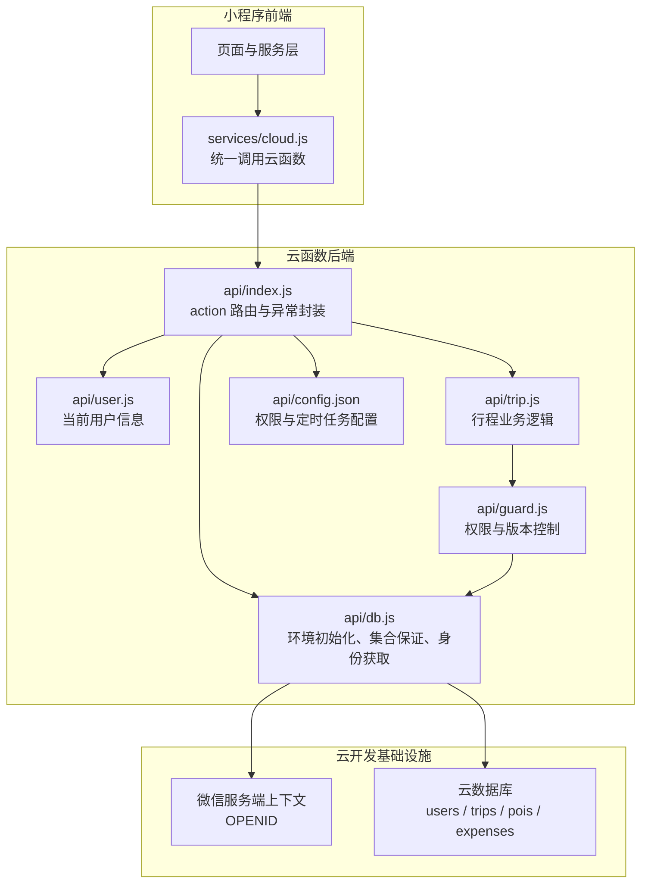
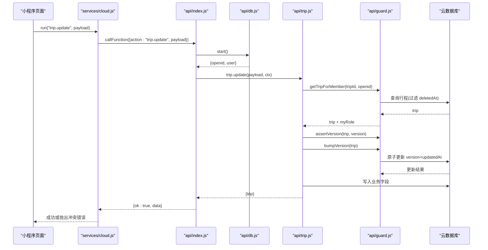
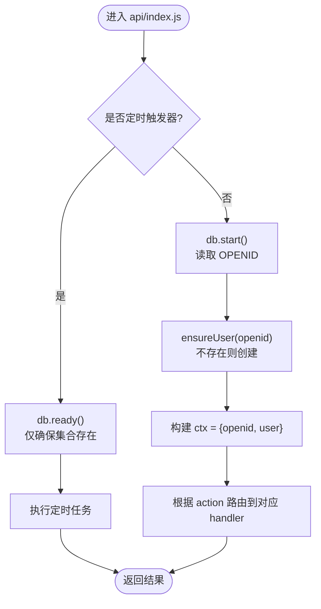
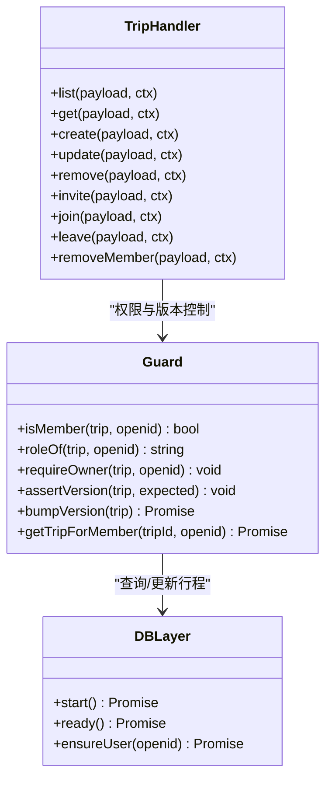
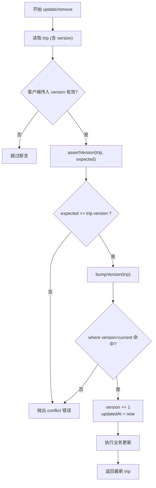
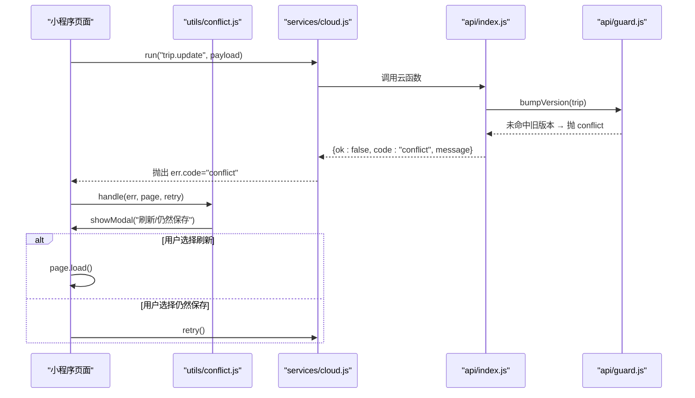
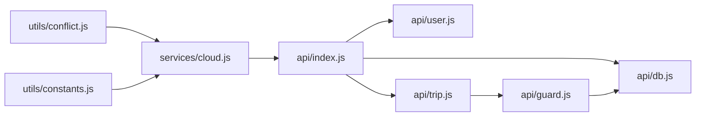
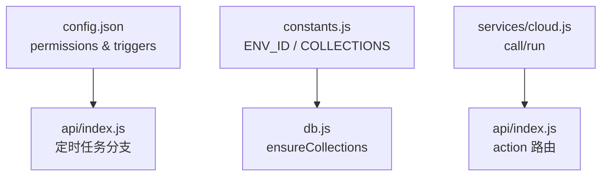

# 安全与认证

<cite>
**本文引用的文件**   
- [cloudfunctions/api/index.js](file://cloudfunctions/api/index.js)
- [cloudfunctions/api/db.js](file://cloudfunctions/api/db.js)
- [cloudfunctions/api/user.js](file://cloudfunctions/api/user.js)
- [cloudfunctions/api/guard.js](file://cloudfunctions/api/guard.js)
- [cloudfunctions/api/trip.js](file://cloudfunctions/api/trip.js)
- [cloudfunctions/api/config.json](file://cloudfunctions/api/config.json)
- [services/cloud.js](file://services/cloud.js)
- [services/user.js](file://services/user.js)
- [utils/constants.js](file://utils/constants.js)
- [utils/conflict.js](file://utils/conflict.js)
</cite>

## 目录
1. [引言](#引言)
2. [项目结构与安全边界](#项目结构与安全边界)
3. [核心安全组件](#核心安全组件)
4. [架构总览](#架构总览)
5. [详细组件分析](#详细组件分析)
6. [依赖关系分析](#依赖关系分析)
7. [性能与并发特性](#性能与并发特性)
8. [威胁模型与防护措施](#威胁模型与防护措施)
9. [安全配置示例](#安全配置示例)
10. [故障排除指南](#故障排除指南)
11. [结论](#结论)

## 引言
本文件面向“安全与认证”主题，系统性说明该小程序后端云函数在用户身份验证、权限控制、数据版本控制与并发冲突处理方面的实现。重点覆盖：
- 基于微信服务端上下文的 OpenID 认证流程
- 角色权限管理（创建者/编辑者）与成员访问控制
- 数据安全措施（输入校验、软删除、集合白名单）
- 版本控制机制与乐观锁实现
- 并发冲突解决策略与前端交互
- 安全最佳实践、威胁模型与防护建议
- 安全配置要点与常见问题排查

## 项目结构与安全边界
本项目采用“小程序前端 + 云函数后端”的架构。所有写操作统一通过云函数入口进行路由分发，避免前端直连数据库，从而将鉴权、校验、权限检查集中在服务端。

**图表来源**
- [cloudfunctions/api/index.js:10-41](file://cloudfunctions/api/index.js#L10-L41)
- [cloudfunctions/api/db.js:46-53](file://cloudfunctions/api/db.js#L46-L53)
- [cloudfunctions/api/user.js:1-11](file://cloudfunctions/api/user.js#L1-L11)
- [cloudfunctions/api/trip.js:1-10](file://cloudfunctions/api/trip.js#L1-L10)
- [cloudfunctions/api/guard.js:1-14](file://cloudfunctions/api/guard.js#L1-L14)
- [cloudfunctions/api/config.json:1-15](file://cloudfunctions/api/config.json#L1-L15)

**章节来源**
- [cloudfunctions/api/index.js:10-41](file://cloudfunctions/api/index.js#L10-L41)
- [cloudfunctions/api/db.js:1-10](file://cloudfunctions/api/db.js#L1-L10)
- [services/cloud.js:1-12](file://services/cloud.js#L1-L12)
- [utils/constants.js:1-10](file://utils/constants.js#L1-L10)

## 核心安全组件
- 云函数入口与路由：集中接收 action，统一返回 ok/code/message，并强制从服务端上下文取 openid。
- 数据库与身份层：初始化云开发环境、确保集合存在、从微信上下文读取 OPENID、自动创建用户记录。
- 权限守卫：成员判断、角色推导、所有者校验、版本断言、原子版本号递增。
- 业务处理器：行程相关操作均通过守卫进行权限与版本控制。
- 前端服务层：统一包装云函数调用，区分普通错误与冲突错误，提供带 loading 的统一调用方法。
- 冲突处理工具：统一的版本冲突交互流程，刷新后重试。

**章节来源**
- [cloudfunctions/api/index.js:43-76](file://cloudfunctions/api/index.js#L43-L76)
- [cloudfunctions/api/db.js:29-53](file://cloudfunctions/api/db.js#L29-L53)
- [cloudfunctions/api/guard.js:3-42](file://cloudfunctions/api/guard.js#L3-L42)
- [cloudfunctions/api/trip.js:90-147](file://cloudfunctions/api/trip.js#L90-L147)
- [services/cloud.js:5-47](file://services/cloud.js#L5-L47)
- [utils/conflict.js:1-20](file://utils/conflict.js#L1-L20)

## 架构总览
下图展示一次典型的用户认证与受保护操作的完整流程：前端调用云函数，后端从微信上下文取得 openid，构造 ctx 传给具体 handler；handler 使用 guard 进行权限与版本控制，最终落库。

**图表来源**
- [cloudfunctions/api/index.js:43-76](file://cloudfunctions/api/index.js#L43-L76)
- [cloudfunctions/api/db.js:46-53](file://cloudfunctions/api/db.js#L46-L53)
- [cloudfunctions/api/trip.js:90-131](file://cloudfunctions/api/trip.js#L90-L131)
- [cloudfunctions/api/guard.js:26-42](file://cloudfunctions/api/guard.js#L26-L42)
- [services/cloud.js:33-47](file://services/cloud.js#L33-L47)

## 详细组件分析

### 用户认证流程（OpenID 验证）
- 认证来源：所有请求的身份必须来自微信服务端上下文 OPENID，前端传入的 openid 不被信任。
- 身份获取：每次请求通过 db.start() 初始化环境、确保集合存在、读取 OPENID，若缺失则直接报错。
- 用户记录：首次登录时自动创建用户记录，包含 openid、nickname、默认币种、时间戳等。
- 用户信息接口：user.me 仅返回服务端上下文中的 openid 与用户基本信息，不暴露敏感字段。

**图表来源**
- [cloudfunctions/api/index.js:43-76](file://cloudfunctions/api/index.js#L43-L76)
- [cloudfunctions/api/db.js:29-53](file://cloudfunctions/api/db.js#L29-L53)
- [cloudfunctions/api/user.js:1-11](file://cloudfunctions/api/user.js#L1-L11)

**章节来源**
- [cloudfunctions/api/index.js:43-76](file://cloudfunctions/api/index.js#L43-L76)
- [cloudfunctions/api/db.js:29-53](file://cloudfunctions/api/db.js#L29-L53)
- [cloudfunctions/api/user.js:1-11](file://cloudfunctions/api/user.js#L1-L11)

### 权限控制策略（角色与成员）
- 成员判定：通过 memberOpenids 数组判断 openid 是否为成员。
- 角色推导：优先从 members 中查找 role；若无 role 则回退为 owner/editor。
- 所有者校验：requireOwner 用于限制只有创建者可执行敏感操作（如删除）。
- 成员变更：加入/退出/移除成员会更新 memberOpenids 与 members，并调整 mode（solo/group）。
- 列表可见性：list 仅返回包含当前 openid 的行程，避免越权浏览。

**图表来源**
- [cloudfunctions/api/guard.js:3-74](file://cloudfunctions/api/guard.js#L3-L74)
- [cloudfunctions/api/trip.js:35-368](file://cloudfunctions/api/trip.js#L35-L368)
- [cloudfunctions/api/db.js:29-53](file://cloudfunctions/api/db.js#L29-L53)

**章节来源**
- [cloudfunctions/api/guard.js:3-74](file://cloudfunctions/api/guard.js#L3-L74)
- [cloudfunctions/api/trip.js:35-368](file://cloudfunctions/api/trip.js#L35-L368)

### 版本控制与乐观锁实现
- 客户端携带期望版本号：assertVersion 比较客户端传入的 version 与服务器端 trip.version，不一致即抛冲突错误。
- 原子占位更新：bumpVersion 使用 where 条件匹配旧版本号，并通过 inc(1) 原子递增，未命中则抛冲突错误。
- 兼容老数据：对无 version 字段的旧行程补 0，避免 where version:0 无法匹配。
- 写操作统一流程：先 assertVersion，再 bumpVersion，最后执行业务更新。

**图表来源**
- [cloudfunctions/api/guard.js:26-42](file://cloudfunctions/api/guard.js#L26-L42)
- [cloudfunctions/api/trip.js:90-131](file://cloudfunctions/api/trip.js#L90-L131)

**章节来源**
- [cloudfunctions/api/guard.js:26-42](file://cloudfunctions/api/guard.js#L26-L42)
- [cloudfunctions/api/trip.js:90-131](file://cloudfunctions/api/trip.js#L90-L131)

### 并发冲突解决策略
- 冲突检测：当客户端版本与服务端不一致，或原子更新未命中旧版本时，抛出 code=conflict 的错误。
- 前端处理：services/cloud.run 捕获冲突错误，不显示通用 toast；utils/conflict.handle 弹出选择框，刷新后重试。
- 用户体验：冲突提示明确告知“有人刚改过”，并提供“仍然保存”或“刷新”两种路径。

**图表来源**
- [cloudfunctions/api/guard.js:20-42](file://cloudfunctions/api/guard.js#L20-L42)
- [cloudfunctions/api/index.js:62-76](file://cloudfunctions/api/index.js#L62-L76)
- [services/cloud.js:33-47](file://services/cloud.js#L33-L47)
- [utils/conflict.js:1-20](file://utils/conflict.js#L1-L20)

**章节来源**
- [cloudfunctions/api/guard.js:20-42](file://cloudfunctions/api/guard.js#L20-L42)
- [cloudfunctions/api/index.js:62-76](file://cloudfunctions/api/index.js#L62-L76)
- [services/cloud.js:33-47](file://services/cloud.js#L33-L47)
- [utils/conflict.js:1-20](file://utils/conflict.js#L1-L20)

### 数据安全措施
- 输入校验：标题、目的地、日期等字段进行长度裁剪与合法性校验；状态值限定枚举范围；预算转换为分单位存储。
- 软删除：行程、地点、账目统一标记 deletedAt，保留历史数据供回放与审计。
- 集合白名单：db.js 定义允许操作的集合名，避免任意集合被滥用。
- 上下文隔离：定时任务走独立分支，不依赖用户身份，但仍需确保集合存在。

**章节来源**
- [cloudfunctions/api/trip.js:50-88](file://cloudfunctions/api/trip.js#L50-L88)
- [cloudfunctions/api/trip.js:134-147](file://cloudfunctions/api/trip.js#L134-L147)
- [cloudfunctions/api/db.js:9-10](file://cloudfunctions/api/db.js#L9-L10)
- [cloudfunctions/api/index.js:43-54](file://cloudfunctions/api/index.js#L43-L54)

## 依赖关系分析
- 入口依赖：index.js 依赖 db、user、trip、poi、expense、photo、notify 等处理器。
- 身份依赖：db.start 依赖 wx-server-sdk 的 cloud.getWXContext 获取 OPENID。
- 权限依赖：trip.js 依赖 guard 提供的成员与版本控制能力。
- 前端依赖：services/cloud.js 依赖 utils/constants 中的云函数名称；utils/conflict.js 提供冲突交互。

**图表来源**
- [cloudfunctions/api/index.js:1-9](file://cloudfunctions/api/index.js#L1-L9)
- [cloudfunctions/api/db.js:1-7](file://cloudfunctions/api/db.js#L1-L7)
- [cloudfunctions/api/trip.js:1-3](file://cloudfunctions/api/trip.js#L1-L3)
- [cloudfunctions/api/guard.js:1-2](file://cloudfunctions/api/guard.js#L1-L2)
- [services/cloud.js:1-12](file://services/cloud.js#L1-L12)
- [utils/conflict.js:1-20](file://utils/conflict.js#L1-L20)
- [utils/constants.js:1-10](file://utils/constants.js#L1-L10)

**章节来源**
- [cloudfunctions/api/index.js:1-9](file://cloudfunctions/api/index.js#L1-L9)
- [cloudfunctions/api/db.js:1-7](file://cloudfunctions/api/db.js#L1-L7)
- [cloudfunctions/api/trip.js:1-3](file://cloudfunctions/api/trip.js#L1-L3)
- [cloudfunctions/api/guard.js:1-2](file://cloudfunctions/api/guard.js#L1-L2)
- [services/cloud.js:1-12](file://services/cloud.js#L1-L12)
- [utils/conflict.js:1-20](file://utils/conflict.js#L1-L20)
- [utils/constants.js:1-10](file://utils/constants.js#L1-L10)

## 性能与并发特性
- 乐观锁减少锁竞争：通过版本号断言与原子递增，避免传统行级锁带来的阻塞。
- 批量与分页：行程列表限制返回数量，减少网络与渲染压力。
- 索引建议：文档注释指出 poistripId+dayIndex+order、expenses(tripId,spentAt) 等索引应在控制台补充以提升查询性能。
- 幂等集合创建：ensureCollections 使用 Promise 缓存，避免重复创建开销。

**章节来源**
- [cloudfunctions/api/trip.js:35-43](file://cloudfunctions/api/trip.js#L35-L43)
- [cloudfunctions/api/db.js:13-27](file://cloudfunctions/api/db.js#L13-L27)
- [cloudfunctions/api/db.js:13-14](file://cloudfunctions/api/db.js#L13-L14)

## 威胁模型与防护措施
- 威胁：前端伪造 openid 以越权访问。
  - 防护：openid 仅从服务端上下文读取，前端传参无效。
- 威胁：并发修改导致数据覆盖。
  - 防护：乐观锁 + 原子更新，冲突时提示刷新并重试。
- 威胁：未授权成员访问他人行程。
  - 防护：成员数组校验与角色推导，列表与详情均限制可见范围。
- 威胁：恶意输入破坏数据结构。
  - 防护：字段长度裁剪、枚举校验、数值转换（预算转分）、日期合法性检查。
- 威胁：定时任务误用用户身份。
  - 防护：定时任务分支不依赖 openid，仅确保集合存在。

**章节来源**
- [cloudfunctions/api/db.js:46-53](file://cloudfunctions/api/db.js#L46-L53)
- [cloudfunctions/api/guard.js:3-18](file://cloudfunctions/api/guard.js#L3-L18)
- [cloudfunctions/api/trip.js:50-88](file://cloudfunctions/api/trip.js#L50-L88)
- [cloudfunctions/api/index.js:43-54](file://cloudfunctions/api/index.js#L43-L54)

## 安全配置示例
- 云函数权限：config.json 声明 openapi 权限（如订阅消息发送），以及定时触发器 cron 表达式。
- 环境变量与集合名：constants.js 集中定义 ENV_ID、CLOUD_FUNCTION、COLLECTIONS，便于环境切换与权限收敛。
- 前端调用：services/cloud.js 统一封装 call/run，确保所有写操作经过云函数。

**图表来源**
- [cloudfunctions/api/config.json:1-15](file://cloudfunctions/api/config.json#L1-L15)
- [cloudfunctions/api/index.js:43-54](file://cloudfunctions/api/index.js#L43-L54)
- [utils/constants.js:1-10](file://utils/constants.js#L1-L10)
- [cloudfunctions/api/db.js:13-27](file://cloudfunctions/api/db.js#L13-L27)
- [services/cloud.js:5-30](file://services/cloud.js#L5-L30)

**章节来源**
- [cloudfunctions/api/config.json:1-15](file://cloudfunctions/api/config.json#L1-L15)
- [utils/constants.js:1-10](file://utils/constants.js#L1-L10)
- [services/cloud.js:5-30](file://services/cloud.js#L5-L30)

## 故障排除指南
- 问题：提示“没有获取到用户身份”。
  - 原因：未在微信环境中打开小程序，或上下文缺失。
  - 处理：确认在微信内运行，检查云函数日志与 db.start 返回值。
- 问题：提示“这趟行程刚被别人改过，刷新一下再试”。
  - 原因：乐观锁冲突，客户端版本与服务端不一致。
  - 处理：使用 utils/conflict.handle 刷新后重试；检查前端是否正确传递 version。
- 问题：权限不足或“你没有这份行程的权限”。
  - 原因：当前 openid 不在 memberOpenids 中，或角色不符合要求。
  - 处理：确认成员邀请/加入流程，检查 requireOwner 与 roleOf 逻辑。
- 问题：网络异常或服务暂时不可用。
  - 原因：wx.cloud.callFunction 失败或后端抛出非业务错误。
  - 处理：检查 services/cloud.run 的 fail 分支与 API 异常封装。

**章节来源**
- [cloudfunctions/api/db.js:46-53](file://cloudfunctions/api/db.js#L46-L53)
- [cloudfunctions/api/guard.js:20-42](file://cloudfunctions/api/guard.js#L20-L42)
- [cloudfunctions/api/index.js:62-76](file://cloudfunctions/api/index.js#L62-L76)
- [services/cloud.js:33-47](file://services/cloud.js#L33-L47)
- [utils/conflict.js:1-20](file://utils/conflict.js#L1-L20)

## 结论
该项目的安全与认证机制围绕“服务端可信身份 + 集中式权限控制 + 乐观锁版本控制”展开。通过严格限制 openid 来源、成员与角色校验、输入校验与软删除、以及统一的冲突处理流程，系统在多用户协作场景下具备较好的安全性与一致性。建议在后续迭代中继续完善索引优化、日志审计与更细粒度的权限策略，同时保持前端与服务端的错误码语义一致，提升可观测性与可维护性。