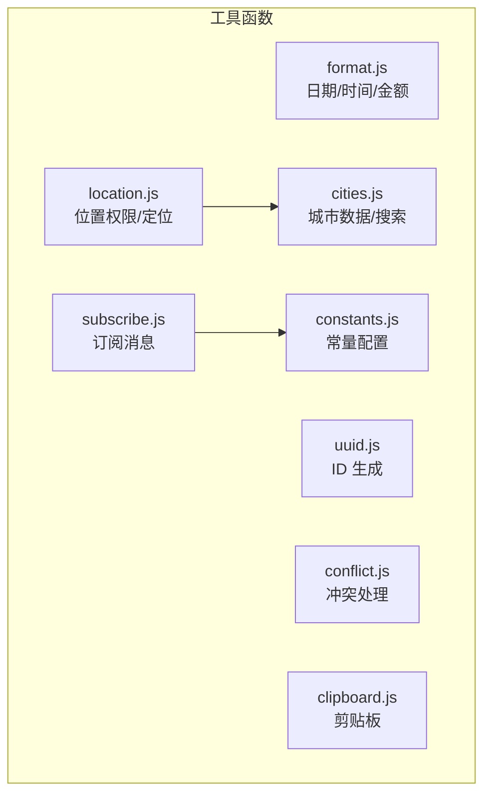
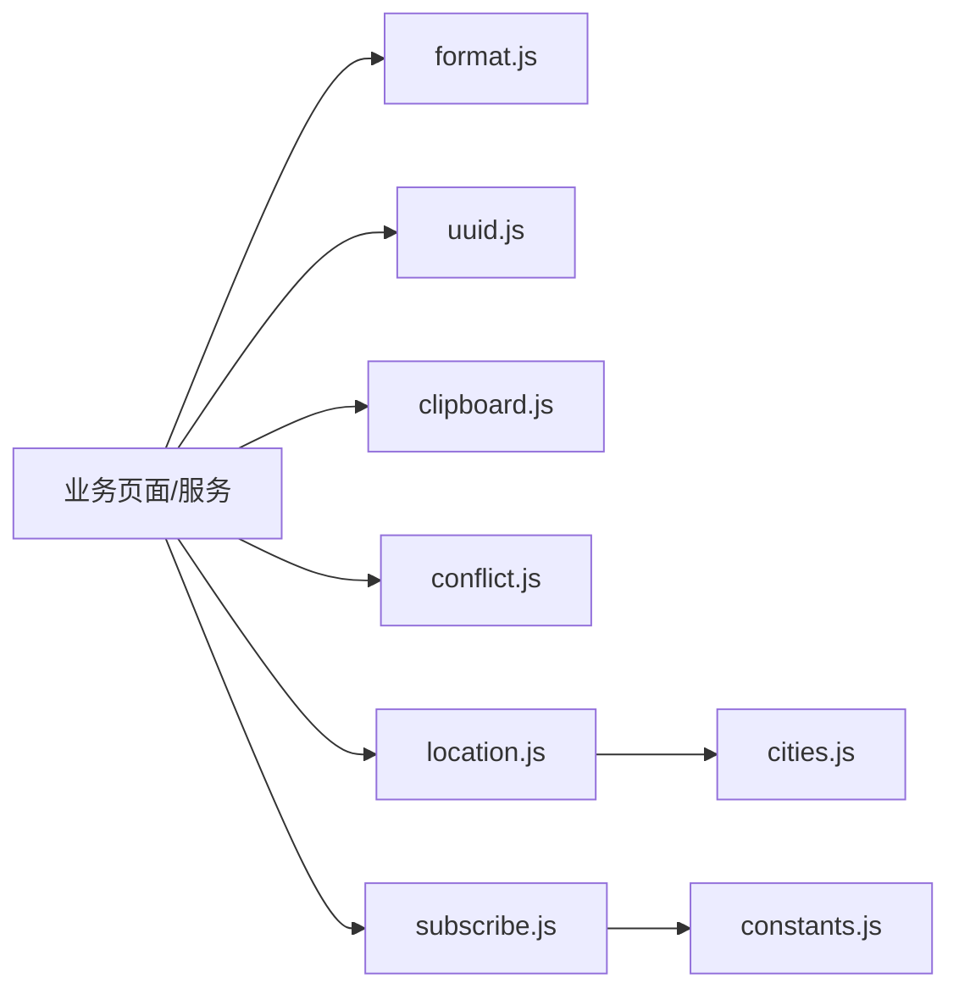
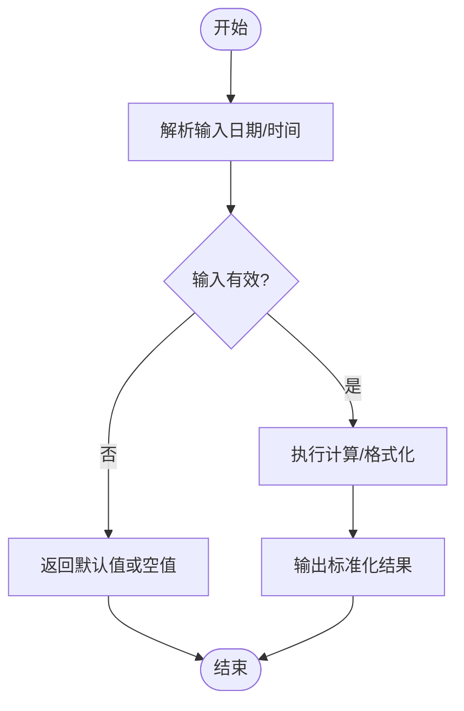
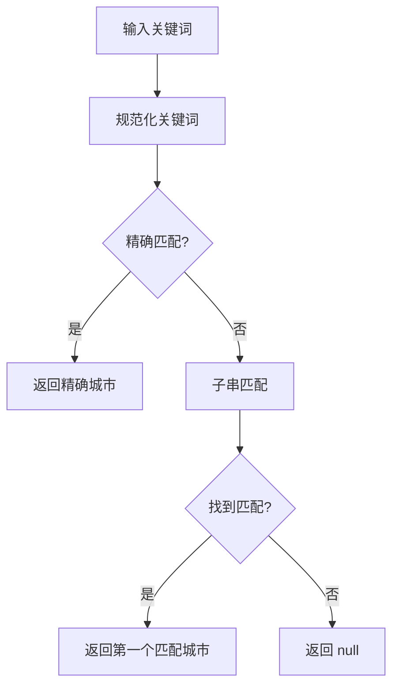
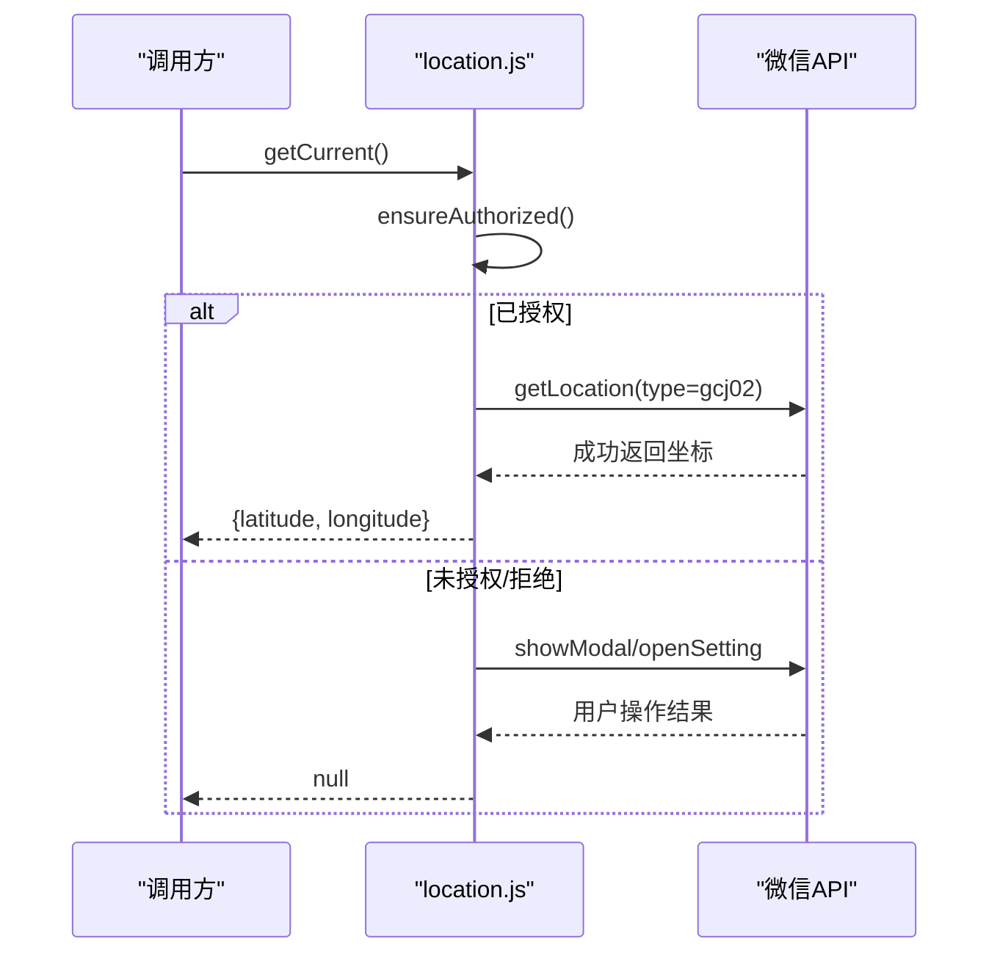
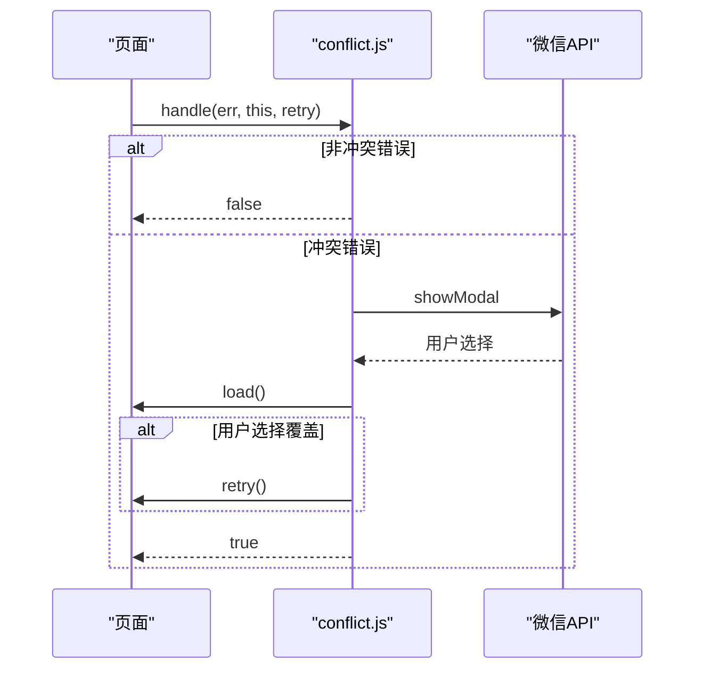
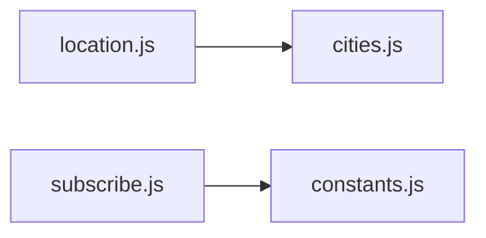

# 工具函数库

<cite>
**本文引用的文件**   
- [format.js](file://utils/format.js)
- [cities.js](file://utils/cities.js)
- [uuid.js](file://utils/uuid.js)
- [location.js](file://utils/location.js)
- [conflict.js](file://utils/conflict.js)
- [clipboard.js](file://utils/clipboard.js)
- [constants.js](file://utils/constants.js)
- [subscribe.js](file://utils/subscribe.js)
</cite>

## 目录
1. [简介](#简介)
2. [项目结构](#项目结构)
3. [核心组件](#核心组件)
4. [架构总览](#架构总览)
5. [详细组件分析](#详细组件分析)
6. [依赖关系分析](#依赖关系分析)
7. [性能与优化建议](#性能与优化建议)
8. [故障排查指南](#故障排查指南)
9. [结论](#结论)
10. [附录：常用用法速查](#附录常用用法速查)

## 简介
本工具函数库为小程序前端提供一组通用能力，覆盖日期与时间处理、金额格式化、城市数据与搜索、UUID 生成、地理位置权限与定位、冲突解决交互、剪贴板复制以及订阅消息请求等。所有工具以模块形式导出，便于在页面、服务层或云函数中按需引用。

设计目标：
- 统一输入输出格式，避免脏数据进入数据库
- 将易错逻辑封装为稳定 API
- 通过集中常量减少环境配置分散
- 对第三方能力（微信 API）进行统一封装与降级处理

## 项目结构
工具函数集中在 utils 目录下，按职责拆分：
- format.js：日期、时间、金额等格式化工具
- cities.js：城市坐标表与模糊匹配、搜索
- uuid.js：客户端唯一 ID 生成
- location.js：位置权限与定位的统一入口
- conflict.js：版本冲突的交互流程
- clipboard.js：剪贴板复制与提示
- constants.js：环境、集合名、分类、限制等常量
- subscribe.js：订阅消息授权与提醒

图表来源
- [location.js:4-4](file://utils/location.js#L4-L4)
- [subscribe.js:1-1](file://utils/subscribe.js#L1-L1)

章节来源
- [format.js:1-116](file://utils/format.js#L1-L116)
- [cities.js:1-144](file://utils/cities.js#L1-L144)
- [uuid.js:1-9](file://utils/uuid.js#L1-L9)
- [location.js:1-139](file://utils/location.js#L1-L139)
- [conflict.js:1-20](file://utils/conflict.js#L1-L20)
- [clipboard.js:1-17](file://utils/clipboard.js#L1-L17)
- [constants.js:1-48](file://utils/constants.js#L1-L48)
- [subscribe.js:1-32](file://utils/subscribe.js#L1-L32)

## 核心组件
本节概述各工具的职责、典型输入输出与错误处理策略。

- 日期与时间（format.js）
  - 功能：解析/格式化日期、计算天数差、时间段显示、分钟与时间字符串互转、今日与星期文本等
  - 输入：字符串型日期、数字分钟、时间字符串等
  - 输出：标准化日期字符串、可读文本、数值
  - 错误处理：非法输入返回空值或默认值，避免脏数据

- 城市数据（cities.js）
  - 功能：内置城市坐标表、名称规范化、精确/模糊匹配、关键词搜索
  - 输入：城市名、省份名、关键词
  - 输出：城市对象数组或单个城市对象
  - 错误处理：空输入返回空结果；不依赖外部地理编码接口

- UUID 生成（uuid.js）
  - 功能：基于时间与随机数生成短 ID
  - 输入：无
  - 输出：固定长度字符串
  - 错误处理：无异常抛出，适合离线重试与并发写场景

- 地理位置（location.js）
  - 功能：统一位置权限判断、引导设置、获取当前位置（gcj02）
  - 输入：无
  - 输出：经纬度对象或 null
  - 错误处理：未授权或失败时返回 null，调用方可降级

- 冲突处理（conflict.js）
  - 功能：捕获后端冲突错误，弹窗让用户选择刷新或覆盖保存
  - 输入：错误对象、页面实例、重试回调
  - 输出：布尔值表示是否已处理冲突
  - 错误处理：非冲突错误直接返回 false

- 剪贴板（clipboard.js）
  - 功能：复制文本并给出友好提示
  - 输入：文本、可选提示文案
  - 输出：无
  - 错误处理：失败时提示用户长按选择

- 订阅消息（subscribe.js）
  - 功能：请求订阅消息授权，模板未配置时明确提示
  - 输入：无
  - 输出：Promise，状态为 accept/reject/fail/missing
  - 错误处理：模板缺失时不发起请求，直接返回 missing

- 常量（constants.js）
  - 功能：集中管理环境 ID、云函数名、集合名、分类、限制、默认时间等
  - 使用方式：被其他工具或业务代码引入

章节来源
- [format.js:1-116](file://utils/format.js#L1-L116)
- [cities.js:1-144](file://utils/cities.js#L1-L144)
- [uuid.js:1-9](file://utils/uuid.js#L1-L9)
- [location.js:1-139](file://utils/location.js#L1-L139)
- [conflict.js:1-20](file://utils/conflict.js#L1-L20)
- [clipboard.js:1-17](file://utils/clipboard.js#L1-L17)
- [subscribe.js:1-32](file://utils/subscribe.js#L1-L32)
- [constants.js:1-48](file://utils/constants.js#L1-L48)

## 架构总览
工具函数之间耦合度低，主要依赖如下：
- location.js 依赖 cities.js 的城市数据用于地址语义判断
- subscribe.js 依赖 constants.js 中的模板 ID
- 其余工具相互独立，可单独复用

图表来源
- [location.js:4-4](file://utils/location.js#L4-L4)
- [subscribe.js:1-1](file://utils/subscribe.js#L1-L1)

## 详细组件分析

### 日期与时间工具（format.js）
职责与要点：
- 日期解析与格式化：统一使用 YYYY-MM-DD 字符串作为内部存储格式
- 时间显示：支持“约 X 小时 Y 分钟”、“X月Y日 周X”等展示文本
- 金额处理：以“分”为单位存储，展示时转为元，并提供纯数字格式化
- 时间转换：支持 HH:mm 与分钟数互转，并对边界值做归一化
- 区间计算：支持起止日期天数差与区间文本生成

关键函数说明（仅描述行为，不展示源码）：
- parseDate(value)：解析字符串日期，非法返回 null
- formatDate(date)：将 Date 对象格式化为 YYYY-MM-DD
- addDays(value, n)：对日期加 n 天，非法输入原样返回
- toDateText(value)：生成“X月Y日 周X”文本
- durationText(min)：根据分钟生成“约 X 小时 Y 分钟”文本
- moneyText(cents)/moneyPlain(cents)：金额展示与纯数字格式化
- toCents(text)：将用户输入的金额文本转为“分”，非法输入视为 0
- dayCount(start, end)：计算包含首尾的天数，非法返回 0
- dateRangeText(start, end)：生成区间展示文本
- timeToMin(text)/minToTime(min)：HH:mm 与分钟互转
- todayText()/weekdayText(value)：今日日期与星期文本

复杂度与性能：
- 均为 O(1) 操作，无循环与 I/O，性能开销极低
- 建议在列表渲染前预格式化，避免重复计算

错误处理：
- 输入校验严格，非法值返回空串、null 或 0，保证下游安全

图表来源
- [format.js:7-13](file://utils/format.js#L7-L13)
- [format.js:15-18](file://utils/format.js#L15-L18)
- [format.js:53-59](file://utils/format.js#L53-L59)

章节来源
- [format.js:1-116](file://utils/format.js#L1-L116)

### 城市数据与搜索（cities.js）
职责与要点：
- 内置城市坐标表，用于地图初始定位到目的地城市
- 名称规范化：去除空格与行政区划后缀，提升匹配鲁棒性
- 精确匹配优先，其次子串匹配
- 支持按城市名或省份搜索，最多返回 8 条

关键函数说明：
- normalize(text)：清洗输入，去除空白与常见行政区划后缀
- matchCity(text)：返回匹配到的城市对象或 null
- searchCities(keyword)：返回最多 8 个候选城市对象数组

复杂度与性能：
- 匹配与搜索基于数组遍历，时间复杂度 O(n)，n 为城市数量
- 城市数据量较小，单次查询开销可忽略

错误处理：
- 空输入返回 null 或空数组
- 不依赖外部地理编码接口，避免域名白名单与 Key 泄露

图表来源
- [cities.js:103-120](file://utils/cities.js#L103-L120)

章节来源
- [cities.js:1-144](file://utils/cities.js#L1-L144)

### UUID 生成（uuid.js）
职责与要点：
- 基于当前时间与随机数拼接生成短 ID
- 适用于客户端离线、重试、并发写场景，降低重复记录概率

关键函数说明：
- uuid()：返回固定长度的字符串 ID

复杂度与性能：
- O(1) 操作，无 I/O，性能极优

错误处理：
- 无异常抛出

章节来源
- [uuid.js:1-9](file://utils/uuid.js#L1-L9)

### 地理位置处理（location.js）
职责与要点：
- 统一位置权限入口：已授权直接使用；未询问则弹系统授权；拒绝过则引导去设置页
- 地址回填质检：识别“只是行政区名”或“地址串被回填成名称”的情况，提示用户补充具体地点
- 获取当前位置：返回 gcj02 坐标，与地图组件一致

关键函数说明：
- ensureAuthorized()：确保位置权限，返回布尔值
- getCurrent()：返回 {latitude, longitude} 或 null
- isVaguePlaceName(name, address)：判断是否为模糊地点名

权限与降级流程：

图表来源
- [location.js:94-132](file://utils/location.js#L94-L132)

章节来源
- [location.js:1-139](file://utils/location.js#L1-L139)

### 冲突解决（conflict.js）
职责与要点：
- 当后端返回冲突错误时，弹窗提示用户刷新或覆盖保存
- 刷新后重新执行一次写入动作

关键函数说明：
- handle(err, page, retry)：处理冲突错误，返回 true 表示已处理

交互流程：

图表来源
- [conflict.js:3-17](file://utils/conflict.js#L3-L17)

章节来源
- [conflict.js:1-20](file://utils/conflict.js#L1-L20)

### 剪贴板（clipboard.js）
职责与要点：
- 复制文本并给出友好提示
- 兼容部分基础库自带提示，先隐藏再显示自定义提示

关键函数说明：
- copy(text, tip)：复制文本并提示

错误处理：
- 复制失败时提示用户长按选择

章节来源
- [clipboard.js:1-17](file://utils/clipboard.js#L1-L17)

### 订阅消息（subscribe.js）
职责与要点：
- 请求订阅消息授权，模板未配置时明确提示
- 返回 Promise，区分 accept/reject/fail/missing

关键函数说明：
- requestReminder()：请求订阅消息授权

错误处理：
- 模板缺失时直接返回 missing，不发起请求

章节来源
- [subscribe.js:1-32](file://utils/subscribe.js#L1-L32)

### 常量（constants.js）
职责与要点：
- 集中管理环境 ID、云函数名、集合名、分类、限制、默认时间等
- 便于统一修改与多环境切换

常用字段：
- ENV_ID、CLOUD_FUNCTION
- COLLECTIONS：USERS/TRIPS/POIS/EXPENSES
- POI_CATEGORIES、EXPENSE_CATEGORIES
- MESSAGE_TEMPLATES.tripReminder
- DURATIONS、LIMITS、DEFAULT_START、BUFFER_MIN

章节来源
- [constants.js:1-48](file://utils/constants.js#L1-L48)

## 依赖关系分析
- location.js 依赖 cities.js 的城市数据用于地址语义判断
- subscribe.js 依赖 constants.js 的模板 ID
- 其他工具相互独立

图表来源
- [location.js:4-4](file://utils/location.js#L4-L4)
- [subscribe.js:1-1](file://utils/subscribe.js#L1-L1)

章节来源
- [location.js:1-139](file://utils/location.js#L1-L139)
- [subscribe.js:1-32](file://utils/subscribe.js#L1-L32)

## 性能与优化建议
- 日期与金额格式化
  - 尽量在数据加载阶段完成格式化，避免在渲染循环中重复计算
  - 对频繁使用的文本（如“今日”“本周”）可做缓存
- 城市搜索
  - 城市数据量小，当前线性扫描足够；若未来扩展至数百上千个城市，可考虑建立索引或二分查找
- 地理位置
  - 仅在必要时触发 wx.getLocation，避免频繁定位耗电
  - 对定位结果做短时缓存，减少重复请求
- UUID 生成
  - 客户端生成 ID 成本低，可在创建记录前立即生成，避免后续重试导致不一致
- 冲突处理
  - 将 retry 回调绑定到最新 state，避免闭包陈旧导致状态不同步
- 剪贴板
  - 批量复制时合并为一次操作，减少 UI 提示抖动

[本节为通用指导，无需特定文件引用]

## 故障排查指南
常见问题与处理建议：
- 日期解析为空
  - 检查输入是否为 YYYY-MM-DD 格式；非法输入会被解析为 null
  - 参考：[format.js:7-13](file://utils/format.js#L7-L13)
- 金额显示异常
  - 确认传入的是“分”而非“元”；toCents 会将合法文本转为分，非法视为 0
  - 参考：[format.js:53-59](file://utils/format.js#L53-L59)
- 城市搜索无结果
  - 检查关键词是否包含空白或多余后缀；normalize 会清理常见后缀
  - 参考：[cities.js:103-120](file://utils/cities.js#L103-L120)
- 位置权限被拒
  - 使用 ensureAuthorized 统一处理；若用户拒绝，引导至设置页
  - 参考：[location.js:94-111](file://utils/location.js#L94-L111)
- 订阅消息未生效
  - 检查 constants.js 中模板 ID 是否配置；未配置时会返回 missing
  - 参考：[subscribe.js:5-16](file://utils/subscribe.js#L5-L16)
- 冲突保存失败
  - 使用 conflict.handle 包裹保存逻辑；确保 retry 读取最新 data
  - 参考：[conflict.js:3-17](file://utils/conflict.js#L3-L17)

章节来源
- [format.js:7-13](file://utils/format.js#L7-L13)
- [format.js:53-59](file://utils/format.js#L53-L59)
- [cities.js:103-120](file://utils/cities.js#L103-L120)
- [location.js:94-111](file://utils/location.js#L94-L111)
- [subscribe.js:5-16](file://utils/subscribe.js#L5-L16)
- [conflict.js:3-17](file://utils/conflict.js#L3-L17)

## 结论
本工具函数库围绕“稳定、可复用、易维护”的目标，提供了日期时间、金额、城市数据、UUID、地理位置、冲突处理、剪贴板与订阅消息等核心能力。通过统一的输入输出规范与错误处理策略，降低了业务层的出错概率与维护成本。建议在各页面与服务中优先复用这些工具，避免重复实现与不一致行为。

[本节为总结性内容，无需特定文件引用]

## 附录：常用用法速查
- 日期与时间
  - 解析与格式化：parseDate、formatDate
  - 日期加减：addDays
  - 文本展示：toDateText、durationText、dateRangeText、todayText、weekdayText
  - 时间转换：timeToMin、minToTime
  - 参考路径：[format.js:7-18](file://utils/format.js#L7-L18)、[format.js:27-40](file://utils/format.js#L27-L40)、[format.js:61-88](file://utils/format.js#L61-L88)、[format.js:90-97](file://utils/format.js#L90-L97)

- 金额处理
  - 展示：moneyText
  - 纯数字：moneyPlain
  - 输入转分：toCents
  - 参考路径：[format.js:42-59](file://utils/format.js#L42-L59)

- 城市数据
  - 精确匹配：matchCity
  - 关键词搜索：searchCities
  - 参考路径：[cities.js:103-137](file://utils/cities.js#L103-L137)

- UUID
  - 生成 ID：uuid
  - 参考路径：[uuid.js:2-6](file://utils/uuid.js#L2-L6)

- 地理位置
  - 权限与定位：ensureAuthorized、getCurrent
  - 地址质检：isVaguePlaceName
  - 参考路径：[location.js:94-132](file://utils/location.js#L94-L132)、[location.js:35-48](file://utils/location.js#L35-L48)

- 冲突处理
  - 统一处理：handle
  - 参考路径：[conflict.js:3-17](file://utils/conflict.js#L3-L17)

- 剪贴板
  - 复制文本：copy
  - 参考路径：[clipboard.js:1-14](file://utils/clipboard.js#L1-L14)

- 订阅消息
  - 请求授权：requestReminder
  - 参考路径：[subscribe.js:5-29](file://utils/subscribe.js#L5-L29)

- 常量
  - 环境与集合：ENV_ID、CLOUD_FUNCTION、COLLECTIONS
  - 分类与限制：POI_CATEGORIES、EXPENSE_CATEGORIES、DURATIONS、LIMITS
  - 默认时间：DEFAULT_START、BUFFER_MIN
  - 参考路径：[constants.js:1-48](file://utils/constants.js#L1-L48)