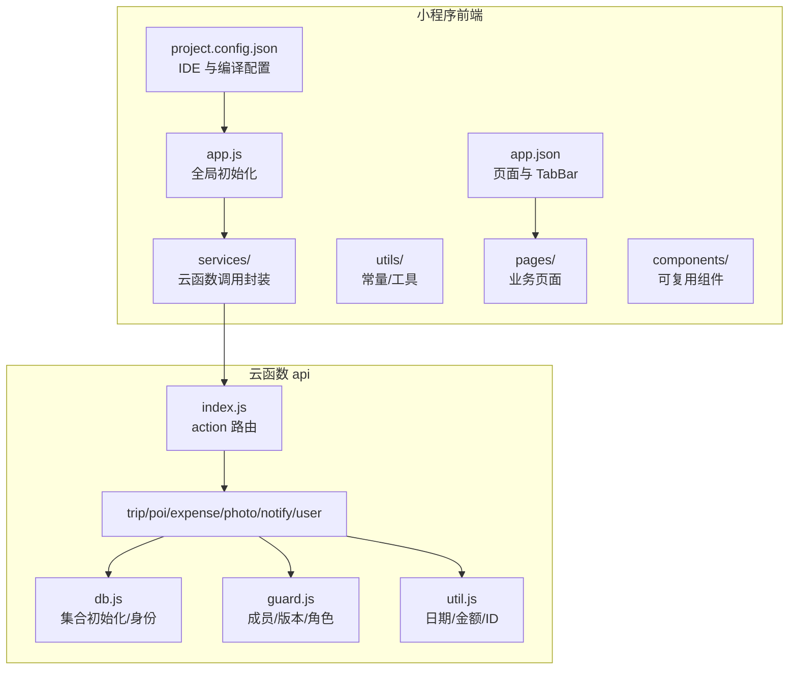
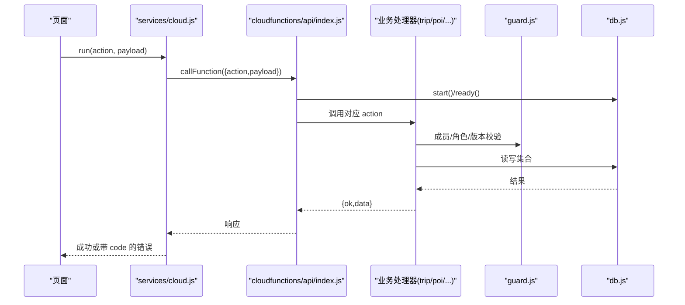
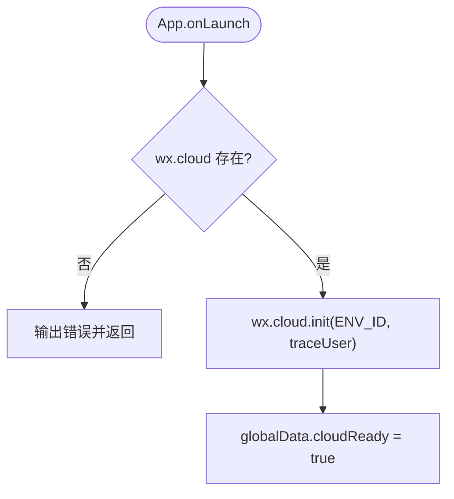
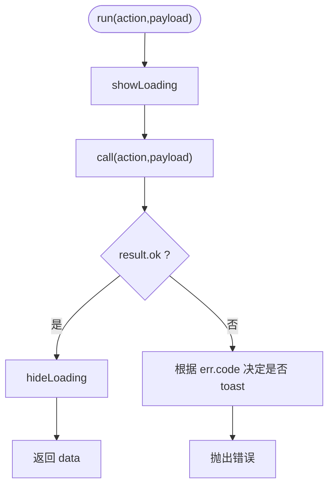
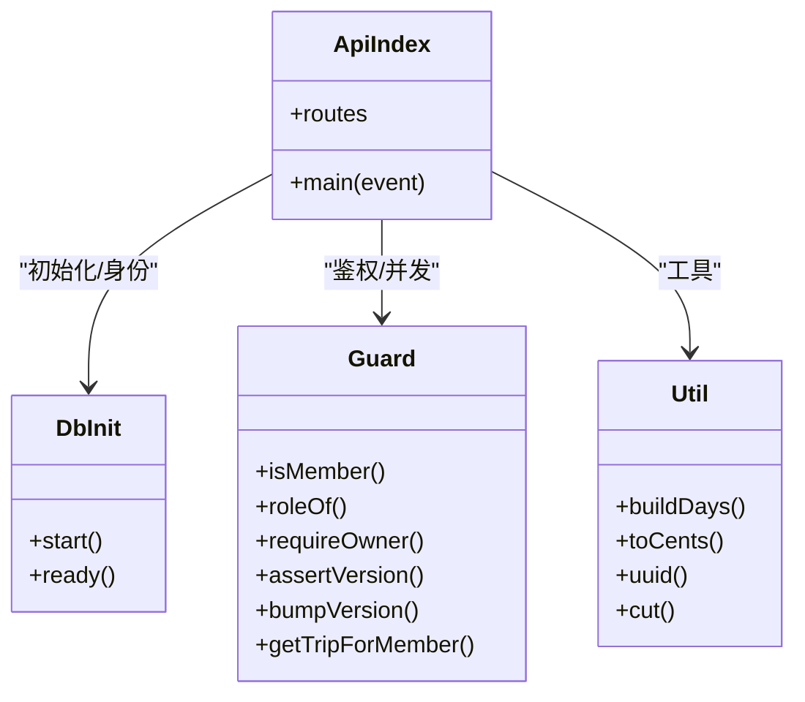
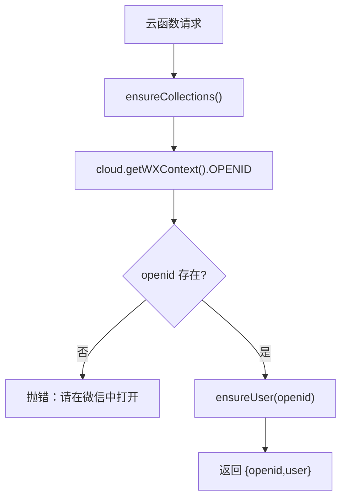
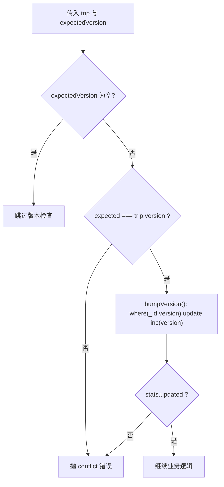
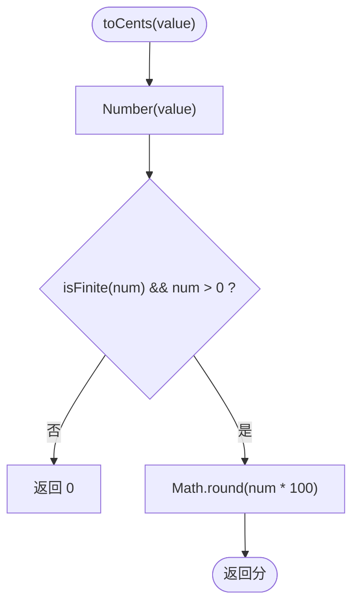
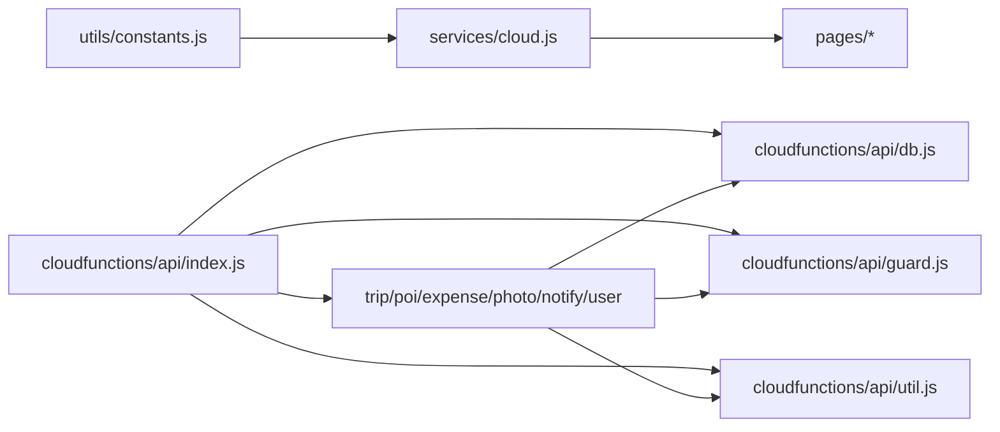

# 开发指南

<cite>
**本文引用的文件**   
- [app.js](file://app.js)
- [app.json](file://app.json)
- [project.config.json](file://project.config.json)
- [方案.md](file://docs/方案.md)
- [services/cloud.js](file://services/cloud.js)
- [utils/constants.js](file://utils/constants.js)
- [cloudfunctions/api/index.js](file://cloudfunctions/api/index.js)
- [cloudfunctions/api/db.js](file://cloudfunctions/api/db.js)
- [cloudfunctions/api/guard.js](file://cloudfunctions/api/guard.js)
- [cloudfunctions/api/util.js](file://cloudfunctions/api/util.js)
</cite>

## 目录
1. [引言](#引言)
2. [项目结构](#项目结构)
3. [核心组件](#核心组件)
4. [架构总览](#架构总览)
5. [详细组件分析](#详细组件分析)
6. [依赖关系分析](#依赖关系分析)
7. [性能与容量特性](#性能与容量特性)
8. [调试与测试方法](#调试与测试方法)
9. [扩展与集成指南](#扩展与集成指南)
10. [代码规范与最佳实践](#代码规范与最佳实践)
11. [贡献与提交规范](#贡献与提交规范)
12. [故障排查](#故障排查)
13. [结论](#结论)

## 引言
本指南面向“旅行计划”小程序的开发者，目标是帮助你在本地快速搭建开发环境、理解系统架构、遵循代码规范、完成功能扩展与第三方服务集成，并掌握调试、测试与性能优化方法。文档同时给出贡献代码的流程建议与提交规范，便于团队协作。

本项目是一个基于微信云开发的旅行行程与记账小程序：前端负责页面与交互，后端通过单个云函数 `api` 统一路由到不同业务模块；数据库集合由云函数自动创建，权限集中在服务端，前端不直连数据库。

## 项目结构
项目采用小程序标准目录组织方式，并按职责分层：
- 应用入口与全局配置：`app.js`、`app.json`、`app.wxss`、`project.config.json`
- 页面：`pages/`，按功能域分目录（行程、记账、地点、我的等）
- 可复用组件：`components/`
- 前端服务封装：`services/`，统一调用云函数
- 工具函数：`utils/`，存放常量、格式化、定位、订阅消息等
- 云函数：`cloudfunctions/api/`，包含 action 路由、数据库初始化、鉴权、工具函数与各业务处理器

**图表来源**
- [app.js:1-22](file://app.js#L1-L22)
- [app.json:1-56](file://app.json#L1-L56)
- [project.config.json:1-53](file://project.config.json#L1-L53)
- [services/cloud.js:1-50](file://services/cloud.js#L1-L50)
- [cloudfunctions/api/index.js:1-77](file://cloudfunctions/api/index.js#L1-L77)
- [cloudfunctions/api/db.js:1-61](file://cloudfunctions/api/db.js#L1-L61)
- [cloudfunctions/api/guard.js:1-76](file://cloudfunctions/api/guard.js#L1-L76)
- [cloudfunctions/api/util.js:1-60](file://cloudfunctions/api/util.js#L1-L60)

**章节来源**
- [app.js:1-22](file://app.js#L1-L22)
- [app.json:1-56](file://app.json#L1-L56)
- [project.config.json:1-53](file://project.config.json#L1-L53)
- [方案.md:72-95](file://docs/方案.md#L72-L95)

## 核心组件
- 应用初始化与云开发接入：在应用启动时检查基础库是否支持云开发，并初始化云环境。
- 全局配置：定义页面路由、TabBar、隐私接口声明与权限说明。
- 云函数调用层：统一封装 `call` 与 `run`，处理 loading、错误提示与冲突分支。
- 云函数入口：action 路由分发、定时任务处理、异常统一返回。
- 数据库与身份：集合自动创建、用户信息兜底、从上下文取 openid。
- 鉴权与并发控制：成员校验、角色判断、乐观锁版本号与原子更新。
- 通用工具：日期、金额、ID、文本截断等。

**章节来源**
- [app.js:10-20](file://app.js#L10-L20)
- [app.json:1-56](file://app.json#L1-L56)
- [services/cloud.js:1-50](file://services/cloud.js#L1-L50)
- [cloudfunctions/api/index.js:10-77](file://cloudfunctions/api/index.js#L10-L77)
- [cloudfunctions/api/db.js:1-61](file://cloudfunctions/api/db.js#L1-L61)
- [cloudfunctions/api/guard.js:1-76](file://cloudfunctions/api/guard.js#L1-L76)
- [cloudfunctions/api/util.js:1-60](file://cloudfunctions/api/util.js#L1-L60)

## 架构总览
整体采用“前端轻量 + 云函数集中处理”的架构：
- 前端只负责展示与交互，所有写操作通过 `services/cloud.js` 调用云函数 `api`。
- 云函数内部按 action 路由到具体业务模块，统一进行身份获取、数据校验、权限控制与并发控制。
- 数据库集合首次访问时自动创建，索引建议在数据量增长后在控制台补充。
- 地图与定位能力通过微信小程序原生 API 实现，选点与导航走微信生态。

**图表来源**
- [services/cloud.js:1-50](file://services/cloud.js#L1-L50)
- [cloudfunctions/api/index.js:10-77](file://cloudfunctions/api/index.js#L10-L77)
- [cloudfunctions/api/db.js:1-61](file://cloudfunctions/api/db.js#L1-L61)
- [cloudfunctions/api/guard.js:1-76](file://cloudfunctions/api/guard.js#L1-L76)

## 详细组件分析

### 应用初始化与全局配置
- 应用启动时检测云开发基础库版本，若不支持则输出错误并终止初始化。
- 初始化云环境并设置跟踪用户行为，随后标记云环境就绪。
- 全局配置中注册页面路径、TabBar、隐私接口与权限描述。

**图表来源**
- [app.js:10-20](file://app.js#L10-L20)

**章节来源**
- [app.js:1-22](file://app.js#L1-L22)
- [app.json:1-56](file://app.json#L1-L56)

### 云函数调用层
- `call`：统一发起 `wx.cloud.callFunction`，将成功结果 resolve，失败 reject，并将服务端返回的 `code` 附加到错误对象上。
- `run`：包装 `call`，提供 loading 状态、统一 toast 提示，并对 `conflict` 错误做特殊处理，避免打扰用户。

**图表来源**
- [services/cloud.js:1-50](file://services/cloud.js#L1-L50)

**章节来源**
- [services/cloud.js:1-50](file://services/cloud.js#L1-L50)

### 云函数入口与路由
- 单个云函数 `api` 暴露 `main`，根据 `event.action` 路由到具体 handler。
- 定时触发器不走 action 路由，直接执行提醒发送逻辑。
- 所有请求通过 `start()` 获取 openid 与用户信息，确保身份可信。
- 异常统一捕获，返回 `{ ok:false, message, code }`，其中 `code` 用于客户端区分冲突等场景。

**图表来源**
- [cloudfunctions/api/index.js:1-77](file://cloudfunctions/api/index.js#L1-L77)
- [cloudfunctions/api/db.js:1-61](file://cloudfunctions/api/db.js#L1-L61)
- [cloudfunctions/api/guard.js:1-76](file://cloudfunctions/api/guard.js#L1-L76)
- [cloudfunctions/api/util.js:1-60](file://cloudfunctions/api/util.js#L1-L60)

**章节来源**
- [cloudfunctions/api/index.js:10-77](file://cloudfunctions/api/index.js#L10-L77)
- [cloudfunctions/api/db.js:1-61](file://cloudfunctions/api/db.js#L1-L61)
- [cloudfunctions/api/guard.js:1-76](file://cloudfunctions/api/guard.js#L1-L76)
- [cloudfunctions/api/util.js:1-60](file://cloudfunctions/api/util.js#L1-L60)

### 数据库与身份管理
- 首次访问自动创建集合，幂等且缓存 Promise，避免重复创建。
- 每次请求通过 `start()` 获取 openid，不存在则抛错；首次调用自动创建用户记录。
- 定时任务使用 `ready()` 仅保证集合存在，无需用户身份。

**图表来源**
- [cloudfunctions/api/db.js:1-61](file://cloudfunctions/api/db.js#L1-L61)

**章节来源**
- [cloudfunctions/api/db.js:1-61](file://cloudfunctions/api/db.js#L1-L61)

### 鉴权与并发控制
- 成员校验：通过 `memberOpenids` 数组判断是否为同行。
- 角色判断：兼容老数据，默认 owner/editor。
- 乐观锁：客户端传版本号，服务端用 `where({_id, version})` 原子更新，防止覆盖写入。
- 版本冲突：抛出带 `code:'conflict'` 的错误，前端可选择刷新或覆盖保存。

**图表来源**
- [cloudfunctions/api/guard.js:20-42](file://cloudfunctions/api/guard.js#L20-L42)

**章节来源**
- [cloudfunctions/api/guard.js:1-76](file://cloudfunctions/api/guard.js#L1-L76)

### 工具函数
- 日期解析与格式化：保证日期格式一致，构建行程天数。
- 金额转换：统一以“分”存储，避免浮点误差。
- ID 生成与文本截断：保证唯一性与长度限制。

**图表来源**
- [cloudfunctions/api/util.js:44-49](file://cloudfunctions/api/util.js#L44-L49)

**章节来源**
- [cloudfunctions/api/util.js:1-60](file://cloudfunctions/api/util.js#L1-L60)

## 依赖关系分析
- 前端依赖 `utils/constants.js` 中的环境变量与集合名，以及 `services/cloud.js` 的统一调用封装。
- 云函数 `index.js` 依赖 `db.js`、`guard.js`、`util.js` 与各业务处理器。
- 业务处理器依赖 `guard.js` 进行成员与角色校验，依赖 `db.js` 进行数据读写。
- 常量集中管理，便于切换环境与统一约束。

**图表来源**
- [utils/constants.js:1-48](file://utils/constants.js#L1-L48)
- [services/cloud.js:1-50](file://services/cloud.js#L1-L50)
- [cloudfunctions/api/index.js:1-77](file://cloudfunctions/api/index.js#L1-L77)
- [cloudfunctions/api/db.js:1-61](file://cloudfunctions/api/db.js#L1-L61)
- [cloudfunctions/api/guard.js:1-76](file://cloudfunctions/api/guard.js#L1-L76)
- [cloudfunctions/api/util.js:1-60](file://cloudfunctions/api/util.js#L1-L60)

**章节来源**
- [utils/constants.js:1-48](file://utils/constants.js#L1-L48)
- [services/cloud.js:1-50](file://services/cloud.js#L1-L50)
- [cloudfunctions/api/index.js:1-77](file://cloudfunctions/api/index.js#L1-L77)

## 性能与容量特性
- 单云函数承载多个 action，部署简单但随 action 增多可能影响冷启动与体积。
- 列表与明细查询未分页，单行程点位/账目超过阈值会被截断，后续需加分页游标。
- 并发控制采用整趟粒度乐观锁，多人同时改不同地点也会冲突，后续可细化到点位级版本。
- 数据库索引已建关键组合索引，数据量增长后可补充更多索引以提升查询性能。
- 手帐照片无体积限制，大量原图会持续占用云存储空间，后续应加体积限制与清理策略。

[本节为通用性能讨论，不直接分析具体文件]

## 调试与测试方法
- 基础库要求：云开发需要基础库 2.2.3 以上，否则无法初始化。
- 模拟器限制：
  - `wx.chooseLocation` 在开发者工具中返回固定模拟位置，真机才正常。
  - `moveToLocation` 在模拟器不支持，真机正常。
- 权限与隐私：
  - 需在小程序后台开通 `chooseLocation`、`getLocation` 接口。
  - 隐私协议中勾选位置信息。
- 云函数部署：
  - 使用命令行部署云函数，部署后核对触发器是否创建成功。
- 订阅消息：
  - 模板字段名必须与公众平台一致，不一致会报特定错误码，日志可见。
  - 定时触发器每天 20:00 发送出发提醒，需在控制台确认触发器存在。

**章节来源**
- [app.js:10-20](file://app.js#L10-L20)
- [方案.md:248-294](file://docs/方案.md#L248-L294)

## 扩展与集成指南

### 添加新页面
- 在 `app.json` 的 `pages` 数组中注册页面路径。
- 如需加入 TabBar，在 `tabBar.list` 中添加条目。
- 页面逻辑放在 `pages/<feature>/` 目录下，样式与模板分离。

**章节来源**
- [app.json:1-56](file://app.json#L1-L56)

### 添加新组件
- 在 `components/` 下新建组件目录，包含 `.js`、`.json`、`.wxml`、`.wxss`。
- 组件 props 建议使用小写单词，避免 WXML 属性映射问题。
- 组件样式可通过 `styleIsolation: 'apply-shared'` 复用全局样式。

**章节来源**
- [方案.md:269-279](file://docs/方案.md#L269-L279)

### 新增云函数 action
- 在 `cloudfunctions/api/index.js` 的 `routes` 中注册新的 action 与处理器。
- 在对应业务处理器文件中实现逻辑，并通过 `guard.js` 进行鉴权与并发控制。
- 如需新增集合，在 `db.js` 的 `COLLECTIONS` 中登记，首次访问会自动创建。

**章节来源**
- [cloudfunctions/api/index.js:10-41](file://cloudfunctions/api/index.js#L10-L41)
- [cloudfunctions/api/db.js:9-27](file://cloudfunctions/api/db.js#L9-L27)

### 集成第三方服务
- 当前项目未直接集成第三方地理编码或地图服务，以避免 Key 泄露与域名白名单问题。
- 如需接入，建议通过云函数中转，避免在前端暴露敏感配置。
- 订阅消息模板 id 集中在 `utils/constants.js`，修改一处即可生效。

**章节来源**
- [方案.md:248-266](file://docs/方案.md#L248-L266)
- [utils/constants.js:18-21](file://utils/constants.js#L18-L21)

## 代码规范与最佳实践
- 分层清晰：页面只写业务，接口全走 `services/`，纯函数放 `utils/`。
- WXML 不做复杂计算：时长、日期文案、百分比宽度等在 JS 预计算。
- 组件 props 命名简洁：使用小写单词，避免映射坑。
- 日切换组件契约固定：数组长度变化时需夹取合法范围。
- 样式 token 统一：主色、危险色、正文色、卡片圆角、底部安全区。
- 文案基调：说人话，承认边界，不承诺做不到的事。
- 云函数目录拍平：函数根目录下不能有子目录或残留空目录，否则部署报错。
- 改完代码重启 IDE：避免旧进程仍在运行。

**章节来源**
- [方案.md:269-279](file://docs/方案.md#L269-L279)

## 贡献与提交规范
- 功能范围、数据字段、接口 action、验收结论发生变化时，同步更新产品与技术主文档。
- 模块内部实现细节写在代码注释里，不在主文档重复。
- 建议提交前自检：
  - 页面文件、JSON、`usingComponents`、`require` 路径、tabBar 注册全绿。
  - JS 语法检查 0 错误。
  - 核心流程在模拟器或真机走通。
- 提交信息建议包含：
  - 变更类型（feat/fix/chore/docs）
  - 简要描述
  - 关联 issue 或需求编号

[本节为通用协作建议，不直接分析具体文件]

## 故障排查
- 云开发基础库不支持：检查基础库版本，升级到 2.2.3 以上。
- 云函数调用失败：检查网络、云函数部署状态、action 名称是否正确。
- 版本冲突：客户端收到 `code:'conflict'`，提示刷新或覆盖保存。
- 权限不足：检查是否为行程成员或创建者。
- 订阅消息未到达：检查模板字段名是否与公众平台一致，确认触发器存在。
- 地图与定位异常：检查权限授权与后台接口配置，真机复测。

**章节来源**
- [app.js:10-20](file://app.js#L10-L20)
- [services/cloud.js:32-47](file://services/cloud.js#L32-L47)
- [cloudfunctions/api/guard.js:20-42](file://cloudfunctions/api/guard.js#L20-L42)
- [方案.md:298-334](file://docs/方案.md#L298-L334)

## 结论
本指南梳理了“旅行计划”小程序的开发环境、架构设计、核心组件、扩展方法与协作规范。通过统一的云函数入口、集中的鉴权与并发控制、以及清晰的工程约定，项目在保持简洁的同时具备良好的可扩展性。建议在后续迭代中逐步完善分页、离线能力、头像昵称展示与数据导出等功能，进一步提升用户体验与系统健壮性。