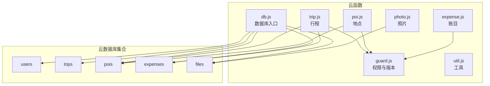
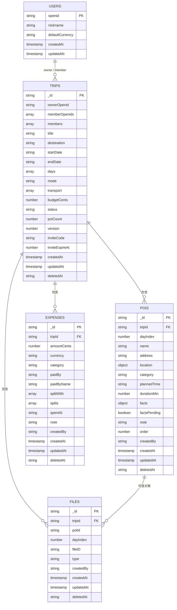
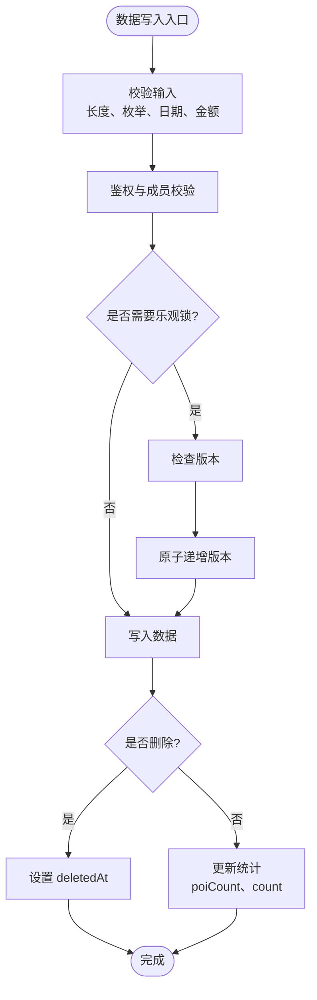
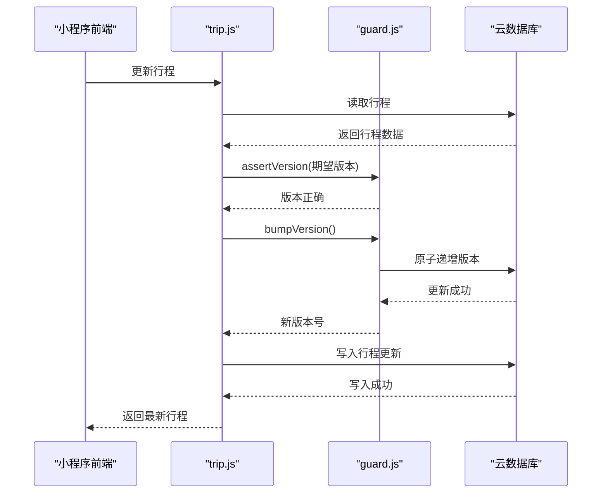

# 数据模型设计

<cite>
**本文引用的文件**   
- [cloudfunctions/api/db.js](file://cloudfunctions/api/db.js)
- [cloudfunctions/api/trip.js](file://cloudfunctions/api/trip.js)
- [cloudfunctions/api/expense.js](file://cloudfunctions/api/expense.js)
- [cloudfunctions/api/poi.js](file://cloudfunctions/api/poi.js)
- [cloudfunctions/api/photo.js](file://cloudfunctions/api/photo.js)
- [cloudfunctions/api/guard.js](file://cloudfunctions/api/guard.js)
- [cloudfunctions/api/util.js](file://cloudfunctions/api/util.js)
- [cloudfunctions/api/config.json](file://cloudfunctions/api/config.json)
</cite>

## 目录
1. [引言](#引言)
2. [项目结构与数据边界](#项目结构与数据边界)
3. [核心实体与关系](#核心实体与关系)
4. [字段定义与数据类型](#字段定义与数据类型)
5. [主键、外键、索引与约束](#主键外键索引与约束)
6. [数据验证规则与业务规则](#数据验证规则与业务规则)
7. [数据库模式图](#数据库模式图)
8. [示例数据说明](#示例数据说明)
9. [数据访问模式与一致性策略](#数据访问模式与一致性策略)
10. [缓存、聚合与性能考虑](#缓存聚合与性能考虑)
11. [数据生命周期、保留与归档](#数据生命周期保留与归档)
12. [数据迁移与版本管理](#数据迁移与版本管理)
13. [数据安全、隐私与访问控制](#数据安全隐私与访问控制)
14. [常见问题排查](#常见问题排查)
15. [结论](#结论)

## 引言
本文件面向“旅行行程与记账”小程序后端的数据模型，目标是用统一视角说明云数据库中的集合、字段、关系、约束、索引、校验规则、一致性机制、性能策略、生命周期、迁移路径与安全控制。该项目的数据层基于微信云开发的文档数据库，通过云函数暴露接口；所有写逻辑集中在服务端，避免前端直接操作数据库。

## 项目结构与数据边界
数据模型由一组云函数共同维护：
- `db.js`：初始化数据库、声明集合、保证集合存在、获取当前用户身份。
- `trip.js`：行程的创建、更新、删除、邀请、加入、退出、复制等。
- `poi.js`：行程地点（景点、餐饮等）的增删改查与重排。
- `expense.js`：行程账目的增删改查、汇总、AA结算。
- `photo.js`：手帐照片记录，实际图片存储在云存储，数据库只存引用。
- `guard.js`：成员权限、角色判断、乐观锁版本号检查与递增。
- `util.js`：日期、金额、截断、UUID 等通用工具。
- `config.json`：云函数定时触发器与消息订阅权限。

**图表来源**
- [cloudfunctions/api/db.js:9-60](file://cloudfunctions/api/db.js#L9-L60)
- [cloudfunctions/api/trip.js:1-88](file://cloudfunctions/api/trip.js#L1-L88)
- [cloudfunctions/api/poi.js:1-71](file://cloudfunctions/api/poi.js#L1-L71)
- [cloudfunctions/api/expense.js:1-103](file://cloudfunctions/api/expense.js#L1-L103)
- [cloudfunctions/api/photo.js:1-40](file://cloudfunctions/api/photo.js#L1-L40)
- [cloudfunctions/api/guard.js:1-75](file://cloudfunctions/api/guard.js#L1-L75)

**章节来源**
- [cloudfunctions/api/db.js:1-60](file://cloudfunctions/api/db.js#L1-L60)
- [cloudfunctions/api/config.json:1-15](file://cloudfunctions/api/config.json#L1-L15)

## 核心实体与关系
系统围绕“人—行程—地点—账目—照片”展开：
- **用户 users**：最小化身份与偏好，包含 openid、昵称、默认币种、时间戳。
- **行程 trips**：一次旅行的主体，包含成员、日期段、状态、预算、邀请码、版本号等。
- **地点 pois**：行程中按天安排的地点，包含名称、地址、位置、分类、计划时间、时长、事实信息、排序等。
- **账目 expenses**：行程花费明细，包含金额、分类、付款人、分摊、消费时间、备注等。
- **文件 files**：手帐照片元数据，仅存云存储 fileID，不存图片二进制。

关系要点：
- 一个用户可属于多个行程。
- 一个行程有多个地点和多个账目。
- 一个照片记录关联到行程，可选关联到某个地点。
- 所有子资源都通过 `tripId` 归属到行程。
- 软删除广泛使用 `deletedAt`，历史数据保留用于回放与审计。

**图表来源**
- [cloudfunctions/api/db.js:9-60](file://cloudfunctions/api/db.js#L9-L60)
- [cloudfunctions/api/trip.js:50-88](file://cloudfunctions/api/trip.js#L50-L88)
- [cloudfunctions/api/poi.js:73-143](file://cloudfunctions/api/poi.js#L73-L143)
- [cloudfunctions/api/expense.js:132-184](file://cloudfunctions/api/expense.js#L132-L184)
- [cloudfunctions/api/photo.js:19-40](file://cloudfunctions/api/photo.js#L19-L40)

**章节来源**
- [cloudfunctions/api/trip.js:50-88](file://cloudfunctions/api/trip.js#L50-L88)
- [cloudfunctions/api/poi.js:73-143](file://cloudfunctions/api/poi.js#L73-L143)
- [cloudfunctions/api/expense.js:132-184](file://cloudfunctions/api/expense.js#L132-L184)
- [cloudfunctions/api/photo.js:19-40](file://cloudfunctions/api/photo.js#L19-L40)

## 字段定义与数据类型
以下字段类型以云数据库常见类型为准：字符串、数字、布尔值、数组、对象、时间戳、日期字符串。

### 用户 users
| 字段 | 类型 | 是否必填 | 说明 |
| --- | --- | --- | --- |
| `openid` | 字符串 | 是 | 微信用户唯一标识，作为主键。 |
| `nickname` | 字符串 | 否 | 用户昵称，可为空。 |
| `defaultCurrency` | 字符串 | 否 | 默认币种，默认值为 CNY。 |
| `createdAt` | 时间戳 | 是 | 创建时间。 |
| `updatedAt` | 时间戳 | 是 | 更新时间。 |

### 行程 trips
| 字段 | 类型 | 是否必填 | 说明 |
| --- | --- | --- | --- |
| `_id` | 字符串 | 是 | 行程主键，由客户端或服务端生成 UUID。 |
| `ownerOpenid` | 字符串 | 是 | 行程创建者。 |
| `memberOpenids` | 字符串数组 | 是 | 成员 openid 列表。 |
| `members` | 对象数组 | 是 | 成员详细信息，含 openid、role、name、joinedAt。 |
| `title` | 字符串 | 是 | 行程标题，最多 20 字符。 |
| `destination` | 字符串 | 否 | 目的地，最多 30 字符。 |
| `startDate` | 字符串 | 是 | 开始日期，格式 YYYY-MM-DD。 |
| `endDate` | 字符串 | 是 | 结束日期，格式 YYYY-MM-DD。 |
| `days` | 对象数组 | 是 | 由起止日期推导出的天数列表。 |
| `mode` | 字符串 | 是 | solo 或 group。 |
| `transport` | 字符串数组 | 否 | 交通方式，枚举 drive/transit。 |
| `budgetCents` | 数字 | 否 | 预算，单位为分。 |
| `status` | 字符串 | 是 | planning/ongoing/ended。 |
| `poiCount` | 数字 | 否 | 地点数量统计。 |
| `version` | 数字 | 是 | 乐观锁版本号。 |
| `inviteCode` | 字符串 | 否 | 邀请码。 |
| `inviteExpireAt` | 数字 | 否 | 邀请码过期时间戳。 |
| `createdAt` | 时间戳 | 是 | 创建时间。 |
| `updatedAt` | 时间戳 | 是 | 更新时间。 |
| `deletedAt` | 字符串 | 是 | 软删除标记，空表示未删除。 |

### 地点 pois
| 字段 | 类型 | 是否必填 | 说明 |
| --- | --- | --- | --- |
| `_id` | 字符串 | 是 | 地点主键。 |
| `tripId` | 字符串 | 是 | 所属行程。 |
| `dayIndex` | 数字 | 是 | 第几天，从 0 开始。 |
| `name` | 字符串 | 是 | 地点名称，最多 30 字符。 |
| `address` | 字符串 | 否 | 地址，最多 60 字符。 |
| `location` | 对象 | 否 | 经纬度对象，需有效数值。 |
| `category` | 字符串 | 是 | 分类，来自固定枚举。 |
| `plannedTime` | 字符串 | 否 | HH:mm 计划时间。 |
| `durationMin` | 数字 | 否 | 预计时长分钟，来自固定枚举。 |
| `facts` | 对象 | 否 | 开放、预约、费用等事实信息。 |
| `factsPending` | 布尔值 | 否 | 事实信息是否待核实。 |
| `note` | 字符串 | 否 | 备注，最多 200 字符。 |
| `order` | 数字 | 是 | 排序号，按天进位。 |
| `createdBy` | 字符串 | 是 | 创建者 openid。 |
| `createdAt` | 时间戳 | 是 | 创建时间。 |
| `updatedAt` | 时间戳 | 是 | 更新时间。 |
| `deletedAt` | 字符串 | 是 | 软删除标记。 |

### 账目 expenses
| 字段 | 类型 | 是否必填 | 说明 |
| --- | --- | --- | --- |
| `_id` | 字符串 | 是 | 账目主键。 |
| `tripId` | 字符串 | 是 | 所属行程。 |
| `amountCents` | 数字 | 是 | 金额，单位为分，必须大于 0。 |
| `currency` | 字符串 | 是 | 币种，目前固定为 CNY。 |
| `category` | 字符串 | 是 | 分类，来自固定枚举。 |
| `paidBy` | 字符串 | 是 | 付款人 openid。 |
| `paidByName` | 字符串 | 是 | 付款人展示名。 |
| `splitWith` | 字符串数组 | 否 | 兼容旧数据的分摊成员列表。 |
| `splits` | 对象数组 | 是 | 新分摊结构，含 openid 与 amountCents。 |
| `spentAt` | 字符串 | 是 | 消费日期，YYYY-MM-DD。 |
| `note` | 字符串 | 否 | 备注，最多 100 字符。 |
| `createdBy` | 字符串 | 是 | 创建者 openid。 |
| `createdAt` | 时间戳 | 是 | 创建时间。 |
| `updatedAt` | 时间戳 | 是 | 更新时间。 |
| `deletedAt` | 字符串 | 是 | 软删除标记。 |

### 文件 files
| 字段 | 类型 | 是否必填 | 说明 |
| --- | --- | --- | --- |
| `_id` | 字符串 | 是 | 文件记录主键。 |
| `tripId` | 字符串 | 是 | 所属行程。 |
| `poiId` | 字符串 | 否 | 可选关联地点。 |
| `dayIndex` | 数字 | 否 | 关联天数。 |
| `fileID` | 字符串 | 是 | 云存储文件 ID。 |
| `type` | 字符串 | 是 | 文件类型，目前为 photo。 |
| `createdBy` | 字符串 | 是 | 创建者 openid。 |
| `createdAt` | 时间戳 | 是 | 创建时间。 |
| `updatedAt` | 时间戳 | 是 | 更新时间。 |
| `deletedAt` | 字符串 | 是 | 软删除标记。 |

**章节来源**
- [cloudfunctions/api/trip.js:50-88](file://cloudfunctions/api/trip.js#L50-L88)
- [cloudfunctions/api/poi.js:73-143](file://cloudfunctions/api/poi.js#L73-L143)
- [cloudfunctions/api/expense.js:132-184](file://cloudfunctions/api/expense.js#L132-L184)
- [cloudfunctions/api/photo.js:19-40](file://cloudfunctions/api/photo.js#L19-L40)

## 主键、外键、索引与约束
### 主键
- 每个集合使用 `_id` 作为主键。
- 用户表使用 `openid` 作为主键。

### 外键
- 云数据库没有强制外键约束，但业务上通过字段建立逻辑关系：
  - `pois.tripId` → `trips._id`
  - `expenses.tripId` → `trips._id`
  - `files.tripId` → `trips._id`
  - `files.poiId` → `pois._id`（可选）

### 索引建议
代码注释明确建议在控制台补建索引以提升查询性能：
- `pois`：`(tripId, dayIndex, order)`
- `expenses`：`(tripId, spentAt)`

此外，根据查询模式，建议补充：
- `trips`：`(memberOpenids, deletedAt)`
- `trips`：`(inviteCode, deletedAt)`
- `files`：`(tripId, deletedAt, createdAt)`

### 约束
- 软删除：所有集合使用 `deletedAt` 字段，空字符串表示未删除。
- 枚举约束：
  - 行程状态：planning、ongoing、ended。
  - 交通方式：drive、transit。
  - 地点分类：景点、餐饮、住宿、交通、购物、其它。
  - 账目分类：交通、餐饮、门票、住宿、购物、其它。
  - 地点时长：30、60、90、120、180 分钟。
- 长度限制：
  - 行程标题最多 20 字符。
  - 目的地最多 30 字符。
  - 地点名称最多 30 字符。
  - 地址最多 60 字符。
  - 备注最多 200 字符（地点）、100 字符（账目）。
- 数量限制：
  - 每天地点最多 20 个。
  - 一趟行程最多 300 条账目。
  - 一趟行程最多 100 张照片。
  - 行程最大天数 15 天。

**章节来源**
- [cloudfunctions/api/db.js:13-15](file://cloudfunctions/api/db.js#L13-L15)
- [cloudfunctions/api/trip.js:5-9](file://cloudfunctions/api/trip.js#L5-L9)
- [cloudfunctions/api/poi.js:5-7](file://cloudfunctions/api/poi.js#L5-L7)
- [cloudfunctions/api/expense.js:5-6](file://cloudfunctions/api/expense.js#L5-L6)
- [cloudfunctions/api/photo.js:5](file://cloudfunctions/api/photo.js#L5)

## 数据验证规则与业务规则
### 行程
- 标题不能为空，且被截断到 20 字符。
- 目的地被截断到 30 字符。
- 起止日期必须合法，结束不早于开始，且总天数不超过 15 天。
- 当减少天数时，若后续天数仍有地点，会拒绝修改并提示先删除或移动。
- 状态只能取 planning、ongoing、ended。
- 邀请码 7 天有效，重复码会被重新生成。
- 成员加入后自动转为 group 模式。
- 创建者可移除同行成员，但不能移除自己或创建者。
- 普通成员可自行退出；创建者不能退出，只能删除行程。
- 复制行程会重置日期、清空成员、拷贝地点，并重建顺序。

### 地点
- 名称必填，最多 30 字符。
- 经纬度必须为有限数值且非零。
- 分类来自固定枚举，否则归为“其它”。
- 计划时间必须为 HH:mm。
- 时长来自固定枚举，否则回退到 60 分钟。
- 事实信息字段被截断到 40 字符。
- 一天最多 20 个地点。
- 换天或新增地点时，order 按天进位并递增。

### 账目
- 金额必须大于 0，并以“分”存储。
- 分类来自固定枚举，否则归为“其它”。
- 付款人必须是行程成员，未传则默认为当前用户。
- 分摊合计必须等于总金额，否则报错。
- 未传分摊时按全部成员均摊，除不尽零头给第一个成员。
- 消费日期必须为 YYYY-MM-DD。
- 备注最多 100 字符。
- 每条账目最多 300 条。

### 照片
- 必须传入有效的 fileID。
- 一趟行程最多 100 张照片。
- 删除仅软删记录，原图保留在云存储以便恢复。

### 用户
- 首次调用确保用户存在，缺失时自动创建，默认币种为 CNY。

**章节来源**
- [cloudfunctions/api/trip.js:50-147](file://cloudfunctions/api/trip.js#L50-L147)
- [cloudfunctions/api/trip.js:149-272](file://cloudfunctions/api/trip.js#L149-L272)
- [cloudfunctions/api/trip.js:280-356](file://cloudfunctions/api/trip.js#L280-L356)
- [cloudfunctions/api/poi.js:73-143](file://cloudfunctions/api/poi.js#L73-L143)
- [cloudfunctions/api/expense.js:8-11](file://cloudfunctions/api/expense.js#L8-L11)
- [cloudfunctions/api/expense.js:51-86](file://cloudfunctions/api/expense.js#L51-L86)
- [cloudfunctions/api/expense.js:132-184](file://cloudfunctions/api/expense.js#L132-L184)
- [cloudfunctions/api/photo.js:19-40](file://cloudfunctions/api/photo.js#L19-L40)
- [cloudfunctions/api/db.js:29-44](file://cloudfunctions/api/db.js#L29-L44)

## 数据库模式图
下图展示集合之间的逻辑关系与关键字段：

**图表来源**
- [cloudfunctions/api/guard.js:26-42](file://cloudfunctions/api/guard.js#L26-L42)
- [cloudfunctions/api/poi.js:101-143](file://cloudfunctions/api/poi.js#L101-L143)
- [cloudfunctions/api/trip.js:90-147](file://cloudfunctions/api/trip.js#L90-L147)

## 示例数据说明
以下为概念性示例，帮助理解字段取值范围与关系：
- 用户：openid 为字符串，nickname 可为空，defaultCurrency 为 CNY。
- 行程：title 为“北京三日游”，startDate 为“2025-01-01”，endDate 为“2025-01-03”，mode 为 group，status 为 planning，version 初始为 0。
- 地点：dayIndex 为 0，name 为“故宫”，category 为“景点”，plannedTime 为“09:30”，durationMin 为 120，order 为 101000。
- 账目：amountCents 为 20000，category 为“门票”，paidBy 为成员 openid，splits 为两个成员的金额对象，spentAt 为“2025-01-01”。
- 照片：fileID 为云存储返回的字符串，type 为 photo，tripId 指向行程。

这些示例仅用于说明字段含义，不代表真实数据内容。

[本节为概念说明，不直接分析具体文件]

## 数据访问模式与一致性策略
### 读取模式
- 行程列表：按成员 openid 过滤，按更新时间倒序，最多 50 条。
- 行程详情：通过 `getTripForMember` 校验成员权限。
- 地点列表：按 tripId 过滤，按 order 升序，最多 300 条。
- 账目列表：按 tripId 过滤，按 spentAt 倒序，最多 300 条。
- 账目概览：对多个行程的账目进行聚合，返回总额与计数。
- 照片列表：按 tripId 过滤，按创建时间升序，最多 100 条。

### 写入模式
- 所有写操作在服务端执行，前端不直接操作数据库。
- 行程更新、地点更新、删除等操作普遍使用乐观锁版本号。
- 删除采用软删除，保留历史数据。
- 批量重排地点使用并行更新，保证顺序一致。

### 一致性
- 乐观锁：通过 `assertVersion` 与 `bumpVersion` 防止并发覆盖。
- 成员权限：通过 `getTripForMember` 与 `requireOwner` 控制读写权限。
- 数据校验：服务端统一截断、枚举校验、日期与金额校验。

**图表来源**
- [cloudfunctions/api/trip.js:90-131](file://cloudfunctions/api/trip.js#L90-L131)
- [cloudfunctions/api/guard.js:26-42](file://cloudfunctions/api/guard.js#L26-L42)

**章节来源**
- [cloudfunctions/api/trip.js:35-48](file://cloudfunctions/api/trip.js#L35-L48)
- [cloudfunctions/api/poi.js:62-71](file://cloudfunctions/api/poi.js#L62-L71)
- [cloudfunctions/api/expense.js:88-103](file://cloudfunctions/api/expense.js#L88-L103)
- [cloudfunctions/api/photo.js:8-17](file://cloudfunctions/api/photo.js#L8-L17)
- [cloudfunctions/api/guard.js:44-65](file://cloudfunctions/api/guard.js#L44-L65)

## 缓存、聚合与性能考虑
### 聚合与计算
- 账目汇总在服务端计算，避免前端不一致。
- 账目概览使用聚合管道，按行程分组求和与计数。
- 地点数量通过 `refreshCount` 同步到行程的 `poiCount`。

### 查询优化
- 使用 `orderBy` 与 `limit` 控制返回集大小。
- 建议为高频查询字段建立索引：
  - `trips.memberOpenids`
  - `trips.inviteCode`
  - `pois.tripId`
  - `pois.dayIndex`
  - `pois.order`
  - `expenses.tripId`
  - `expenses.spentAt`
  - `files.tripId`

### 并发与冲突
- 乐观锁避免并发覆盖。
- 冲突错误带有特定 code，便于前端提示刷新。

**章节来源**
- [cloudfunctions/api/expense.js:14-33](file://cloudfunctions/api/expense.js#L14-L33)
- [cloudfunctions/api/expense.js:105-130](file://cloudfunctions/api/expense.js#L105-L130)
- [cloudfunctions/api/poi.js:53-59](file://cloudfunctions/api/poi.js#L53-L59)
- [cloudfunctions/api/guard.js:20-24](file://cloudfunctions/api/guard.js#L20-L24)

## 数据生命周期、保留与归档
### 生命周期
- 用户：首次访问时创建，后续复用。
- 行程：创建后进入 planning，可变为 ongoing 或 ended。
- 地点：随行程存在，支持增删改与重排。
- 账目：随行程存在，支持增删改与结算。
- 照片：随行程存在，删除仅软删，原图保留。

### 保留策略
- 软删除保留历史数据，便于回放与审计。
- 行程删除时，其地点与账目也标记删除。
- 照片原图不随记录删除，避免误删无法恢复。

### 归档建议
- 对已结束超过一定时间的行程，可将数据归档到冷存储或备份集合。
- 对超期邀请码进行清理。
- 对长期未更新的行程进行提醒或归档。

**章节来源**
- [cloudfunctions/api/trip.js:134-147](file://cloudfunctions/api/trip.js#L134-L147)
- [cloudfunctions/api/photo.js:43-57](file://cloudfunctions/api/photo.js#L43-L57)
- [cloudfunctions/api/config.json:7-13](file://cloudfunctions/api/config.json#L7-L13)

## 数据迁移与版本管理
### 版本管理
- 行程使用 `version` 字段实现乐观锁。
- 老数据可能缺少 `version`，读取时会补 0 并写回。
- 每次写操作前检查版本，成功后原子递增。

### 迁移路径
- V1.0：只有 ownerOpenid，无 role。
- V1.5：引入 members、role、version、inviteCode、inviteExpireAt。
- 地点与账目结构演进：
  - 地点增加 facts、factsPending、order。
  - 账目增加 splits，兼容 splitWith。

### 兼容性处理
- 角色判断兜底：若无 role，则根据 ownerOpenid 推断。
- 老账目分摊逻辑兼容 splitWith。
- 老行程无 version 时自动补 0。

**章节来源**
- [cloudfunctions/api/guard.js:7-14](file://cloudfunctions/api/guard.js#L7-L14)
- [cloudfunctions/api/guard.js:56-60](file://cloudfunctions/api/guard.js#L56-L60)
- [cloudfunctions/api/expense.js:152-156](file://cloudfunctions/api/expense.js#L152-L156)
- [cloudfunctions/api/expense.js:253-261](file://cloudfunctions/api/expense.js#L253-L261)

## 数据安全、隐私与访问控制
### 身份与权限
- 所有请求通过 `start()` 获取 openid，不信任前端传入。
- 行程访问必须通过 `getTripForMember` 校验成员权限。
- 创建者拥有删除与移除成员权限。
- 普通成员可编辑地点与账目，但受版本控制。

### 数据隔离
- 所有查询都带 `deletedAt` 过滤，避免读到已删除数据。
- 成员列表与成员对象用于权限判断，不暴露敏感信息。

### 隐私保护
- 用户昵称可为空，账单显示名使用角色与 openid 后四位组合。
- 不直接暴露 openid 全量，仅在必要场景使用。

### 安全建议
- 限制云函数权限，仅开放必要 API。
- 对敏感字段进行脱敏处理。
- 定期审计日志与异常访问。

**章节来源**
- [cloudfunctions/api/db.js:46-53](file://cloudfunctions/api/db.js#L46-L53)
- [cloudfunctions/api/guard.js:3-18](file://cloudfunctions/api/guard.js#L3-L18)
- [cloudfunctions/api/expense.js:35-49](file://cloudfunctions/api/expense.js#L35-L49)

## 常见问题排查
### 行程刚被别人改过
- 现象：更新失败，提示冲突。
- 原因：乐观锁版本不一致。
- 解决：前端刷新行程后再提交。

### 行程不存在或已被删除
- 现象：读取失败。
- 原因：行程不存在或被软删除。
- 解决：检查 tripId 与 deletedAt。

### 地点不存在或已被删除
- 现象：更新或删除失败。
- 原因：地点不存在或已软删除。
- 解决：检查 poiId 与 deletedAt。

### 账目金额分摊不一致
- 现象：保存失败，提示差额。
- 原因：splits 合计不等于 amountCents。
- 解决：修正分摊金额。

### 一天地点过多
- 现象：添加失败，提示上限。
- 原因：当天地点数超过 20。
- 解决：合并或调整到其他天。

### 照片超过上限
- 现象：添加失败，提示上限。
- 原因：行程照片数超过 100。
- 解决：清理旧照片或分批上传。

**章节来源**
- [cloudfunctions/api/guard.js:20-24](file://cloudfunctions/api/guard.js#L20-L24)
- [cloudfunctions/api/poi.js:123-123](file://cloudfunctions/api/poi.js#L123-L123)
- [cloudfunctions/api/photo.js:24-25](file://cloudfunctions/api/photo.js#L24-L25)
- [cloudfunctions/api/expense.js:82-84](file://cloudfunctions/api/expense.js#L82-L84)

## 结论
该数据模型以行程为核心，围绕地点、账目、照片构建完整旅行协作体验。通过软删除、乐观锁、枚举校验、长度限制与服务端聚合，系统在一致性、可维护性与性能之间取得平衡。未来可在索引完善、数据归档、权限细化方面继续优化，以支撑更大规模与更复杂的使用场景。