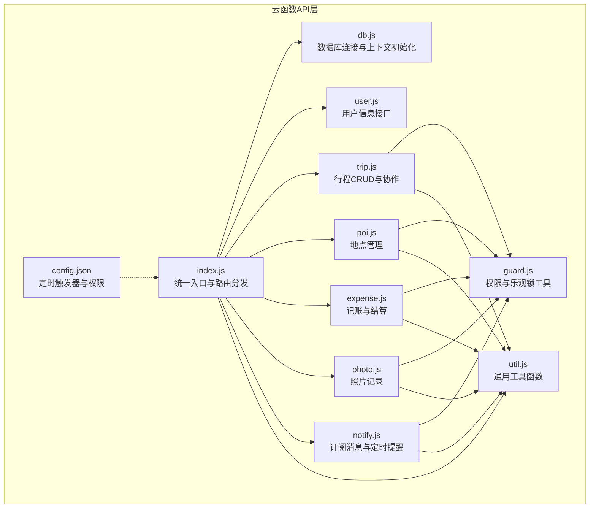
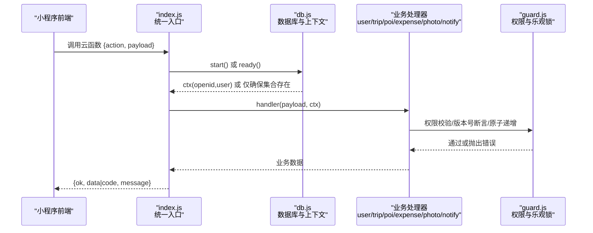
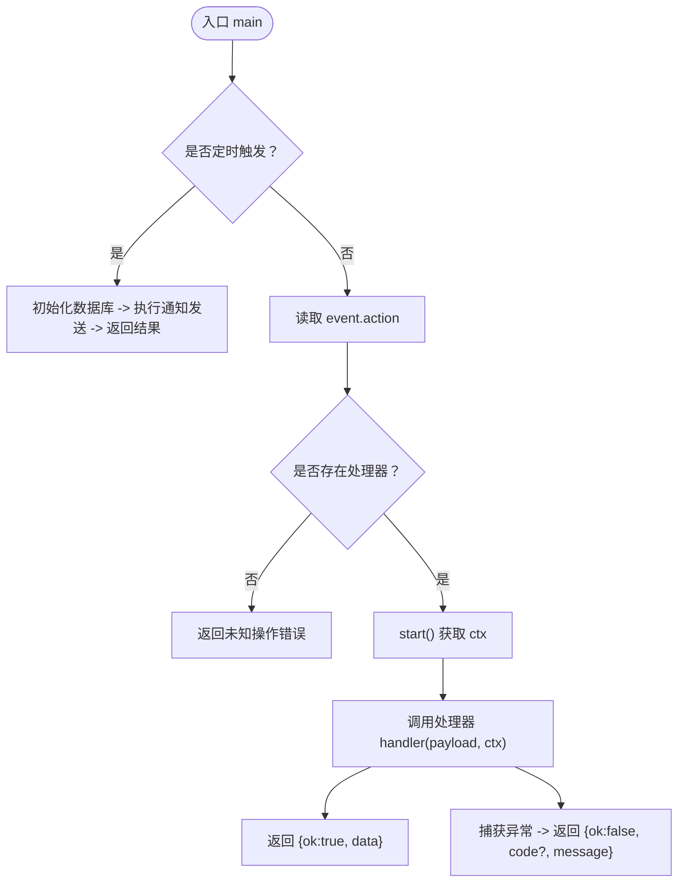
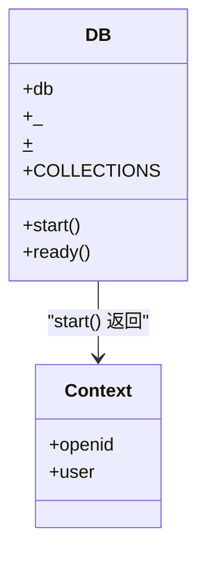
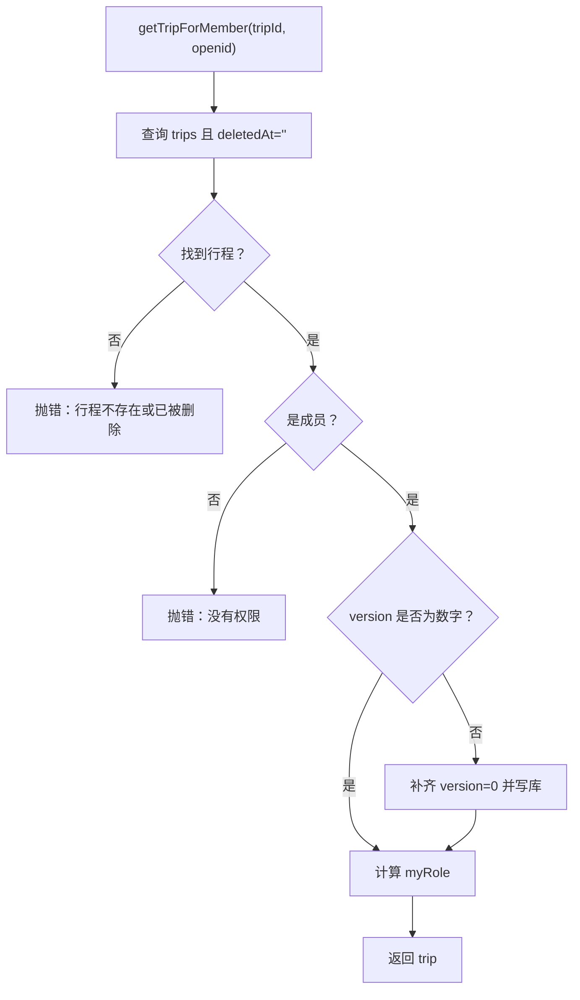
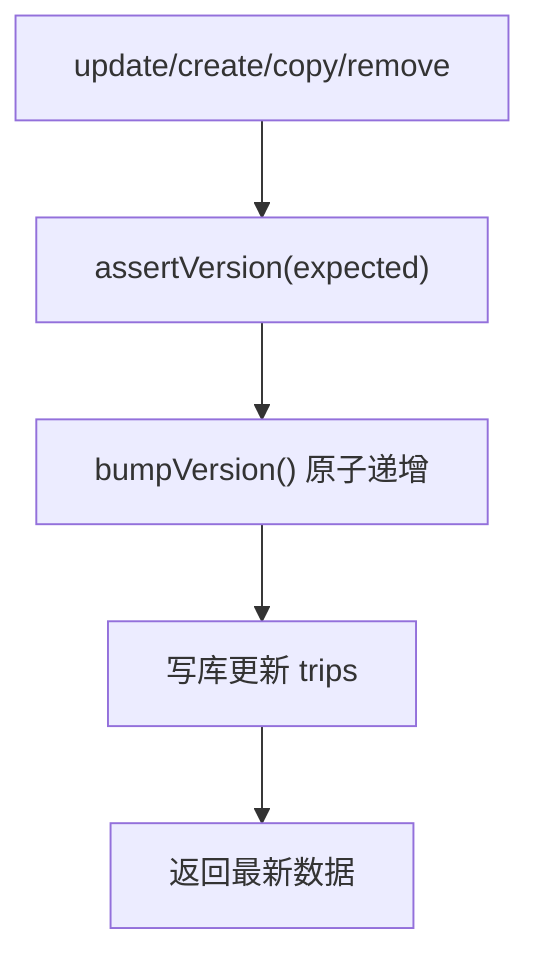
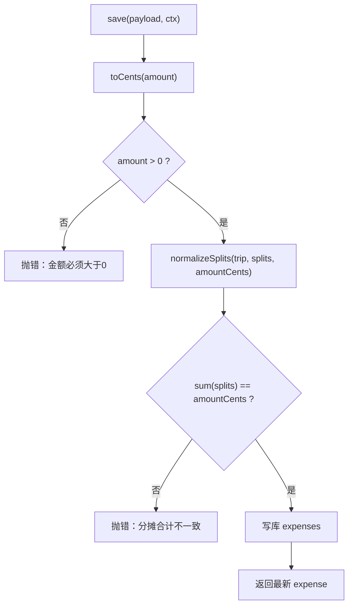
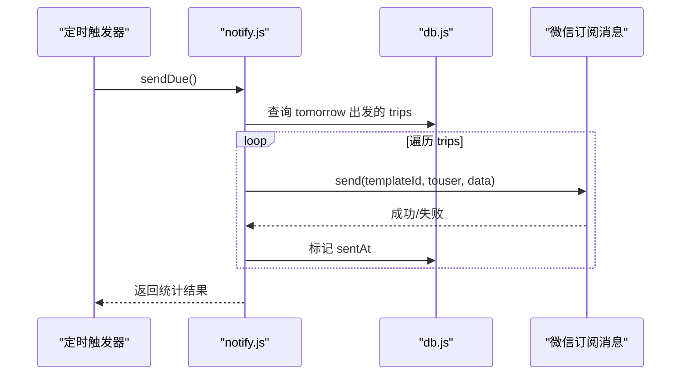
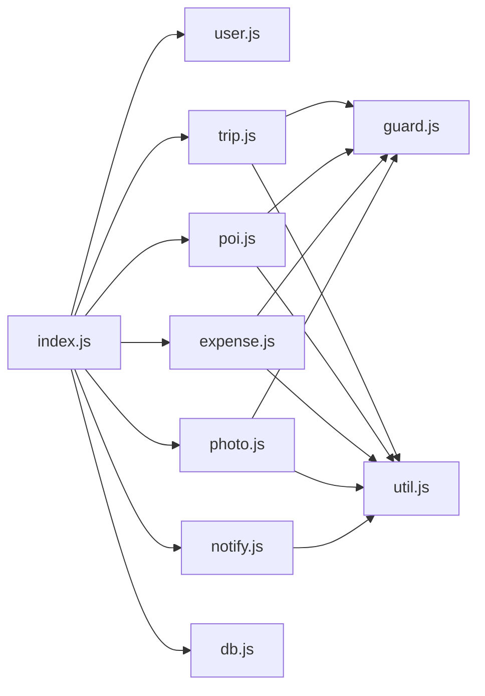
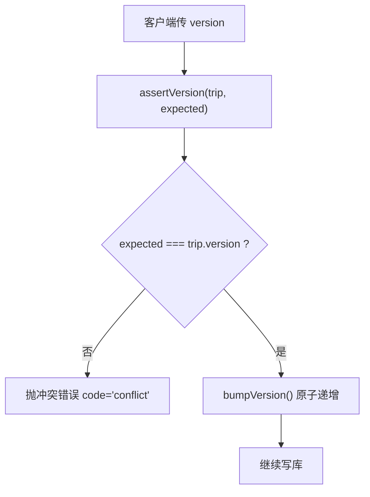

# API层设计

<cite>
**本文引用的文件**   
- [index.js](file://cloudfunctions/api/index.js)
- [db.js](file://cloudfunctions/api/db.js)
- [guard.js](file://cloudfunctions/api/guard.js)
- [util.js](file://cloudfunctions/api/util.js)
- [config.json](file://cloudfunctions/api/config.json)
- [user.js](file://cloudfunctions/api/user.js)
- [trip.js](file://cloudfunctions/api/trip.js)
- [poi.js](file://cloudfunctions/api/poi.js)
- [expense.js](file://cloudfunctions/api/expense.js)
- [photo.js](file://cloudfunctions/api/photo.js)
- [notify.js](file://cloudfunctions/api/notify.js)
</cite>

## 目录
1. [引言](#引言)
2. [项目结构](#项目结构)
3. [核心组件](#核心组件)
4. [架构总览](#架构总览)
5. [详细组件分析](#详细组件分析)
6. [依赖关系分析](#依赖关系分析)
7. [性能与并发特性](#性能与并发特性)
8. [API版本管理与向后兼容](#api版本管理与向后兼容)
9. [安全加固最佳实践](#安全加固最佳实践)
10. [新增API接口标准流程](#新增api接口标准流程)
11. [故障排查指南](#故障排查指南)
12. [结论](#结论)

## 引言
本技术文档聚焦旅行计划小程序的云函数API层，即“云函数路由分发”这一统一入口。该层通过单一云函数接收所有业务请求，按 action 进行路由分发，集中完成身份解析、权限校验、参数校验、错误处理与标准化响应。同时，系统采用中间件式的设计思想，将日志、错误、数据库初始化、权限与乐观锁等横切能力下沉到公共模块，使业务处理器保持简洁。

本文面向开发者与维护者，既提供高层架构说明，也深入到具体实现细节，包括：
- 统一入口与路由分发机制
- 权限验证、参数校验与响应标准化
- 中间件模式在云函数中的应用
- 新增API的标准流程与规范
- API版本管理与向后兼容性策略
- 安全加固与性能优化建议

## 项目结构
云函数API层位于 `cloudfunctions/api` 目录下，采用“单入口 + 多处理器”的组织方式：
- 入口与路由：`index.js`
- 数据库与上下文初始化：`db.js`
- 权限与一致性工具：`guard.js`
- 通用工具函数：`util.js`
- 业务处理器：`user.js`、`trip.js`、`poi.js`、`expense.js`、`photo.js`、`notify.js`
- 云函数配置（定时任务与OpenAPI权限）：`config.json`

**图表来源**
- [index.js:1-77](file://cloudfunctions/api/index.js#L1-L77)
- [db.js:1-61](file://cloudfunctions/api/db.js#L1-L61)
- [guard.js:1-76](file://cloudfunctions/api/guard.js#L1-L76)
- [util.js:1-60](file://cloudfunctions/api/util.js#L1-L60)
- [config.json:1-15](file://cloudfunctions/api/config.json#L1-L15)

**章节来源**
- [index.js:1-77](file://cloudfunctions/api/index.js#L1-L77)
- [db.js:1-61](file://cloudfunctions/api/db.js#L1-L61)
- [config.json:1-15](file://cloudfunctions/api/config.json#L1-L15)

## 核心组件
- 统一入口与路由分发：`index.js`
  - 维护 action 到处理器的映射表
  - 区分普通HTTP调用与定时触发器
  - 统一捕获异常并返回标准化结果
- 数据库与上下文：`db.js`
  - 初始化微信云开发环境
  - 自动创建集合（幂等）
  - 从服务端上下文获取 openid，拒绝前端传入的 openid
  - 提供 start 与 ready 两种启动方式
- 权限与一致性：`guard.js`
  - 成员判断、角色推导、创建者校验
  - 乐观锁版本号断言与原子递增
  - 冲突错误封装
  - 按成员权限读取行程并补全 myRole
- 通用工具：`util.js`
  - 日期解析与格式化
  - 天数序列生成
  - 金额单位转换（元转分）
  - 字符串裁剪与UUID生成
- 业务处理器：
  - user.js：当前用户信息
  - trip.js：行程列表、详情、创建、更新、复制、删除、邀请、加入、退出、移除成员
  - poi.js：地点列表、保存、删除、重排
  - expense.js：账目列表、汇总、保存、删除、AA结算
  - photo.js：照片列表、添加、删除
  - notify.js：订阅消息授权、定时发送出发提醒
- 配置：`config.json`
  - 声明 OpenAPI 权限（如订阅消息）
  - 定义定时触发器（每日20点执行）

**章节来源**
- [index.js:1-77](file://cloudfunctions/api/index.js#L1-L77)
- [db.js:1-61](file://cloudfunctions/api/db.js#L1-L61)
- [guard.js:1-76](file://cloudfunctions/api/guard.js#L1-L76)
- [util.js:1-60](file://cloudfunctions/api/util.js#L1-L60)
- [user.js:1-12](file://cloudfunctions/api/user.js#L1-L12)
- [trip.js:1-370](file://cloudfunctions/api/trip.js#L1-L370)
- [poi.js:1-199](file://cloudfunctions/api/poi.js#L1-L199)
- [expense.js:1-329](file://cloudfunctions/api/expense.js#L1-L329)
- [photo.js:1-65](file://cloudfunctions/api/photo.js#L1-L65)
- [notify.js:1-102](file://cloudfunctions/api/notify.js#L1-L102)
- [config.json:1-15](file://cloudfunctions/api/config.json#L1-L15)

## 架构总览
整体架构遵循“单云函数 + action 路由”的模式：
- 客户端调用统一入口，携带 action 与 payload
- 入口根据 action 查找对应处理器
- 处理器从 db.start() 获取 ctx（包含 openid 与用户信息）
- 处理器内部使用 guard 做权限校验与乐观锁控制
- 所有异常被入口捕获，返回统一的 ok/code/message 结构

**图表来源**
- [index.js:43-76](file://cloudfunctions/api/index.js#L43-L76)
- [db.js:46-58](file://cloudfunctions/api/db.js#L46-L58)
- [guard.js:16-42](file://cloudfunctions/api/guard.js#L16-L42)

## 详细组件分析

### 统一入口与路由分发（index.js）
- 路由表集中管理 action 到处理器的映射，便于扩展与维护
- 支持两类调用：
  - 普通调用：从 event.action 取 action，从 event.payload 取参数
  - 定时触发器：识别 Timer 类型或 TriggerName，直接走通知逻辑
- 统一异常处理：
  - 成功返回 `{ ok: true, data }`
  - 失败返回 `{ ok: false, code?, message }`，其中 code 用于客户端特殊分支（如 conflict）
- 身份来源严格来自服务端上下文，不信任前端传入的 openid

**图表来源**
- [index.js:43-76](file://cloudfunctions/api/index.js#L43-L76)

**章节来源**
- [index.js:1-77](file://cloudfunctions/api/index.js#L1-L77)

### 数据库与上下文初始化（db.js）
- 初始化 wx-server-sdk 并设置动态环境
- 自动创建必要集合（users、trips、pois、expenses、files），忽略已存在的错误
- start()：
  - 确保集合存在
  - 从 cloud.getWXContext().OPENID 获取 openid
  - 若不存在则抛错，要求必须在微信环境中打开
  - 确保用户记录存在，缺失时创建默认用户
  - 返回 ctx = { openid, user }
- ready()：
  - 仅确保集合存在，适用于无用户身份的定时任务

**图表来源**
- [db.js:1-61](file://cloudfunctions/api/db.js#L1-L61)

**章节来源**
- [db.js:1-61](file://cloudfunctions/api/db.js#L1-L61)

### 权限与一致性工具（guard.js）
- isMember(trip, openid)：判断是否为成员
- roleOf(trip, openid)：推导角色（owner/editor），兼容老数据
- requireOwner(trip, openid)：非创建者抛错
- assertVersion(trip, expected)：客户端传入版本号不一致则抛冲突错误
- bumpVersion(trip)：原子递增版本号，防止并发覆盖
- getTripForMember(tripId, openid)：
  - 校验行程存在且未删除
  - 校验成员权限
  - 补齐 version 字段（兼容老数据）
  - 计算并附加 myRole 给调用方

**图表来源**
- [guard.js:44-65](file://cloudfunctions/api/guard.js#L44-L65)

**章节来源**
- [guard.js:1-76](file://cloudfunctions/api/guard.js#L1-L76)

### 通用工具（util.js）
- parseDate/formatDate：日期解析与格式化
- buildDays：由起止日期推导天数序列，限制最大天数
- uuid：简易唯一ID生成
- cut：字符串裁剪，避免超长字段
- toCents：金额元转分，保证精度

这些工具在各业务处理器中被广泛复用，确保输入一致性与存储格式统一。

**章节来源**
- [util.js:1-60](file://cloudfunctions/api/util.js#L1-L60)

### 用户接口（user.js）
- me(payload, ctx)：返回当前用户的 openid 与用户信息（昵称、默认币种）
- 不暴露敏感字段，仅返回必要信息

**章节来源**
- [user.js:1-12](file://cloudfunctions/api/user.js#L1-L12)

### 行程接口（trip.js）
- list/get：按成员权限列出与获取行程
- create：创建行程，校验标题与日期，生成 days 序列，初始化版本与邀请码
- update：部分更新，校验状态枚举、日期合法性，重建 days，校验并原子递增版本
- remove：软删除行程及其地点、账目，需创建者权限与版本一致
- invite/join/leave/removeMember：协作功能，含邀请码有效期、成员增删、模式切换（solo/group）
- copy：复制行程，重新计算日期，迁移地点，成员仅保留自己

关键设计要点：
- 所有写操作均通过 guard.assertVersion/bumpVersion 保证一致性
- 日期与天数由服务端推导，避免前后端不一致
- 邀请码唯一性通过查询去重保障

**图表来源**
- [trip.js:90-132](file://cloudfunctions/api/trip.js#L90-L132)
- [guard.js:26-42](file://cloudfunctions/api/guard.js#L26-L42)

**章节来源**
- [trip.js:1-370](file://cloudfunctions/api/trip.js#L1-L370)

### 地点接口（poi.js）
- list：一次返回 trip 与 pois，减少往返
- save：新增或更新地点，校验名称、分类、时间、时长，限制每天最多地点数
- remove：软删地点，刷新计数
- reorder：批量调整顺序与时间，基于 dayIndex 与 order 字段排序

关键点：
- order 以天为单位进位，单索引即可实现“按天+按序”排序
- 换天或重排时重新计算 order，避免重复
- 使用 assertVersion/bumpVersion 保证并发安全

**章节来源**
- [poi.js:1-199](file://cloudfunctions/api/poi.js#L1-L199)

### 账目接口（expense.js）
- list：按行程拉取明细，服务端排序并附带汇总
- overview：聚合统计各行程花费总额与条数
- save：新增或更新账目，校验金额、分类、分摊；支持 splitWith 与 splits 双格式兼容
- remove：软删账目
- settle：AA结算，计算每人应付与实付差额，给出最少转账建议

关键点：
- 金额统一以“分”存储，避免浮点误差
- 分摊校验确保总和等于金额
- 兼容旧数据 splitWith 与新数据 splits

**图表来源**
- [expense.js:132-184](file://cloudfunctions/api/expense.js#L132-L184)

**章节来源**
- [expense.js:1-329](file://cloudfunctions/api/expense.js#L1-L329)

### 照片接口（photo.js）
- list：按行程拉取照片记录（仅存 fileID）
- add：校验 fileID，限制每趟行程照片数量
- remove：软删记录，不清理云存储原图，避免误删不可恢复

**章节来源**
- [photo.js:1-65](file://cloudfunctions/api/photo.js#L1-L65)

### 通知接口（notify.js）
- subscribe：为行程绑定订阅消息模板，每个 openid 只保留一条授权记录
- sendDue：定时任务扫描“明天出发”的行程，向尚未发送的用户推送提醒
- 模板字段名可配置，便于适配不同模板

**图表来源**
- [notify.js:49-96](file://cloudfunctions/api/notify.js#L49-L96)
- [config.json:7-13](file://cloudfunctions/api/config.json#L7-L13)

**章节来源**
- [notify.js:1-102](file://cloudfunctions/api/notify.js#L1-L102)
- [config.json:1-15](file://cloudfunctions/api/config.json#L1-L15)

## 依赖关系分析
- index.js 依赖 db.js 获取上下文，依赖各业务处理器
- 业务处理器普遍依赖 guard.js 做权限与一致性控制
- 业务处理器普遍依赖 util.js 做输入规范化与工具函数
- notify.js 额外依赖 wx-server-sdk 的 openapi 能力

**图表来源**
- [index.js:1-41](file://cloudfunctions/api/index.js#L1-L41)
- [trip.js:1-3](file://cloudfunctions/api/trip.js#L1-L3)
- [poi.js:1-3](file://cloudfunctions/api/poi.js#L1-L3)
- [expense.js:1-3](file://cloudfunctions/api/expense.js#L1-L3)
- [photo.js:1-3](file://cloudfunctions/api/photo.js#L1-L3)
- [notify.js:1-4](file://cloudfunctions/api/notify.js#L1-L4)

**章节来源**
- [index.js:1-41](file://cloudfunctions/api/index.js#L1-L41)
- [trip.js:1-3](file://cloudfunctions/api/trip.js#L1-L3)
- [poi.js:1-3](file://cloudfunctions/api/poi.js#L1-L3)
- [expense.js:1-3](file://cloudfunctions/api/expense.js#L1-L3)
- [photo.js:1-3](file://cloudfunctions/api/photo.js#L1-L3)
- [notify.js:1-4](file://cloudfunctions/api/notify.js#L1-L4)

## 性能与并发特性
- 单次请求内尽量减少往返：
  - poi.list 同时返回 trip 与 pois
  - expense.list 在服务端计算 summary
- 并发写保护：
  - 使用乐观锁版本号与原子递增，避免覆盖写
  - 对 trips/pois/expenses/files 等集合进行软删除，保留历史数据
- 批量操作：
  - poi.reorder 使用 Promise.all 并行更新多条记录
- 聚合查询：
  - expense.overview 使用 aggregate 聚合统计，降低前端计算压力
- 索引建议：
  - pois(tripId, dayIndex, order)
  - expenses(tripId, spentAt)
  - trips(memberOpenids), trips(inviteCode)

[本节为通用性能指导，不直接分析具体文件]

## API版本管理与向后兼容
- 乐观锁版本：
  - trips 文档包含 version 字段，客户端传 expected 版本
  - guard.assertVersion 检查版本一致性，guard.bumpVersion 原子递增
  - 冲突时返回 code='conflict'，客户端提示刷新
- 数据结构兼容：
  - trips 兼容老数据 ownerOpenid 与 members.role 缺失场景
  - expenses 兼容 splitWith 与 splits 双格式
  - trips 兼容无 version 字段的情况，首次访问补齐为 0
- 邀请码与提醒：
  - inviteExpireAt 控制邀请码有效期
  - reminders 数组记录订阅消息授权与发送状态

**图表来源**
- [guard.js:26-42](file://cloudfunctions/api/guard.js#L26-L42)
- [trip.js:127-131](file://cloudfunctions/api/trip.js#L127-L131)

**章节来源**
- [guard.js:1-76](file://cloudfunctions/api/guard.js#L1-L76)
- [trip.js:1-370](file://cloudfunctions/api/trip.js#L1-L370)
- [expense.js:152-156](file://cloudfunctions/api/expense.js#L152-L156)

## 安全加固最佳实践
- 身份来源可信：
  - 始终从 cloud.getWXContext().OPENID 获取 openid，拒绝前端传入
- 权限校验：
  - 所有涉及行程的写操作均需通过 getTripForMember 校验成员权限
  - 创建者敏感操作（删除、移除成员）使用 requireOwner
- 参数校验与裁剪：
  - 使用 util.cut 限制字符串长度
  - 数值与枚举严格校验（如 status、category、transport）
- 并发安全：
  - 写操作前 assertVersion，后 bumpVersion
- 最小权限原则：
  - config.json 仅声明必要的 OpenAPI 权限
- 错误信息脱敏：
  - 对外返回 message，内部错误堆栈仅记录日志

**章节来源**
- [db.js:46-52](file://cloudfunctions/api/db.js#L46-L52)
- [guard.js:16-24](file://cloudfunctions/api/guard.js#L16-L24)
- [util.js:39-49](file://cloudfunctions/api/util.js#L39-L49)
- [config.json:1-6](file://cloudfunctions/api/config.json#L1-L6)

## 新增API接口标准流程
以下流程用于在现有架构下新增一个API接口，确保与现有风格一致：

1. 确定 action 命名
   - 建议采用“模块.动作”形式，例如 “feature.create”
2. 在 index.js 中注册路由
   - 在 routes 表中添加 action 到处理器的映射
3. 编写处理器
   - 在对应模块文件中新增方法，签名：async function handler(payload, ctx)
   - 使用 db.start() 提供的 ctx.openid 与 ctx.user
   - 需要权限校验时调用 guard 相关函数
   - 参数校验使用 util 工具函数
   - 写操作前调用 assertVersion，成功后 bumpVersion
4. 返回标准化数据
   - 成功返回业务对象（会被包装为 {ok:true, data}）
   - 失败抛错（message 必填，必要时设置 code）
5. 测试与部署
   - 本地调试确认 action 路由正确
   - 验证权限与并发场景
   - 部署云函数

示例路径参考：
- 路由注册位置：[index.js:11-41](file://cloudfunctions/api/index.js#L11-L41)
- 处理器签名示例：[user.js:1-9](file://cloudfunctions/api/user.js#L1-L9)
- 权限与一致性调用示例：[trip.js:90-131](file://cloudfunctions/api/trip.js#L90-L131)

**章节来源**
- [index.js:11-41](file://cloudfunctions/api/index.js#L11-L41)
- [user.js:1-12](file://cloudfunctions/api/user.js#L1-L12)
- [trip.js:90-131](file://cloudfunctions/api/trip.js#L90-L131)

## 故障排查指南
- 常见错误与定位：
  - 未知操作：检查 event.action 是否在 routes 中存在
  - 没有获取到用户身份：确认是否在微信环境中调用，且未绕过云函数上下文
  - 行程不存在或已被删除：检查 tripId 与 deletedAt 字段
  - 没有权限：检查成员列表与角色
  - 冲突：客户端传的 version 与服务端不一致，提示刷新并重试
  - 金额不正确：检查 toCents 转换与 splits 合计
  - 订阅消息失败：检查模板字段与权限配置
- 日志与监控：
  - 入口统一 console.error 记录 action 与异常
  - 通知发送失败记录 errCode/errMsg，便于追踪模板问题

**章节来源**
- [index.js:56-75](file://cloudfunctions/api/index.js#L56-L75)
- [db.js:46-52](file://cloudfunctions/api/db.js#L46-L52)
- [guard.js:20-24](file://cloudfunctions/api/guard.js#L20-L24)
- [expense.js:82-84](file://cloudfunctions/api/expense.js#L82-L84)
- [notify.js:77-86](file://cloudfunctions/api/notify.js#L77-L86)

## 结论
该API层通过单一云函数入口与集中式路由分发，实现了权限、校验、错误处理的统一治理。中间件式的公共模块（db、guard、util）有效降低了业务代码复杂度，提升了可维护性与一致性。乐观锁与原子递增保证了高并发下的数据一致性，而向后兼容策略确保了平滑演进。建议在后续迭代中持续强化参数校验、日志埋点与性能监控，并依据数据量增长完善索引与分页策略。

[本节为总结性内容，不直接分析具体文件]