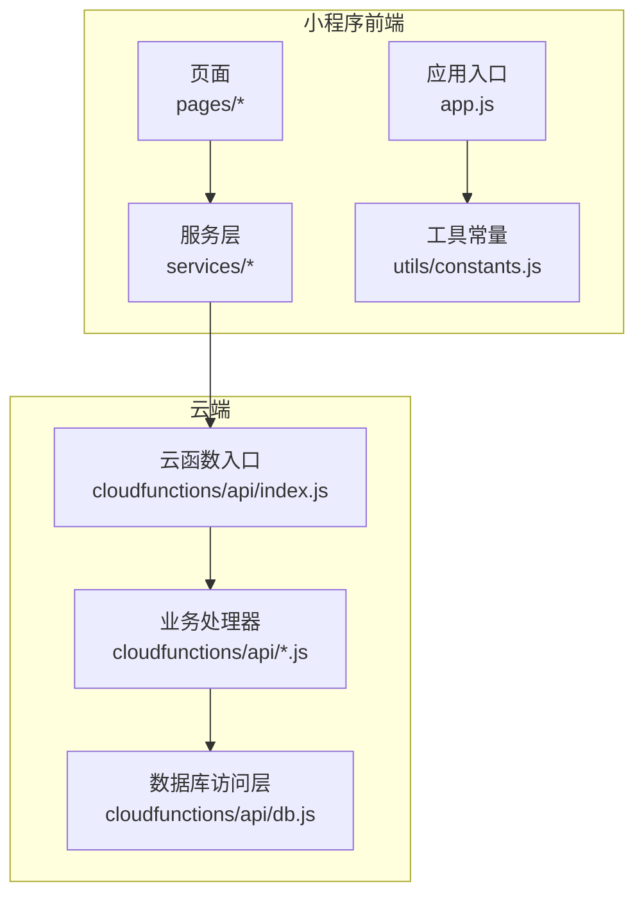
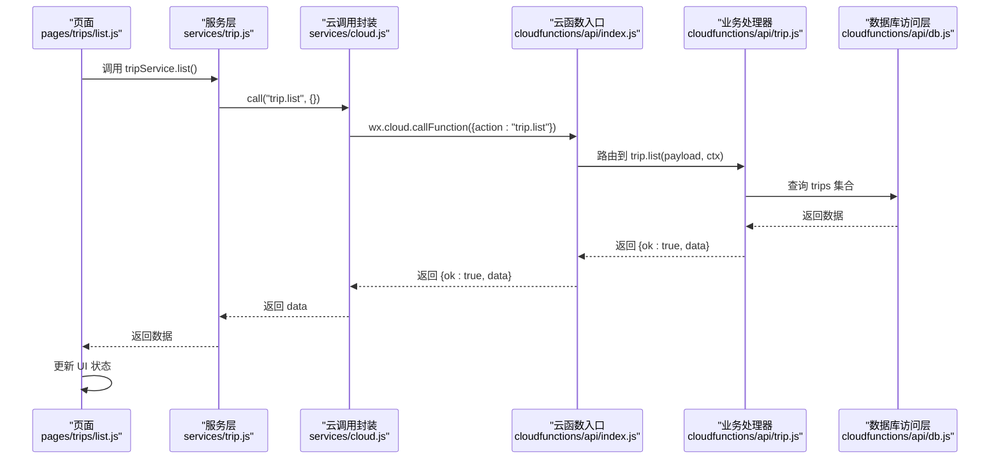
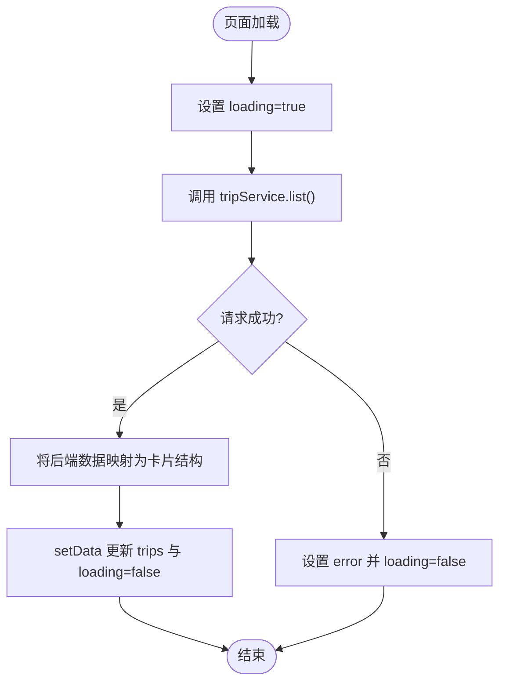
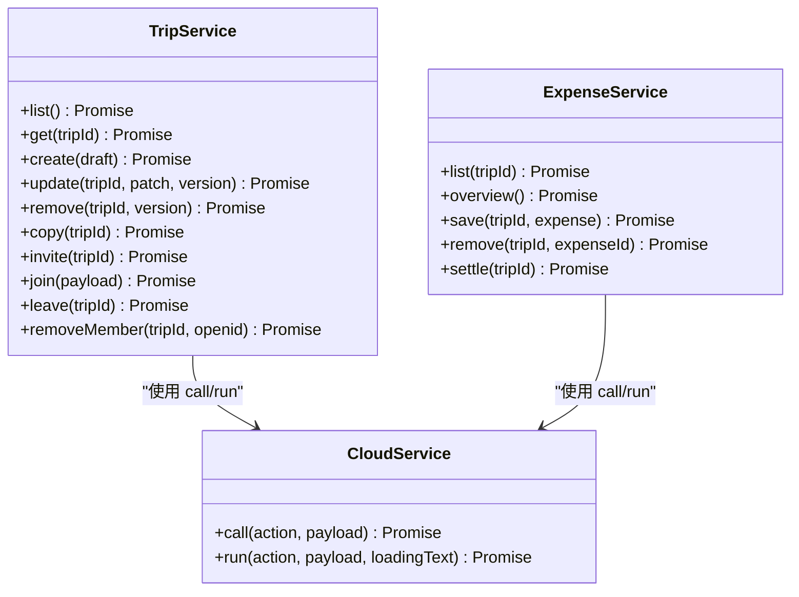
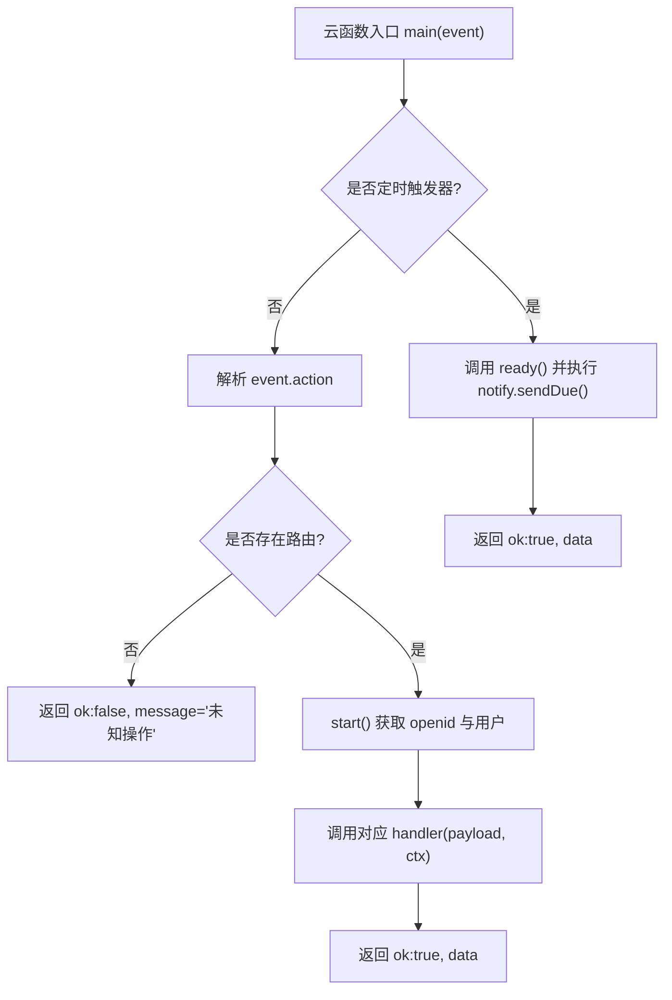
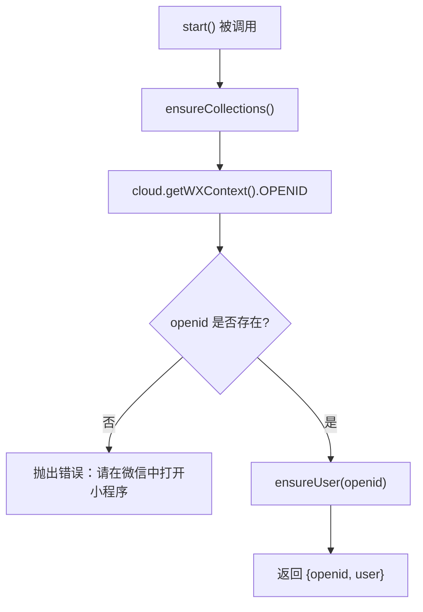
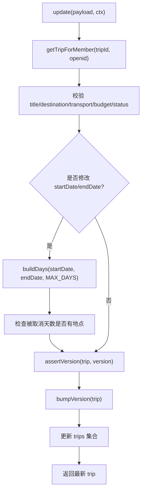
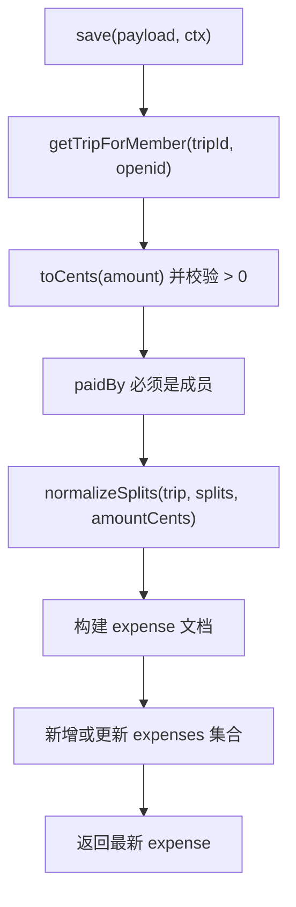
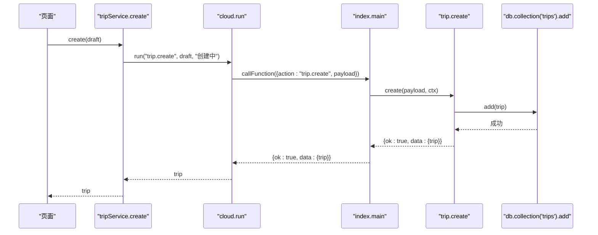
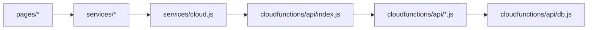

# 分层架构设计

<cite>
**本文引用的文件**   
- [app.js](file://app.js)
- [constants.js](file://utils/constants.js)
- [cloud.js](file://services/cloud.js)
- [trip.js](file://services/trip.js)
- [expense.js](file://services/expense.js)
- [index.js](file://cloudfunctions\api\index.js)
- [db.js](file://cloudfunctions\api\db.js)
- [trip.js](file://cloudfunctions\api\trip.js)
- [expense.js](file://cloudfunctions\api\expense.js)
- [list.js](file://pages\trips\list.js)
</cite>

## 目录
1. [引言](#引言)
2. [项目结构](#项目结构)
3. [核心组件](#核心组件)
4. [架构总览](#架构总览)
5. [详细组件分析](#详细组件分析)
6. [依赖关系分析](#依赖关系分析)
7. [性能与扩展性](#性能与扩展性)
8. [故障排查指南](#故障排查指南)
9. [结论](#结论)

## 引言
本技术文档围绕旅行计划小程序的分层架构展开，重点解释表现层（Page 页面）、服务层（Service 封装）、API 层（云函数）和数据访问层（Database）的职责边界、交互协议、错误处理机制以及数据转换流程。文档同时说明采用分层设计的原因、各层解耦策略、跨层调用时的参数传递与状态管理方式，并给出常见陷阱与最佳实践。

该小程序采用“前端不直连数据库”的设计：所有写操作统一通过云函数入口分发，服务端集中进行身份校验、权限控制、数据校验和版本控制；小程序端仅负责展示、用户输入收集、加载提示与基础 UI 状态管理。

## 项目结构
从职责划分看，代码组织遵循“按领域 + 分层”的方式：
- 表现层位于 pages 目录，每个业务页面只关注视图渲染、用户交互与本地状态更新。
- 服务层位于 services 目录，对云函数调用进行封装，统一处理 loading、错误提示与异常透传。
- API 层位于 cloudfunctions/api 目录，使用单一云函数作为路由入口，再分派到具体业务处理器。
- 数据访问层由 cloudfunctions/api/db.js 提供，负责集合初始化、用户身份获取与基础数据库能力暴露。

**图表来源**
- [app.js:10-20](file://app.js#L10-L20)
- [constants.js:1-10](file://utils/constants.js#L1-L10)
- [cloud.js:1-49](file://services/cloud.js#L1-L49)
- [index.js:1-41](file://cloudfunctions\api\index.js#L1-L41)
- [db.js:1-10](file://cloudfunctions\api\db.js#L1-L10)

**章节来源**
- [app.js:1-22](file://app.js#L1-L22)
- [constants.js:1-48](file://utils/constants.js#L1-L48)

## 核心组件
本节聚焦四层中最重要的组件及其职责：

- 应用入口 app.js：初始化云开发环境，设置全局环境变量与云就绪状态。
- 常量配置 utils/constants.js：集中管理云环境 ID、云函数名、集合名、分类、限制等。
- 服务层 services/cloud.js：统一封装 wx.cloud.callFunction，提供 call 与 run 两种调用模式。
- 服务层 services/trip.js 与 services/expense.js：按业务域封装 trip 与 expense 的接口。
- API 层 cloudfunctions/api/index.js：单入口路由分发，统一返回 ok/data/message/code 结构。
- 数据访问层 cloudfunctions/api/db.js：集合创建、用户身份获取、ensureUser 与 start/ready 生命周期。
- 业务处理器 cloudfunctions/api/trip.js 与 cloudfunctions/api/expense.js：实现行程与记账的核心逻辑。
- 表现层 pages/trips/list.js：示例页面，展示如何调用服务层并更新 UI。

**章节来源**
- [app.js:1-22](file://app.js#L1-L22)
- [constants.js:1-48](file://utils/constants.js#L1-L48)
- [cloud.js:1-49](file://services/cloud.js#L1-L49)
- [trip.js:1-47](file://services/trip.js#L1-L47)
- [expense.js:1-26](file://services/expense.js#L1-L26)
- [index.js:1-77](file://cloudfunctions\api\index.js#L1-L77)
- [db.js:1-61](file://cloudfunctions\api\db.js#L1-L61)
- [trip.js:1-370](file://cloudfunctions\api\trip.js#L1-L370)
- [expense.js:1-329](file://cloudfunctions\api\expense.js#L1-L329)
- [list.js:1-72](file://pages\trips\list.js#L1-L72)

## 架构总览
整体数据流如下：
1. 页面发起业务动作，例如打开行程列表或创建行程。
2. 页面调用服务层方法，如 tripService.list() 或 tripService.create()。
3. 服务层通过 cloud.js 调用云函数 api，传入 action 与 payload。
4. 云函数 index.js 根据 action 路由到对应处理器，如 tripHandler.list。
5. 处理器通过 db.js 提供的数据库能力读取或写入数据。
6. 云函数返回统一结果结构 { ok, data, message, code }。
7. 服务层解析结果：成功时返回 data；失败时构造 Error 并带上 code。
8. 页面捕获异常，显示错误信息或执行重试逻辑。

**图表来源**
- [list.js:39-49](file://pages\trips\list.js#L39-L49)
- [trip.js:3-10](file://services/trip.js#L3-L10)
- [cloud.js:5-29](file://services/cloud.js#L5-L29)
- [index.js:43-76](file://cloudfunctions\api\index.js#L43-L76)
- [trip.js:35-43](file://cloudfunctions\api\trip.js#L35-L43)
- [db.js:46-53](file://cloudfunctions\api\db.js#L46-L53)

## 详细组件分析

### 表现层（Page 页面）
表现层职责：
- 维护页面级状态，如 loading、error、列表数据。
- 将后端数据转换为 UI 友好的卡片结构。
- 调用服务层完成数据读写。
- 处理用户交互，如跳转详情页、重试加载。

以行程列表页为例：
- onShow 触发 load。
- load 先设置 loading=true，然后调用 tripService.list。
- 成功后将 trips 映射为 toCard 结构并更新 UI。
- 失败时设置 error 字段用于展示错误信息。

**图表来源**
- [list.js:28-49](file://pages\trips\list.js#L28-L49)

**章节来源**
- [list.js:1-72](file://pages\trips\list.js#L1-L72)

### 服务层（Service 封装）
服务层职责：
- 隐藏云函数调用的细节，向上暴露语义化方法。
- 统一处理 loading 与 toast 提示。
- 将云函数返回的结构转换为业务数据。
- 将异常包装为 Error，保留 code 以便页面做差异化处理。

关键封装：
- call(action, payload)：无 loading 的轻量调用，适合纯读操作。
- run(action, payload, loadingText)：带 loading 的写操作封装，失败时自动 hideLoading 与 showToast。
- 对于 conflict 等需要特殊处理的错误码，不在服务层直接 toast，而是抛出给页面决定交互。

**图表来源**
- [cloud.js:5-49](file://services/cloud.js#L5-L49)
- [trip.js:3-46](file://services/trip.js#L3-L46)
- [expense.js:3-25](file://services/expense.js#L3-L25)

**章节来源**
- [cloud.js:1-49](file://services/cloud.js#L1-L49)
- [trip.js:1-47](file://services/trip.js#L1-L47)
- [expense.js:1-26](file://services/expense.js#L1-L26)

### API 层（云函数）
API 层职责：
- 单入口路由分发，避免多个云函数部署带来的权限与校验分散问题。
- 统一返回结构 { ok, data, message, code }。
- 从服务端上下文获取 openid，拒绝信任前端传来的身份。
- 支持定时任务路径，无需用户身份。

路由表：
- user.me
- trip.*：list/get/create/update/copy/remove/invite/join/leave/removeMember
- poi.*：list/save/remove/reorder
- expense.*：list/overview/save/remove/settle
- photo.*：list/add/remove
- notify.subscribe

**图表来源**
- [index.js:43-76](file://cloudfunctions\api\index.js#L43-L76)

**章节来源**
- [index.js:1-77](file://cloudfunctions\api\index.js#L1-L77)

### 数据访问层（Database）
数据访问层职责：
- 初始化云数据库与聚合命令。
- 确保集合存在，幂等创建。
- 提供 start() 与 ready() 两个生命周期钩子：
  - start()：每次请求获取 openid，确保用户存在，返回 ctx。
  - ready()：定时任务等无用户身份的入口，仅确保集合存在。
- 暴露 db、_、$ 供业务处理器使用。

关键点：
- 永不信任前端传来的 openid，openid 必须来自 cloud.getWXContext().OPENID。
- ensureUser 在首次访问时创建默认用户记录。
- COLLECTIONS 集中声明集合名，便于后续索引与维护。

**图表来源**
- [db.js:46-53](file://cloudfunctions\api\db.js#L46-L53)
- [db.js:15-27](file://cloudfunctions\api\db.js#L15-L27)
- [db.js:29-44](file://cloudfunctions\api\db.js#L29-L44)

**章节来源**
- [db.js:1-61](file://cloudfunctions\api\db.js#L1-L61)

### 业务处理器：行程与记账
#### 行程处理器 trip.js
主要职责：
- 列表与详情查询，基于成员权限过滤。
- 创建行程：校验标题、日期区间，生成 days 数组，设置初始版本与邀请码。
- 更新行程：增量 patch，校验状态枚举，日期变更重建 days，乐观锁版本检查。
- 删除行程：软删除，级联标记 pois 与 expenses。
- 邀请与加入：邀请码有效期校验，成员数组更新，mode 切换 solo/group。
- 退出与移除成员：区分 owner 与普通成员，更新 members 与 mode。
- 复制行程：重新计算日期，拷贝 poi，重置成员为单人。

关键设计点：
- 使用版本号进行乐观锁，防止并发覆盖。
- 使用 cut/toCents/formatDate 等工具函数保证数据格式。
- 使用 _ 与 $ 进行数据库命令与聚合。

**图表来源**
- [trip.js:90-131](file://cloudfunctions\api\trip.js#L90-L131)

**章节来源**
- [trip.js:1-370](file://cloudfunctions\api\trip.js#L1-L370)

#### 记账处理器 expense.js
主要职责：
- 列表查询：按 tripId 拉取明细，排序后返回 summary。
- 汇总概览：对所有行程花费进行聚合统计。
- 保存账目：金额校验、付款人校验、分摊 normalizeSplits、类别归一化。
- 删除账目：软删除。
- AA 结算：计算每人实付、应摊、差额，并生成转账建议。

关键设计点：
- summarize 在服务端计算合计，保证前端与明细一致。
- evenSplits 均摊算法保证合计等于总金额。
- normalizeSplits 校验客户端传入的分摊是否与金额一致。
- buildSettlement 兼容旧数据 splitWith 与新数据 splits。

**图表来源**
- [expense.js:132-184](file://cloudfunctions\api\expense.js#L132-L184)

**章节来源**
- [expense.js:1-329](file://cloudfunctions\api\expense.js#L1-L329)

### 数据在各层之间的流转示例
以“创建行程”为例，数据流转如下：
1. 用户在页面填写行程信息并提交。
2. 页面调用 tripService.create(draft)。
3. service/trip.js 调用 cloud.run('trip.create', draft, '创建中')。
4. cloud.js 显示 loading，调用 wx.cloud.callFunction。
5. 云函数 index.js 路由到 tripHandler.create。
6. tripHandler.create 校验标题与日期，生成 days 与 inviteCode，插入 trips 集合。
7. 返回 { ok: true, data: { trip } }。
8. cloud.js 解析 result.ok，resolve(data)。
9. service/trip.js 返回 trip 给页面。
10. 页面 setData 更新本地状态并跳转或刷新列表。

**图表来源**
- [trip.js:12-14](file://services/trip.js#L12-L14)
- [cloud.js:33-47](file://services/cloud.js#L33-L47)
- [index.js:43-76](file://cloudfunctions\api\index.js#L43-L76)
- [trip.js:50-88](file://cloudfunctions\api\trip.js#L50-L88)

**章节来源**
- [trip.js:12-14](file://services/trip.js#L12-L14)
- [cloud.js:33-47](file://services/cloud.js#L33-L47)
- [index.js:43-76](file://cloudfunctions\api\index.js#L43-L76)
- [trip.js:50-88](file://cloudfunctions\api\trip.js#L50-L88)

## 依赖关系分析
各层之间的耦合关系如下：
- 页面仅依赖服务层，不直接调用云函数或数据库。
- 服务层依赖 cloud.js 与业务常量，屏蔽底层网络与错误处理。
- 云函数入口依赖业务处理器与数据库访问层。
- 业务处理器依赖 guard/util/db 等模块，保持职责单一。
- 数据库访问层独立于业务逻辑，仅提供基础设施。

**图表来源**
- [list.js:1-2](file://pages\trips\list.js#L1-L2)
- [trip.js:1-2](file://services/trip.js#L1-L2)
- [cloud.js:1-2](file://services/cloud.js#L1-L2)
- [index.js:1-8](file://cloudfunctions\api\index.js#L1-L8)
- [trip.js:1-3](file://cloudfunctions\api\trip.js#L1-L3)
- [db.js:1-7](file://cloudfunctions\api\db.js#L1-L7)

**章节来源**
- [list.js:1-72](file://pages\trips\list.js#L1-L72)
- [trip.js:1-47](file://services/trip.js#L1-L47)
- [cloud.js:1-49](file://services/cloud.js#L1-L49)
- [index.js:1-77](file://cloudfunctions\api\index.js#L1-L77)
- [trip.js:1-370](file://cloudfunctions\api\trip.js#L1-L370)
- [db.js:1-61](file://cloudfunctions\api\db.js#L1-L61)

## 性能与扩展性
- 单云函数入口减少部署复杂度，集中权限与校验，便于扩展新 action。
- 服务层统一 loading 与 toast，降低页面样板代码，提升一致性。
- 服务端聚合与汇总（如 expense.overview）减少前端计算与多次请求。
- 乐观锁（version）避免频繁加锁，提高并发场景下的吞吐。
- 软删除保留历史数据，便于未来回放与审计。
- 集合名与常量集中管理，便于迁移环境与索引优化。

[本节为通用指导，不直接分析具体文件]

## 故障排查指南
常见问题与定位思路：
- 网络异常：cloud.js 的 fail 分支会抛出“网络异常”，页面需提示重试。
- 服务不可用：result.ok 为 false 且 message 非空时，service 层会构造 Error 并携带 message。
- 冲突处理：err.code === 'conflict' 时，service 层不 toast，交由页面决定是否弹窗刷新。
- 未知操作：云函数未匹配到 action，返回 message 包含“未知操作”。
- 身份缺失：db.start() 未获取到 openid，抛出错误，需在微信环境中运行。
- 数据校验失败：如金额不大于 0、日期不合法、邀请码过期等，由业务处理器抛错。

建议：
- 页面层捕获 err.message 并展示给用户。
- 对 conflict 等特殊 code 做差异化交互。
- 日志记录 action 与 payload（脱敏），便于服务端排查。
- 定期检查集合索引，尤其是高频查询字段如 tripId、spentAt。

**章节来源**
- [cloud.js:13-27](file://services/cloud.js#L13-L27)
- [cloud.js:39-46](file://services/cloud.js#L39-L46)
- [index.js:56-74](file://cloudfunctions\api\index.js#L56-L74)
- [db.js:46-53](file://cloudfunctions\api\db.js#L46-L53)
- [expense.js:132-184](file://cloudfunctions\api\expense.js#L132-L184)
- [trip.js:90-131](file://cloudfunctions\api\trip.js#L90-L131)

## 结论
该旅行计划小程序采用清晰的分层架构：
- 表现层专注 UI 与用户交互。
- 服务层统一封装云函数调用与错误处理。
- API 层通过单入口路由集中权限、校验与业务逻辑。
- 数据访问层提供稳定的数据库基础设施。

这种设计实现了前后端解耦、职责分离与可维护性提升。通过乐观锁、软删除与服务端聚合等手段，系统在并发与扩展性方面具备良好基础。实践中应避免在前端直接操作数据库、注意错误码差异化处理、集中管理常量与集合名，并在服务端做好数据校验与权限控制。

[本节为总结性内容，不直接分析具体文件]