# 数据访问层设计

<cite>
**本文引用的文件**   
- [cloudfunctions/api/db.js](file://cloudfunctions/api/db.js)
- [cloudfunctions/api/index.js](file://cloudfunctions/api/index.js)
- [cloudfunctions/api/guard.js](file://cloudfunctions/api/guard.js)
- [cloudfunctions/api/trip.js](file://cloudfunctions/api/trip.js)
- [cloudfunctions/api/poi.js](file://cloudfunctions/api/poi.js)
- [cloudfunctions/api/expense.js](file://cloudfunctions/api/expense.js)
- [services/cloud.js](file://services/cloud.js)
- [docs/方案.md](file://docs/方案.md)
</cite>

## 目录
1. [引言](#引言)
2. [项目结构](#项目结构)
3. [核心组件](#核心组件)
4. [架构总览](#架构总览)
5. [详细组件分析](#详细组件分析)
6. [依赖关系分析](#依赖关系分析)
7. [性能与索引优化](#性能与索引优化)
8. [事务与一致性保障](#事务与一致性保障)
9. [CRUD 封装模式与批量操作](#crud-封装模式与批量操作)
10. [复杂查询与聚合示例](#复杂查询与聚合示例)
11. [数据迁移策略](#数据迁移策略)
12. [备份与恢复方案](#备份与恢复方案)
13. [故障排查指南](#故障排查指南)
14. [结论](#结论)

## 引言
本技术文档聚焦旅行计划小程序的数据访问层，围绕云函数端数据库连接管理、集合初始化、身份校验、查询构建、事务与一致性、CRUD 封装、批量优化、索引设计与性能调优展开。该项目的数据访问采用“前端不直连数据库”的设计：所有写操作通过 `services/cloud.js` 调用统一云函数入口 `api`，再由 `index.js` 路由到具体业务处理器；数据库句柄、命令对象和集合初始化集中在 `db.js`，权限与乐观锁在 `guard.js` 中实现，业务逻辑分布在 `trip.js`、`poi.js`、`expense.js` 等模块。

## 项目结构
从数据访问视角看，关键路径如下：
- 小程序前端通过 `services/cloud.js` 发起 `wx.cloud.callFunction`，携带 `action` 与 `payload`。
- 云函数入口 `cloudfunctions/api/index.js` 解析 action，调用对应 handler。
- 每个 handler 通过 `require('./db')` 获取 `db`、`_`、`$`，并调用 `guard` 做成员校验与版本控制。
- 数据模型包含 `users`、`trips`、`pois`、`expenses`、`files` 五个集合，首次请求自动创建。

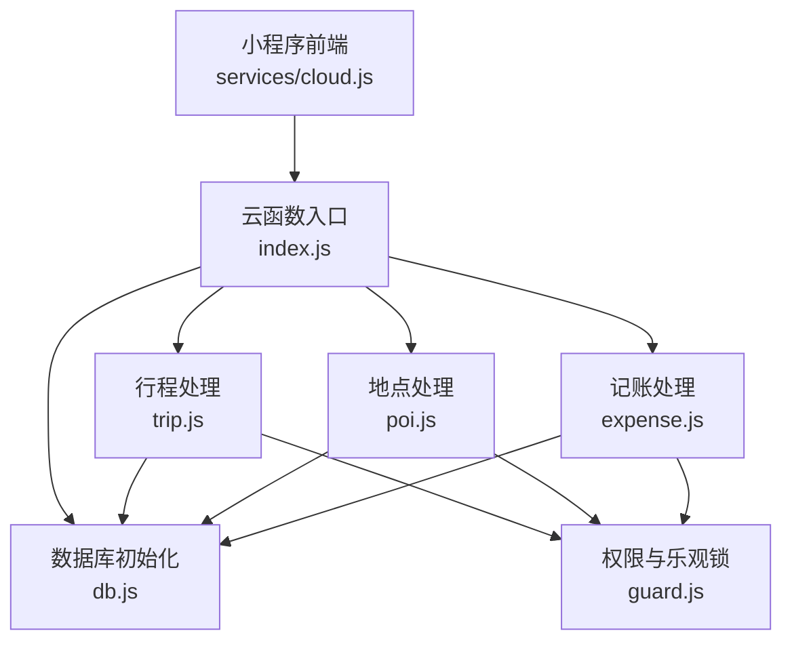

**图表来源**
- [services/cloud.js:5-30](file://services/cloud.js#L5-L30)
- [cloudfunctions/api/index.js:10-41](file://cloudfunctions/api/index.js#L10-L41)
- [cloudfunctions/api/db.js:1-10](file://cloudfunctions/api/db.js#L1-L10)
- [cloudfunctions/api/trip.js:1-4](file://cloudfunctions/api/trip.js#L1-L4)
- [cloudfunctions/api/poi.js:1-3](file://cloudfunctions/api/poi.js#L1-L3)
- [cloudfunctions/api/expense.js:1-3](file://cloudfunctions/api/expense.js#L1-L3)
- [cloudfunctions/api/guard.js:1-5](file://cloudfunctions/api/guard.js#L1-L5)

**章节来源**
- [services/cloud.js:1-50](file://services/cloud.js#L1-L50)
- [cloudfunctions/api/index.js:1-77](file://cloudfunctions/api/index.js#L1-L77)
- [cloudfunctions/api/db.js:1-61](file://cloudfunctions/api/db.js#L1-L61)
- [docs/方案.md:72-95](file://docs/方案.md#L72-L95)

## 核心组件
- 数据库初始化与集合管理：`db.js` 负责初始化云开发环境、暴露 `db`、`command`、`aggregate`，并提供集合幂等创建、用户身份获取与默认用户创建。
- 统一入口与路由：`index.js` 将 `action` 映射到各业务 handler，并统一处理定时触发器、错误码与消息。
- 权限与并发控制：`guard.js` 提供成员判断、角色判断、版本断言与原子版本号递增。
- 业务数据访问：`trip.js`、`poi.js`、`expense.js` 分别封装行程、地点、账目的 CRUD 与聚合逻辑。

**章节来源**
- [cloudfunctions/api/db.js:1-61](file://cloudfunctions/api/db.js#L1-L61)
- [cloudfunctions/api/index.js:1-77](file://cloudfunctions/api/index.js#L1-L77)
- [cloudfunctions/api/guard.js:1-76](file://cloudfunctions/api/guard.js#L1-L76)
- [cloudfunctions/api/trip.js:1-370](file://cloudfunctions/api/trip.js#L1-L370)
- [cloudfunctions/api/poi.js:1-199](file://cloudfunctions/api/poi.js#L1-L199)
- [cloudfunctions/api/expense.js:1-329](file://cloudfunctions/api/expense.js#L1-L329)

## 架构总览
整体数据访问架构遵循“前端只调用云函数，后端集中鉴权与数据操作”的原则。前端通过 `call` 与 `run` 两个方法统一发起请求，失败时带 `code`（如 `conflict`）以便页面差异化处理。后端通过 `start` 或 `ready` 保证集合存在与用户身份可用，再交由具体 handler 完成业务逻辑。

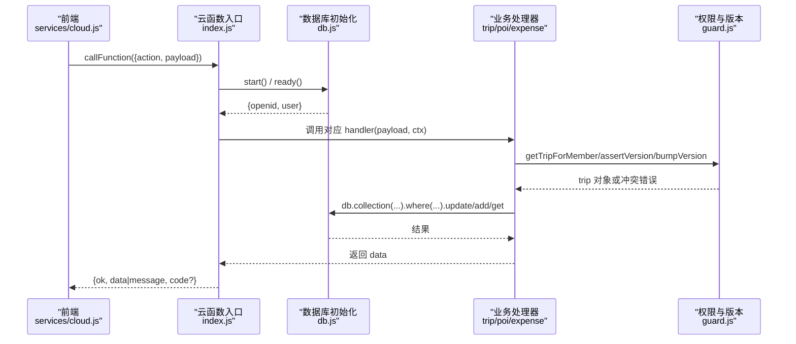

**图表来源**
- [services/cloud.js:5-47](file://services/cloud.js#L5-L47)
- [cloudfunctions/api/index.js:43-76](file://cloudfunctions/api/index.js#L43-L76)
- [cloudfunctions/api/db.js:29-58](file://cloudfunctions/api/db.js#L29-L58)
- [cloudfunctions/api/guard.js:26-65](file://cloudfunctions/api/guard.js#L26-L65)

## 详细组件分析

### 数据库连接与集合管理（db.js）
- 使用 `wx-server-sdk` 初始化云开发环境，并暴露 `db`、`command`（`_`）、`aggregate`（`$`）。
- 定义 `COLLECTIONS` 列表，首次请求通过 `ensureCollections()` 幂等创建集合，忽略已存在的错误。
- `ensureUser(openid)` 根据服务端上下文中的 `OPENID` 查找或创建用户记录，避免信任前端传入的 openid。
- `start()` 用于有用户身份的请求，先确保集合存在，再从 `cloud.getWXContext().OPENID` 取身份，并返回 `{openid, user}`。
- `ready()` 用于定时触发器等无用户身份场景，仅确保集合存在。

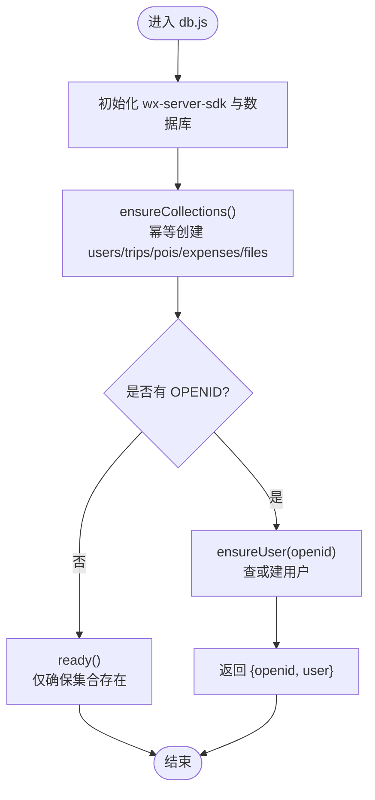

**图表来源**
- [cloudfunctions/api/db.js:1-61](file://cloudfunctions/api/db.js#L1-L61)

**章节来源**
- [cloudfunctions/api/db.js:1-61](file://cloudfunctions/api/db.js#L1-L61)

### 统一入口与路由（index.js）
- 维护 `routes` 表，将 `user.me`、`trip.*`、`poi.*`、`expense.*`、`photo.*`、`notify.subscribe` 等 action 映射到对应 handler。
- `main(event)` 区分定时触发器与普通请求：定时任务走 `ready()` 后调用通知发送；普通请求走 `start()` 获取身份，再调用 handler。
- 统一捕获异常，返回 `{ok:false, message, code?}`，其中 `code` 用于客户端特殊分支（如 `conflict`）。

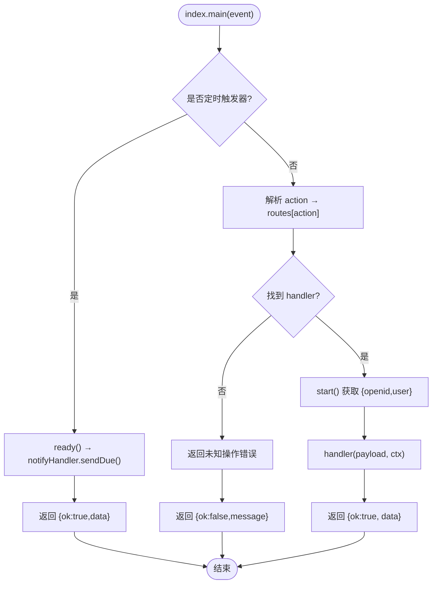

**图表来源**
- [cloudfunctions/api/index.js:10-76](file://cloudfunctions/api/index.js#L10-L76)

**章节来源**
- [cloudfunctions/api/index.js:1-77](file://cloudfunctions/api/index.js#L1-L77)

### 权限与乐观锁（guard.js）
- `isMember(trip, openid)` 判断 openid 是否在 `memberOpenids` 数组中。
- `roleOf(trip, openid)` 兼容老数据，若没有 `role` 字段则按 `ownerOpenid` 推断为 `owner`，否则为 `editor`。
- `requireOwner(trip, openid)` 非 owner 抛错。
- `assertVersion(trip, expected)` 客户端传入期望版本，不一致抛 `conflictError()`。
- `bumpVersion(trip)` 原子更新 `version`：用 `where({_id, version: current})` 更新为 `_.inc(1)`，未命中说明被抢先写入，抛 `conflictError()`。
- `getTripForMember(tripId, openid)` 统一读取行程并校验成员权限，同时补全老数据的 `version` 字段，并附加 `myRole` 给前端。

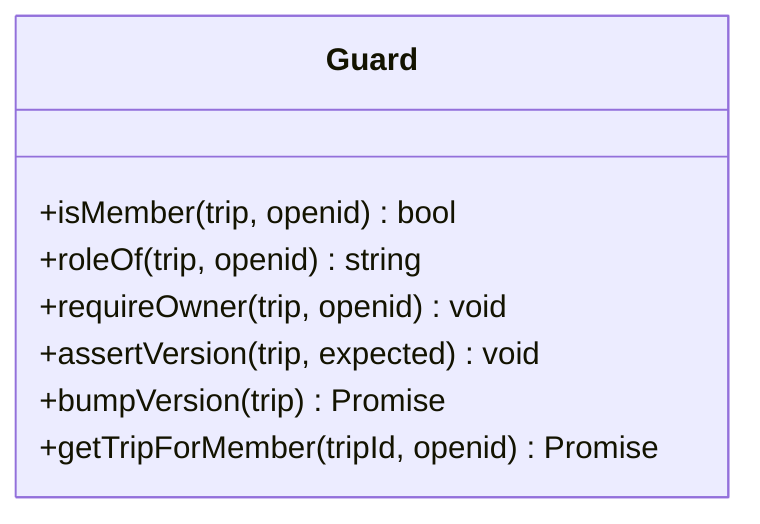

**图表来源**
- [cloudfunctions/api/guard.js:3-75](file://cloudfunctions/api/guard.js#L3-L75)

**章节来源**
- [cloudfunctions/api/guard.js:1-76](file://cloudfunctions/api/guard.js#L1-L76)

### 行程数据访问（trip.js）
- 列表查询：按 `memberOpenids` 过滤、`updatedAt` 倒序、限制 50 条。
- 创建行程：生成 uuid、推导 `days`、设置初始状态与邀请码字段，写入 trips 集合。
- 更新行程：校验标题、目的地、交通方式、预算、状态；日期变化时重建 `days`，减少天数前检查孤儿点位；使用 `assertVersion` 与 `bumpVersion` 保证并发安全。
- 删除行程：软删除 trips、pois、expenses，要求 owner 且版本一致。
- 邀请与加入：邀请码 7 天有效，唯一性通过重复尝试生成；加入时更新 `memberOpenids`、`members`、`mode`、`version`。
- 复制行程：重新计算起止日期与 `days`，复制 pois 并重排 `order`，成员仅保留自己。

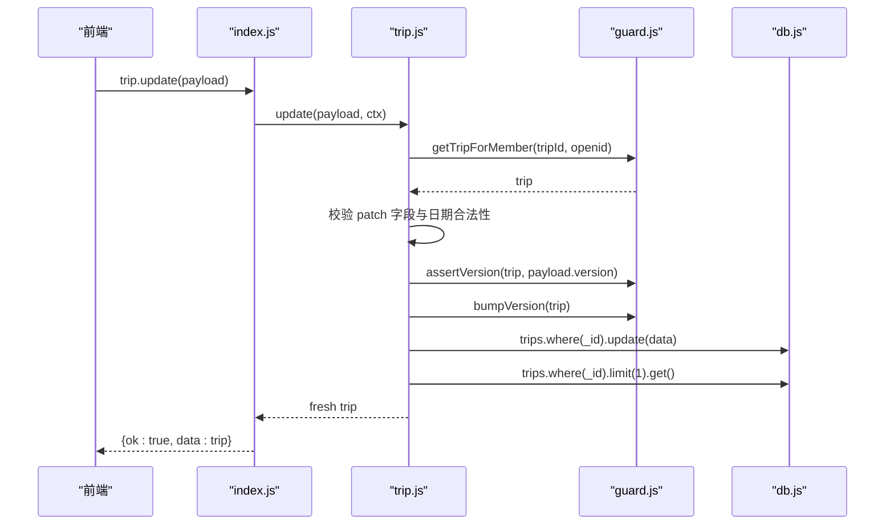

**图表来源**
- [cloudfunctions/api/index.js:14-17](file://cloudfunctions/api/index.js#L14-L17)
- [cloudfunctions/api/trip.js:90-131](file://cloudfunctions/api/trip.js#L90-L131)
- [cloudfunctions/api/guard.js:26-42](file://cloudfunctions/api/guard.js#L26-L42)

**章节来源**
- [cloudfunctions/api/trip.js:35-356](file://cloudfunctions/api/trip.js#L35-L356)

### 地点数据访问（poi.js）
- 列表查询：一次返回 trip 与 pois，减少往返；按 `order` 升序，限制 300 条。
- 保存地点：校验名称、dayIndex、分类、时间、时长；新增时检查一天最多 20 个；换天时重算 `order`；使用 `assertVersion` 与 `bumpVersion`。
- 删除地点：软删 poi，回写 trips 的 `poiCount`。
- 重排地点：支持顺序调整、换天、重排时间，一次性提交多个更新，使用 `Promise.all` 并行执行。

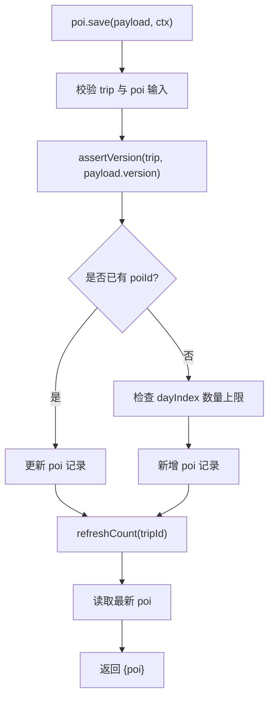

**图表来源**
- [cloudfunctions/api/poi.js:73-143](file://cloudfunctions/api/poi.js#L73-L143)

**章节来源**
- [cloudfunctions/api/poi.js:42-191](file://cloudfunctions/api/poi.js#L42-L191)

### 记账数据访问（expense.js）
- 列表查询：按 `tripId` 过滤、`spentAt` 倒序，限制 300 条；服务端汇总分类占比与总额。
- 概览查询：对当前用户参与的所有行程进行聚合统计，使用 `aggregate().match().group()` 计算每个 trip 的总额与笔数。
- 保存账目：金额必须大于 0；付款人必须是成员；分摊份额合计必须等于金额；新增或更新 expenses。
- 删除账目：软删 expenses。
- AA 结算：计算每人实付与应摊差额，给出最少转账建议。

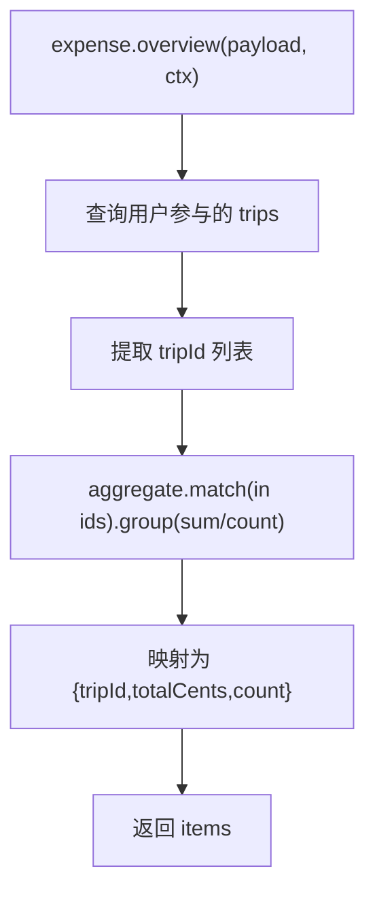

**图表来源**
- [cloudfunctions/api/expense.js:105-130](file://cloudfunctions/api/expense.js#L105-L130)

**章节来源**
- [cloudfunctions/api/expense.js:88-320](file://cloudfunctions/api/expense.js#L88-L320)

## 依赖关系分析
- `index.js` 依赖 `db.js` 的 `start`、`ready`，以及各业务 handler。
- 各 handler 依赖 `db.js` 的 `db`、`_`、`$`，以及 `guard.js` 的权限与版本工具。
- `services/cloud.js` 作为前端统一封装，屏蔽网络异常与服务端错误，并将 `code` 透传。

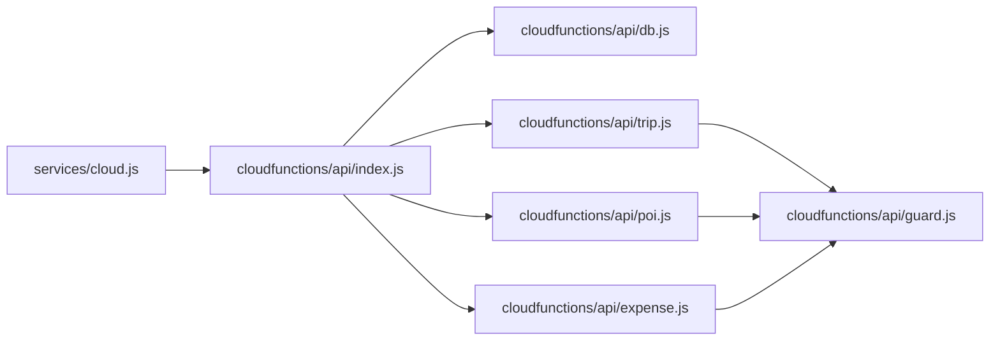

**图表来源**
- [services/cloud.js:1-50](file://services/cloud.js#L1-L50)
- [cloudfunctions/api/index.js:1-41](file://cloudfunctions/api/index.js#L1-L41)
- [cloudfunctions/api/db.js:1-10](file://cloudfunctions/api/db.js#L1-L10)
- [cloudfunctions/api/trip.js:1-4](file://cloudfunctions/api/trip.js#L1-L4)
- [cloudfunctions/api/poi.js:1-3](file://cloudfunctions/api/poi.js#L1-L3)
- [cloudfunctions/api/expense.js:1-3](file://cloudfunctions/api/expense.js#L1-L3)
- [cloudfunctions/api/guard.js:1-5](file://cloudfunctions/api/guard.js#L1-L5)

**章节来源**
- [services/cloud.js:1-50](file://services/cloud.js#L1-L50)
- [cloudfunctions/api/index.js:1-77](file://cloudfunctions/api/index.js#L1-L77)
- [cloudfunctions/api/db.js:1-61](file://cloudfunctions/api/db.js#L1-L61)
- [cloudfunctions/api/guard.js:1-76](file://cloudfunctions/api/guard.js#L1-L76)

## 性能与索引优化
- 查询限制：行程列表限制 50 条，地点与账目列表限制 300 条，避免单次拉取过多数据。
- 聚合优先：概览类统计在服务端使用 `aggregate`，减少明细传输与前端计算开销。
- 排序优化：地点使用 `order` 字段实现“按天+按序”的单字段排序，减少复合排序成本。
- 索引建议：
  - `trips`：`memberOpenids + updatedAt`
  - `pois`：`tripId + order`；`tripId + dayIndex + order`
  - `expenses`：`tripId + spentAt`
- 集合权限：全部设为“仅管理端可读写”，前端不直连数据库，降低越权风险与无效查询。

**章节来源**
- [cloudfunctions/api/trip.js:35-43](file://cloudfunctions/api/trip.js#L35-L43)
- [cloudfunctions/api/poi.js:62-70](file://cloudfunctions/api/poi.js#L62-L70)
- [cloudfunctions/api/expense.js:88-103](file://cloudfunctions/api/expense.js#L88-L103)
- [docs/方案.md:183-191](file://docs/方案.md#L183-L191)

## 事务与一致性保障
- 乐观锁：通过 `trips.version` 字段实现 CAS 语义。客户端读到的版本在更新/删除时传入，服务端用 `assertVersion` 校验，再用 `bumpVersion` 原子递增。
- 原子占位：`bumpVersion` 使用 `where({_id, version: current})` 更新为 `_.inc(1)`，若 `stats.updated === 0` 说明被其他请求抢先写入，抛出 `conflictError()`。
- 软删除：行程、地点、账目均采用 `deletedAt` 标记，历史数据保留，便于后续回放与审计。
- 成员一致性：加入/退出/移除成员时同步更新 `memberOpenids`、`members`、`mode`，并保持 `version` 递增。

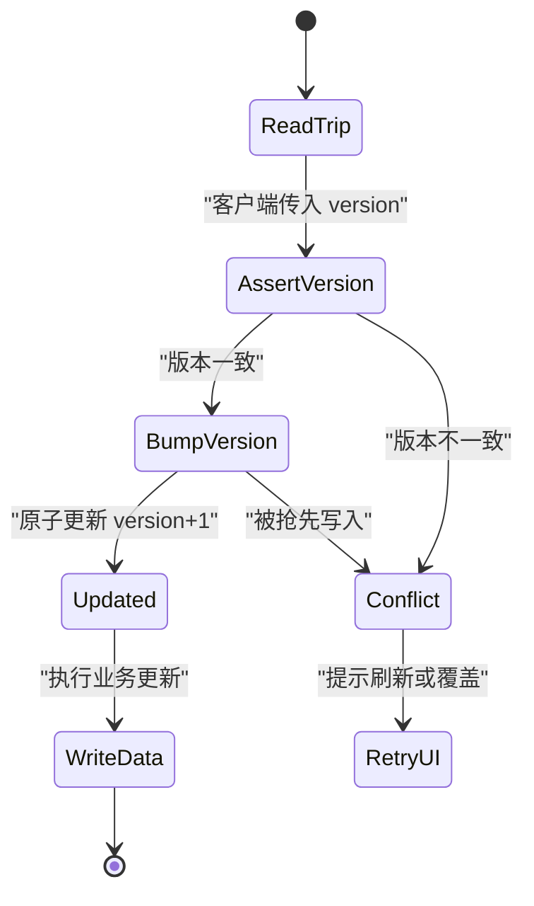

**图表来源**
- [cloudfunctions/api/guard.js:26-42](file://cloudfunctions/api/guard.js#L26-L42)
- [cloudfunctions/api/trip.js:127-131](file://cloudfunctions/api/trip.js#L127-L131)

**章节来源**
- [cloudfunctions/api/guard.js:20-42](file://cloudfunctions/api/guard.js#L20-L42)
- [cloudfunctions/api/trip.js:134-147](file://cloudfunctions/api/trip.js#L134-L147)

## CRUD 封装模式与批量操作
- 统一入口：前端通过 `services/cloud.js` 的 `call` 与 `run` 发起请求，统一处理 loading、toast 与错误码。
- 后端路由：`index.js` 将 action 映射到 handler，集中处理身份与异常。
- 业务封装：
  - trip.js：list/get/create/update/copy/remove/invite/join/leave/removeMember。
  - poi.js：list/save/remove/reorder。
  - expense.js：list/overview/save/remove/settle。
- 批量优化：
  - `poi.reorder` 一次性提交多个更新，使用 `Promise.all` 并行执行。
  - `expense.overview` 使用 `aggregate` 聚合统计，避免逐条明细传输。
  - 列表查询均加 `limit`，防止大数据量拖慢响应。

**章节来源**
- [services/cloud.js:5-47](file://services/cloud.js#L5-L47)
- [cloudfunctions/api/index.js:10-76](file://cloudfunctions/api/index.js#L10-L76)
- [cloudfunctions/api/poi.js:162-191](file://cloudfunctions/api/poi.js#L162-L191)
- [cloudfunctions/api/expense.js:105-130](file://cloudfunctions/api/expense.js#L105-L130)

## 复杂查询与聚合示例
- 行程列表：`where({ memberOpenids: ctx.openid, deletedAt: '' }).orderBy('updatedAt', 'desc').limit(50)`。
- 地点列表：`where({ tripId: trip._id, deletedAt: '' }).orderBy('order', 'asc').limit(300)`。
- 账目概览：`aggregate().match({ tripId: _.in(ids), deletedAt: '' }).group({ _id: '$tripId', totalCents: $.sum('$amountCents'), count: $.sum(1) })`。
- AA 结算：遍历 expenses 计算 paid 与 owed，再贪心匹配债务人与债权人，输出最少转账建议。

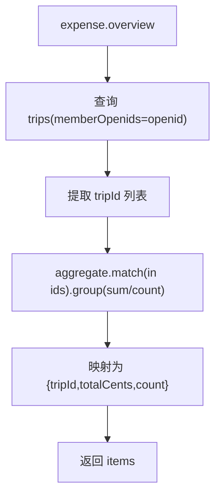

**图表来源**
- [cloudfunctions/api/expense.js:105-130](file://cloudfunctions/api/expense.js#L105-L130)

**章节来源**
- [cloudfunctions/api/trip.js:35-43](file://cloudfunctions/api/trip.js#L35-L43)
- [cloudfunctions/api/poi.js:62-70](file://cloudfunctions/api/poi.js#L62-L70)
- [cloudfunctions/api/expense.js:105-130](file://cloudfunctions/api/expense.js#L105-L130)

## 数据迁移策略
- 老数据兼容：
  - `trips.version`：首次读取时若不存在则补 0，并写库，确保后续乐观锁生效。
  - `splitWith`：老账目只有 `splitWith` 字段时，按人数均摊还原为 `splits`。
- 增量迁移：
  - 集合首次请求自动创建，无需手工建表。
  - 索引建议在数据量增长后通过控制台补充，代码中不动态创建索引。
- 字段演进：
  - `members` 数组与 `role` 字段用于 V1.5 协同，老数据通过 `roleOf` 兜底。
  - `deletedAt` 软删除字段贯穿 trips、pois、expenses，历史数据保留。

**章节来源**
- [cloudfunctions/api/guard.js:56-64](file://cloudfunctions/api/guard.js#L56-L64)
- [cloudfunctions/api/expense.js:253-261](file://cloudfunctions/api/expense.js#L253-L261)
- [cloudfunctions/api/db.js:13-27](file://cloudfunctions/api/db.js#L13-L27)
- [docs/方案.md:123-207](file://docs/方案.md#L123-L207)

## 备份与恢复方案
- 软删除机制：删除行程、地点、账目仅标记 `deletedAt`，不物理删除，便于恢复与回放。
- 云存储照片：手帐照片上传至云存储，数据库仅存 fileID；删除记录只软删，原图保留。
- 导出能力：方案中提到 V1.5 预留“导出行程为图片/文本”，但当前代码未实现，属于待办项。
- 定时触发器：订阅消息记录在 `trips.reminders`，定时任务每天 20:00 发送提醒，发过标 `sentAt` 不再重发。

**章节来源**
- [cloudfunctions/api/trip.js:134-147](file://cloudfunctions/api/trip.js#L134-L147)
- [docs/方案.md:193-207](file://docs/方案.md#L193-L207)
- [docs/方案.md:346-351](file://docs/方案.md#L346-L351)

## 故障排查指南
- 网络异常：前端 `services/cloud.js` 的 `call` 在 `fail` 分支返回“网络异常，请检查网络后重试”。
- 服务异常：后端 `index.js` 捕获异常后返回 `{ok:false, message, code?}`，`code` 可用于客户端特殊处理（如 `conflict`）。
- 版本冲突：`guard.js` 的 `conflictError` 设置 `err.code = 'conflict'`，前端需弹选择框让用户决定刷新或覆盖。
- 权限不足：`guard.js` 的 `requireOwner` 与 `getTripForMember` 会抛错，提示“只有创建者可以做这个操作”或“你没有这份行程的权限”。
- 定时任务失败：`index.js` 的定时分支捕获异常并记录日志，返回 `{ok:false, message}`。

**章节来源**
- [services/cloud.js:25-47](file://services/cloud.js#L25-L47)
- [cloudfunctions/api/index.js:43-76](file://cloudfunctions/api/index.js#L43-L76)
- [cloudfunctions/api/guard.js:20-24](file://cloudfunctions/api/guard.js#L20-L24)
- [cloudfunctions/api/guard.js:16-18](file://cloudfunctions/api/guard.js#L16-L18)
- [cloudfunctions/api/guard.js:44-54](file://cloudfunctions/api/guard.js#L44-L54)

## 结论
本项目数据访问层以云函数为统一入口，集中处理身份校验、权限控制与数据操作，前端不直连数据库，安全性与可控性较强。通过乐观锁与原子版本号递增保证并发一致性，软删除与历史数据保留提升可恢复性。查询与聚合在服务端完成，配合合理的索引设计与限流策略，满足旅行计划小程序的性能需求。未来可扩展分页、离线缓存、更细粒度乐观锁与数据导出能力，进一步提升用户体验与系统健壮性。