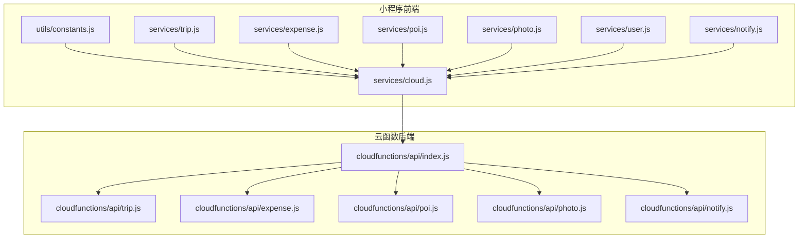
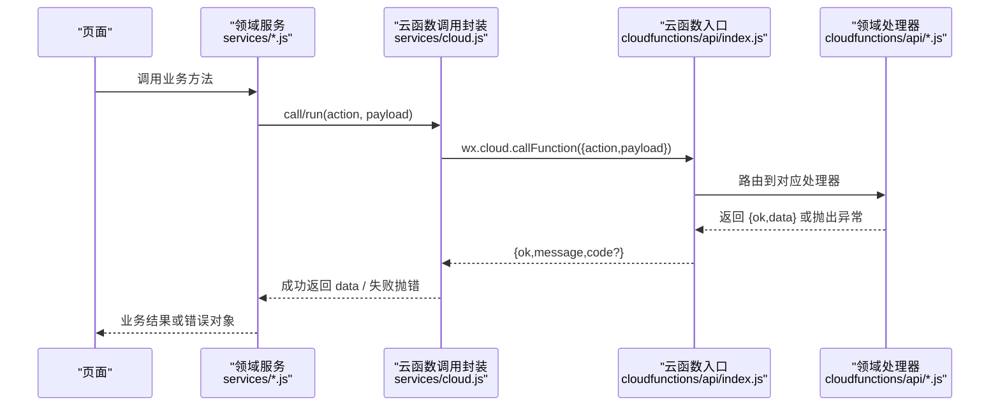
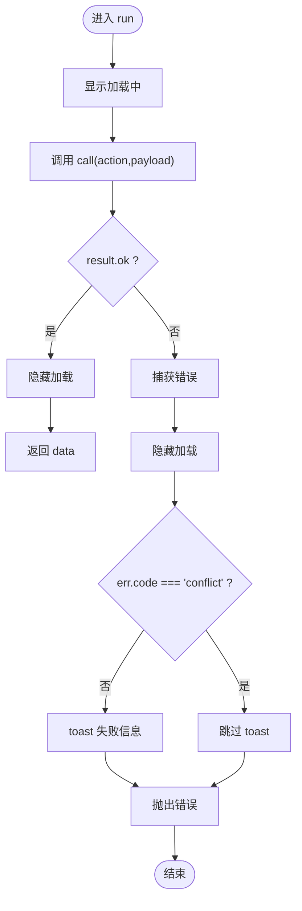
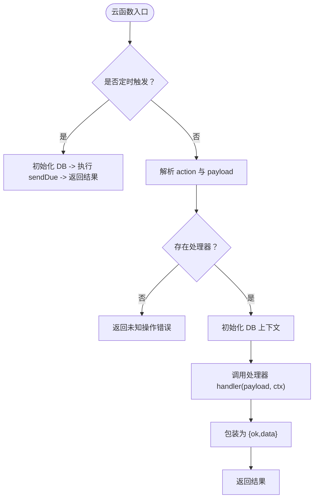
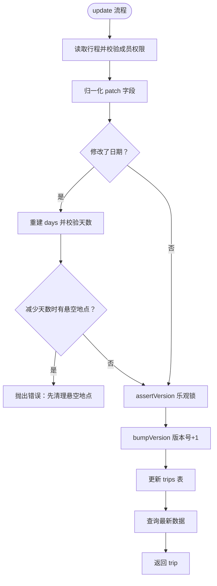
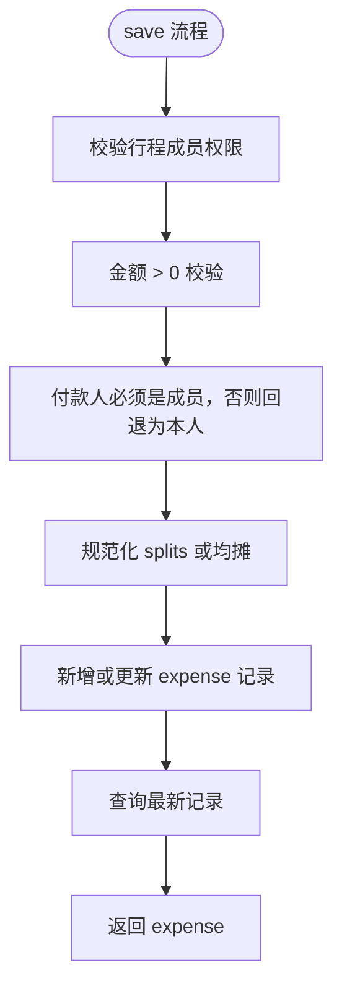
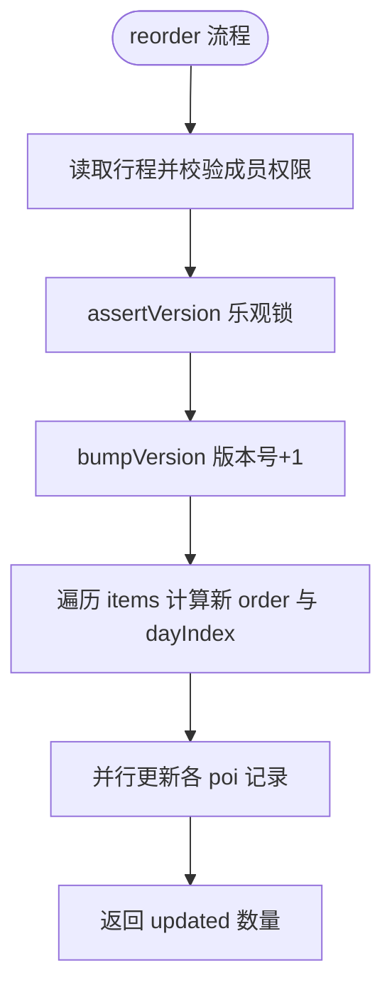
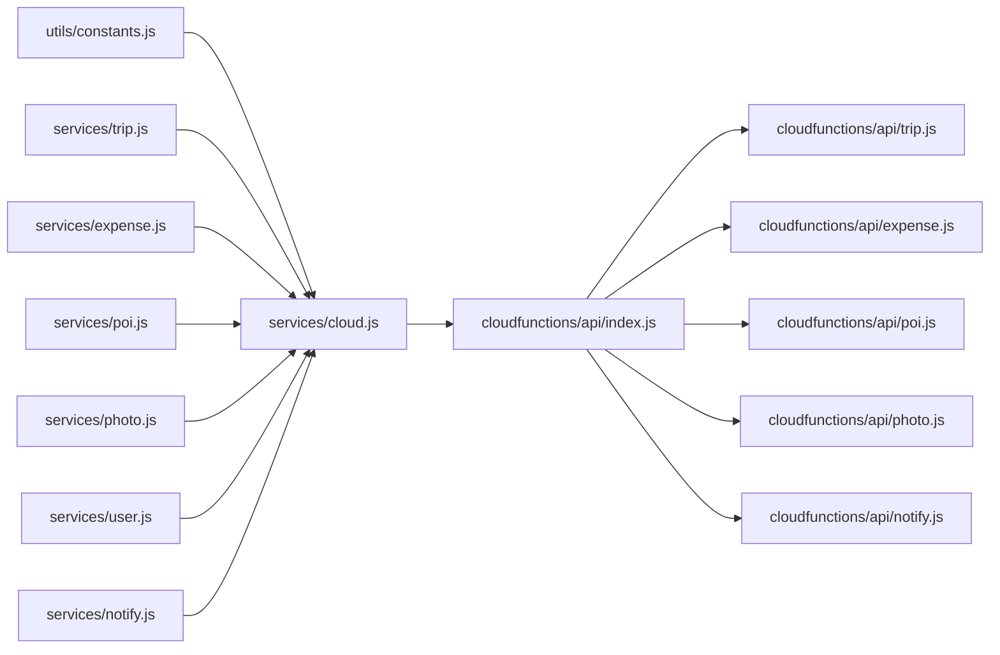

# 服务层设计

<cite>
**本文引用的文件**   
- [services/cloud.js](file://services/cloud.js)
- [services/trip.js](file://services/trip.js)
- [services/expense.js](file://services/expense.js)
- [services/poi.js](file://services/poi.js)
- [services/photo.js](file://services/photo.js)
- [services/user.js](file://services/user.js)
- [services/notify.js](file://services/notify.js)
- [cloudfunctions/api/index.js](file://cloudfunctions/api/index.js)
- [cloudfunctions/api/trip.js](file://cloudfunctions/api/trip.js)
- [cloudfunctions/api/expense.js](file://cloudfunctions/api/expense.js)
- [cloudfunctions/api/poi.js](file://cloudfunctions/api/poi.js)
- [cloudfunctions/api/photo.js](file://cloudfunctions/api/photo.js)
- [cloudfunctions/api/notify.js](file://cloudfunctions/api/notify.js)
- [utils/constants.js](file://utils/constants.js)
</cite>

## 目录
1. [引言](#引言)
2. [项目结构](#项目结构)
3. [核心组件](#核心组件)
4. [架构总览](#架构总览)
5. [详细组件分析](#详细组件分析)
6. [依赖关系分析](#依赖关系分析)
7. [性能与一致性](#性能与一致性)
8. [故障排查指南](#故障排查指南)
9. [结论](#结论)
10. [附录：扩展与最佳实践](#附录扩展与最佳实践)

## 引言
本技术文档聚焦旅行计划小程序的服务层（Service 封装），系统阐述其业务逻辑封装策略、数据获取与转换的统一模式、错误处理机制，以及通过云函数 API 调用异步操作和 Promise 链的规范。文档同时说明数据模型定义、业务规则校验、乐观锁与版本控制、缓存与同步策略，并提供扩展建议与常见陷阱规避方法，帮助读者在保持前后端解耦的同时，稳定地扩展新的业务能力。

## 项目结构
服务层位于 services 目录，统一通过 cloud.js 调用云函数；云函数入口 index.js 将 action 路由到具体业务模块（trip、poi、expense、photo、notify、user）。常量集中在 utils/constants.js，统一管理环境、集合名、分类与限制等配置。

**图表来源**
- [services/cloud.js:1-50](file://services/cloud.js#L1-L50)
- [services/trip.js:1-47](file://services/trip.js#L1-L47)
- [services/expense.js:1-26](file://services/expense.js#L1-L26)
- [services/poi.js:1-22](file://services/poi.js#L1-L22)
- [services/photo.js:1-16](file://services/photo.js#L1-L16)
- [services/user.js:1-8](file://services/user.js#L1-L8)
- [services/notify.js:1-8](file://services/notify.js#L1-L8)
- [cloudfunctions/api/index.js:1-77](file://cloudfunctions/api/index.js#L1-L77)
- [cloudfunctions/api/trip.js:1-370](file://cloudfunctions/api/trip.js#L1-L370)
- [cloudfunctions/api/expense.js:1-329](file://cloudfunctions/api/expense.js#L1-L329)
- [cloudfunctions/api/poi.js:1-199](file://cloudfunctions/api/poi.js#L1-L199)
- [cloudfunctions/api/photo.js:1-65](file://cloudfunctions/api/photo.js#L1-L65)
- [cloudfunctions/api/notify.js:1-102](file://cloudfunctions/api/notify.js#L1-L102)
- [utils/constants.js:1-48](file://utils/constants.js#L1-L48)

**章节来源**
- [services/cloud.js:1-50](file://services/cloud.js#L1-L50)
- [cloudfunctions/api/index.js:1-77](file://cloudfunctions/api/index.js#L1-L77)
- [utils/constants.js:1-48](file://utils/constants.js#L1-L48)

## 核心组件
- 云函数调用封装：提供 call 与 run 两个统一入口，负责参数包装、Promise 化、loading 展示、失败 toast 与错误码透传。
- 领域服务：trip、expense、poi、photo、user、notify 分别封装各自业务动作，屏蔽网络细节，向上暴露简洁 API。
- 云函数路由：index.js 集中维护 action 到处理器的映射，统一异常捕获与返回格式。
- 常量配置：constants.js 集中管理环境、集合名、分类、限制等全局常量。

关键职责划分：
- 前端 Service 只关注“做什么”，不关心“怎么实现”。
- 云函数处理器专注“怎么做”，包含数据校验、权限检查、事务性更新与结果组装。
- 错误通过统一的 ok/message/code 协议传递，前端按 code 做差异化处理。

**章节来源**
- [services/cloud.js:1-50](file://services/cloud.js#L1-L50)
- [services/trip.js:1-47](file://services/trip.js#L1-L47)
- [services/expense.js:1-26](file://services/expense.js#L1-L26)
- [services/poi.js:1-22](file://services/poi.js#L1-L22)
- [services/photo.js:1-16](file://services/photo.js#L1-L16)
- [services/user.js:1-8](file://services/user.js#L1-L8)
- [services/notify.js:1-8](file://services/notify.js#L1-L8)
- [cloudfunctions/api/index.js:1-77](file://cloudfunctions/api/index.js#L1-L77)
- [utils/constants.js:1-48](file://utils/constants.js#L1-L48)

## 架构总览
服务层采用“前端 Service + 云函数单入口 + 领域处理器”的分层架构。所有写操作均走云函数，避免前端直连数据库，便于后续成员/权限等能力的演进。

**图表来源**
- [services/cloud.js:5-47](file://services/cloud.js#L5-L47)
- [cloudfunctions/api/index.js:43-76](file://cloudfunctions/api/index.js#L43-L76)

**章节来源**
- [services/cloud.js:5-47](file://services/cloud.js#L5-L47)
- [cloudfunctions/api/index.js:10-76](file://cloudfunctions/api/index.js#L10-L76)

## 详细组件分析

### 云函数调用封装（services/cloud.js）
- call：将 wx.cloud.callFunction 的结果 Promise 化，解析 result.ok 分支，将 message 与 code 注入错误对象后 reject。
- run：在 call 基础上增加 loading 显示、失败时统一 showToast（冲突类错误除外），并透传错误给调用方。

设计要点：
- 统一错误协议：{ok, message, code?}，前端按 code 区分 conflict 等特殊场景。
- 统一交互体验：run 自动 show/hide loading，减少页面样板代码。
- 网络异常兜底：fail 分支给出明确提示。

**图表来源**
- [services/cloud.js:33-47](file://services/cloud.js#L33-L47)

**章节来源**
- [services/cloud.js:1-50](file://services/cloud.js#L1-L50)

### 行程服务（services/trip.js）
- 读接口：list、get 使用 call，直接返回数据。
- 写接口：create、update、remove、copy、invite、join、leave、removeMember 使用 run，带 loading 与统一错误处理。
- 乐观锁：update/remove 等方法携带 version，服务端校验不一致则返回 conflict。

典型调用模式：
- 列表/详情：无副作用，直接 call。
- 创建/保存/删除：有副作用，run 包裹，确保用户反馈一致。

**章节来源**
- [services/trip.js:1-47](file://services/trip.js#L1-L47)

### 记账服务（services/expense.js）
- list/overview：聚合计算在服务端完成，保证前端与明细一致。
- save/remove：写操作走 run，带 loading。
- settle：服务端计算 AA 结算与转账建议，返回结构化结果。

注意：
- overview 一次聚合多行程花费，适合“记账 Tab”的概览场景。
- settle 的计算逻辑在服务端，避免前端重复计算导致不一致。

**章节来源**
- [services/expense.js:1-26](file://services/expense.js#L1-L26)

### 地点服务（services/poi.js）
- list：一次性返回 trip 与 poi 列表，减少往返。
- save/remove/reorder：写操作走 run，支持版本控制与批量重排。
- reorder：客户端提交完整顺序，服务端原子更新，避免部分成功。

关键点：
- save/remove 需要传入 version，防止并发覆盖。
- reorder 通过单一接口完成换天、排序、时间调整，提升一致性。

**章节来源**
- [services/poi.js:1-22](file://services/poi.js#L1-L22)

### 照片服务（services/photo.js）
- list/add/remove：照片记录仅存储 fileID，图片地址由小程序端直接使用 fileID 渲染。
- add/remove：写操作走 run，带 loading。

约束：
- 每趟行程照片上限由服务端限制，避免滥用。

**章节来源**
- [services/photo.js:1-16](file://services/photo.js#L1-L16)

### 用户服务（services/user.js）
- me：返回当前用户基本信息，如昵称与默认币种。

**章节来源**
- [services/user.js:1-8](file://services/user.js#L1-L8)

### 通知服务（services/notify.js）
- subscribe：订阅出发提醒模板，服务端记录模板 ID 与时间戳。
- 定时任务：由云函数定时触发 notify.sendDue，向即将出发的行程成员发送提醒。

**章节来源**
- [services/notify.js:1-8](file://services/notify.js#L1-L8)
- [cloudfunctions/api/notify.js:28-101](file://cloudfunctions/api/notify.js#L28-L101)

### 云函数路由与统一异常处理（cloudfunctions/api/index.js）
- routes：集中维护 action 到处理器的映射，新增能力只需在此注册。
- main：统一解析 event，区分定时触发器与普通请求；统一 try/catch，返回 {ok, data, message, code?}。
- 安全：openid 从服务端上下文获取，不信任前端传入。

**图表来源**
- [cloudfunctions/api/index.js:10-76](file://cloudfunctions/api/index.js#L10-L76)

**章节来源**
- [cloudfunctions/api/index.js:1-77](file://cloudfunctions/api/index.js#L1-L77)

### 领域处理器示例：行程（cloudfunctions/api/trip.js）
- 校验与规范化：标题、目的地、日期区间、出行方式、预算等字段在服务端严格校验与归一化。
- 乐观锁：update/remove 使用 assertVersion/bumpVersion，避免并发覆盖。
- 软删除：remove 对 trips/pois/expenses 进行软删，保留历史用于手帐回放。
- 邀请与成员：生成邀请码、加入/退出/移除成员，动态切换 solo/group 模式。
- 复制行程：以今天为起点重建 days，整份搬迁点位，成员仅保留自己。

**图表来源**
- [cloudfunctions/api/trip.js:90-131](file://cloudfunctions/api/trip.js#L90-L131)

**章节来源**
- [cloudfunctions/api/trip.js:1-370](file://cloudfunctions/api/trip.js#L1-L370)

### 领域处理器示例：记账（cloudfunctions/api/expense.js）
- 汇总计算：summarize 在服务端聚合总额与分类占比，保证前端与明细一致。
- 分摊逻辑：evenSplits 与 normalizeSplits 确保分摊合计等于金额，零头分配给第一个成员。
- 结算算法：buildSettlement 计算每人实付/应摊/差额，并输出最少笔数的转账建议。

**图表来源**
- [cloudfunctions/api/expense.js:132-184](file://cloudfunctions/api/expense.js#L132-L184)

**章节来源**
- [cloudfunctions/api/expense.js:1-329](file://cloudfunctions/api/expense.js#L1-L329)

### 领域处理器示例：地点（cloudfunctions/api/poi.js）
- 排序策略：order 基于 dayIndex 进位，使单字段 order 即可实现“按天+按序”排序。
- 数量限制：每天最多 MAX_PER_DAY 个地点。
- 批量重排：reorder 接受完整顺序，原子更新，避免半成功。

**图表来源**
- [cloudfunctions/api/poi.js:164-190](file://cloudfunctions/api/poi.js#L164-L190)

**章节来源**
- [cloudfunctions/api/poi.js:1-199](file://cloudfunctions/api/poi.js#L1-L199)

### 领域处理器示例：照片（cloudfunctions/api/photo.js）
- 存储策略：仅存 fileID，图片地址由小程序端直接使用。
- 数量限制：每趟行程最多 MAX_PHOTOS 张照片。
- 软删除：删除仅标记 deletedAt，原图保留以便恢复。

**章节来源**
- [cloudfunctions/api/photo.js:1-65](file://cloudfunctions/api/photo.js#L1-L65)

### 领域处理器示例：通知（cloudfunctions/api/notify.js）
- 订阅：记录模板 ID 与时间戳，同一 openid 仅保留一条。
- 定时任务：sendDue 每日扫描“明天出发”的行程，向未发送的成员推送消息，失败也标记已用掉授权。

**章节来源**
- [cloudfunctions/api/notify.js:1-102](file://cloudfunctions/api/notify.js#L1-L102)

## 依赖关系分析
- 前端 Service 依赖 constants.js 中的 CLOUD_FUNCTION 与环境配置。
- 云函数入口 index.js 依赖各领域处理器，形成清晰的单向依赖。
- 领域处理器依赖 guard/util/db 等工具模块，进行权限、校验与数据访问。

**图表来源**
- [utils/constants.js:1-48](file://utils/constants.js#L1-L48)
- [services/cloud.js:1-50](file://services/cloud.js#L1-L50)
- [cloudfunctions/api/index.js:1-77](file://cloudfunctions/api/index.js#L1-L77)

**章节来源**
- [utils/constants.js:1-48](file://utils/constants.js#L1-L48)
- [services/cloud.js:1-50](file://services/cloud.js#L1-L50)
- [cloudfunctions/api/index.js:1-77](file://cloudfunctions/api/index.js#L1-L77)

## 性能与一致性
- 聚合计算与服务端结算：expense.overview 与 settle 在服务端计算，减少前端负担并确保一致性。
- 批量更新：poi.reorder 使用 Promise.all 并行更新，缩短整体耗时。
- 乐观锁：trip/poi 的 update/remove 使用 version 控制并发，避免覆盖写入。
- 软删除：trips/pois/expenses/files 采用软删，保留历史数据，便于审计与回放。
- 限制与边界：days、poi_per_day、photos 等上限在服务端强制，避免前端绕过。

[本节为通用指导，不涉及具体文件分析]

## 故障排查指南
- 网络异常：cloud.run 的 fail 分支会提示“网络异常，请检查网络后重试”，需检查网络环境与云函数部署状态。
- 冲突错误：当 err.code === 'conflict' 时，前端不应 toast，而应引导用户刷新或选择处理方式。
- 未知操作：云函数入口对未注册的 action 返回“未知操作”，检查 services 中 action 名称与 index.js 路由是否一致。
- 权限问题：所有写操作均需通过 getTripForMember 校验成员权限，若报错请确认 openid 与成员列表。
- 数据校验失败：如金额<=0、地点名称为空、日期不合法等，查看对应处理器的校验逻辑与错误信息。

**章节来源**
- [services/cloud.js:33-47](file://services/cloud.js#L33-L47)
- [cloudfunctions/api/index.js:56-76](file://cloudfunctions/api/index.js#L56-L76)
- [cloudfunctions/api/trip.js:50-88](file://cloudfunctions/api/trip.js#L50-L88)
- [cloudfunctions/api/expense.js:132-184](file://cloudfunctions/api/expense.js#L132-L184)
- [cloudfunctions/api/poi.js:73-144](file://cloudfunctions/api/poi.js#L73-L144)

## 结论
服务层通过统一的云函数调用封装与领域服务抽象，实现了数据获取、转换与错误处理的标准化；云函数侧集中路由与统一异常处理，保证了行为一致性与可维护性。乐观锁、软删除、服务端聚合与限制等手段，共同保障了数据一致性与用户体验。该架构便于扩展新业务能力，同时降低前端复杂度。

[本节为总结性内容，不涉及具体文件分析]

## 附录：扩展与最佳实践
- 新增领域服务
  - 在 services 下新建 service.js，复用 call/run 封装。
  - 在 cloudfunctions/api/index.js 的 routes 中注册 action。
  - 在 cloudfunctions/api 下新增处理器，实现业务逻辑。
- 错误处理策略
  - 使用 run 包裹写操作，获得统一 loading 与 toast。
  - 针对 conflict 等特殊 code，在前端做差异化处理（如提示刷新）。
- 数据模型与校验
  - 所有输入在服务端进行 cut/toCents/normalize 等归一化与校验。
  - 使用枚举与白名单限制 category/status 等字段。
- 并发与一致性
  - 写操作携带 version，服务端使用 assertVersion/bumpVersion。
  - 批量更新尽量合并为单次接口（如 poi.reorder）。
- 缓存与同步
  - 当前服务层未实现本地缓存；如需缓存，建议在页面层结合本地存储与版本号进行增量同步。
  - 对于频繁读取的数据（如 trip.list），可在页面层做短时缓存，并在写操作后失效。
- 常见陷阱
  - 忘记在写操作中传入 version，导致并发覆盖。
  - 前端直接拼接 action 名称，出现拼写错误导致“未知操作”。
  - 忽略服务端限制（如 POI 数量上限），导致写入失败。
  - 在 conflict 场景下重复 toast，打扰用户。

[本节为通用指导，不涉及具体文件分析]