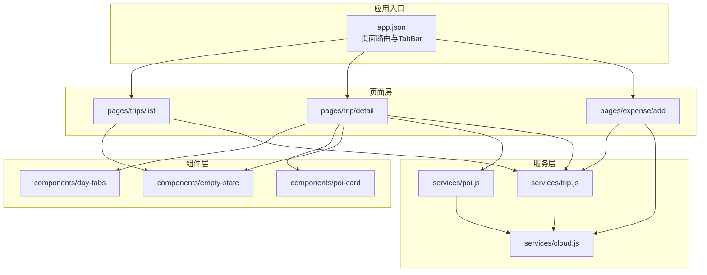
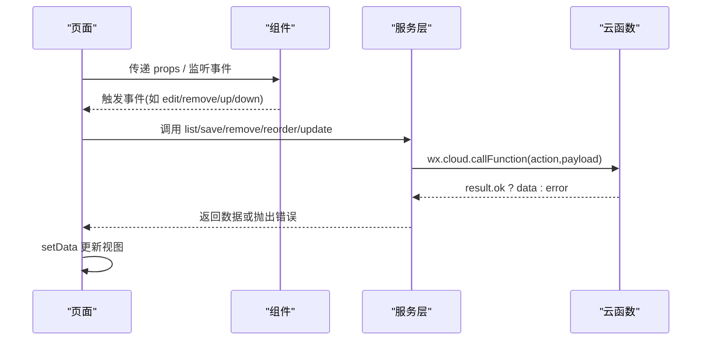
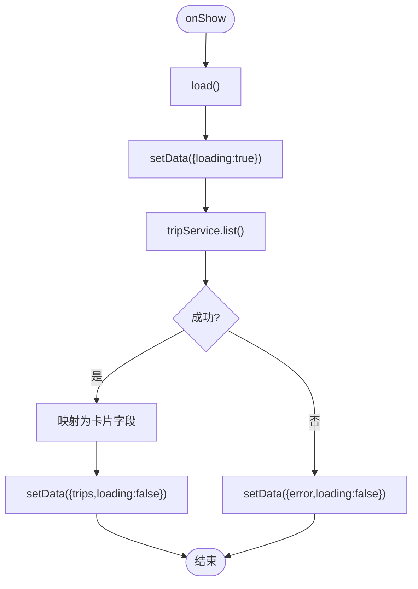
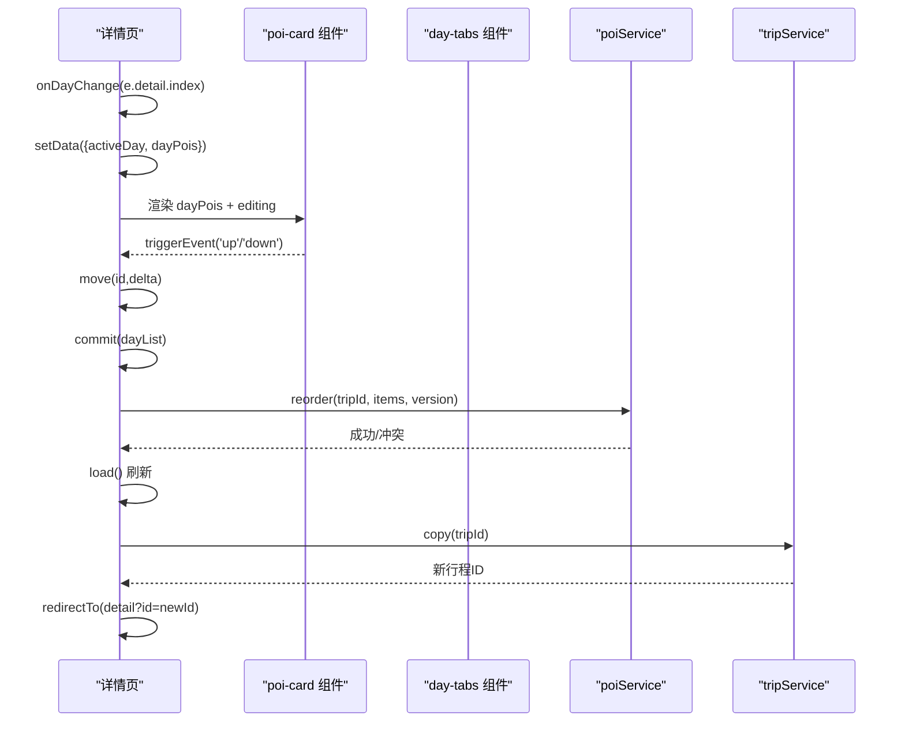
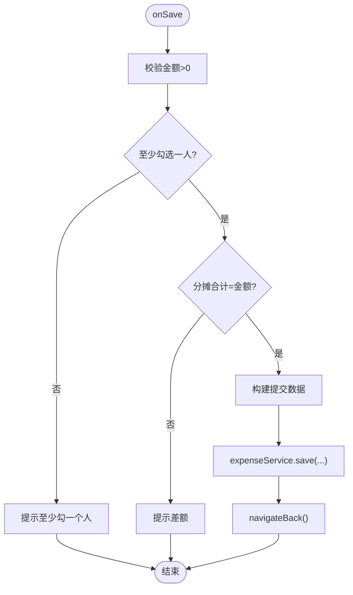
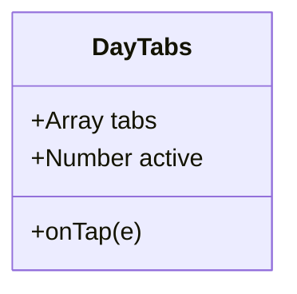
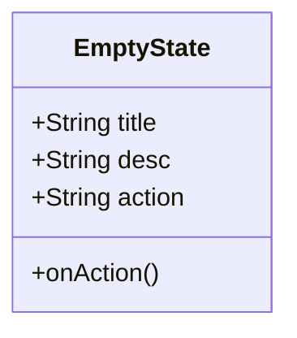
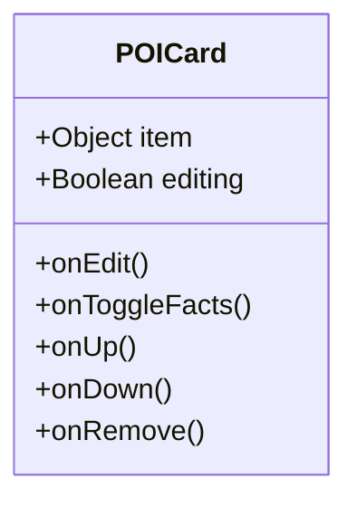
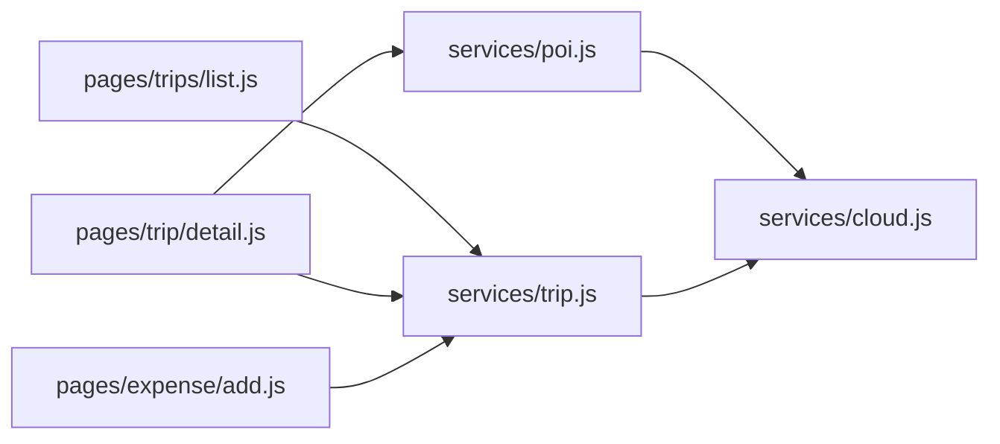

# 表现层设计

<cite>
**本文引用的文件**   
- [app.json](file://app.json)
- [services/cloud.js](file://services/cloud.js)
- [services/poi.js](file://services/poi.js)
- [services/trip.js](file://services/trip.js)
- [components/day-tabs/day-tabs.js](file://components/day-tabs/day-tabs.js)
- [components/day-tabs/day-tabs.wxml](file://components/day-tabs/day-tabs.wxml)
- [components/empty-state/empty-state.js](file://components/empty-state/empty-state.js)
- [components/empty-state/empty-state.wxml](file://components/empty-state/empty-state.wxml)
- [components/poi-card/poi-card.js](file://components/poi-card/poi-card.js)
- [components/poi-card/poi-card.wxml](file://components/poi-card/poi-card.wxml)
- [pages/trips/list.js](file://pages/trips/list.js)
- [pages/trips/list.wxml](file://pages/trips/list.wxml)
- [pages/trip/detail.js](file://pages/trip/detail.js)
- [pages/trip/detail.wxml](file://pages/trip/detail.wxml)
- [pages/expense/add.js](file://pages/expense/add.js)
- [pages/expense/add.wxml](file://pages/expense/add.wxml)
</cite>

## 目录
1. [引言](#引言)
2. [项目结构](#项目结构)
3. [核心组件与页面](#核心组件与页面)
4. [架构总览](#架构总览)
5. [详细组件分析](#详细组件分析)
6. [依赖关系分析](#依赖关系分析)
7. [性能与体验优化](#性能与体验优化)
8. [故障排查指南](#故障排查指南)
9. [结论](#结论)

## 引言
本技术文档聚焦旅行计划小程序的表现层，包括 Page 页面与可复用组件的 WXML 模板、WXSS 样式组织与 JavaScript 逻辑。重点说明：
- 页面生命周期管理、数据绑定机制与用户交互处理
- 组件化设计最佳实践：props 传递、事件处理与状态管理
- 页面调用服务层 API 的方式，以及如何处理用户输入和界面更新
- 响应式设计与跨设备兼容性考虑
- 页面性能优化技巧与用户体验改进建议

## 项目结构
小程序采用“按功能域划分”的结构：
- pages：页面级路由与业务视图
- components：可复用 UI 组件
- services：统一封装云函数调用与服务接口
- utils：工具函数与常量
- app.json：全局配置、页面路由与 TabBar

图表来源
- [app.json:1-56](file://app.json#L1-L56)
- [services/cloud.js:1-50](file://services/cloud.js#L1-L50)
- [services/poi.js:1-22](file://services/poi.js#L1-L22)
- [services/trip.js:1-47](file://services/trip.js#L1-L47)
- [pages/trips/list.js:1-72](file://pages/trips/list.js#L1-L72)
- [pages/trip/detail.js:1-422](file://pages/trip/detail.js#L1-L422)
- [pages/expense/add.js:1-264](file://pages/expense/add.js#L1-L264)

章节来源
- [app.json:1-56](file://app.json#L1-L56)

## 核心组件与页面
- 行程列表页（pages/trips/list）
  - 负责展示行程卡片、加载失败重试、新建行程跳转
  - 使用 empty-state 组件表达空状态
- 行程详情页（pages/trip/detail）
  - 负责按天切换、地点增删改、顺序调整、复制行程、邀请同行、订阅提醒等
  - 使用 day-tabs 组件进行按天导航，poi-card 组件渲染每个地点
- 记账新增页（pages/expense/add）
  - 负责金额输入、类别选择、分摊计算、保存提交
  - 通过 tripService 获取行程成员信息，用于 AA 分摊

章节来源
- [pages/trips/list.js:1-72](file://pages/trips/list.js#L1-L72)
- [pages/trips/list.wxml:1-50](file://pages/trips/list.wxml#L1-L50)
- [pages/trip/detail.js:1-422](file://pages/trip/detail.js#L1-L422)
- [pages/trip/detail.wxml:1-90](file://pages/trip/detail.wxml#L1-L90)
- [pages/expense/add.js:1-264](file://pages/expense/add.js#L1-L264)
- [pages/expense/add.wxml:1-102](file://pages/expense/add.wxml#L1-L102)

## 架构总览
表现层遵循“页面 → 组件 → 服务 → 云函数”的分层模式：
- 页面只关注视图与交互，不直接操作网络
- 组件封装独立 UI 行为，通过 props 接收数据、通过事件向父组件汇报
- 服务层统一封装云函数调用，提供带 loading 的统一方法
- 云函数承担写操作，前端不直连数据库，便于权限与协作扩展

图表来源
- [pages/trip/detail.js:1-422](file://pages/trip/detail.js#L1-L422)
- [components/poi-card/poi-card.js:1-33](file://components/poi-card/poi-card.js#L1-L33)
- [services/poi.js:1-22](file://services/poi.js#L1-L22)
- [services/cloud.js:1-50](file://services/cloud.js#L1-L50)

## 详细组件分析

### 行程列表页（pages/trips/list）
- 生命周期
  - onShow：每次显示时重新加载数据
  - onLoad：未使用；分享回调用于设置分享标题与路径
- 数据流
  - trips：由 tripService.list 返回后映射为卡片字段
  - loading/error：控制加载态与错误提示
- 交互
  - 点击卡片跳转到行程详情
  - 点击“新建行程”进入创建页
  - 错误时提供“重试”按钮

图表来源
- [pages/trips/list.js:28-72](file://pages/trips/list.js#L28-L72)
- [pages/trips/list.wxml:1-50](file://pages/trips/list.wxml#L1-L50)

章节来源
- [pages/trips/list.js:1-72](file://pages/trips/list.js#L1-L72)
- [pages/trips/list.wxml:1-50](file://pages/trips/list.wxml#L1-L50)

### 行程详情页（pages/trip/detail）
- 生命周期
  - onLoad：解析 query.id
  - onShow：根据 tripId 加载数据
  - onPullDownRefresh：支持下拉刷新
- 数据模型
  - trip：行程基本信息、预算、状态、成员数、是否所有者
  - tabs：按天标签，供 day-tabs 组件使用
  - pois：所有地点（已增强展示字段）
  - dayPois：当前选中天的地点列表
  - editing：是否处于“调整顺序”模式
- 关键流程
  - 添加地点：默认时间基于上一站时长+缓冲
  - 调整顺序：本地先交换，再批量 reorder，冲突时回滚并提示
  - 复制行程：日期从当天起算，地点整份搬走
  - 订阅提醒：申请授权后记录模板 ID
  - 删除/结束/重开：带乐观锁 version 参数

图表来源
- [pages/trip/detail.js:127-322](file://pages/trip/detail.js#L127-L322)
- [components/poi-card/poi-card.js:1-33](file://components/poi-card/poi-card.js#L1-L33)
- [components/day-tabs/day-tabs.js:1-15](file://components/day-tabs/day-tabs.js#L1-L15)
- [services/poi.js:1-22](file://services/poi.js#L1-L22)
- [services/trip.js:1-47](file://services/trip.js#L1-L47)

章节来源
- [pages/trip/detail.js:1-422](file://pages/trip/detail.js#L1-L422)
- [pages/trip/detail.wxml:1-90](file://pages/trip/detail.wxml#L1-L90)

### 记账新增页（pages/expense/add）
- 生命周期
  - onLoad：解析 tripId/expenseId，加载行程与用户信息
  - loadExpense：编辑模式下回填该笔支出
- 数据模型
  - amount/amountText：金额与格式化显示
  - category/spentAt/note：分类、日期、备注
  - members/payerLabels/payerIndex：付款人选择
  - splits：分摊明细，含 checked/amountText
  - splitStatusText/splitBalanced：分摊校验状态
- 交互
  - 快速金额按钮、类别选择、日期选择
  - 自动均摊与手动修改份额
  - 保存前校验金额、参与人与分摊合计

图表来源
- [pages/expense/add.js:224-262](file://pages/expense/add.js#L224-L262)
- [pages/expense/add.wxml:1-102](file://pages/expense/add.wxml#L1-L102)

章节来源
- [pages/expense/add.js:1-264](file://pages/expense/add.js#L1-L264)
- [pages/expense/add.wxml:1-102](file://pages/expense/add.wxml#L1-L102)

### 组件：day-tabs
- props
  - tabs：数组 [{index,label}]
  - active：当前激活索引
- 事件
  - change：当用户点击不同 tab 时触发，携带 index
- 实现要点
  - 使用 scroll-view 横向滚动，避免长标签溢出
  - 防抖：重复点击相同 tab 不触发事件

图表来源
- [components/day-tabs/day-tabs.js:1-15](file://components/day-tabs/day-tabs.js#L1-L15)
- [components/day-tabs/day-tabs.wxml:1-11](file://components/day-tabs/day-tabs.wxml#L1-L11)

章节来源
- [components/day-tabs/day-tabs.js:1-15](file://components/day-tabs/day-tabs.js#L1-L15)
- [components/day-tabs/day-tabs.wxml:1-11](file://components/day-tabs/day-tabs.wxml#L1-L11)

### 组件：empty-state
- props
  - title/desc/action：标题、描述、动作文案
- 事件
  - action：点击动作区域时触发
- 用途
  - 无数据时的占位引导，配合 bind:action 与页面交互

图表来源
- [components/empty-state/empty-state.js:1-14](file://components/empty-state/empty-state.js#L1-L14)
- [components/empty-state/empty-state.wxml:1-6](file://components/empty-state/empty-state.wxml#L1-L6)

章节来源
- [components/empty-state/empty-state.js:1-14](file://components/empty-state/empty-state.js#L1-L14)
- [components/empty-state/empty-state.wxml:1-6](file://components/empty-state/empty-state.wxml#L1-L6)

### 组件：poi-card
- props
  - item：地点对象（包含 name/category/address/plannedTime/durationText/factsList/note 等）
  - editing：是否处于编辑模式（显示上移/下移/删除）
- 事件
  - edit/togglefacts/up/down/remove：向父组件传递 id 以执行对应操作
- 实现要点
  - 已知信息折叠区，支持“待核实/已核实”状态切换
  - 编辑模式下暴露排序与删除操作

图表来源
- [components/poi-card/poi-card.js:1-33](file://components/poi-card/poi-card.js#L1-L33)
- [components/poi-card/poi-card.wxml:1-41](file://components/poi-card/poi-card.wxml#L1-L41)

章节来源
- [components/poi-card/poi-card.js:1-33](file://components/poi-card/poi-card.js#L1-L33)
- [components/poi-card/poi-card.wxml:1-41](file://components/poi-card/poi-card.wxml#L1-L41)

## 依赖关系分析
- 页面依赖服务层
  - trips/list 依赖 tripService.list
  - trip/detail 依赖 poiService.list/reorder/save/remove 与 tripService.update/copy
  - expense/add 依赖 tripService.get 与 userService.me
- 服务层依赖 cloud.js
  - call：基础调用，返回 Promise
  - run：带 loading 与 toast 的统一包装
- 组件之间解耦
  - 通过 props 传数据，通过 triggerEvent 上报事件
  - 父组件集中处理业务逻辑与状态更新

图表来源
- [pages/trips/list.js:1-72](file://pages/trips/list.js#L1-L72)
- [pages/trip/detail.js:1-422](file://pages/trip/detail.js#L1-L422)
- [pages/expense/add.js:1-264](file://pages/expense/add.js#L1-L264)
- [services/poi.js:1-22](file://services/poi.js#L1-L22)
- [services/trip.js:1-47](file://services/trip.js#L1-L47)
- [services/cloud.js:1-50](file://services/cloud.js#L1-L50)

章节来源
- [services/cloud.js:1-50](file://services/cloud.js#L1-L50)
- [services/poi.js:1-22](file://services/poi.js#L1-L22)
- [services/trip.js:1-47](file://services/trip.js#L1-L47)

## 性能与体验优化
- 数据与展示分离
  - 在 JS 中完成数据增强（如 durationText、factsList），WXML 只做渲染，减少模板内运算
- 本地优先更新
  - 顺序调整先本地生效再提交，弱网下也能立刻看到结果，提升流畅度
- 统一加载与错误反馈
  - 服务层 run 方法统一 showLoading/hideLoading 与 showToast，页面只需处理成功分支
- 条件渲染与最小化重绘
  - 使用 wx:if 控制大区块渲染，避免不必要的节点更新
- 列表 key 优化
  - 使用稳定唯一键（如 _id）提升 diff 效率
- 响应式与跨设备兼容
  - 使用 rpx 单位适配不同屏幕尺寸
  - 使用 scroll-view 承载横向内容，避免溢出
  - 合理设置 tabBar 与导航栏样式，保证多端一致性
- 交互细节
  - 防重复点击（如 saving 标志、active 判断）
  - 明确的状态文案与视觉反馈（badge、muted、is-disabled）

[本节为通用指导，不直接分析具体文件]

## 故障排查指南
- 网络异常
  - cloud.js 的 fail 分支会拒绝 Promise 并提示“网络异常”，检查网络后重试
- 服务端错误
  - cloud.js 的 success 分支若 result.ok 为 false，会构造 Error 并带上 code/message
  - run 方法对非 conflict 错误统一 showToast，页面无需重复提示
- 版本冲突
  - 当服务端返回 code='conflict' 时，页面应提供“刷新放弃本次/用最新版本重试”的处理策略
  - 行程详情页在移动、删除、加/减天等操作中均集成冲突处理
- 表单校验失败
  - 记账新增页在保存前校验金额、参与人与分摊合计，给出明确提示

章节来源
- [services/cloud.js:1-50](file://services/cloud.js#L1-L50)
- [pages/trip/detail.js:232-382](file://pages/trip/detail.js#L232-L382)
- [pages/expense/add.js:224-262](file://pages/expense/add.js#L224-L262)

## 结论
本项目表现层通过清晰的页面-组件-服务分层，实现了良好的可维护性与可扩展性：
- 页面专注交互与状态编排
- 组件职责单一、接口清晰
- 服务层统一网络与错误处理
- 云函数承担写操作，便于权限与协作扩展

在此基础上，结合本地优先更新、统一加载反馈、条件渲染与 rpx 响应式方案，整体具备较好的性能与用户体验。后续可在以下方面继续优化：
- 进一步拆分复杂页面为子组件
- 引入更细粒度的缓存策略
- 完善无障碍与国际化支持