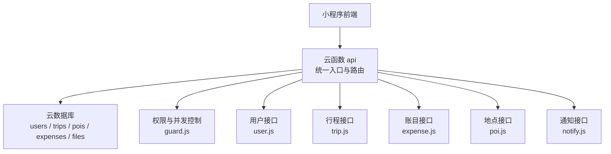
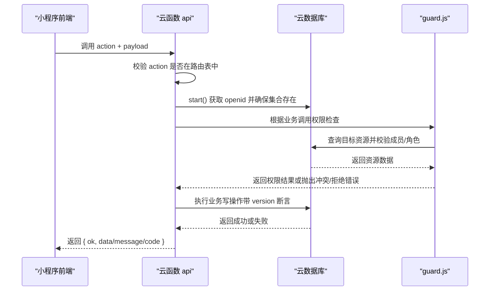
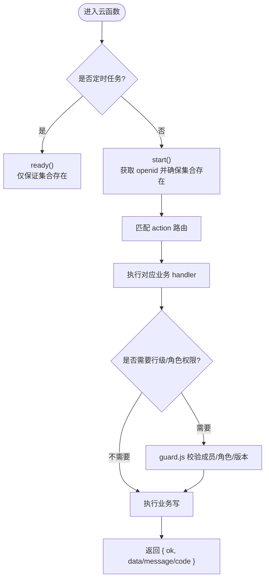
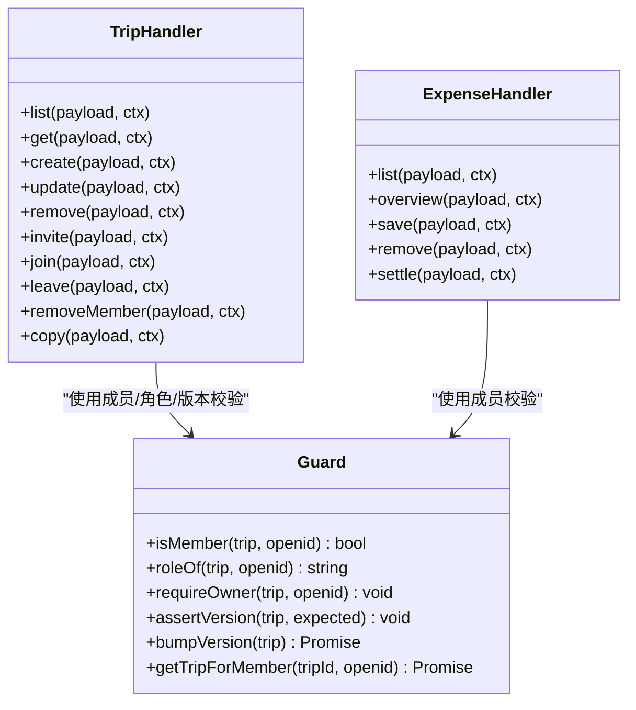
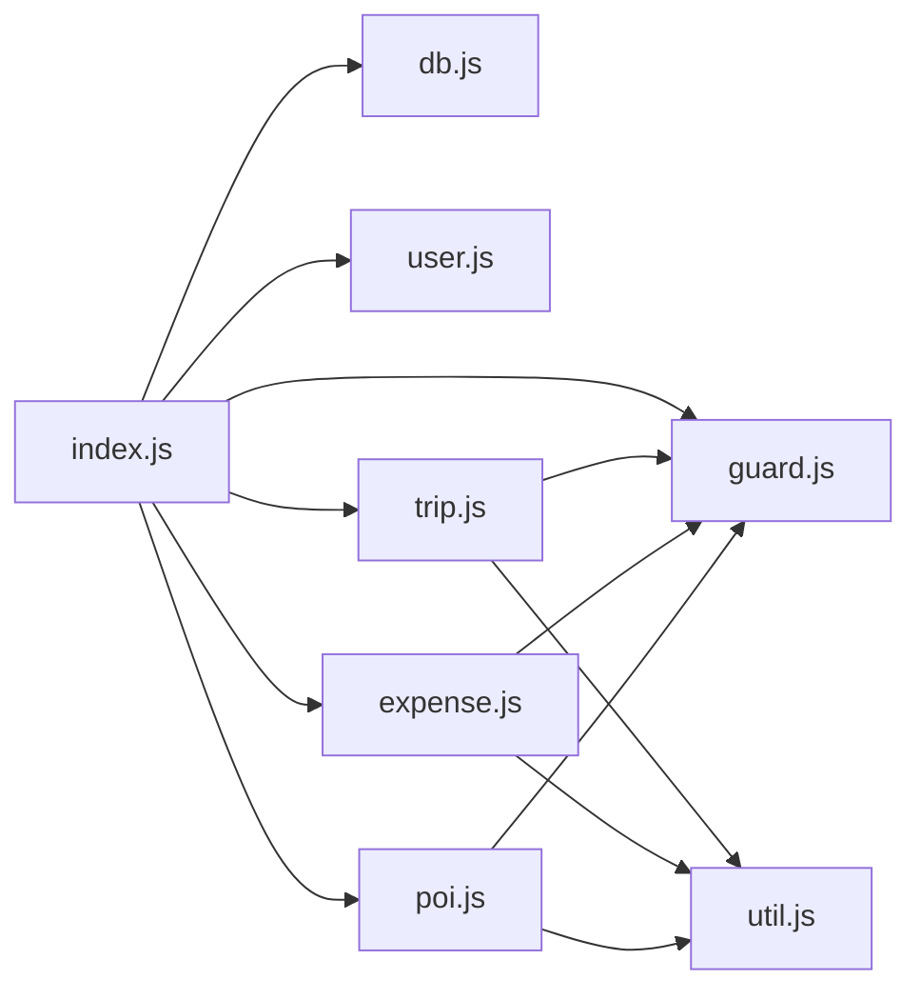

# 安全架构设计

<cite>
**本文引用的文件**   
- [index.js](file://cloudfunctions\api\index.js)
- [db.js](file://cloudfunctions\api\db.js)
- [guard.js](file://cloudfunctions\api\guard.js)
- [user.js](file://cloudfunctions\api\user.js)
- [trip.js](file://cloudfunctions\api\trip.js)
- [expense.js](file://cloudfunctions\api\expense.js)
- [poi.js](file://cloudfunctions\api\poi.js)
- [util.js](file://cloudfunctions\api\util.js)
- [config.json](file://cloudfunctions\api\config.json)
- [app.js](file://app.js)
- [constants.js](file://utils\constants.js)
- [方案.md](file://docs\方案.md)
</cite>

## 目录
1. [引言](#引言)
2. [项目结构](#项目结构)
3. [核心组件](#核心组件)
4. [架构总览](#架构总览)
5. [详细组件分析](#详细组件分析)
6. [依赖关系分析](#依赖关系分析)
7. [性能与并发控制](#性能与并发控制)
8. [安全防护机制](#安全防护机制)
9. [数据隐私与合规性](#数据隐私与合规性)
10. [故障排查指南](#故障排查指南)
11. [结论](#结论)
12. [附录：API 行为与安全要点对照表](#附录api-行为与安全要点对照表)

## 引言
本技术文档面向旅行计划小程序的安全架构，聚焦以下目标：
- 用户认证机制：基于微信云开发的 openid 身份来源、权限校验与鉴权流程。
- 数据访问控制：行级权限（按行程成员）、字段级权限（仅返回必要字段）、角色权限模型（创建者/同行）。
- 敏感数据保护：金额以“分”存储、输入裁剪与白名单校验、软删除保留审计线索。
- API 安全：统一入口路由、服务端身份不可伪造、乐观锁防并发冲突、集合权限隔离。
- 配置与审计：定时任务、订阅消息权限、错误码与日志输出。
- 隐私与合规：最小化数据暴露、避免前端直连数据库、邀请码有效期控制。
- 漏洞防护与监控：版本冲突提示、异常日志、集合索引建议。

## 项目结构
本项目采用“小程序前端 + 单个云函数聚合接口”的架构：
- 前端通过 `wx.cloud.callFunction` 调用统一的 `api` 云函数，传入 `action` 和 `payload`。
- 后端在 `cloudfunctions/api/index.js` 中集中路由到具体业务模块。
- 所有数据库操作集中在 `cloudfunctions/api/db.js`，并通过 `start()` 注入可信身份。
- 权限与并发控制集中在 `cloudfunctions/api/guard.js`。
- 业务模块包括行程、地点、账目、照片、通知等。

**图示来源**
- [index.js:10-41](file://cloudfunctions\api\index.js#L10-L41)
- [db.js:46-53](file://cloudfunctions\api\db.js#L46-L53)
- [guard.js:3-14](file://cloudfunctions\api\guard.js#L3-L14)

**章节来源**
- [index.js:10-77](file://cloudfunctions\api\index.js#L10-L77)
- [app.js:10-20](file://app.js#L10-L20)
- [constants.js:1-10](file://utils\constants.js#L1-L10)

## 核心组件
- 统一入口与路由：`index.js` 负责 action 分发、定时任务分支、全局异常处理。
- 身份与数据库初始化：`db.js` 提供 `start()`，从云上下文获取 openid，自动建集合，确保用户记录存在。
- 权限与并发控制：`guard.js` 提供成员判断、角色推导、创建者强校验、版本号断言与原子递增。
- 业务模块：`trip.js`、`expense.js`、`poi.js`、`user.js` 等实现具体业务逻辑，并复用 guard 能力。
- 工具函数：`util.js` 提供日期、长度裁剪、金额转换、ID 生成等通用能力。
- 配置：`config.json` 声明订阅消息权限与定时触发器；`constants.js` 集中环境与集合名。

**章节来源**
- [index.js:43-76](file://cloudfunctions\api\index.js#L43-L76)
- [db.js:29-53](file://cloudfunctions\api\db.js#L29-L53)
- [guard.js:3-74](file://cloudfunctions\api\guard.js#L3-L74)
- [util.js:33-49](file://cloudfunctions\api\util.js#L33-L49)
- [config.json:1-15](file://cloudfunctions\api\config.json#L1-L15)
- [constants.js:1-10](file://utils\constants.js#L1-L10)

## 架构总览
整体安全架构围绕“单一可信入口 + 服务端身份 + 行级权限 + 乐观锁 + 集合权限隔离”展开：
- 小程序不直接访问数据库，所有读写经过云函数。
- openid 由云环境注入，禁止前端传参伪造。
- 行级权限通过 `memberOpenids` 过滤，确保只能访问自己参与的行程。
- 角色权限通过 `roleOf` 推导，区分创建者与同行。
- 并发写使用版本号断言与原子更新，避免覆盖写入。
- 集合权限设置为“仅管理端可读写”，进一步降低越权风险。

**图示来源**
- [index.js:43-76](file://cloudfunctions\api\index.js#L43-L76)
- [db.js:46-53](file://cloudfunctions\api\db.js#L46-L53)
- [guard.js:26-42](file://cloudfunctions\api\guard.js#L26-L42)

## 详细组件分析

### 用户认证与鉴权流程
- 身份来源：`db.start()` 从云上下文取 `OPENID`，若为空则抛错，强制要求微信环境。
- 用户记录：首次调用自动创建 `users` 记录，包含昵称、默认币种、时间戳。
- 鉴权流程：
  - 所有业务 handler 接收 `ctx = { openid, user }`，openid 来自服务端，不可伪造。
  - 行级权限：通过 `getTripForMember` 查询行程并校验 `memberOpenids`。
  - 角色权限：通过 `roleOf` 推导 `owner` 或 `editor`，`requireOwner` 用于强限制。

**图示来源**
- [index.js:43-76](file://cloudfunctions\api\index.js#L43-L76)
- [db.js:46-53](file://cloudfunctions\api\db.js#L46-L53)
- [guard.js:3-14](file://cloudfunctions\api\guard.js#L3-L14)

**章节来源**
- [db.js:29-53](file://cloudfunctions\api\db.js#L29-L53)
- [user.js:1-11](file://cloudfunctions\api\user.js#L1-L11)
- [trip.js:45-48](file://cloudfunctions\api\trip.js#L45-L48)

### 数据访问控制策略
- 行级权限：
  - 行程列表：只返回 `memberOpenids` 包含当前 openid 的行程。
  - 行程详情：通过 `getTripForMember` 校验成员身份。
  - 账目列表：先查行程再查账目，确保归属正确。
- 字段级权限：
  - 用户信息接口仅返回昵称与默认币种，不暴露敏感字段。
  - 行程详情返回 `myRole` 供前端展示，但不持久化。
- 角色权限模型：
  - `owner`：创建者，拥有删除、邀请、移除成员等强权限。
  - `editor`：同行成员，可编辑但不可删除或移除他人。
  - 老数据兼容：若无 `role`，回退为 `owner` 或 `editor`。

**图示来源**
- [guard.js:3-74](file://cloudfunctions\api\guard.js#L3-L74)
- [trip.js:35-369](file://cloudfunctions\api\trip.js#L35-L369)
- [expense.js:88-328](file://cloudfunctions\api\expense.js#L88-L328)

**章节来源**
- [trip.js:35-48](file://cloudfunctions\api\trip.js#L35-L48)
- [expense.js:88-103](file://cloudfunctions\api\expense.js#L88-L103)
- [guard.js:3-14](file://cloudfunctions\api\guard.js#L3-L14)

### 敏感数据保护措施
- 金额保护：
  - 金额统一转换为“分”存储，避免浮点误差与前端篡改。
  - 分摊逻辑在服务端计算，保证合计一致。
- 输入裁剪与白名单：
  - 文本字段使用 `cut` 限制长度，防止超长输入。
  - 分类字段使用白名单校验，非法值回退默认值。
- 软删除与审计：
  - 行程、地点、账目删除均标记 `deletedAt`，保留历史。
  - 创建者、创建时间、更新时间等元数据记录完整。

**章节来源**
- [util.js:39-49](file://cloudfunctions\api\util.js#L39-L49)
- [expense.js:132-184](file://cloudfunctions\api\expense.js#L132-L184)
- [trip.js:134-147](file://cloudfunctions\api\trip.js#L134-L147)

### API 安全防护机制
- 请求签名：当前未实现自定义签名，依赖微信云开发的环境信任链。
- 频率限制：未在云函数内实现限流，建议在网关或云函数平台层补充。
- SQL 注入防护：使用云数据库 SDK 的参数化查询，无原生 SQL 拼接。
- 路由白名单：仅允许已注册的 action，未知操作直接拒绝。
- 身份不可伪造：openid 从云上下文获取，前端传参无效。

**章节来源**
- [index.js:56-60](file://cloudfunctions\api\index.js#L56-L60)
- [db.js:46-53](file://cloudfunctions\api\db.js#L46-L53)

### 安全配置最佳实践
- 集合权限：所有集合设置为“仅管理端可读写”，前端不直连数据库。
- 定时任务：通过 `config.json` 声明定时器，仅执行通知发送。
- 环境变量：环境 ID 集中管理，避免硬编码分散。
- 最小权限：订阅消息权限按需申请，不开放无关 OpenAPI。

**章节来源**
- [方案.md:189-191](file://docs\方案.md#L189-L191)
- [config.json:1-15](file://cloudfunctions\api\config.json#L1-L15)
- [constants.js:1-10](file://utils\constants.js#L1-L10)

### 安全审计机制
- 错误日志：云函数捕获异常并输出 `[api]` 前缀日志，便于排查。
- 冲突提示：版本不一致时返回 `code: 'conflict'`，前端提示刷新。
- 审计字段：所有写操作记录 `createdAt`、`updatedAt`、`createdBy`、`deletedAt`。

**章节来源**
- [index.js:67-75](file://cloudfunctions\api\index.js#L67-L75)
- [guard.js:20-30](file://cloudfunctions\api\guard.js#L20-L30)
- [trip.js:60-84](file://cloudfunctions\api\trip.js#L60-L84)

## 依赖关系分析
- `index.js` 依赖 `db.js`、`guard.js` 及各业务 handler。
- `trip.js`、`expense.js`、`poi.js` 依赖 `guard.js` 进行权限与并发控制。
- `db.js` 提供数据库连接、集合初始化、身份注入。
- `util.js` 被多个业务模块复用，提供通用工具函数。

**图示来源**
- [index.js:1-9](file://cloudfunctions\api\index.js#L1-L9)
- [trip.js:1-3](file://cloudfunctions\api\trip.js#L1-L3)
- [expense.js:1-3](file://cloudfunctions\api\expense.js#L1-L3)
- [poi.js:1-3](file://cloudfunctions\api\poi.js#L1-L3)

**章节来源**
- [index.js:1-9](file://cloudfunctions\api\index.js#L1-L9)
- [trip.js:1-3](file://cloudfunctions\api\trip.js#L1-L3)
- [expense.js:1-3](file://cloudfunctions\api\expense.js#L1-L3)

## 性能与并发控制
- 乐观锁：通过 `version` 字段断言与原子递增，避免并发覆盖。
- 批量操作：复制行程时限制点位数量，避免单次过大事务。
- 索引建议：地点按 `tripId + dayIndex + order` 排序，账目按 `tripId + spentAt` 查询。
- 聚合优化：账目概览使用聚合管道，减少前端计算负担。

**章节来源**
- [guard.js:32-42](file://cloudfunctions\api\guard.js#L32-L42)
- [trip.js:315-355](file://cloudfunctions\api\trip.js#L315-L355)
- [方案.md:185-187](file://docs\方案.md#L185-L187)
- [expense.js:119-130](file://cloudfunctions\api\expense.js#L119-L130)

## 安全防护机制
- 身份认证：强制微信环境，openid 从云上下文获取。
- 权限控制：行级权限 + 角色权限 + 创建者强校验。
- 并发安全：版本号断言 + 原子更新。
- 输入安全：长度裁剪 + 白名单校验 + 金额单位统一。
- 数据隔离：集合权限“仅管理端可读写”。
- 审计追踪：软删除 + 时间戳 + 创建者标识。

**章节来源**
- [db.js:46-53](file://cloudfunctions\api\db.js#L46-L53)
- [guard.js:3-14](file://cloudfunctions\api\guard.js#L3-L14)
- [guard.js:26-42](file://cloudfunctions\api\guard.js#L26-L42)
- [util.js:39-49](file://cloudfunctions\api\util.js#L39-L49)
- [方案.md:189-191](file://docs\方案.md#L189-L191)

## 数据隐私与合规性
- 最小化暴露：用户接口仅返回必要字段，不泄露敏感信息。
- 本地存储：数据存储在微信云开发数据库，无第三方服务器。
- 邀请码安全：有效期控制，过期后需重新生成。
- 位置隐私：地图页仅显示有坐标的地点，避免猜测位置。

**章节来源**
- [user.js:1-11](file://cloudfunctions\api\user.js#L1-L11)
- [trip.js:149-183](file://cloudfunctions\api\trip.js#L149-L183)
- [方案.md:193-202](file://docs\方案.md#L193-L202)

## 故障排查指南
- 常见错误：
  - “没有获取到用户身份”：检查是否在微信环境中调用。
  - “这趟行程刚被别人改过”：前端收到 `code: 'conflict'`，提示刷新。
  - “缺少行程 id”：检查 payload 是否传递 tripId。
  - “只有创建者可以做这个操作”：非 owner 尝试删除或邀请。
- 日志定位：查看云函数控制台输出，搜索 `[api]` 前缀。
- 数据一致性：检查 `version` 字段是否与前端读取一致。

**章节来源**
- [db.js:46-53](file://cloudfunctions\api\db.js#L46-L53)
- [guard.js:20-30](file://cloudfunctions\api\guard.js#L20-L30)
- [trip.js:136-147](file://cloudfunctions\api\trip.js#L136-L147)

## 结论
该旅行计划小程序的安全架构以“单一可信入口 + 服务端身份 + 行级权限 + 乐观锁 + 集合权限隔离”为核心，实现了较为完善的数据访问控制与并发安全保障。未来可在网关层增加请求签名与频率限制，进一步增强 API 安全性。同时，建议持续监控云函数日志，定期审查集合权限与索引配置，确保系统长期稳定运行。

## 附录：API 行为与安全要点对照表
- `user.me`：返回当前用户基本信息，不暴露敏感字段。
- `trip.list` / `trip.get`：仅返回成员可见行程，行级权限控制。
- `trip.create` / `trip.update` / `trip.remove`：创建者强校验，更新/删除带版本控制。
- `trip.invite`：邀请码有效期控制，仅创建者可生成。
- `trip.join`：支持 tripId 或邀请码加入，过期码拒绝。
- `trip.removeMember`：仅创建者可移除成员，不能移除自己或创建者。
- `trip.leave`：成员可自行退出，创建者不可退出。
- `trip.copy`：复制行程，重置日期与成员，点位重排。
- `poi.list` / `poi.save` / `poi.remove` / `poi.reorder`：地点增删改查，带版本控制。
- `expense.list` / `expense.overview` / `expense.save` / `expense.remove` / `expense.settle`：账目明细与汇总，服务端计算分摊。

**章节来源**
- [index.js:10-41](file://cloudfunctions\api\index.js#L10-L41)
- [方案.md:216-234](file://docs\方案.md#L216-L234)