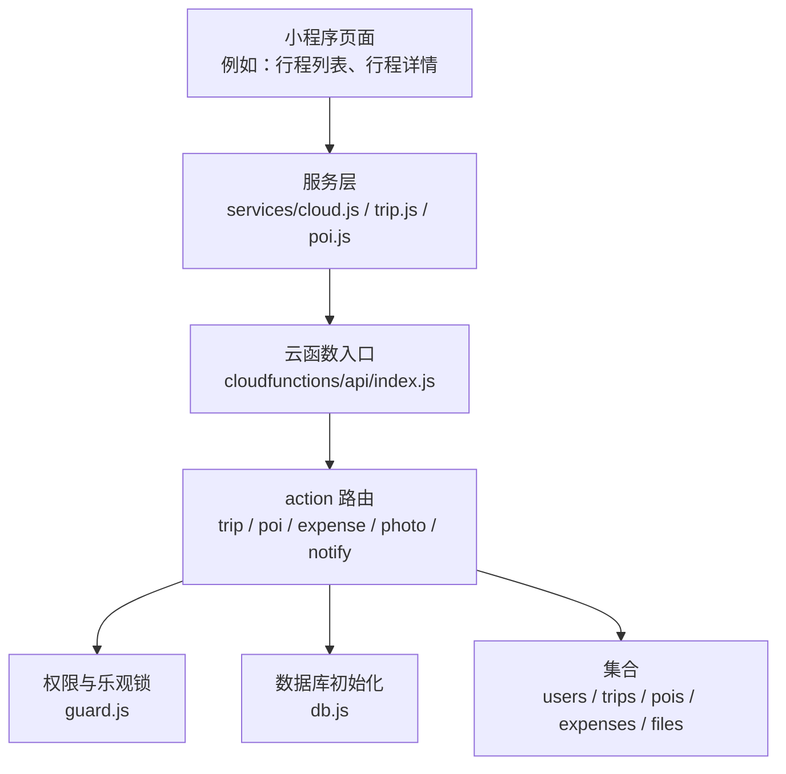
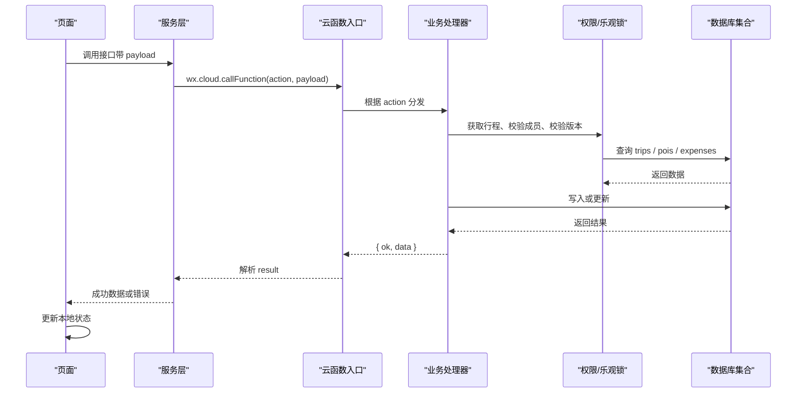
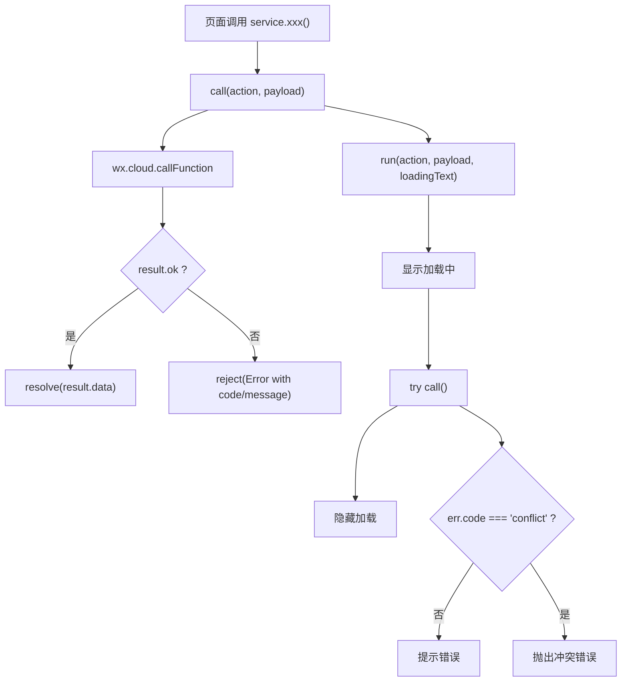
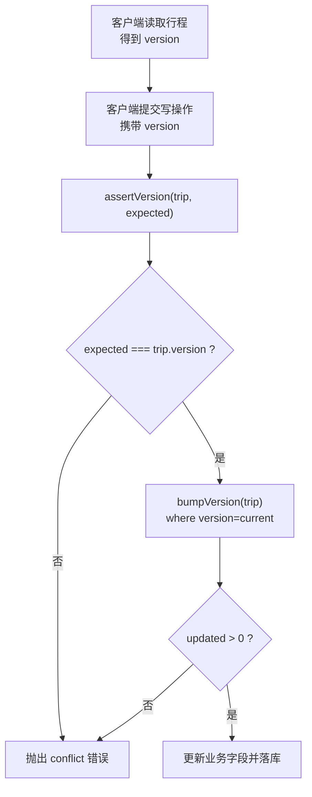
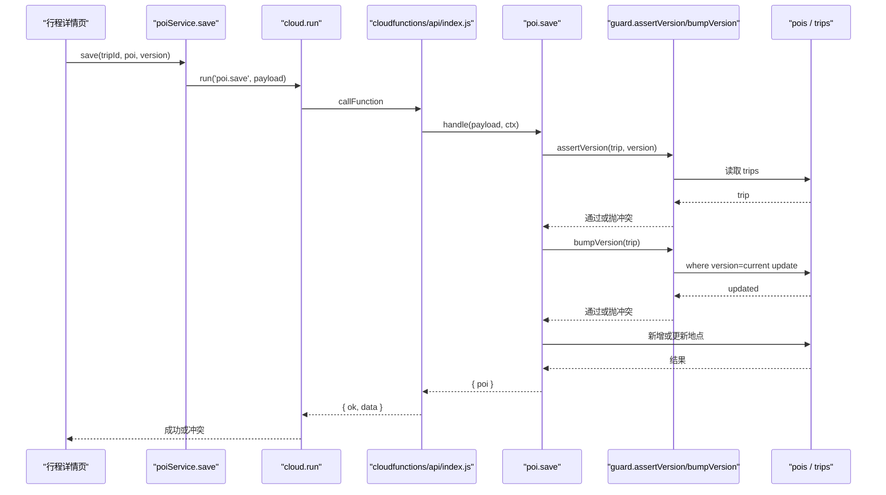
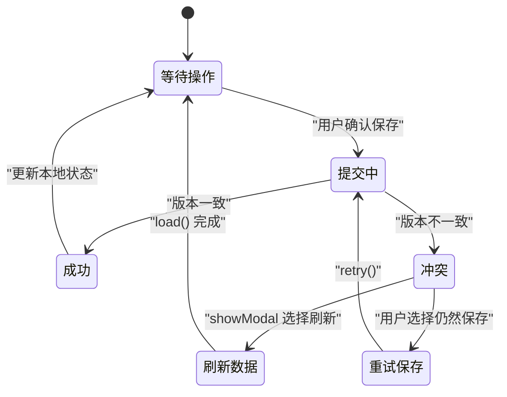
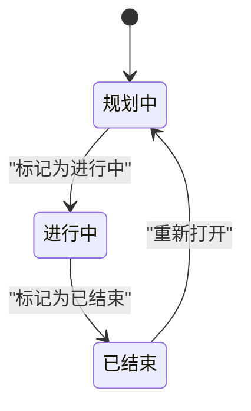

# 数据流设计

<cite>
**本文引用的文件**   
- [app.js](file://app.js)
- [cloud.js](file://services/cloud.js)
- [trip.js（服务层）](file://services/trip.js)
- [poi.js（服务层）](file://services/poi.js)
- [index.js（云函数入口）](file://cloudfunctions\api\index.js)
- [db.js（云函数数据库初始化）](file://cloudfunctions\api\db.js)
- [guard.js（权限与乐观锁）](file://cloudfunctions\api\guard.js)
- [trip.js（云函数业务）](file://cloudfunctions\api\trip.js)
- [poi.js（云函数业务）](file://cloudfunctions\api\poi.js)
- [list.js（行程列表页）](file://pages\trips\list.js)
- [detail.js（行程详情页）](file://pages\trip\detail.js)
- [conflict.js（冲突交互工具）](file://utils\conflict.js)
</cite>

## 目录
1. [引言](#引言)
2. [项目结构与数据边界](#项目结构与数据边界)
3. [核心数据流总览](#核心数据流总览)
4. [前端状态管理与页面数据流](#前端状态管理与页面数据流)
5. [服务层调用与统一封装](#服务层调用与统一封装)
6. [云函数路由、鉴权与数据库访问](#云函数路由鉴权与数据库访问)
7. [乐观锁并发控制与版本号机制](#乐观锁并发控制与版本号机制)
8. [序列化、反序列化与格式转换](#序列化反序列化与格式转换)
9. [数据同步策略：增量更新与全量刷新](#数据同步策略增量更新与全量刷新)
10. [一致性保证与事务处理](#一致性保证与事务处理)
11. [关键时序图与状态图](#关键时序图与状态图)
12. [性能与扩展建议](#性能与扩展建议)
13. [故障排查指南](#故障排查指南)
14. [结论](#结论)

## 引言
本文面向旅行计划小程序的数据流设计，目标是把“用户界面操作 → 前端状态 → 服务层 → 云函数 → 数据库”的完整链路讲清楚。重点包括：
- 前端如何维护本地状态并触发写操作；
- 服务层如何统一封装云函数调用；
- 云函数如何集中路由、鉴权、校验和落库；
- 乐观锁如何通过版本号防止覆盖式并发修改；
- 数据在前后端之间的序列化、反序列化和格式规范化；
- 数据同步中的增量更新与全量刷新策略；
- 一致性保障、事务边界以及常见问题的定位方法。

## 项目结构与数据边界
该小程序采用“前端不直连数据库”的设计：所有写操作都通过单个云函数 `api` 转发到具体业务模块，读操作也优先走云函数，以便集中做权限、版本控制和数据清洗。

**图示来源**
- [cloud.js:3-49](file://services/cloud.js#L3-L49)
- [index.js:10-41](file://cloudfunctions\api\index.js#L10-L41)
- [db.js:1-10](file://cloudfunctions\api\db.js#L1-L10)

**章节来源**
- [app.js:1-22](file://app.js#L1-L22)
- [cloud.js:1-50](file://services/cloud.js#L1-L50)
- [index.js:1-77](file://cloudfunctions\api\index.js#L1-L77)
- [db.js:1-61](file://cloudfunctions\api\db.js#L1-L61)

## 核心数据流总览
整体数据流分为两条主线：

1. **读取流程**：页面调用服务层 → 服务层调用云函数 → 云函数查询集合 → 返回结构化数据 → 页面渲染。
2. **写入流程**：页面编辑本地状态 → 提交时携带当前版本号 → 服务层调用云函数 → 云函数校验权限和版本 → 原子更新版本号并落库 → 返回最新数据 → 页面刷新。

**图示来源**
- [cloud.js:5-30](file://services/cloud.js#L5-L30)
- [index.js:43-76](file://cloudfunctions\api\index.js#L43-L76)
- [guard.js:26-42](file://cloudfunctions\api\guard.js#L26-L42)

**章节来源**
- [cloud.js:1-50](file://services/cloud.js#L1-L50)
- [index.js:1-77](file://cloudfunctions\api\index.js#L1-L77)
- [guard.js:1-75](file://cloudfunctions\api\guard.js#L1-L75)

## 前端状态管理与页面数据流
### 行程列表页
行程列表页负责展示用户可参与的行程卡片，并在进入页面时拉取数据。它不直接操作数据库，而是通过 `services/trip.js` 调用云函数。

关键点：
- 使用 `tripService.list()` 获取行程列表；
- 将后端行程对象转换为前端卡片展示结构；
- 加载失败时保留错误信息并提供重试；
- 点击卡片跳转到行程详情页。

**章节来源**
- [list.js:1-72](file://pages\trips\list.js#L1-L72)
- [trip.js（服务层）:1-47](file://services/trip.js#L1-L47)

### 行程详情页
行程详情页是数据流最复杂的地方：它同时管理行程元数据、地点列表、天数切换、排序、时间重排、状态切换、删除等逻辑，并且大量使用乐观锁。

关键点：
- 通过 `poiService.list(tripId)` 一次性获取行程和地点；
- 本地先更新 UI，再异步提交变更，提升弱网体验；
- 所有写操作都携带 `trip.version`；
- 遇到冲突时使用 `utils/conflict.js` 提供刷新或重试交互；
- 对“加一天/减一天/结束/重开/删除行程”等操作单独处理冲突，避免自动重试导致语义变化。

**章节来源**
- [detail.js:1-422](file://pages\trip\detail.js#L1-L422)
- [poi.js（服务层）:1-22](file://services/poi.js#L1-L22)
- [conflict.js:1-20](file://utils\conflict.js#L1-L20)

## 服务层调用与统一封装
服务层是前端与云函数之间的桥梁，主要职责包括：
- 统一构造 `action` 和 `payload`；
- 统一处理 loading、toast、网络异常；
- 区分普通调用 `call` 和带 loading 的 `run`；
- 把云函数返回的 `{ ok, data, code, message }` 标准化为 Promise 成功或失败。

**图示来源**
- [cloud.js:5-49](file://services/cloud.js#L5-L49)

**章节来源**
- [cloud.js:1-50](file://services/cloud.js#L1-L50)

## 云函数路由、鉴权与数据库访问
### 云函数入口
云函数入口只暴露一个 `main`，通过 `action` 字符串路由到具体业务模块。这样部署一次即可支持多个接口，便于集中处理权限、日志和错误。

关键点：
- 定时触发器不走 action 路由，直接调用通知相关逻辑；
- 普通请求从服务端上下文取 `openid`，不信任前端传入；
- 所有 handler 抛出的错误会被包装成 `{ ok: false, code, message }`；
- `code` 用于客户端分派，例如 `conflict`。

**章节来源**
- [index.js:1-77](file://cloudfunctions\api\index.js#L1-L77)

### 数据库初始化
数据库模块负责：
- 初始化微信云开发环境；
- 懒创建集合；
- 每个请求启动时确保集合存在并获取用户身份；
- 为定时任务提供无用户身份的初始化入口。

**章节来源**
- [db.js:1-61](file://cloudfunctions\api\db.js#L1-L61)

### 权限与成员校验
`guard.js` 提供成员判断、角色推导、创建者校验、版本断言、版本号原子递增等能力。行程相关写操作大多依赖这些工具。

**章节来源**
- [guard.js:1-75](file://cloudfunctions\api\guard.js#L1-L75)

## 乐观锁并发控制与版本号机制
乐观锁是该系统并发控制的核心。其基本思想是：
- 客户端读取数据时拿到 `version`；
- 写操作携带这个 `version`；
- 服务端比较当前数据库中的 `version` 是否一致；
- 不一致则拒绝写入，返回冲突；
- 如果一致，则原子递增版本号并落库。

**图示来源**
- [guard.js:26-42](file://cloudfunctions\api\guard.js#L26-L42)
- [trip.js（云函数业务）:90-131](file://cloudfunctions\api\trip.js#L90-L131)
- [poi.js（云函数业务）:73-143](file://cloudfunctions\api\poi.js#L73-L143)

### 版本号机制要点
- 新建行程时初始版本为 `0`；
- 每次写成功后版本号递增；
- 成员加入、移除、退出等行为也会增加版本，因为属于“协同状态变化”；
- 某些写操作会先断言版本，再原子占位，避免“白占一次版本”。

**章节来源**
- [trip.js（云函数业务）:50-88](file://cloudfunctions\api\trip.js#L50-L88)
- [trip.js（云函数业务）:90-147](file://cloudfunctions\api\trip.js#L90-L147)
- [trip.js（云函数业务）:171-272](file://cloudfunctions\api\trip.js#L171-L272)
- [poi.js（云函数业务）:73-191](file://cloudfunctions\api\poi.js#L73-L191)
- [guard.js:26-42](file://cloudfunctions\api\guard.js#L26-L42)

## 序列化、反序列化与格式转换
前后端之间传递的是 JSON 对象，但业务字段在服务端会进行严格规范化，避免脏数据进入数据库。

### 前端到云函数的常见转换
- 行程预算：前端传金额文本，服务端转为分；
- 日期：前端传字符串，服务端校验并重建 `days`；
- 地点分类：前端传分类名，服务端限制在白名单；
- 地点时间：前端传 `HH:mm`，服务端正则校验；
- 地点时长：前端传分钟数，服务端限制在允许值；
- 地点位置：前端传经纬度对象，服务端校验并规范化；
- 事实字段：前端传 facts 对象，服务端裁剪长度并补齐默认键。

### 云函数到前端的常见转换
- 行程列表返回 `{ items }`；
- 行程详情接口返回 `{ trip, items }`，减少一次往返；
- 写操作后返回最新数据，例如 `{ trip }` 或 `{ poi }`；
- 错误统一包装为 `{ ok: false, code, message }`。

**章节来源**
- [trip.js（云函数业务）:28-33](file://cloudfunctions\api\trip.js#L28-L33)
- [trip.js（云函数业务）:50-88](file://cloudfunctions\api\trip.js#L50-L88)
- [trip.js（云函数业务）:90-131](file://cloudfunctions\api\trip.js#L90-L131)
- [poi.js（云函数业务）:15-40](file://cloudfunctions\api\poi.js#L15-L40)
- [poi.js（云函数业务）:73-143](file://cloudfunctions\api\poi.js#L73-L143)
- [cloud.js:13-27](file://services/cloud.js#L13-L27)

## 数据同步策略：增量更新与全量刷新
### 全量刷新
当前实现以“全量刷新为主”：
- 行程列表页每次进入页面都重新拉取列表；
- 行程详情页通过 `poiService.list(tripId)` 一次性拉取行程和地点；
- 写操作成功后通常再次调用 `load()` 刷新本地状态。

这种方式简单可靠，适合行程规模不大、成员数量有限的场景。

### 增量更新
代码中并未实现基于游标或时间戳的增量同步，而是通过以下手段降低重复数据量：
- 列表接口限制返回条数；
- 地点列表限制最大条数；
- 详情页一次返回行程和地点，减少往返；
- 写操作返回最新单条数据，页面局部更新。

如果需要扩展到多人高频协作场景，可考虑：
- 按 `updatedAt` 增量拉取变更；
- 对地点使用 `dayIndex + order` 增量同步；
- 引入事件或消息推送通知版本变化。

**章节来源**
- [list.js:35-49](file://pages\trips\list.js#L35-L49)
- [detail.js:66-74](file://pages\trip\detail.js#L66-L74)
- [poi.js（云函数业务）:61-71](file://cloudfunctions\api\poi.js#L61-L71)
- [trip.js（云函数业务）:35-43](file://cloudfunctions\api\trip.js#L35-L43)

## 一致性保证与事务处理
### 一致性策略
系统没有使用显式数据库事务，而是通过以下机制保证最终一致性：
- 权限前置：只有成员才能读写行程；
- 版本断言：写前检查 `version`；
- 原子占位：用 `where version=current` 更新版本号，保证只有一个请求能成功；
- 软删除：行程、地点、账目删除时标记 `deletedAt`，保留历史；
- 计数回写：地点变更后更新行程的 `poiCount`。

### 事务边界
由于未使用事务，跨集合写操作需要特别注意：
- 删除行程时会依次标记 `trips`、`pois`、`expenses`；
- 复制行程时会先创建新行程，再批量复制地点；
- 如果中间失败，可能出现部分数据不一致。

改进方向：
- 对关键写路径引入云开发事务；
- 对批量操作增加补偿逻辑；
- 对删除和复制增加幂等标识。

**章节来源**
- [guard.js:26-42](file://cloudfunctions\api\guard.js#L26-L42)
- [trip.js（云函数业务）:134-147](file://cloudfunctions\api\trip.js#L134-L147)
- [trip.js（云函数业务）:280-355](file://cloudfunctions\api\trip.js#L280-L355)
- [poi.js（云函数业务）:53-59](file://cloudfunctions\api\poi.js#L53-L59)

## 关键时序图与状态图

### 保存地点的乐观锁时序

**图示来源**
- [poi.js（服务层）:8-11](file://services/poi.js#L8-L11)
- [cloud.js:33-47](file://services/cloud.js#L33-L47)
- [index.js:56-76](file://cloudfunctions\api\index.js#L56-L76)
- [poi.js（云函数业务）:73-143](file://cloudfunctions\api\poi.js#L73-L143)
- [guard.js:26-42](file://cloudfunctions\api\guard.js#L26-L42)

### 冲突处理状态图

**图示来源**
- [conflict.js:1-20](file://utils\conflict.js#L1-L20)
- [detail.js:246-255](file://pages\trip\detail.js#L246-L255)
- [detail.js:304-309](file://pages\trip\detail.js#L304-L309)

### 行程状态转换图

**图示来源**
- [detail.js:15](file://pages\trip\detail.js#L15)
- [detail.js:384-395](file://pages\trip\detail.js#L384-L395)
- [trip.js（云函数业务）:7](file://cloudfunctions\api\trip.js#L7)

## 性能与扩展建议
### 当前性能特点
- 读多写少场景下，全量刷新足够简单；
- 通过 `limit` 控制返回数据量；
- 详情页合并返回行程和地点，减少往返；
- 地点顺序调整使用批量 `reorder`，避免多次写。

### 可扩展优化
- 对列表接口增加分页或游标；
- 对地点数据增加增量同步字段；
- 对高频写操作增加本地队列和重试；
- 对冲突频率高的场景增加冲突合并策略；
- 对照片和附件使用独立上传接口，避免阻塞主流程。

[本节为通用性能讨论，不直接分析具体文件]

## 故障排查指南
### 常见问题定位
1. **网络异常**：服务层 `call` 的 `fail` 分支会抛出网络异常；
2. **服务不可用**：云函数返回 `ok: false` 且无 `code` 时，通常是服务端异常；
3. **版本冲突**：`code === 'conflict'`，应引导用户刷新或重试；
4. **权限不足**：非成员或不是创建者执行了受限操作；
5. **数据格式错误**：地点名称为空、时间格式不对、分类不在白名单等。

### 推荐排查步骤
- 先看服务层是否抛出 `conflict`；
- 再看云函数入口是否正确路由；
- 检查 `guard.js` 的版本断言和成员校验；
- 查看数据库集合是否存在、索引是否合理；
- 核对前端提交的 `version` 是否与页面最新数据一致。

**章节来源**
- [cloud.js:13-27](file://services/cloud.js#L13-L27)
- [cloud.js:39-47](file://services/cloud.js#L39-L47)
- [index.js:62-76](file://cloudfunctions\api\index.js#L62-L76)
- [guard.js:16-30](file://cloudfunctions\api\guard.js#L16-L30)

## 结论
该旅行计划小程序的数据流设计以“前端不直连数据库 + 单一云函数路由 + 乐观锁版本号”为核心。优点是权限集中、逻辑清晰、并发可控；缺点是强依赖全量刷新，大规模协作场景下可能需要增量同步和事务增强。对于现有规模，这套数据流已经能够支撑行程规划、地点管理、成员协作和基础并发控制。未来可在数据同步、事务一致性、冲突合并和性能优化方面逐步演进。