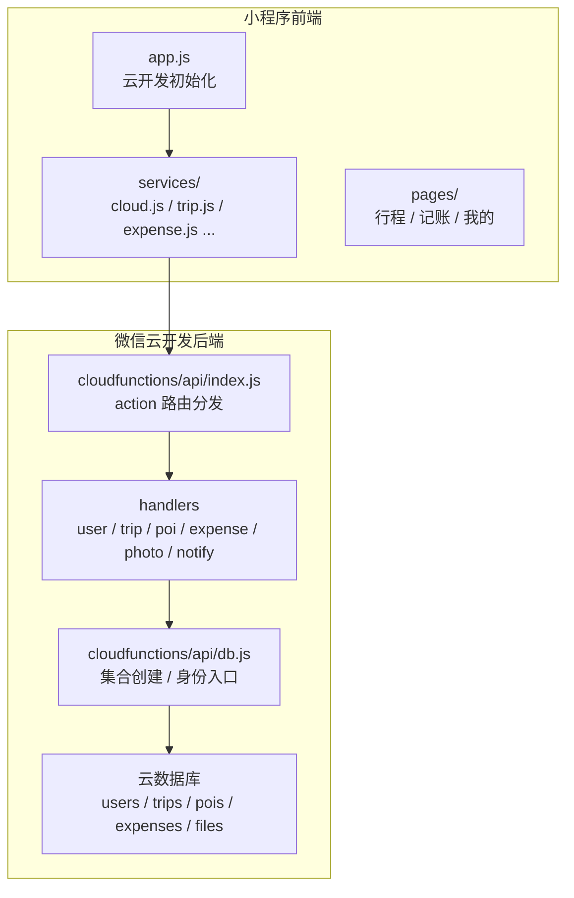
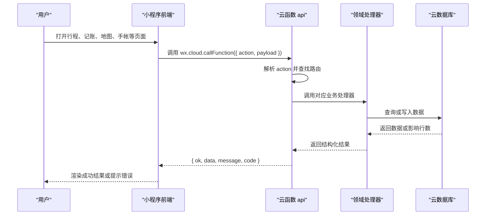
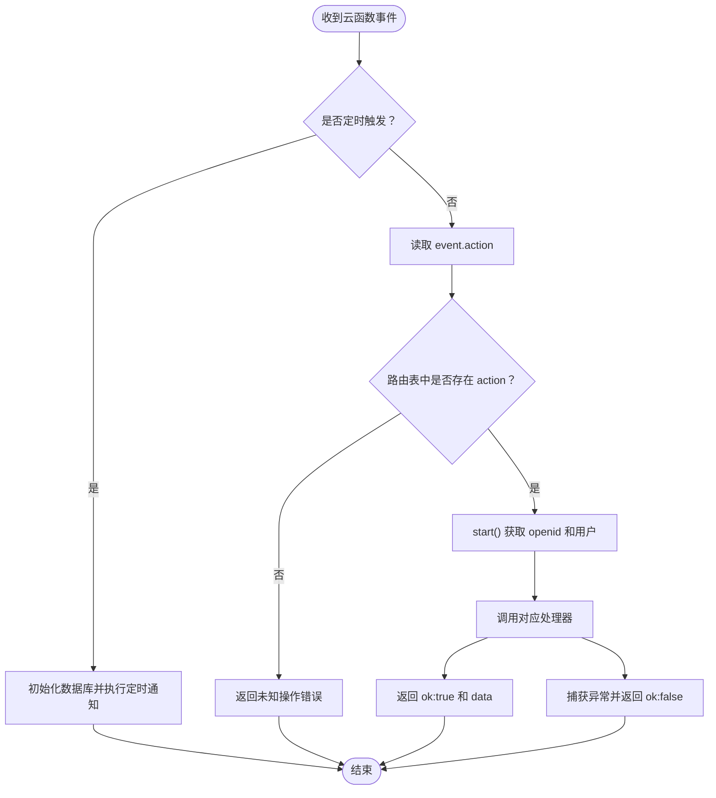
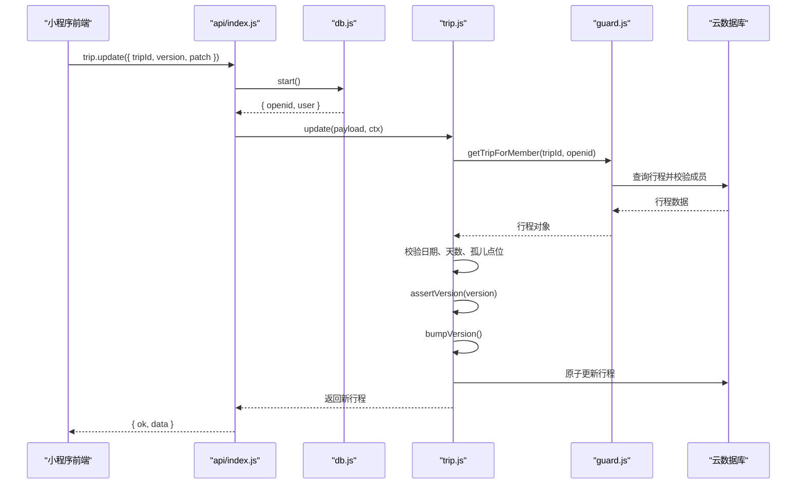
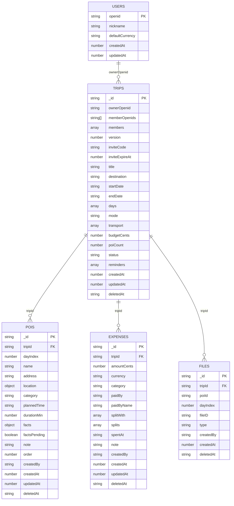
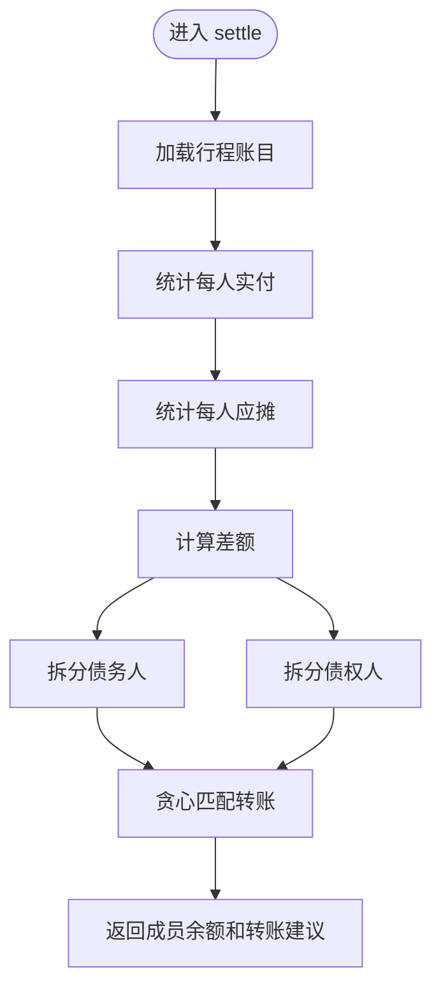
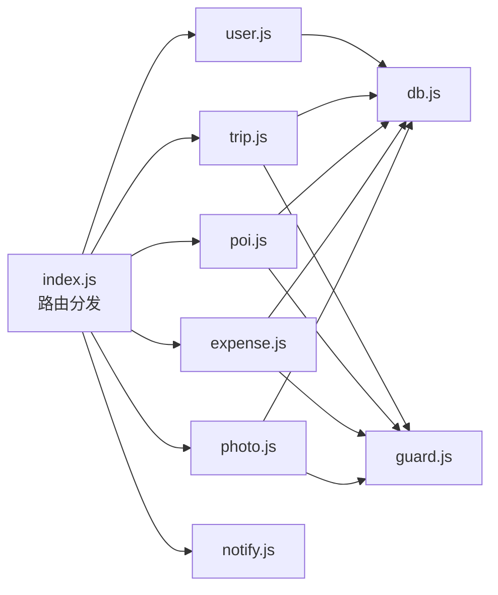
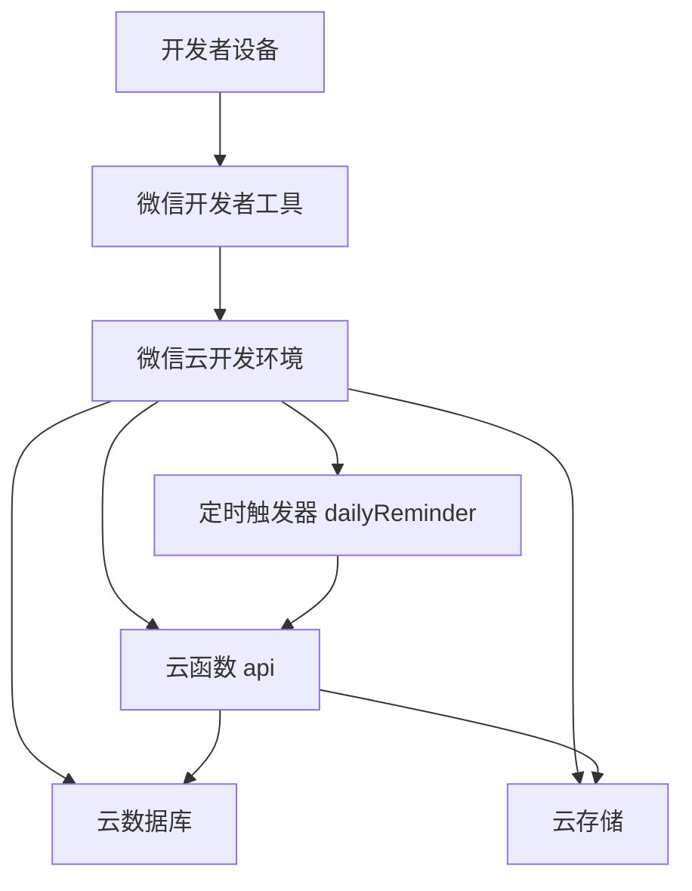

# 整体架构概述

<cite>
**本文引用的文件**   
- [app.js](file://app.js)
- [cloud.js](file://services/cloud.js)
- [index.js](file://cloudfunctions\api\index.js)
- [db.js](file://cloudfunctions\api\db.js)
- [user.js](file://cloudfunctions\api\user.js)
- [trip.js](file://cloudfunctions\api\trip.js)
- [poi.js](file://cloudfunctions\api\poi.js)
- [expense.js](file://cloudfunctions\api\expense.js)
- [photo.js](file://cloudfunctions\api\photo.js)
- [方案.md](file://docs\方案.md)
</cite>

## 目录
1. [引言](#引言)
2. [项目结构](#项目结构)
3. [核心组件](#核心组件)
4. [架构总览](#架构总览)
5. [详细组件分析](#详细组件分析)
6. [依赖关系分析](#依赖关系分析)
7. [性能与可扩展性](#性能与可扩展性)
8. [部署拓扑与环境](#部署拓扑与环境)
9. [故障排查指南](#故障排查指南)
10. [结论](#结论)

## 引言
本文件为旅行计划小程序的整体架构文档，面向产品、前端、后端和运维读者。系统采用微信小程序前端、云函数后端、云数据库三层架构：前端负责交互与展示，云函数统一处理业务逻辑、鉴权和数据访问，云数据库承载行程、地点、账目、用户和手帐照片索引等数据。

该设计的关键目标是：
- 通过单一云函数入口集中权限校验、参数校验和业务规则。
- 使用 action 路由把多个领域能力收敛到一个可独立部署的云函数中。
- 让前端不直连数据库，从而在加入成员、权限、并发控制时只改服务端，不影响页面。
- 用乐观锁、软删除、服务端汇总等手段降低前后端不一致风险。

**章节来源**
- [方案.md:19-44](file://docs\方案.md#L19-L44)
- [方案.md:211-245](file://docs\方案.md#L211-L245)

## 项目结构
项目按职责分层组织：
- 小程序应用层：`app.js`、`app.json`、`app.wxss` 负责云开发初始化、页面注册和全局样式。
- 页面层：`pages/` 下按功能划分行程、记账、我的等页面。
- 服务层：`services/` 封装对云函数的调用，统一 loading、错误提示和结果解析。
- 工具层：`utils/` 提供常量、格式化、定位、冲突处理等纯函数。
- 云函数层：`cloudfunctions/api/` 实现单入口路由、数据库初始化、身份获取和各领域处理器。

**图表来源**
- [app.js:1-22](file://app.js#L1-L22)
- [cloud.js:1-50](file://services/cloud.js#L1-L50)
- [index.js:1-77](file://cloudfunctions\api\index.js#L1-L77)
- [db.js:1-61](file://cloudfunctions\api\db.js#L1-L61)

**章节来源**
- [方案.md:72-95](file://docs\方案.md#L72-L95)
- [方案.md:269-279](file://docs\方案.md#L269-L279)

## 核心组件
### 小程序启动与云环境初始化
小程序启动时检查基础库是否支持云开发，然后初始化云环境并标记云能力就绪。全局状态保存环境 ID、openid 和云就绪标志，供后续页面和服务使用。

关键点：
- 不支持云开发的基础库会直接报错，避免后续调用失败难以定位。
- 初始化后设置 `cloudReady`，方便页面判断是否可发起云函数请求。
- 开启 `traceUser`，便于在云函数日志中追踪用户上下文。

**章节来源**
- [app.js:1-22](file://app.js#L1-L22)

### 前端云函数调用封装
`services/cloud.js` 是所有写操作和大部分读操作的统一入口。它对外暴露两个主要方法：
- `call(action, payload)`：底层调用，返回 Promise，成功返回 data，失败抛出带 code 的错误。
- `run(action, payload, loadingText)`：带 loading 的调用，自动显示隐藏加载态，并对非冲突错误做 toast 提示。

设计要点：
- 所有写操作都走云函数，前端不直连数据库，这样后续加成员和权限时只需改服务端。
- 错误对象携带 `code`，例如 `conflict`，用于页面区分普通失败和版本冲突。
- 页面代码尽量只处理成功分支，异常由服务层统一兜底。

**章节来源**
- [cloud.js:1-50](file://services/cloud.js#L1-L50)

### 云函数单入口与 action 路由
`cloudfunctions/api/index.js` 是唯一的云函数入口。它维护一个 `routes` 映射，把 `action` 字符串分发到具体处理器，如 `trip.list`、`expense.save`、`photo.add` 等。

路由机制的优势：
- 只部署一次云函数，权限校验、日志、异常处理集中在一个入口。
- 新增接口只需要增加 action 和对应处理器，不需要新增云函数实例。
- 定时触发器可以复用同一个入口，但跳过用户身份流程。

分发流程：
1. 如果是定时触发事件，跳过 action 路由，直接执行通知相关逻辑。
2. 从事件中取 `action`，查找路由表。
3. 找不到 action 时返回未知操作错误。
4. 通过 `start()` 获取用户身份和上下文。
5. 调用对应 handler，返回统一的成功或失败结构。

**章节来源**
- [index.js:1-77](file://cloudfunctions\api\index.js#L1-L77)

### 数据库连接、集合初始化与身份入口
`cloudfunctions/api/db.js` 负责：
- 初始化微信云开发 SDK。
- 定义集合名称：`users`、`trips`、`pois`、`expenses`、`files`。
- 首次请求时自动创建集合，忽略已存在的错误。
- 提供 `start()` 和 `ready()` 两个入口：前者要求用户身份，后者仅保证集合存在，用于定时任务。
- 每次请求从 `cloud.getWXContext().OPENID` 获取 openid，绝不信任前端传入的 openid。

安全要点：
- 所有集合权限设置为“仅管理端可读写”，前端不能绕过云函数直接写库。
- 用户不存在时自动创建用户记录，字段包括 openid、昵称、默认币种和时间戳。

**章节来源**
- [db.js:1-61](file://cloudfunctions\api\db.js#L1-L61)
- [方案.md:189-191](file://docs\方案.md#L189-L191)

### 领域处理器
#### 用户处理器
`user.js` 提供 `me` 接口，返回当前用户的 openid 和用户信息，包括昵称和默认币种。该接口常用于初始化用户资料。

#### 行程处理器
`trip.js` 覆盖行程生命周期：
- 列表、详情、创建、更新、复制、删除。
- 邀请码生成、加入行程、移除同行、自行退出。
- 日期推导、天数上限、孤儿点位保护、版本号乐观锁。
- 成员数组和角色字段，为协同预留扩展点。

关键约束：
- 结束日期不早于开始日期，最多 15 天。
- 减天数前检查被取消的天数是否还有地点。
- 删除行程是软删除，同时软删关联的地点和账目。
- 邀请码 7 天有效，重复调用优先复用未过期码。

#### 地点处理器
`poi.js` 负责地点增删改和顺序调整：
- 一天最多 20 个地点。
- 使用 `order` 字段实现按天排序，避免复杂复合排序。
- 支持换天、重排时间、批量 reorder。
- 更新地点数量并回写到行程。

#### 账目处理器
`expense.js` 负责记账、汇总和 AA 结算：
- 金额以“分”存储，避免浮点误差。
- 分类占比在服务端计算，保证明细与合计一致。
- 分摊校验：手动分摊合计必须等于总金额。
- 结算算法基于差额贪心匹配，给出最少转账建议。

#### 照片处理器
`photo.js` 管理手帐照片：
- 只存云存储 fileID，图片地址由小程序端直接使用。
- 单行程最多 100 张照片。
- 删除只软删记录，原图保留，防止误删不可恢复。

**章节来源**
- [user.js:1-12](file://cloudfunctions\api\user.js#L1-L12)
- [trip.js:1-370](file://cloudfunctions\api\trip.js#L1-L370)
- [poi.js:1-199](file://cloudfunctions\api\poi.js#L1-L199)
- [expense.js:1-329](file://cloudfunctions\api\expense.js#L1-L329)
- [photo.js:1-65](file://cloudfunctions\api\photo.js#L1-L65)

## 架构总览
系统上下文图展示用户、小程序前端、云函数、数据库之间的关系。

**图表来源**
- [cloud.js:5-30](file://services/cloud.js#L5-L30)
- [index.js:43-76](file://cloudfunctions\api\index.js#L43-L76)
- [db.js:46-53](file://cloudfunctions\api\db.js#L46-L53)

## 详细组件分析

### 单云函数路由分发机制
路由分发是后端的核心调度中心。它把分散的业务动作收敛到单一入口，形成清晰的调用链。

**图表来源**
- [index.js:43-76](file://cloudfunctions\api\index.js#L43-L76)
- [db.js:46-53](file://cloudfunctions\api\db.js#L46-L53)

优势总结：
- 权限集中：openid 只从服务端上下文获取，前端传值无效。
- 错误统一：所有异常包装成 `{ ok, message, code }`，前端可区分冲突、网络异常和业务错误。
- 扩展简单：新增 action 只需添加路由和处理器，无需改动入口。
- 定时任务复用：同一入口支持定时触发，避免单独维护定时云函数。

**章节来源**
- [index.js:10-76](file://cloudfunctions\api\index.js#L10-L76)

### 身份与鉴权流程
身份获取发生在每个需要用户上下文的请求中。`db.start()` 会：
1. 确保集合存在。
2. 从微信上下文取 openid。
3. 如果用户不存在则创建用户记录。
4. 返回包含 openid 和用户信息的上下文。

鉴权由领域处理器配合守卫模块完成，典型流程如下：

**图表来源**
- [index.js:43-76](file://cloudfunctions\api\index.js#L43-L76)
- [db.js:46-53](file://cloudfunctions\api\db.js#L46-L53)
- [trip.js:90-131](file://cloudfunctions\api\trip.js#L90-L131)

**章节来源**
- [db.js:46-53](file://cloudfunctions\api\db.js#L46-L53)
- [trip.js:90-131](file://cloudfunctions\api\trip.js#L90-L131)

### 数据模型与集合关系
系统使用五个核心集合：
- `users`：用户基本信息。
- `trips`：行程主数据，含成员、版本、邀请码、状态等。
- `pois`：地点，按天排序，关联行程。
- `expenses`：账目，关联行程，支持分摊和结算。
- `files`：手帐照片索引，指向云存储 fileID。

**图表来源**
- [db.js:9-9](file://cloudfunctions\api\db.js#L9-L9)
- [方案.md:123-207](file://docs\方案.md#L123-L207)

**章节来源**
- [方案.md:123-207](file://docs\方案.md#L123-L207)

### 并发控制与版本乐观锁
系统在行程内容变更时使用版本号乐观锁：
- 客户端读取行程时获得 `version`。
- 提交更新或删除时带上 `version`。
- 服务端先校验版本，再递增版本号并写入。
- 版本不一致时返回 `code:'conflict'`，前端提示刷新或重试。

适用场景：
- 行程标题、目的地、预算、状态更新。
- 地点新增、修改、删除。
- 地点顺序批量调整。

不适用场景：
- 成员加入、退出这类成员变化操作，通常不校验内容版本，因为不涉及正文冲突。

**章节来源**
- [trip.js:127-131](file://cloudfunctions\api\trip.js#L127-L131)
- [poi.js:101-143](file://cloudfunctions\api\poi.js#L101-L143)
- [方案.md:111-113](file://docs\方案.md#L111-L113)

### 记账与 AA 结算流程
记账流程强调金额精度和服务端一致性：
- 金额统一转为“分”。
- 付款人必须是行程成员。
- 分摊合计必须等于金额。
- 列表返回明细和服务端计算的汇总。

AA 结算流程：
1. 拉取行程内所有未删除账目。
2. 计算每人实付和应摊。
3. 计算差额。
4. 使用贪心算法合并债务人和债权人，生成最少转账建议。
5. 返回成员余额表和转账建议，但不自动记账。

**图表来源**
- [expense.js:199-320](file://cloudfunctions\api\expense.js#L199-L320)

**章节来源**
- [expense.js:132-184](file://cloudfunctions\api\expense.js#L132-L184)
- [expense.js:199-320](file://cloudfunctions\api\expense.js#L199-L320)

## 依赖关系分析
云函数内部依赖关系清晰：
- `index.js` 依赖各领域处理器和数据库初始化模块。
- 各处理器依赖 `db.js` 提供的数据库句柄、命令聚合和集合名。
- 业务逻辑依赖 `util.js` 的工具函数，如截断、UUID、金额转换、日期格式化。
- 权限校验依赖 `guard.js`，统一成员鉴权和角色判断。

**图表来源**
- [index.js:1-41](file://cloudfunctions\api\index.js#L1-L41)
- [db.js:1-61](file://cloudfunctions\api\db.js#L1-L61)

**章节来源**
- [index.js:1-41](file://cloudfunctions\api\index.js#L1-L41)

## 性能与可扩展性
### 性能特征
- 单次列表限制：行程列表最多 50 条，地点和账目最多 300 条，照片最多 100 张。
- 服务端汇总：分类占比、总额、日均等计算在服务端完成，减少前端计算和二次往返。
- 聚合查询：记账 Tab 使用聚合查询按行程汇总花费，避免逐条拉明细。
- 软删除：删除操作不物理清除数据，提升历史回放和审计能力，但需注意数据量增长。

### 可扩展性设计
- 单一云函数适合中小规模；当 action 超过一定数量时，可按域拆分为 `api-trip`、`api-expense` 等。
- 数据模型预留协同字段：成员数组、角色、版本号、邀请码。
- 集合权限统一收口，后续接入更细粒度权限时只需在服务端扩展。
- 定时任务复用入口，未来可增加更多后台任务。

### 技术选型权衡
选择微信云开发平台的原因：
- 小程序原生集成，无需额外网关和鉴权中间层。
- 云函数与云数据库天然打通，减少部署复杂度。
- 订阅消息、云存储、定时触发器等能力开箱即用。

选择单一入口云函数的原因：
- 初期功能较少，单一入口更容易集中权限、日志和错误处理。
- 部署成本低，调试路径短。
- 随着 action 增多，可通过模块化处理器保持代码整洁，并在必要时按域拆分。

**章节来源**
- [方案.md:337-353](file://docs\方案.md#L337-L353)
- [方案.md:282-295](file://docs\方案.md#L282-L295)

## 部署拓扑与环境
部署拓扑如下：

关键配置：
- 云开发环境 ID 在小程序启动时初始化。
- 云函数 `api` 已部署，包含路由、处理器和数据库初始化。
- 集合首次请求自动创建，生产环境建议在控制台补建索引。
- 订阅消息模板 ID 配置在常量中，定时触发器在云函数配置文件中声明。
- 数据库索引已为高频查询建立，如行程成员、地点顺序、账目日期。

**图表来源**
- [app.js:10-20](file://app.js#L10-L20)
- [方案.md:282-295](file://docs\方案.md#L282-L295)

**章节来源**
- [方案.md:282-295](file://docs\方案.md#L282-L295)

## 故障排查指南
### 常见问题与定位思路
1. **云开发基础库不支持**
   - 现象：小程序启动时报错，无法初始化云环境。
   - 排查：确认基础库版本不低于要求，开发者工具中切换调试基础库。
   - 参考：[app.js:11-14](file://app.js#L11-L14)

2. **未知操作错误**
   - 现象：云函数返回未知操作。
   - 排查：检查前端调用的 `action` 是否在路由表中，注意拼写和命名规范。
   - 参考：[index.js:56-60](file://cloudfunctions\api\index.js#L56-L60)

3. **没有获取到用户身份**
   - 现象：云函数报未获取 openid。
   - 排查：确认用户在微信环境中打开小程序，且云函数入口使用 `start()` 而非 `ready()`。
   - 参考：[db.js:47-52](file://cloudfunctions\api\db.js#L47-L52)

4. **版本冲突 conflict**
   - 现象：更新或删除返回冲突错误。
   - 排查：前端是否携带最新 `version`；多人编辑时是否需要刷新后再提交。
   - 参考：[trip.js:127-131](file://cloudfunctions\api\trip.js#L127-L131)

5. **订阅消息发送失败**
   - 现象：定时触发器执行但用户未收到消息。
   - 排查：检查模板 ID、字段名是否与公众平台一致，查看云函数日志中的错误码。
   - 参考：[方案.md:348-349](file://docs\方案.md#L348-L349)

6. **地图选点位置异常**
   - 现象：模拟器选点返回固定坐标，真机正常。
   - 排查：确认使用真机验收；检查位置授权和隐私协议配置。
   - 参考：[方案.md:260-266](file://docs\方案.md#L260-L266)

**章节来源**
- [app.js:10-20](file://app.js#L10-L20)
- [index.js:43-76](file://cloudfunctions\api\index.js#L43-L76)
- [db.js:46-53](file://cloudfunctions\api\db.js#L46-L53)
- [trip.js:127-131](file://cloudfunctions\api\trip.js#L127-L131)
- [方案.md:260-266](file://docs\方案.md#L260-L266)
- [方案.md:348-349](file://docs\方案.md#L348-L349)

## 结论
旅行计划小程序采用微信小程序前端、云函数后端、云数据库三层架构，通过单一云函数入口和 action 路由实现集中式鉴权、校验和调度。该设计在 V1.0 和 V1.5 阶段有效降低了前后端耦合度，使成员、权限、并发控制和业务规则集中在服务端演进。

系统的优势在于：
- 架构简洁，部署和维护成本低。
- 权限和安全边界清晰，前端不直连数据库。
- 数据一致性通过服务端汇总、乐观锁和软删除保障。
- 可扩展性强，可在 action 增多时按域拆分云函数。

后续改进方向包括：
- 在 action 数量较多时拆分云函数，降低冷启动和体积压力。
- 引入分页和增量同步，应对大数据量场景。
- 完善离线缓存和待同步队列，提升弱网体验。
- 根据真实用户量评估 AI 助手、路线优化等高级功能的成本与收益。