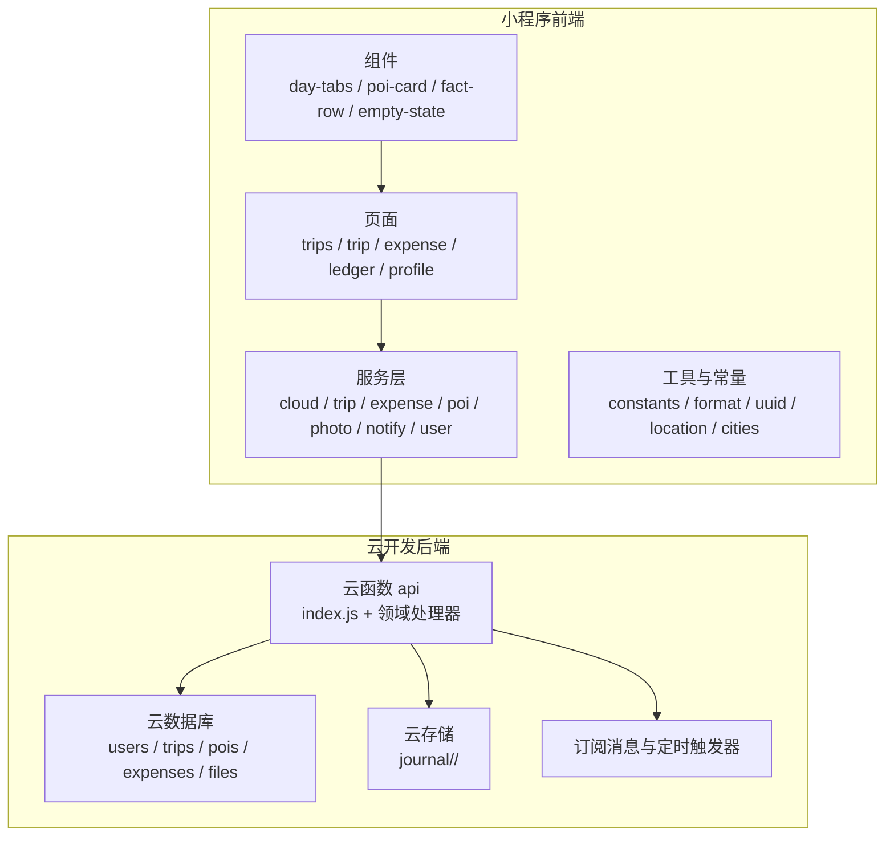
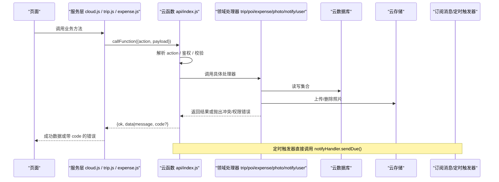
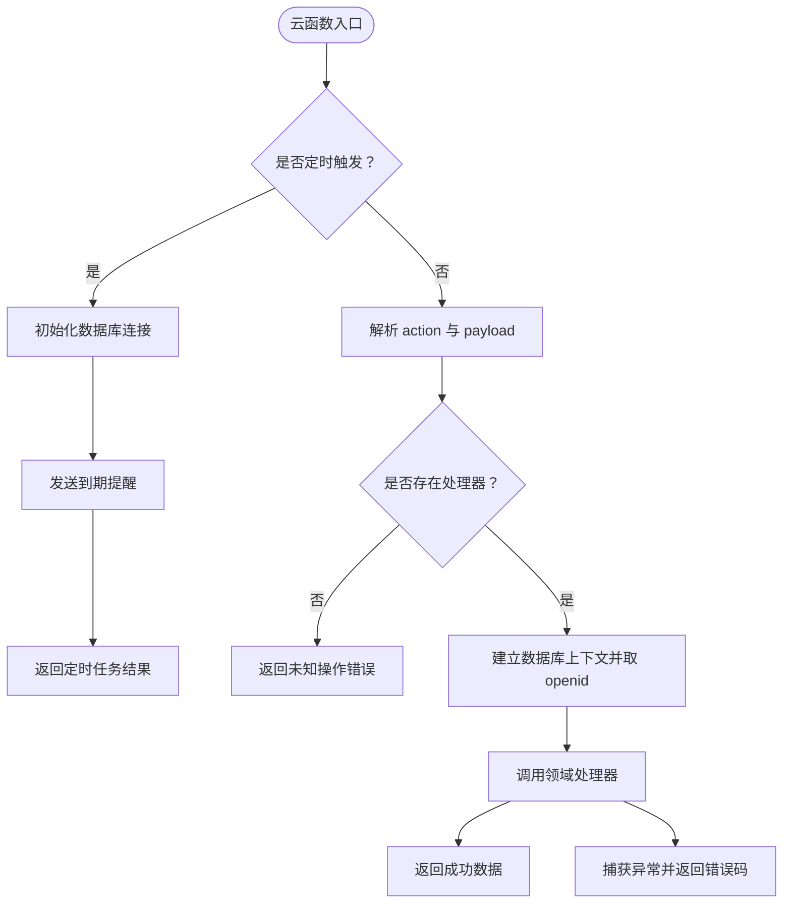
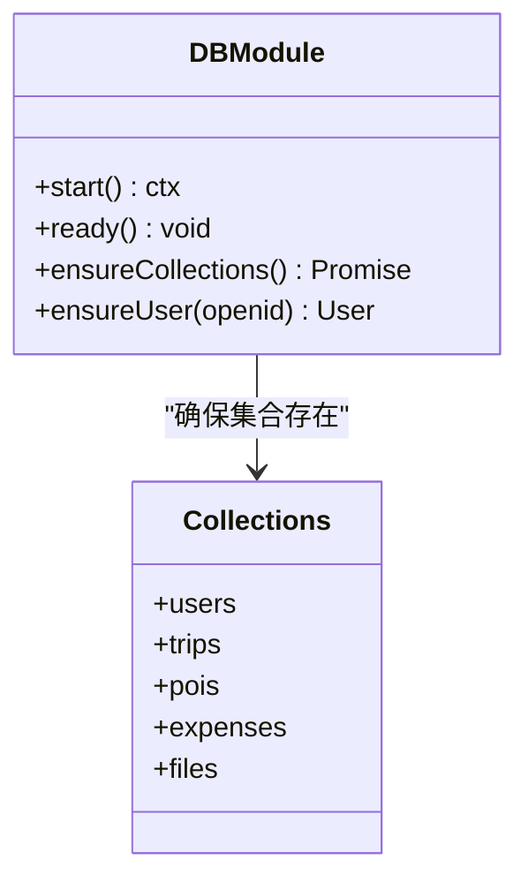
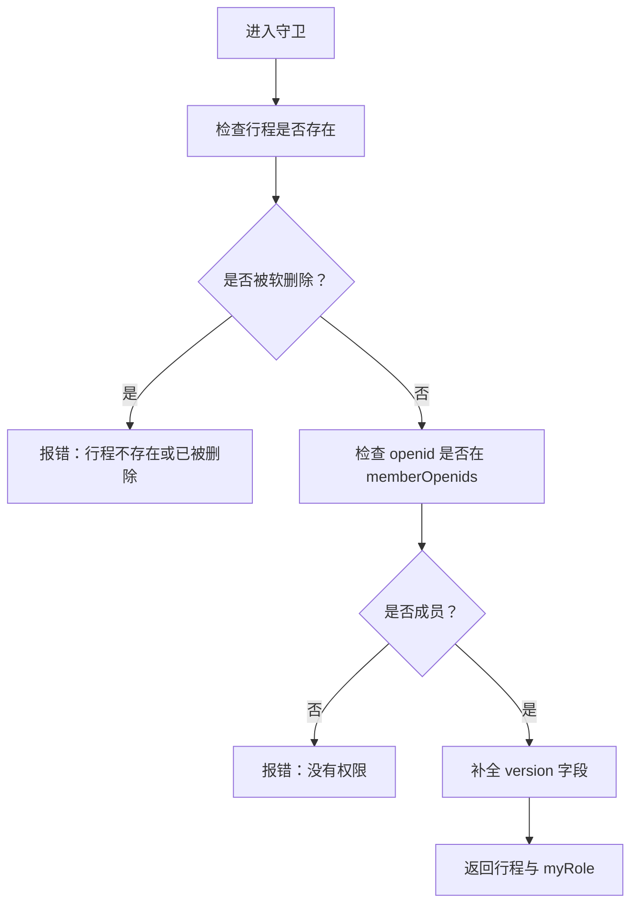
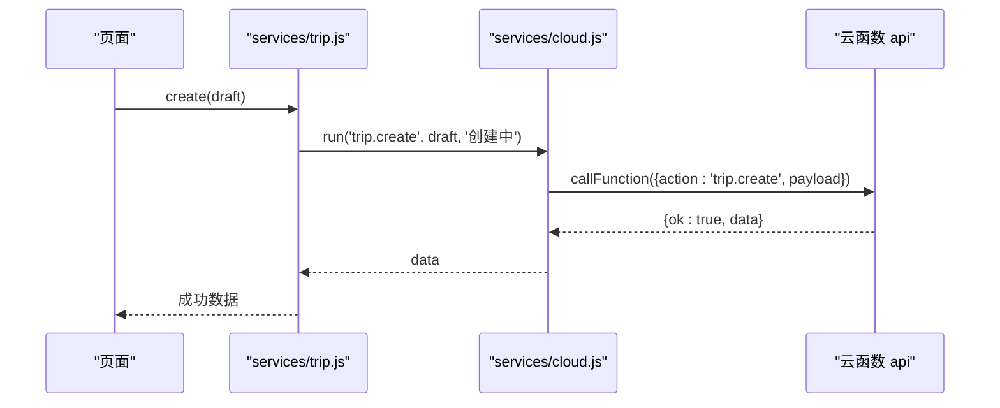
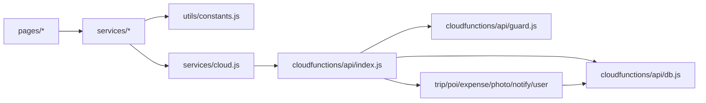
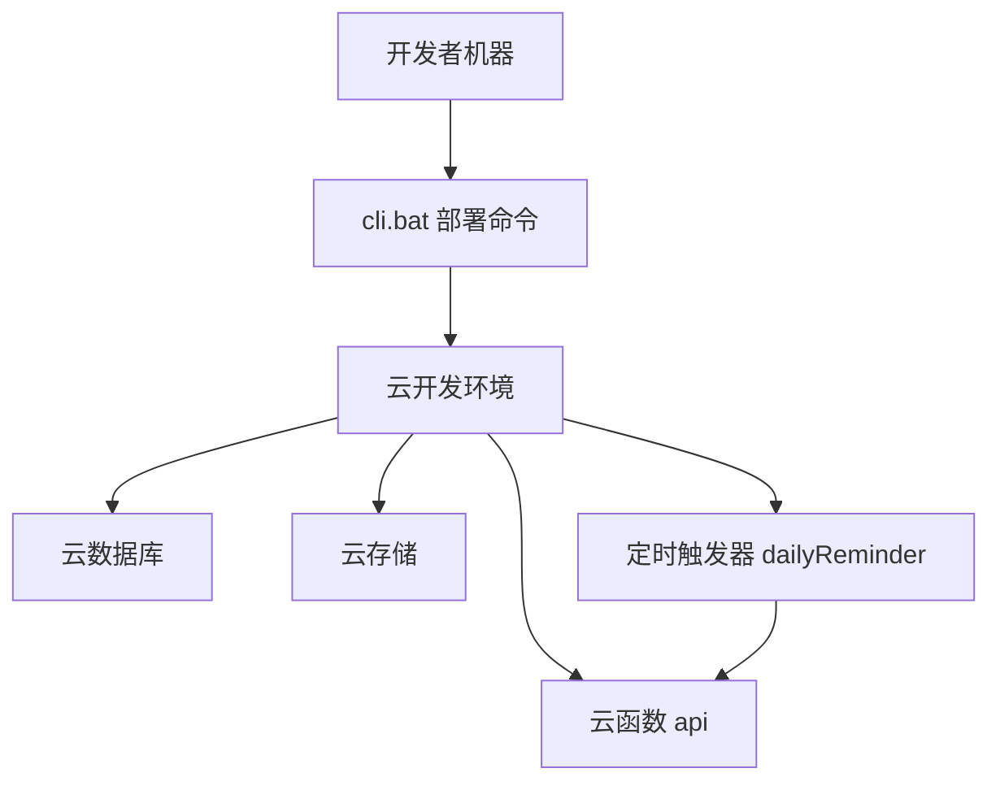

# 架构设计

<cite>
**本文引用的文件**   
- [app.json](file://app.json)
- [方案.md](file://docs/方案.md)
- [index.js](file://cloudfunctions\api\index.js)
- [db.js](file://cloudfunctions\api\db.js)
- [guard.js](file://cloudfunctions\api\guard.js)
- [package.json](file://cloudfunctions\api\package.json)
- [cloud.js](file://services\cloud.js)
- [trip.js](file://services\trip.js)
- [expense.js](file://services\expense.js)
- [constants.js](file://utils\constants.js)
</cite>

## 目录
1. [引言](#引言)
2. [项目结构](#项目结构)
3. [核心组件](#核心组件)
4. [架构总览](#架构总览)
5. [详细组件分析](#详细组件分析)
6. [依赖关系分析](#依赖关系分析)
7. [性能与可扩展性](#性能与可扩展性)
8. [安全、监控与灾难恢复](#安全监控与灾难恢复)
9. [基础设施与部署拓扑](#基础设施与部署拓扑)
10. [技术栈与兼容性](#技术栈与兼容性)
11. [故障排查指南](#故障排查指南)
12. [结论](#结论)

## 引言
本架构文档面向“旅行计划”微信小程序，目标是说明系统的高层设计、分层职责、数据流向、集成模式以及约束条件。系统以小程序为表现层，通过统一的服务层调用单个云函数作为 API 层，后端由云数据库和云存储承载数据，订阅消息与定时触发器提供横切能力。整体采用“前端不直连数据库、所有写操作走云函数”的边界策略，便于后续加入成员权限、并发控制与审计。

## 项目结构
仓库按小程序标准工程组织：
- `pages`：页面路由与业务视图，对应 Tab 栏“行程 / 记账 / 我的”。
- `components`：可复用 UI 组件，如日切换、地点卡片、空态等。
- `services`：封装对云函数的调用，屏蔽 loading、错误提示与网络异常。
- `utils`：纯函数与常量，如环境、集合名、分类、限制、格式化等。
- `cloudfunctions/api`：唯一对外暴露的云函数入口，内部按 action 分发到领域处理器。
- `docs/方案.md`：产品与技术方案主文档，记录信息架构、数据模型、接口契约、部署与验收。

**图表来源**
- [app.json:2-15](file://app.json#L2-L15)
- [方案.md:72-95](file://docs/方案.md#L72-L95)
- [index.js:1-41](file://cloudfunctions\api\index.js#L1-L41)

**章节来源**
- [app.json:1-56](file://app.json#L1-L56)
- [方案.md:72-95](file://docs/方案.md#L72-L95)

## 核心组件
- 表现层（页面）：负责用户交互、表单输入、列表展示、地图展示与跳转导航；不直接访问数据库。
- 服务层（业务逻辑封装）：将页面动作映射为云函数 action，统一处理 loading、toast、版本冲突与网络异常。
- API 层（云函数）：单一入口 `api`，集中鉴权、校验、事务与领域逻辑；按 `action` 路由到 trip/poi/expense/photo/notify/user 处理器。
- 数据访问层（数据库）：云数据库集合 users/trips/pois/expenses/files，由云函数自动创建并维护索引；云存储用于手帐照片。

关键职责边界：
- 页面只写成功分支，失败与加载状态下沉到 `services/cloud.js`。
- 所有写操作必须经过云函数，避免前端越权或绕过业务规则。
- 身份从服务端上下文获取，前端不信任也不传递 openid。
- 金额以“分”为单位，汇总与服务端计算保持一致。

**章节来源**
- [cloud.js:1-50](file://services\cloud.js#L1-L50)
- [index.js:10-76](file://cloudfunctions\api\index.js#L10-L76)
- [方案.md:211-244](file://docs/方案.md#L211-L244)

## 架构总览
系统采用四层架构：
- 表现层：小程序页面与组件。
- 服务层：`services/` 下的模块，封装 action 调用。
- API 层：云函数 `api`，统一鉴权、校验、路由与领域处理。
- 数据层：云数据库与云存储，由云函数管理。

**图表来源**
- [cloud.js:5-47](file://services\cloud.js#L5-L47)
- [index.js:43-76](file://cloudfunctions\api\index.js#L43-L76)
- [方案.md:211-244](file://docs/方案.md#L211-L244)

## 详细组件分析

### API 层：云函数入口与路由
- 单函数多 action：所有业务通过 `action` 路由到对应处理器，减少部署与权限配置复杂度。
- 定时任务分支：当 event 来自定时触发器时跳过 action 路由，直接执行提醒发送。
- 统一错误包装：返回 `{ ok, data }` 或 `{ ok:false, message, code }`，其中 `code:'conflict'` 表示乐观锁冲突。
- 身份隔离：openid 仅从服务端上下文读取，前端传值无效。

**图表来源**
- [index.js:43-76](file://cloudfunctions\api\index.js#L43-L76)

**章节来源**
- [index.js:1-77](file://cloudfunctions\api\index.js#L1-L77)

### 数据访问层：数据库初始化与身份入口
- 集合自动创建：首次请求确保 users/trips/pois/expenses/files 存在，幂等且缓存 Promise。
- 用户自动建表：首次调用 `user.me` 时自动创建用户记录。
- 身份获取：每次请求通过 `cloud.getWXContext().OPENID` 获取 openid，拒绝无身份请求。
- 定时任务专用入口：`ready()` 仅保证集合存在，不要求 openid。

**图表来源**
- [db.js:9-60](file://cloudfunctions\api\db.js#L9-L60)

**章节来源**
- [db.js:1-61](file://cloudfunctions\api\db.js#L1-L61)

### 鉴权与并发控制：守卫模块
- 成员判断：基于 `memberOpenids` 数组判断是否为同行。
- 角色推导：兼容老数据，默认 owner/editor。
- 版本锁：客户端传入 version，服务端用原子更新做 CAS，冲突返回 `code:'conflict'`。
- 行程查询：过滤已删除行程，并回写缺失的 version 字段。

**图表来源**
- [guard.js:44-64](file://cloudfunctions\api\guard.js#L44-L64)

**章节来源**
- [guard.js:1-76](file://cloudfunctions\api\guard.js#L1-L76)

### 服务层：前端调用封装
- `call(action, payload)`：基础调用，解析 `ok/message/code`，区分网络异常与业务错误。
- `run(action, payload, loadingText)`：带 loading 的统一调用，失败时 toast 提示，但冲突错误不 toast，交由页面特殊处理。
- 领域服务：`trip.js`、`expense.js` 等将页面动作映射为 action，参数清晰、语义明确。

**图表来源**
- [trip.js:12-14](file://services\trip.js#L12-L14)
- [cloud.js:33-47](file://services\cloud.js#L33-L47)

**章节来源**
- [cloud.js:1-50](file://services\cloud.js#L1-L50)
- [trip.js:1-47](file://services\trip.js#L1-L47)
- [expense.js:1-26](file://services\expense.js#L1-L26)

### 常量与配置：环境与限制
- 环境变量与云函数名集中在 `constants.js`，便于切换环境与统一引用。
- 集合名、分类、停留时长、默认出发时间、缓冲时间、限额等常量统一管理。
- 订阅消息模板 id 在此处声明，未配置时页面应提示。

**章节来源**
- [constants.js:1-48](file://utils\constants.js#L1-L48)

## 依赖关系分析
- 前端依赖：
  - 页面依赖 `services/*` 进行业务调用。
  - `services/cloud.js` 依赖 `utils/constants.js` 中的云函数名与环境。
- 后端依赖：
  - `index.js` 依赖 `db.js` 获取数据库句柄与身份。
  - 各领域处理器依赖 `guard.js` 做权限与版本控制。
  - 定时任务依赖 `notify.js` 发送订阅消息。

**图表来源**
- [app.json:2-15](file://app.json#L2-L15)
- [index.js:1-41](file://cloudfunctions\api\index.js#L1-L41)
- [cloud.js:1-50](file://services\cloud.js#L1-L50)
- [constants.js:1-48](file://utils\constants.js#L1-L48)

**章节来源**
- [app.json:1-56](file://app.json#L1-L56)
- [index.js:1-77](file://cloudfunctions\api\index.js#L1-L77)
- [cloud.js:1-50](file://services\cloud.js#L1-L50)
- [constants.js:1-48](file://utils\constants.js#L1-L48)

## 性能与可扩展性
- 性能特性：
  - 单云函数集中路由，减少部署次数与权限配置成本。
  - 金额与服务端汇总减少前端计算误差。
  - 软删除与版本号降低误删与并发写入风险。
- 可扩展性考虑：
  - action 增长超过阈值后按域拆分云函数（如 `api-trip`、`api-expense`）。
  - 分页与增量同步在数据量增大后可引入游标与增量拉取。
  - 位置与地理编码保持本地城市表，避免第三方 Key 泄露与域名白名单问题。
- 约束条件：
  - 行程最多 15 天、每天最多 20 个点位、单次列表不超过 300 条、单行程照片不超过 100 张。
  - 无离线能力，弱网场景需重试与降级。
  - 地图与定位依赖权限与网络，需真机验证。

[本节为通用指导，不直接分析具体文件]

## 安全、监控与灾难恢复
- 安全性：
  - 所有写操作走云函数，前端不直连数据库。
  - openid 仅从服务端上下文获取，前端传值无效。
  - 成员权限与角色校验集中在守卫模块，越权直接抛错。
  - 隐私权限与位置信息在 `app.json` 中声明。
- 监控：
  - 云函数日志记录定时任务与异常，便于排查订阅消息与触发器问题。
  - 版本冲突通过 `code:'conflict'` 让页面给出刷新或覆盖提示。
- 灾难恢复：
  - 软删除保留历史数据，便于回放与审计。
  - 手帐照片只软删记录，原图保留，避免不可恢复丢失。
  - 订阅消息模板字段集中管理，变更一处即可。

**章节来源**
- [app.json:44-52](file://app.json#L44-L52)
- [guard.js:16-42](file://cloudfunctions\api\guard.js#L16-L42)
- [index.js:62-76](file://cloudfunctions\api\index.js#L62-L76)
- [方案.md:337-353](file://docs/方案.md#L337-L353)

## 基础设施与部署拓扑
- 云开发环境：固定环境 ID，云函数 `api` 已部署。
- 数据库集合：users/trips/pois/expenses/files，首次请求自动创建。
- 云存储：手帐照片存于 `journal/<tripId>/`。
- 订阅消息：模板 id 在常量中声明，定时触发器每日 20:00 发送提醒。
- 权限与隐私：位置相关接口与隐私描述在 `app.json` 中声明。

**图表来源**
- [方案.md:282-294](file://docs/方案.md#L282-L294)

**章节来源**
- [方案.md:282-294](file://docs/方案.md#L282-L294)

## 技术栈与兼容性
- 前端：微信小程序原生框架（WXML/WXSS/JS），TabBar 与页面路由在 `app.json` 定义。
- 后端：Node.js 云函数，依赖 `wx-server-sdk`。
- 数据库：云数据库集合按需自动创建。
- 存储：云存储用于手帐照片。
- 消息：订阅消息与定时触发器。
- 版本兼容：
  - 老行程可能缺少 `version` 字段，守卫模块会补 0。
  - 老账目只有 `splitWith`，服务端按人数均摊还原。

**章节来源**
- [app.json:1-56](file://app.json#L1-L56)
- [package.json:1-9](file://cloudfunctions\api\package.json#L1-L9)
- [guard.js:56-64](file://cloudfunctions\api\guard.js#L56-L64)
- [方案.md:337-353](file://docs/方案.md#L337-L353)

## 故障排查指南
- 云函数返回未知操作：
  - 检查前端调用的 action 是否在路由表中。
  - 参考路由定义路径：`index.js` 的 routes 映射。
- 版本冲突：
  - 客户端携带的 version 与服务端不一致，页面应提示刷新或覆盖。
  - 冲突错误码为 `code:'conflict'`，服务层不会 toast。
- 订阅消息未到达：
  - 检查模板 id 是否正确，字段名是否与公众平台一致。
  - 确认定时触发器是否创建成功，查看云函数日志中的 errCode。
- 地图与定位异常：
  - 开发者工具中选点与移动位置行为与真机不同，需用真机验收。
  - 确认 `requiredPrivateInfos` 与隐私协议已配置。

**章节来源**
- [index.js:56-76](file://cloudfunctions\api\index.js#L56-L76)
- [cloud.js:33-47](file://services\cloud.js#L33-L47)
- [方案.md:248-266](file://docs/方案.md#L248-L266)
- [方案.md:322-334](file://docs/方案.md#L322-L334)

## 结论
该架构以小程序为表现层、服务层为调用封装、云函数为统一 API 入口、云数据库与云存储为数据层，形成清晰的职责边界与可控的安全策略。通过 action 路由、成员鉴权、乐观锁与软删除，系统在协同编辑与并发写入方面具备基本保障。未来可在 action 规模增长时拆分云函数、引入分页与增量同步、完善离线缓存与导出能力，同时持续强化订阅消息与监控告警。

[本节为总结性内容，不直接分析具体文件]