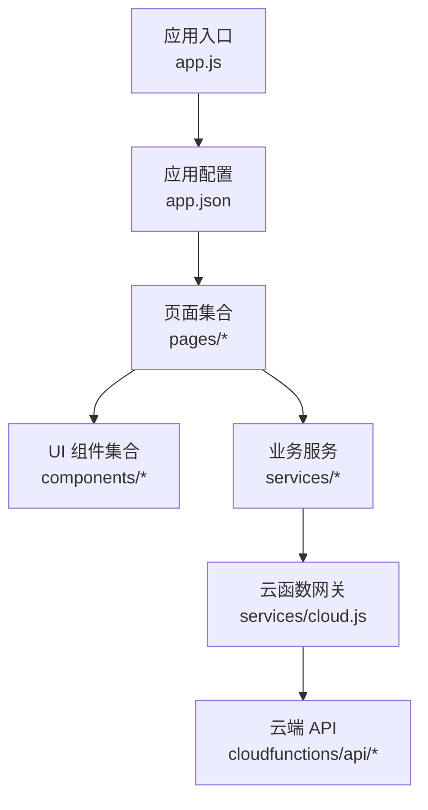
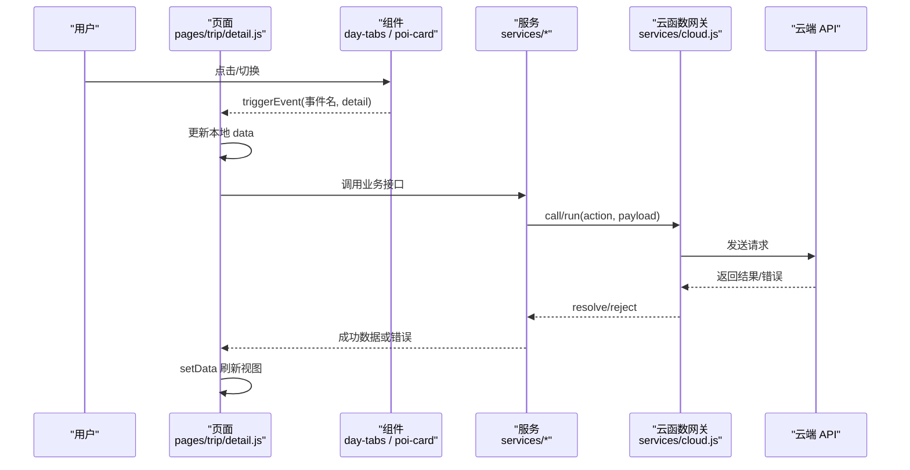
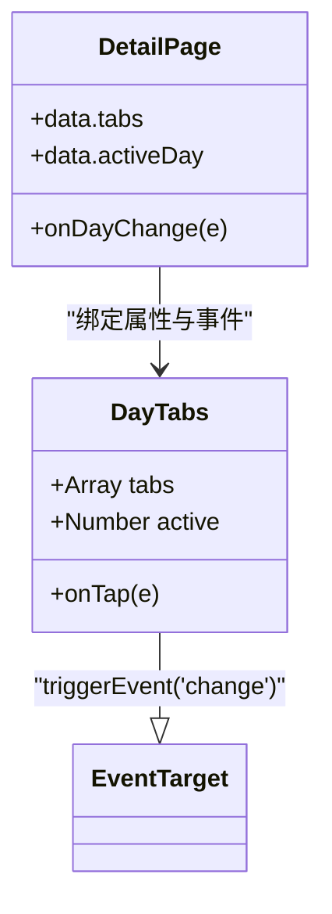
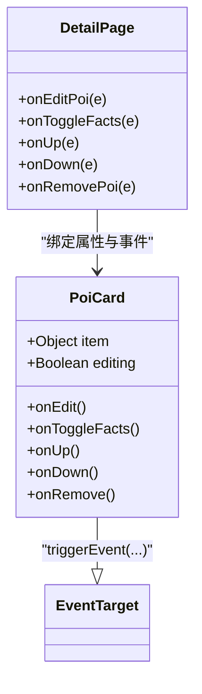
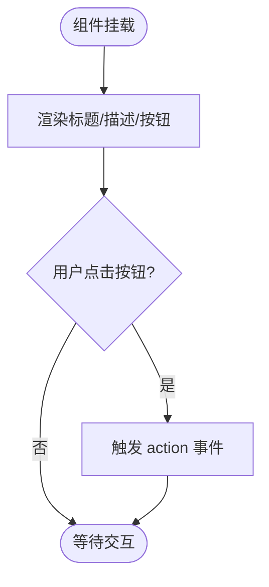
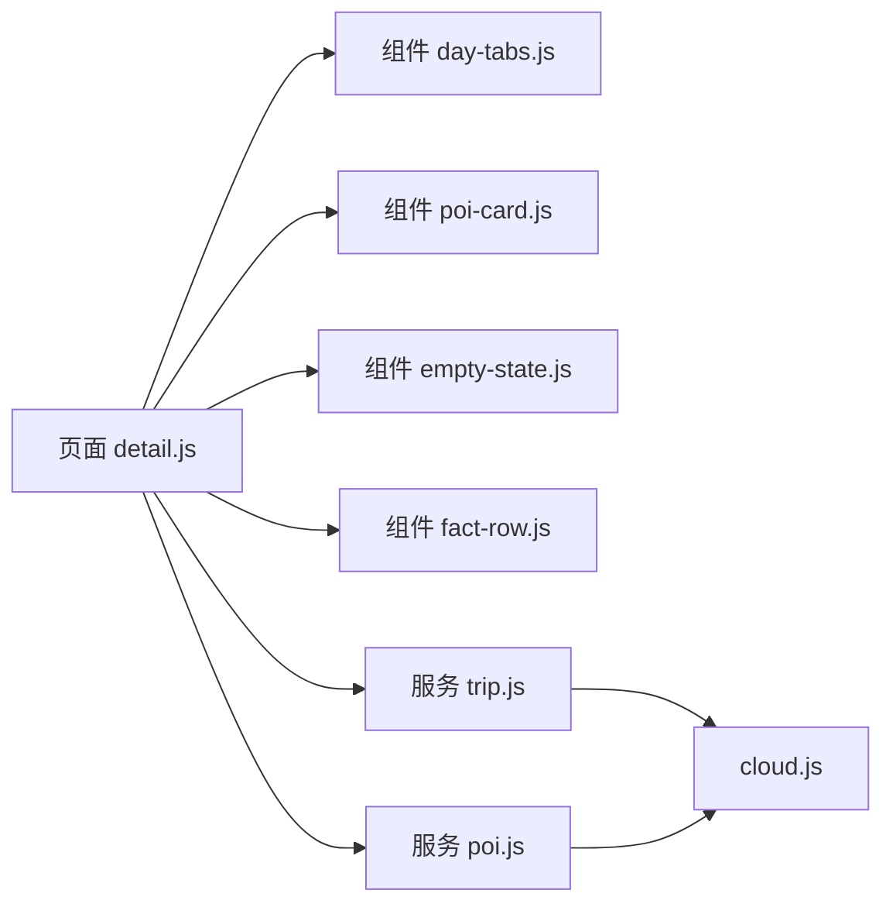

# 组件交互模式

<cite>
**本文引用的文件**   
- [app.js](file://app.js)
- [app.json](file://app.json)
- [components/day-tabs/day-tabs.js](file://components/day-tabs/day-tabs.js)
- [components/empty-state/empty-state.js](file://components/empty-state/empty-state.js)
- [components/poi-card/poi-card.js](file://components/poi-card/poi-card.js)
- [components/fact-row/fact-row.js](file://components/fact-row/fact-row.js)
- [pages/trips/list.js](file://pages/trips/list.js)
- [pages/trip/detail.js](file://pages/trip/detail.js)
- [services/cloud.js](file://services/cloud.js)
- [docs/方案.md](file://docs/方案.md)
</cite>

## 目录
1. [引言](#引言)
2. [项目结构](#项目结构)
3. [核心组件](#核心组件)
4. [架构总览](#架构总览)
5. [详细组件分析](#详细组件分析)
6. [依赖关系分析](#依赖关系分析)
7. [性能与优化](#性能与优化)
8. [可测试性与可维护性](#可测试性与可维护性)
9. [故障排查指南](#故障排查指南)
10. [结论](#结论)

## 引言
本文面向“旅行计划”小程序，聚焦页面组件、可复用 UI 组件与业务服务之间的通信机制。文档从单向数据流、事件冒泡、属性传递等模式出发，结合具体组件与页面实现，说明自定义组件的生命周期管理、与页面的集成方式，并给出交互示例、最佳实践、性能优化策略以及可测试性与可维护性设计建议。

## 项目结构
本项目采用分层组织：
- 应用层：app.js 负责云开发初始化与全局状态；app.json 定义页面路由与 TabBar。
- 页面层：pages 下按功能划分，如 trips、trip、poi、expense、ledger 等。
- 组件层：components 提供可复用的 UI 组件，如 day-tabs、poi-card、fact-row、empty-state。
- 服务层：services 封装云函数调用与业务接口，如 cloud.js、trip.js、poi.js 等。
- 工具层：utils 提供常量、格式化、冲突处理、订阅消息等通用能力。
- 云端：cloudfunctions/api 提供统一 action 路由与数据库访问。

图表来源
- [app.js:1-22](file://app.js#L1-L22)
- [app.json:1-56](file://app.json#L1-L56)
- [services/cloud.js:1-50](file://services/cloud.js#L1-L50)

章节来源
- [app.js:1-22](file://app.js#L1-L22)
- [app.json:1-56](file://app.json#L1-L56)

## 核心组件
本项目的可复用 UI 组件遵循“属性驱动 + 事件回调”的单向数据流模式：
- day-tabs：接收 tabs 与 active，通过 change 事件回传选中索引。
- poi-card：接收 item 与 editing，通过 edit/togglefacts/up/down/remove 等事件向父级上报操作。
- empty-state：接收 title/desc/action，通过 action 事件触发主操作。
- fact-row：纯展示型组件，仅通过 label/value 属性渲染。

这些组件均使用 Component({}) 构造，并通过 properties 声明外部传入的数据，通过 this.triggerEvent 向上抛出事件，由页面或父组件监听处理。

章节来源
- [components/day-tabs/day-tabs.js:1-15](file://components/day-tabs/day-tabs.js#L1-L15)
- [components/poi-card/poi-card.js:1-33](file://components/poi-card/poi-card.js#L1-L33)
- [components/empty-state/empty-state.js:1-14](file://components/empty-state/empty-state.js#L1-L14)
- [components/fact-row/fact-row.js:1-11](file://components/fact-row/fact-row.js#L1-L11)

## 架构总览
小程序整体通信链路如下：
- 页面通过 services 调用云函数，services/cloud.js 统一封装 call/run，负责 loading、错误提示与错误码透传。
- 页面在 onShow/onLoad 中加载数据，将数据映射为组件所需的 props（如 tabs、activeDay、pois）。
- 组件内部不直接访问服务，只通过事件将用户操作上报给页面，页面再决定如何更新本地状态并调用服务持久化。

图表来源
- [pages/trip/detail.js:52-74](file://pages/trip/detail.js#L52-L74)
- [pages/trip/detail.js:127-136](file://pages/trip/detail.js#L127-L136)
- [components/day-tabs/day-tabs.js:7-12](file://components/day-tabs/day-tabs.js#L7-L12)
- [components/poi-card/poi-card.js:11-30](file://components/poi-card/poi-card.js#L11-L30)
- [services/cloud.js:5-47](file://services/cloud.js#L5-L47)

## 详细组件分析

### 日标签页组件 day-tabs
- 输入属性：tabs（数组）、active（数字）
- 输出事件：change，携带 { index }
- 行为要点：
  - 点击后解析 dataset.index，校验有效性且避免重复触发。
  - 通过 triggerEvent('change', { index }) 通知父组件。
- 页面集成：
  - 详情页 onLoad/onShow 中根据 trip.days 生成 tabs，并维护 activeDay。
  - 监听 change 事件，更新 activeDay 与 dayPois。

图表来源
- [components/day-tabs/day-tabs.js:1-15](file://components/day-tabs/day-tabs.js#L1-L15)
- [pages/trip/detail.js:92-136](file://pages/trip/detail.js#L92-L136)

章节来源
- [components/day-tabs/day-tabs.js:1-15](file://components/day-tabs/day-tabs.js#L1-L15)
- [pages/trip/detail.js:92-136](file://pages/trip/detail.js#L92-L136)

### 地点卡片组件 poi-card
- 输入属性：item（对象）、editing（布尔）
- 输出事件：edit、togglefacts、up、down、remove，均携带 { id }
- 行为要点：
  - 所有操作都通过 triggerEvent 上报，不直接修改父级数据。
  - 使用 options.styleIsolation = 'apply-shared' 复用全局样式。
- 页面集成：
  - 详情页在 POI 列表中使用该组件，并在对应事件处理器中调用 poiService 进行保存、重排或删除。

图表来源
- [components/poi-card/poi-card.js:1-33](file://components/poi-card/poi-card.js#L1-L33)
- [pages/trip/detail.js:167-171](file://pages/trip/detail.js#L167-L171)
- [pages/trip/detail.js:232-256](file://pages/trip/detail.js#L232-L256)
- [pages/trip/detail.js:258-310](file://pages/trip/detail.js#L258-L310)
- [pages/trip/detail.js:324-347](file://pages/trip/detail.js#L324-L347)

章节来源
- [components/poi-card/poi-card.js:1-33](file://components/poi-card/poi-card.js#L1-L33)
- [pages/trip/detail.js:167-171](file://pages/trip/detail.js#L167-L171)
- [pages/trip/detail.js:232-256](file://pages/trip/detail.js#L232-L256)
- [pages/trip/detail.js:258-310](file://pages/trip/detail.js#L258-L310)
- [pages/trip/detail.js:324-347](file://pages/trip/detail.js#L324-L347)

### 空态组件 empty-state
- 输入属性：title、desc、action
- 输出事件：action
- 行为要点：
  - 点击主按钮时触发 action 事件，由父组件决定跳转或执行逻辑。
- 适用场景：
  - 列表为空时展示占位信息与引导操作。

图表来源
- [components/empty-state/empty-state.js:1-14](file://components/empty-state/empty-state.js#L1-L14)

章节来源
- [components/empty-state/empty-state.js:1-14](file://components/empty-state/empty-state.js#L1-L14)

### 信息行组件 fact-row
- 输入属性：label、value
- 行为要点：
  - 纯展示组件，无事件输出，适合用于 POI 详情中的事实项展示。
- 样式隔离：
  - 使用 apply-shared 以复用全局样式 token。

章节来源
- [components/fact-row/fact-row.js:1-11](file://components/fact-row/fact-row.js#L1-L11)

## 依赖关系分析
- 页面与组件：
  - 页面持有数据源（如 trip、pois、tabs），将其映射为组件所需 props。
  - 组件通过事件将用户意图上抛，页面集中处理业务逻辑与服务调用。
- 页面与服务：
  - 页面通过 services 调用云函数，services/cloud.js 统一封装网络请求、loading 与错误处理。
  - 错误码（如 conflict）透传给页面，以便差异化处理（重试、合并、提示）。
- 组件与服务：
  - 组件不直接依赖 services，保持 UI 层的纯粹性与可复用性。

图表来源
- [pages/trip/detail.js:1-422](file://pages/trip/detail.js#L1-L422)
- [components/day-tabs/day-tabs.js:1-15](file://components/day-tabs/day-tabs.js#L1-L15)
- [components/poi-card/poi-card.js:1-33](file://components/poi-card/poi-card.js#L1-L33)
- [components/empty-state/empty-state.js:1-14](file://components/empty-state/empty-state.js#L1-L14)
- [components/fact-row/fact-row.js:1-11](file://components/fact-row/fact-row.js#L1-L11)
- [services/cloud.js:1-50](file://services/cloud.js#L1-L50)

章节来源
- [pages/trip/detail.js:1-422](file://pages/trip/detail.js#L1-L422)
- [services/cloud.js:1-50](file://services/cloud.js#L1-L50)

## 性能与优化
- 预计算展示字段：
  - 页面在 JS 中预先计算时长文本、日期文案、百分比宽度等，避免 WXML 中进行复杂运算，减少渲染开销。
- 单向数据流：
  - 组件只读 props，变更通过事件上报，降低双向绑定带来的状态同步复杂度。
- 样式复用：
  - 组件使用 styleIsolation = 'apply-shared'，复用全局样式 token，减少样式体积与重复定义。
- 懒加载与按需渲染：
  - 列表分页、下拉刷新、Tab 切换时仅更新当前可见区域数据，避免一次性渲染大量节点。
- 缓存与去抖：
  - 对频繁触发的操作（如滚动、搜索）做防抖；对热点数据（如城市列表、常量）做内存缓存。
- 弱网体验：
  - services/cloud.js 的 run 方法统一显示 loading，失败时区分冲突错误与普通错误，提升用户体验。

章节来源
- [docs/方案.md:269-275](file://docs/方案.md#L269-L275)
- [services/cloud.js:32-47](file://services/cloud.js#L32-L47)

## 可测试性与可维护性
- 可测试性：
  - 组件职责单一，props 与 events 契约清晰，便于单元测试与交互模拟。
  - 页面逻辑集中在事件处理器中，便于断言状态变化与服务调用。
- 可维护性：
  - 分层清晰：页面只做业务编排，服务封装网络与错误处理，工具函数保持纯函数。
  - 约定明确：WXML 不做方法调用；组件属性命名规范；样式 token 统一管理。
- 扩展性：
  - 新增组件只需遵循 props/events 契约，无需改动现有页面逻辑。
  - 新增服务接口只需在 services 中封装，页面通过统一入口调用。

章节来源
- [docs/方案.md:269-275](file://docs/方案.md#L269-L275)

## 故障排查指南
- 云开发基础库版本问题：
  - app.js 中检查 wx.cloud 是否存在，若不存在则提示升级基础库。
- 云函数调用失败：
  - services/cloud.js 的 call/run 会捕获网络异常与业务错误，统一提示；冲突错误需页面特殊处理。
- 权限与隐私配置：
  - app.json 中已声明位置相关权限，真机需确保开通 chooseLocation/getLocation 及隐私指引。
- 组件样式异常：
  - 确认组件 options.styleIsolation 是否设置为 apply-shared，避免样式隔离导致样式丢失。

章节来源
- [app.js:10-20](file://app.js#L10-L20)
- [services/cloud.js:5-47](file://services/cloud.js#L5-L47)
- [app.json:44-52](file://app.json#L44-L52)
- [components/poi-card/poi-card.js:2-4](file://components/poi-card/poi-card.js#L2-L4)
- [components/fact-row/fact-row.js:2-4](file://components/fact-row/fact-row.js#L2-L4)

## 结论
本项目通过清晰的单向数据流、明确的组件契约与统一的服务封装，实现了页面、组件与服务之间的高效协作。组件以 props 驱动、events 上报为核心，页面集中处理业务逻辑与状态更新，服务层屏蔽网络细节并提供一致的错误处理。在此基础上，通过预计算、样式复用、懒加载与缓存等策略，兼顾了性能与可维护性。未来可在组件层面引入更细粒度的状态管理与单元测试框架，进一步提升可测试性与可扩展性。