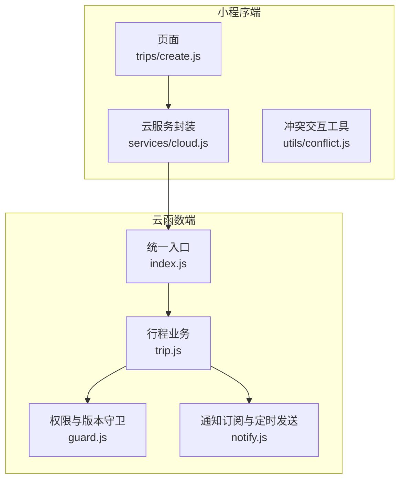
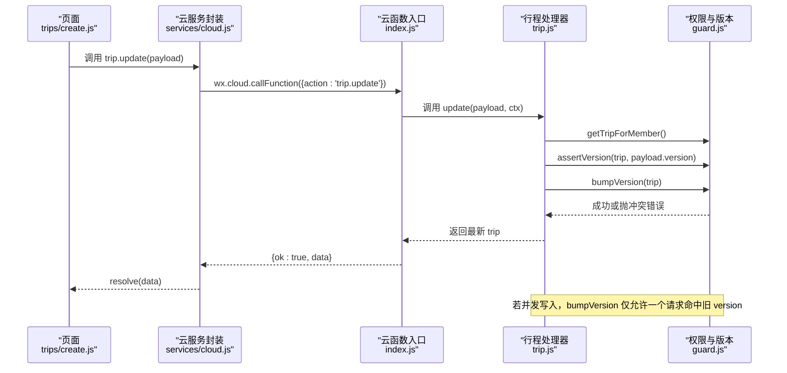
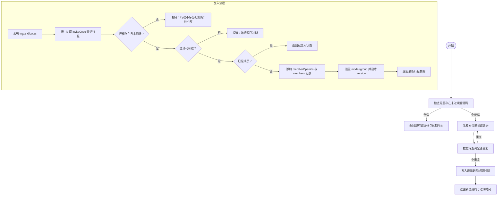
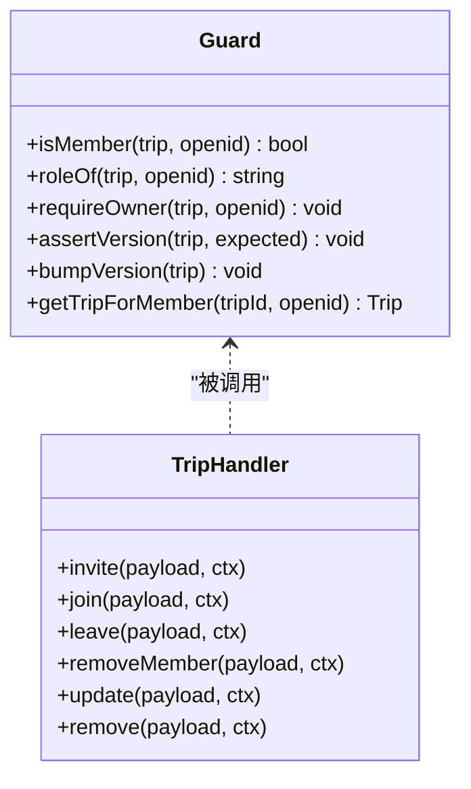
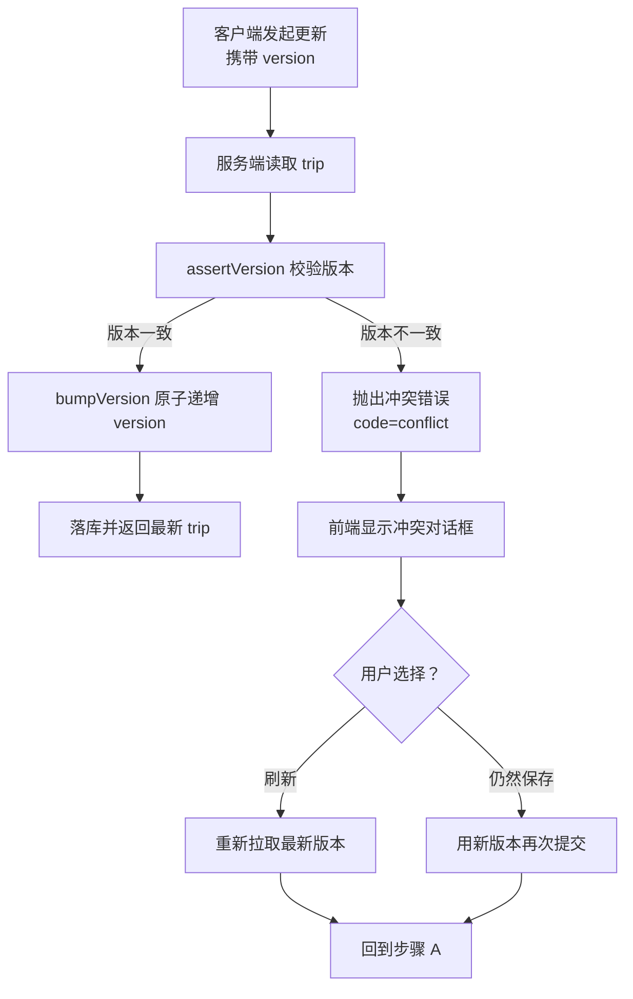
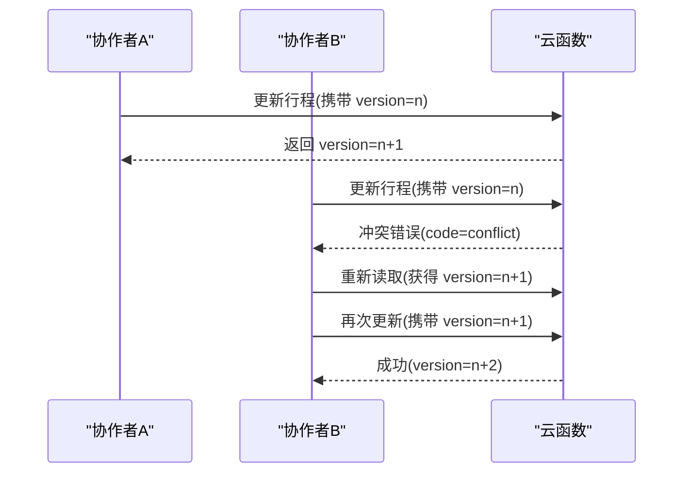
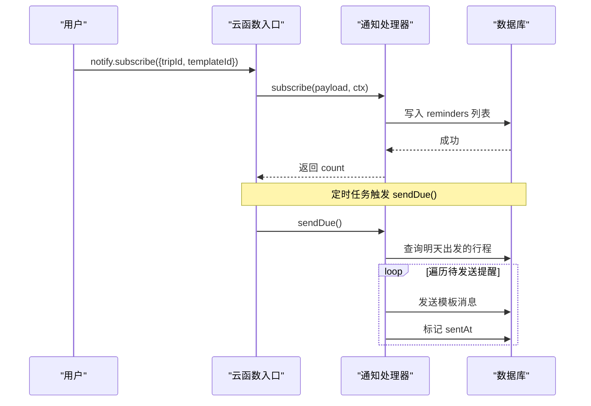
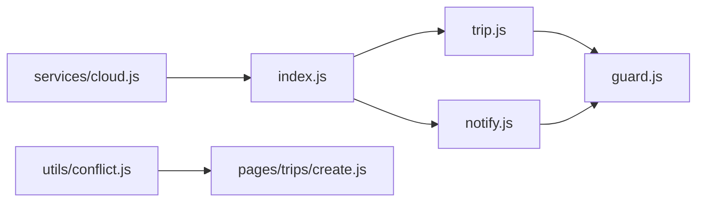

# 协作功能模块

<cite>
**本文引用的文件**   
- [cloudfunctions/api/index.js](file://cloudfunctions/api/index.js)
- [cloudfunctions/api/guard.js](file://cloudfunctions/api/guard.js)
- [cloudfunctions/api/trip.js](file://cloudfunctions/api/trip.js)
- [cloudfunctions/api/notify.js](file://cloudfunctions/api/notify.js)
- [utils/conflict.js](file://utils/conflict.js)
- [services/cloud.js](file://services/cloud.js)
- [pages/trips/create.js](file://pages/trips/create.js)
</cite>

## 目录
1. [引言](#引言)
2. [项目结构](#项目结构)
3. [核心组件](#核心组件)
4. [架构总览](#架构总览)
5. [详细组件分析](#详细组件分析)
6. [依赖关系分析](#依赖关系分析)
7. [性能与并发特性](#性能与并发特性)
8. [故障排查指南](#故障排查指南)
9. [结论](#结论)
10. [附录：扩展方案](#附录扩展方案)

## 引言
本章节面向“多人协作”能力，围绕邀请码生成、成员权限控制、并发冲突解决、乐观锁机制、数据同步策略以及通知扩展进行系统化说明。该模块以云函数为统一入口，通过集中式路由分发到业务处理器；权限校验、版本控制、冲突提示等通用逻辑被抽象到守卫模块中，从而保证多人编辑场景下的数据一致性与用户体验。

## 项目结构
协作相关代码主要分布在以下位置：
- 云函数 API 层：负责动作路由、权限校验、数据更新与通知发送
- 小程序前端服务层：封装云函数调用、错误处理与加载态
- 工具层：提供统一的冲突交互体验
- 页面层：在保存失败时根据冲突码刷新并重试

**图表来源**
- [cloudfunctions/api/index.js:11-41](file://cloudfunctions/api/index.js#L11-L41)
- [cloudfunctions/api/trip.js:1-10](file://cloudfunctions/api/trip.js#L1-L10)
- [cloudfunctions/api/guard.js:1-10](file://cloudfunctions/api/guard.js#L1-L10)
- [cloudfunctions/api/notify.js:1-10](file://cloudfunctions/api/notify.js#L1-L10)
- [services/cloud.js:1-30](file://services/cloud.js#L1-L30)
- [utils/conflict.js:1-10](file://utils/conflict.js#L1-L10)

**章节来源**
- [cloudfunctions/api/index.js:11-41](file://cloudfunctions/api/index.js#L11-L41)
- [services/cloud.js:1-30](file://services/cloud.js#L1-L30)

## 核心组件
- 统一路由与异常包装：所有写操作经单一云函数入口进入，集中返回 ok/message/code，便于前端统一处理。
- 行程协作业务：涵盖创建、更新、删除、复制、邀请加入、退出、移除成员等。
- 权限与版本守卫：成员判定、角色推导、所有者校验、版本号断言与原子递增。
- 通知订阅与定时提醒：基于模板消息的出发前提醒。
- 前端冲突交互：当服务端返回冲突码时，引导用户刷新并选择是否重试保存。

**章节来源**
- [cloudfunctions/api/index.js:43-76](file://cloudfunctions/api/index.js#L43-L76)
- [cloudfunctions/api/trip.js:11-26](file://cloudfunctions/api/trip.js#L11-L26)
- [cloudfunctions/api/guard.js:3-42](file://cloudfunctions/api/guard.js#L3-L42)
- [cloudfunctions/api/notify.js:28-45](file://cloudfunctions/api/notify.js#L28-L45)
- [utils/conflict.js:1-19](file://utils/conflict.js#L1-L19)

## 架构总览
协作流程的关键路径如下：
- 前端发起 action（如 trip.update）
- 云函数路由解析并调用对应处理器
- 处理器先读取行程数据，执行权限校验与版本断言
- 使用原子条件更新递增版本号，落库后返回最新数据
- 若并发冲突，抛出带 code=conflict 的错误，前端展示交互并支持重试

**图表来源**
- [cloudfunctions/api/index.js:43-76](file://cloudfunctions/api/index.js#L43-L76)
- [cloudfunctions/api/trip.js:90-132](file://cloudfunctions/api/trip.js#L90-L132)
- [cloudfunctions/api/guard.js:26-42](file://cloudfunctions/api/guard.js#L26-L42)
- [services/cloud.js:5-30](file://services/cloud.js#L5-L30)

## 详细组件分析

### 邀请码生成与会话加入
- 邀请码生成：
  - 由创建者触发，若已有未过期邀请码则直接复用；否则生成 6 位随机码，并通过数据库计数去重。
  - 有效期固定为 7 天，过期后下次再生成新码。
- 加入行程：
  - 支持通过分享卡片携带 tripId 或手动输入邀请码两种方式加入。
  - 加入成功后将当前用户作为 editor 加入 members 列表，并将行程模式切换为 group。
  - 加入属于成员变更，会递增版本号，确保其他协作者感知到成员变化。

**图表来源**
- [cloudfunctions/api/trip.js:11-26](file://cloudfunctions/api/trip.js#L11-L26)
- [cloudfunctions/api/trip.js:149-169](file://cloudfunctions/api/trip.js#L149-L169)
- [cloudfunctions/api/trip.js:171-204](file://cloudfunctions/api/trip.js#L171-L204)

**章节来源**
- [cloudfunctions/api/trip.js:11-26](file://cloudfunctions/api/trip.js#L11-L26)
- [cloudfunctions/api/trip.js:149-169](file://cloudfunctions/api/trip.js#L149-L169)
- [cloudfunctions/api/trip.js:171-204](file://cloudfunctions/api/trip.js#L171-L204)

### 成员权限体系（owner/editor/viewer）
- 角色推导：
  - 优先从 members 数组中的 role 字段获取；若无 role，则回退到 ownerOpenid 判断：创建者为 owner，其余为 editor。
  - 当前实现中并未显式维护 viewer 角色；如需只读角色，可在 members.role 中新增 viewer，并在需要处增加 requireViewer 类守卫。
- 权限控制：
  - 访问行程需满足 isMember(openid)，否则拒绝。
  - 敏感操作（删除、移除成员、生成邀请码）要求 requireOwner。
  - 离开行程时禁止 owner 退出，避免无主行程。

**图表来源**
- [cloudfunctions/api/guard.js:3-42](file://cloudfunctions/api/guard.js#L3-L42)
- [cloudfunctions/api/trip.js:149-272](file://cloudfunctions/api/trip.js#L149-L272)

**章节来源**
- [cloudfunctions/api/guard.js:3-18](file://cloudfunctions/api/guard.js#L3-L18)
- [cloudfunctions/api/trip.js:206-272](file://cloudfunctions/api/trip.js#L206-L272)

### 并发冲突解决与乐观锁机制
- 乐观锁设计：
  - trips 表包含 version 字段，每次更新前客户端需带上自己读到的 version。
  - assertVersion 比较客户端传入的版本与服务端当前版本，不一致即抛冲突错误。
  - bumpVersion 使用 where 条件匹配旧 version 并原子递增，确保同一时刻只有一个请求能成功落库。
- 前端处理：
  - 云服务封装将服务端 code=conflict 透传至前端。
  - 冲突工具提供统一交互：弹出对话框，让用户选择“仍然保存”或“刷新”，刷新后重新读取最新版本再尝试保存一次。

**图表来源**
- [cloudfunctions/api/guard.js:26-42](file://cloudfunctions/api/guard.js#L26-L42)
- [services/cloud.js:5-30](file://services/cloud.js#L5-L30)
- [utils/conflict.js:1-19](file://utils/conflict.js#L1-L19)
- [pages/trips/create.js:124-139](file://pages/trips/create.js#L124-L139)

**章节来源**
- [cloudfunctions/api/guard.js:26-42](file://cloudfunctions/api/guard.js#L26-L42)
- [services/cloud.js:5-30](file://services/cloud.js#L5-L30)
- [utils/conflict.js:1-19](file://utils/conflict.js#L1-L19)
- [pages/trips/create.js:124-139](file://pages/trips/create.js#L124-L139)

### 数据同步策略
- 成员变更同步：
  - 加入、退出、移除成员均会递增 version，使其他协作者感知到成员结构变化。
- 内容变更同步：
  - 更新行程标题、目的地、交通方式、预算、状态、日期等字段时，同样通过 assertVersion+bumpVersion 保证一致性。
- 软删除同步：
  - 删除行程会同时标记 pois 与 expenses 为已删除，保持数据一致性。

**图表来源**
- [cloudfunctions/api/trip.js:90-132](file://cloudfunctions/api/trip.js#L90-L132)
- [cloudfunctions/api/trip.js:134-147](file://cloudfunctions/api/trip.js#L134-L147)
- [cloudfunctions/api/trip.js:171-204](file://cloudfunctions/api/trip.js#L171-L204)

**章节来源**
- [cloudfunctions/api/trip.js:90-132](file://cloudfunctions/api/trip.js#L90-L132)
- [cloudfunctions/api/trip.js:134-147](file://cloudfunctions/api/trip.js#L134-L147)
- [cloudfunctions/api/trip.js:171-204](file://cloudfunctions/api/trip.js#L171-L204)

### 通知与消息扩展
- 订阅提醒：
  - 用户在行程详情中订阅出发提醒，后端将模板 ID 与时间戳写入行程 reminders 列表。
- 定时发送：
  - 定时任务每天扫描“明天出发”的行程，对尚未发送过的提醒逐一调用模板消息接口，无论成功失败都标记 sentAt，避免重复打扰。

**图表来源**
- [cloudfunctions/api/notify.js:28-45](file://cloudfunctions/api/notify.js#L28-L45)
- [cloudfunctions/api/notify.js:47-96](file://cloudfunctions/api/notify.js#L47-L96)
- [cloudfunctions/api/index.js:43-54](file://cloudfunctions/api/index.js#L43-L54)

**章节来源**
- [cloudfunctions/api/notify.js:28-45](file://cloudfunctions/api/notify.js#L28-L45)
- [cloudfunctions/api/notify.js:47-96](file://cloudfunctions/api/notify.js#L47-L96)
- [cloudfunctions/api/index.js:43-54](file://cloudfunctions/api/index.js#L43-L54)

## 依赖关系分析
- 入口路由依赖各业务处理器，形成松耦合的分发结构。
- 行程处理器依赖守卫模块完成权限与版本控制。
- 通知处理器依赖守卫模块进行成员权限校验。
- 前端云服务封装屏蔽网络异常与 loading 状态，并将冲突码透传给页面。

**图表来源**
- [cloudfunctions/api/index.js:1-10](file://cloudfunctions/api/index.js#L1-L10)
- [cloudfunctions/api/trip.js:1-3](file://cloudfunctions/api/trip.js#L1-L3)
- [cloudfunctions/api/notify.js:1-5](file://cloudfunctions/api/notify.js#L1-L5)
- [cloudfunctions/api/guard.js:1-2](file://cloudfunctions/api/guard.js#L1-L2)
- [services/cloud.js:1-5](file://services/cloud.js#L1-L5)
- [utils/conflict.js:1-3](file://utils/conflict.js#L1-L3)

**章节来源**
- [cloudfunctions/api/index.js:1-10](file://cloudfunctions/api/index.js#L1-L10)
- [cloudfunctions/api/trip.js:1-3](file://cloudfunctions/api/trip.js#L1-L3)
- [cloudfunctions/api/notify.js:1-5](file://cloudfunctions/api/notify.js#L1-L5)
- [cloudfunctions/api/guard.js:1-2](file://cloudfunctions/api/guard.js#L1-L2)
- [services/cloud.js:1-5](file://services/cloud.js#L1-L5)
- [utils/conflict.js:1-3](file://utils/conflict.js#L1-L3)

## 性能与并发特性
- 乐观锁减少锁竞争：通过版本号断言与原子递增，避免长事务与行级锁，提升并发写入吞吐。
- 原子条件更新：where 条件中包含旧 version，确保并发下仅一个请求可成功，降低脏写概率。
- 批量扫描限制：定时任务限制最大扫描数量，避免单次任务过重。
- 前端重试策略：冲突时引导用户刷新并重试，避免频繁覆盖他人改动。

[本节为通用性能讨论，不直接分析具体文件]

## 故障排查指南
- 权限越权访问：
  - 现象：非成员或低权限用户访问/修改行程。
  - 排查：确认 getTripForMember 是否通过 isMember 校验；敏感操作是否调用 requireOwner。
  - 参考：[cloudfunctions/api/guard.js:3-18](file://cloudfunctions/api/guard.js#L3-L18)、[cloudfunctions/api/trip.js:136-147](file://cloudfunctions/api/trip.js#L136-L147)
- 数据竞争条件：
  - 现象：多人同时编辑导致覆盖。
  - 排查：确认客户端是否携带 version；服务端是否调用 assertVersion 与 bumpVersion。
  - 参考：[cloudfunctions/api/guard.js:26-42](file://cloudfunctions/api/guard.js#L26-L42)、[cloudfunctions/api/trip.js:127-131](file://cloudfunctions/api/trip.js#L127-L131)
- 邀请码失效：
  - 现象：加入时报错邀请码过期。
  - 排查：检查 inviteExpireAt 是否小于当前时间；必要时让创建者重新生成邀请码。
  - 参考：[cloudfunctions/api/trip.js:171-183](file://cloudfunctions/api/trip.js#L171-L183)
- 通知未送达：
  - 现象：定时提醒未发送或重复发送。
  - 排查：检查模板字段映射是否正确；确认 sentAt 是否已标记；查看日志中的 errCode/errMsg。
  - 参考：[cloudfunctions/api/notify.js:68-92](file://cloudfunctions/api/notify.js#L68-L92)

**章节来源**
- [cloudfunctions/api/guard.js:3-18](file://cloudfunctions/api/guard.js#L3-L18)
- [cloudfunctions/api/trip.js:127-131](file://cloudfunctions/api/trip.js#L127-L131)
- [cloudfunctions/api/trip.js:171-183](file://cloudfunctions/api/trip.js#L171-L183)
- [cloudfunctions/api/notify.js:68-92](file://cloudfunctions/api/notify.js#L68-L92)

## 结论
该协作模块通过统一路由、集中权限校验与乐观锁机制，实现了稳定的多人编辑体验。邀请码机制简化了成员加入流程，成员变更与内容变更均通过版本号同步，确保数据一致性。通知系统提供了实用的出发前提醒能力。未来可扩展只读角色（viewer）、实时协作（WebSocket/增量同步）与更细粒度的权限控制。

[本节为总结性内容，不直接分析具体文件]

## 附录：扩展方案
- 实时协作：
  - 引入 WebSocket 或云开发实时数据库，推送成员在线状态、光标位置与增量变更。
  - 结合版本号做合并策略（如最后写入胜出或三方合并）。
- 消息通知增强：
  - 支持站内信、群聊消息与邮件通知；模板消息用于关键事件提醒。
- 权限细化：
  - 新增 viewer 角色，增加 requireViewer 守卫；支持按字段级权限控制。
- 审计与回放：
  - 记录变更历史（谁在何时改了什么），支持手帐回放与差异对比。

[本节为概念性扩展建议，不直接分析具体文件]