# 地点管理模块

<cite>
**本文引用的文件**   
- [cloudfunctions/api/poi.js](file://cloudfunctions/api/poi.js)
- [services/poi.js](file://services/poi.js)
- [pages/poi/edit.js](file://pages/poi/edit.js)
- [utils/location.js](file://utils/location.js)
- [utils/constants.js](file://utils/constants.js)
- [cloudfunctions/api/guard.js](file://cloudfunctions/api/guard.js)
</cite>

## 目录
1. [简介](#简介)
2. [项目结构中的地点相关位置](#项目结构中的地点相关位置)
3. [核心功能总览](#核心功能总览)
4. [架构与数据流](#架构与数据流)
5. [详细组件分析](#详细组件分析)
6. [依赖关系分析](#依赖关系分析)
7. [性能与索引优化建议](#性能与索引优化建议)
8. [常见问题与排错](#常见问题与排错)
9. [结论](#结论)

## 简介
本文件面向“地点管理模块”，围绕小程序端与云函数端的实现，系统性说明以下能力：
- 地点的添加、编辑、删除、排序。
- 地点分类系统（景点、餐饮、住宿、交通、购物、其它）。
- 地理位置处理与选点校验。
- 时间规划字段与停留时长。
- 地点与行程天数的关联关系。
- 基于 `order` 字段的排序算法。
- 并发控制与冲突处理。
- 数据模型设计、重复检测策略与索引优化建议。

该模块采用“前端页面 + 服务层 + 云函数”的分层结构：小程序页面负责交互与表单校验，服务层封装云函数调用，云函数负责权限校验、版本控制、数据规范化与持久化。

## 项目结构中的地点相关位置
| 层级 | 文件 | 职责 |
|---|---|---|
| 小程序页面 | [pages/poi/edit.js](file://pages/poi/edit.js) | 地点新增/编辑表单、地图选点、保存与删除流程、冲突处理 |
| 小程序服务层 | [services/poi.js](file://services/poi.js) | 封装 `poi.list/save/remove/reorder` 等接口调用 |
| 云函数接口 | [cloudfunctions/api/poi.js](file://cloudfunctions/api/poi.js) | 地点列表、保存、删除、重排；分类、时间、时长、顺序等规则 |
| 位置工具 | [utils/location.js](file://utils/location.js) | 位置授权、当前位置获取、模糊地名判断 |
| 常量配置 | [utils/constants.js](file://utils/constants.js) | 集合名、分类、停留时长选项、默认出发时间、缓冲时间等 |
| 权限与版本 | [cloudfunctions/api/guard.js](file://cloudfunctions/api/guard.js) | 成员校验、角色推断、乐观锁版本控制 |

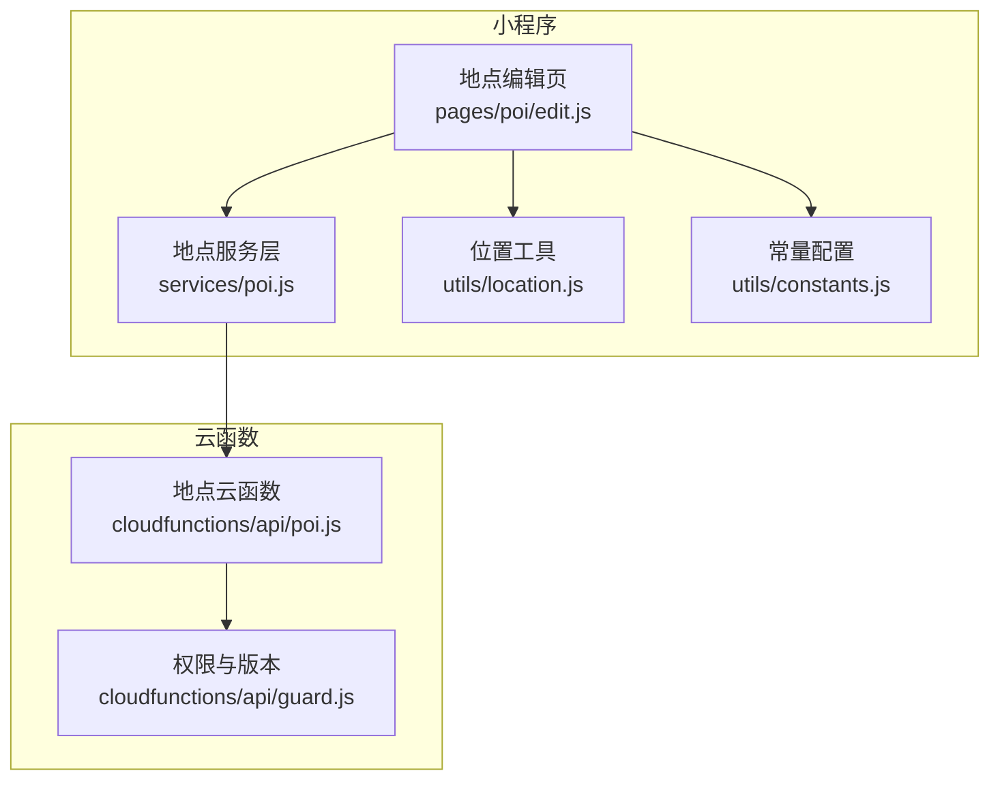

**图表来源**
- [pages/poi/edit.js:1-360](file://pages/poi/edit.js#L1-L360)
- [services/poi.js:1-22](file://services/poi.js#L1-L22)
- [cloudfunctions/api/poi.js:1-199](file://cloudfunctions/api/poi.js#L1-L199)
- [utils/location.js:1-139](file://utils/location.js#L1-L139)
- [utils/constants.js:1-48](file://utils/constants.js#L1-L48)
- [cloudfunctions/api/guard.js:1-76](file://cloudfunctions/api/guard.js#L1-L76)

**章节来源**
- [pages/poi/edit.js:1-360](file://pages/poi/edit.js#L1-L360)
- [services/poi.js:1-22](file://services/poi.js#L1-L22)
- [cloudfunctions/api/poi.js:1-199](file://cloudfunctions/api/poi.js#L1-L199)
- [utils/location.js:1-139](file://utils/location.js#L1-L139)
- [utils/constants.js:1-48](file://utils/constants.js#L1-L48)
- [cloudfunctions/api/guard.js:1-76](file://cloudfunctions/api/guard.js#L1-L76)

## 核心功能总览
- 地点列表：一次返回行程信息与地点集合，减少往返。
- 地点保存：支持新增与编辑，包含名称、地址、坐标、分类、计划时间、停留时长、备注、事实待核实标记。
- 地点删除：软删除，保留历史并可恢复。
- 地点排序：按天+顺序字段 `order` 统一排序；支持批量重排与换天。
- 分类系统：景点、餐饮、住宿、交通、购物、其它。
- 时间规划：计划时间字段与停留时长选项；默认出发时间与缓冲时间用于后续时间规划扩展。
- 位置处理：选择地图位置、权限引导、模糊地名识别与回退。
- 并发控制：乐观锁版本号，避免多人同时修改导致覆盖。

**章节来源**
- [cloudfunctions/api/poi.js:5-199](file://cloudfunctions/api/poi.js#L5-L199)
- [utils/constants.js:12-48](file://utils/constants.js#L12-L48)
- [utils/location.js:6-48](file://utils/location.js#L6-L48)

## 架构与数据流
### 整体请求序列
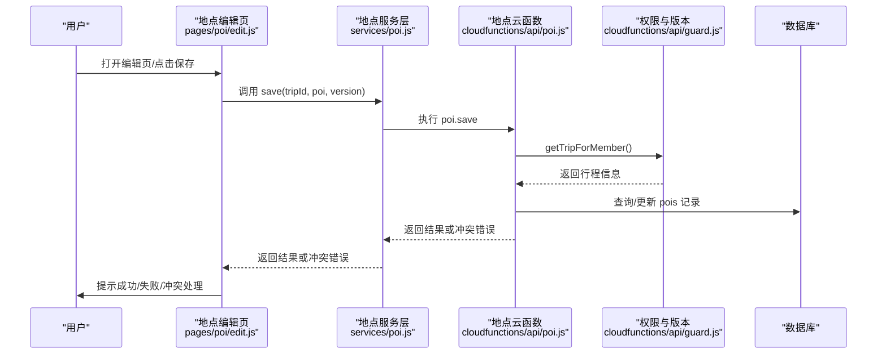

**图表来源**
- [pages/poi/edit.js:272-324](file://pages/poi/edit.js#L272-L324)
- [services/poi.js:8-15](file://services/poi.js#L8-L15)
- [cloudfunctions/api/poi.js:73-143](file://cloudfunctions/api/poi.js#L73-L143)
- [cloudfunctions/api/guard.js:44-65](file://cloudfunctions/api/guard.js#L44-L65)

### 列表加载与地图中心计算
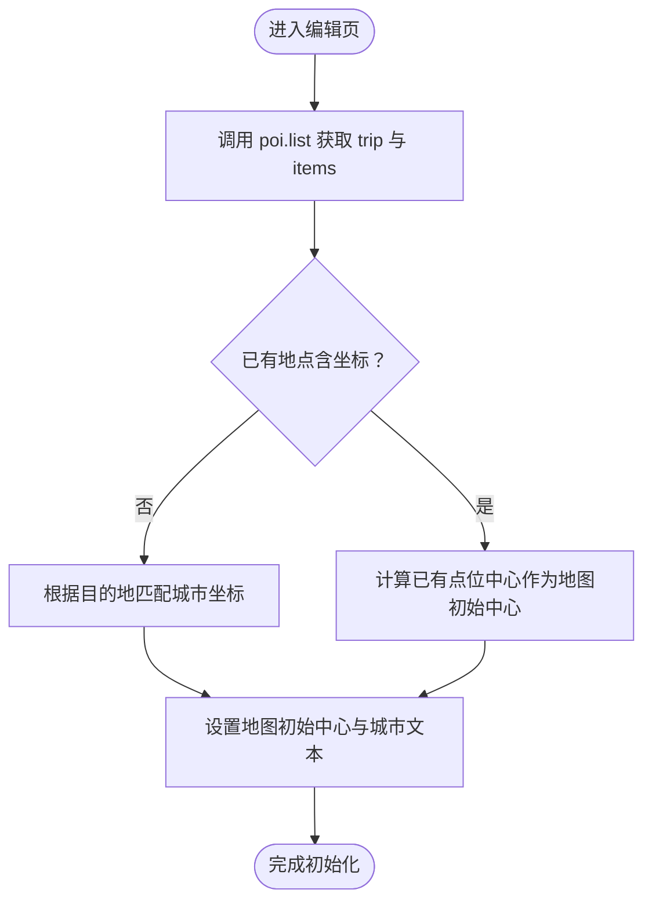

**图表来源**
- [pages/poi/edit.js:81-101](file://pages/poi/edit.js#L81-L101)

**章节来源**
- [cloudfunctions/api/poi.js:62-71](file://cloudfunctions/api/poi.js#L62-L71)
- [pages/poi/edit.js:81-101](file://pages/poi/edit.js#L81-L101)

## 详细组件分析

### 数据模型与字段定义
地点文档主要字段如下：
- `_id`：地点唯一标识。
- `tripId`：所属行程标识。
- `dayIndex`：行程天数索引（从 0 开始）。
- `name`：地点名称。
- `address`：地址文本。
- `location`：地理坐标对象，包含 `latitude` 与 `longitude`。
- `category`：分类，取值来自固定枚举。
- `plannedTime`：计划时间，格式为 `HH:mm`。
- `durationMin`：停留时长（分钟），来自固定选项集。
- `facts`：事实信息对象，包含 `open`、`reserve`、`fee`。
- `factsPending`：事实是否待核实。
- `note`：备注。
- `order`：排序键，按天进位，保证单字段排序即“按天+按序”。
- `createdBy`、`createdAt`、`deletedAt`、`updatedAt`：审计与软删除字段。

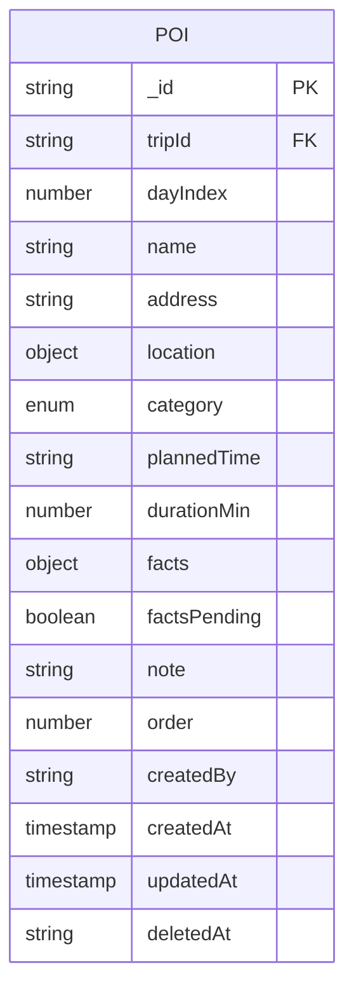

**图表来源**
- [cloudfunctions/api/poi.js:73-143](file://cloudfunctions/api/poi.js#L73-L143)
- [utils/constants.js:12-24](file://utils/constants.js#L12-L24)

**章节来源**
- [cloudfunctions/api/poi.js:73-143](file://cloudfunctions/api/poi.js#L73-L143)
- [utils/constants.js:12-24](file://utils/constants.js#L12-L24)

### 地点分类系统
- 分类枚举：景点、餐饮、住宿、交通、购物、其它。
- 分类在云函数中做白名单校验，非法值归入“其它”。
- 小程序侧提供分类选项，便于用户选择。

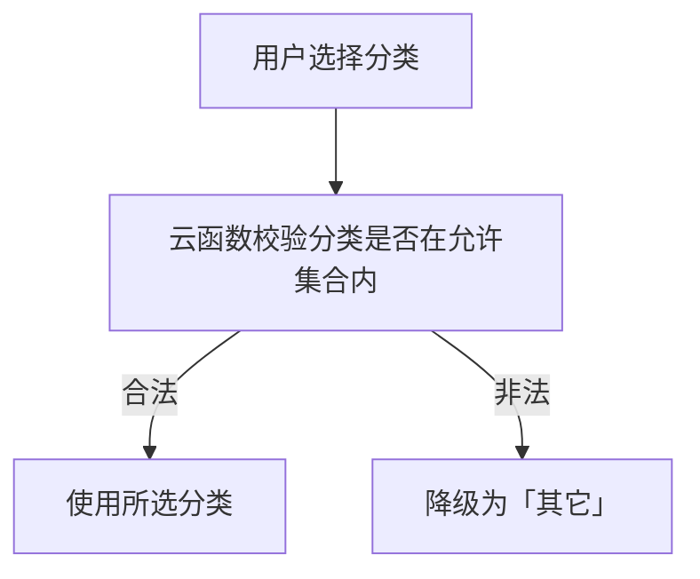

**图表来源**
- [cloudfunctions/api/poi.js:5](file://cloudfunctions/api/poi.js#L5)
- [cloudfunctions/api/poi.js:89](file://cloudfunctions/api/poi.js#L89)
- [utils/constants.js:12-13](file://utils/constants.js#L12-L13)

**章节来源**
- [cloudfunctions/api/poi.js:5](file://cloudfunctions/api/poi.js#L5)
- [cloudfunctions/api/poi.js:89](file://cloudfunctions/api/poi.js#L89)
- [utils/constants.js:12-13](file://utils/constants.js#L12-L13)

### 地理位置处理
- 位置授权：统一入口检查并引导授权，拒绝后仍可继续但无坐标。
- 当前位置：返回 GCJ02 坐标，与地图组件一致。
- 地图选点回填：对微信返回的名称进行“模糊地名”判断，若仅为行政区划或城市名，则提示手动填写。
- 坐标规范化：云函数侧将输入转为数字并校验有效性，无效时置空。

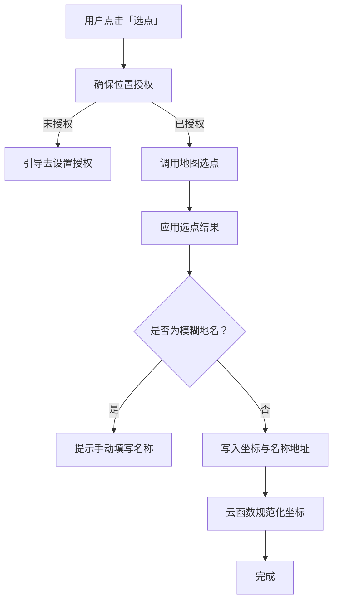

**图表来源**
- [utils/location.js:94-132](file://utils/location.js#L94-L132)
- [utils/location.js:6-48](file://utils/location.js#L6-L48)
- [cloudfunctions/api/poi.js:15-21](file://cloudfunctions/api/poi.js#L15-L21)
- [pages/poi/edit.js:183-243](file://pages/poi/edit.js#L183-L243)

**章节来源**
- [utils/location.js:6-48](file://utils/location.js#L6-L48)
- [utils/location.js:94-132](file://utils/location.js#L94-L132)
- [cloudfunctions/api/poi.js:15-21](file://cloudfunctions/api/poi.js#L15-L21)
- [pages/poi/edit.js:183-243](file://pages/poi/edit.js#L183-L243)

### 时间规划与停留时长
- 计划时间：仅接受 `HH:mm` 格式，否则清空。
- 停留时长：限定为 30/60/90/120/180 分钟，默认 60。
- 默认出发时间与缓冲时间：用于后续自动规划时间线（当前模块预留常量）。

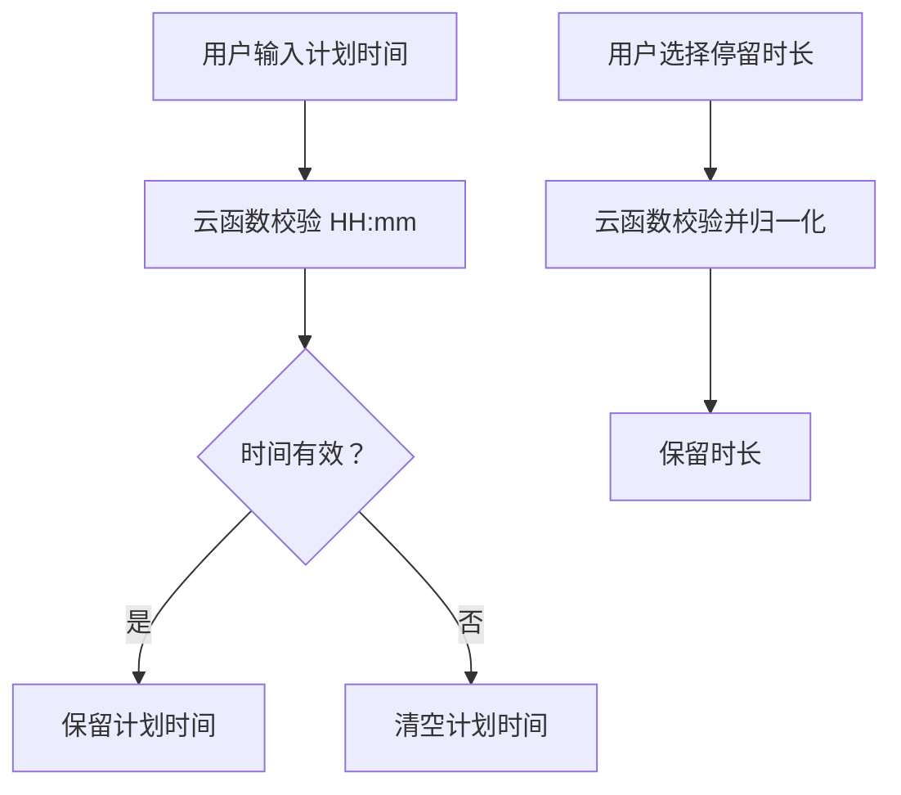

**图表来源**
- [cloudfunctions/api/poi.js:32-40](file://cloudfunctions/api/poi.js#L32-L40)
- [utils/constants.js:23-34](file://utils/constants.js#L23-L34)

**章节来源**
- [cloudfunctions/api/poi.js:32-40](file://cloudfunctions/api/poi.js#L32-L40)
- [utils/constants.js:23-34](file://utils/constants.js#L23-L34)

### 地点与行程天数的关联
- 每个地点通过 `tripId` 归属到具体行程，通过 `dayIndex` 归属到第几天。
- 新增地点时，若目标天超出行程天数范围，会被裁剪到有效区间。
- 列表返回时附带行程信息，便于前端展示天数与目的地。

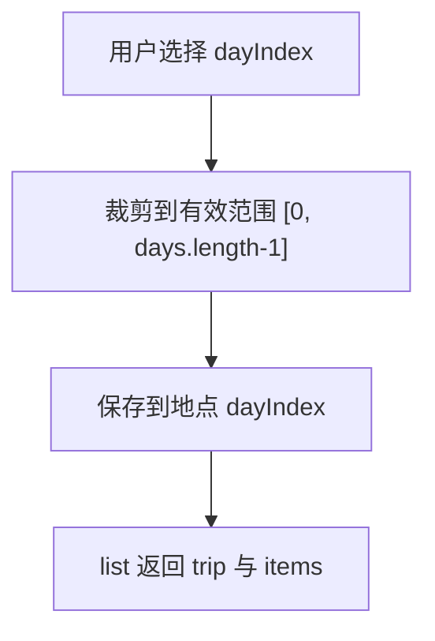

**图表来源**
- [cloudfunctions/api/poi.js:81](file://cloudfunctions/api/poi.js#L81)
- [cloudfunctions/api/poi.js:62-71](file://cloudfunctions/api/poi.js#L62-L71)

**章节来源**
- [cloudfunctions/api/poi.js:81](file://cloudfunctions/api/poi.js#L81)
- [cloudfunctions/api/poi.js:62-71](file://cloudfunctions/api/poi.js#L62-L71)

### 地点排序算法与重排
- 排序键 `order` 按天进位：第 0 天从 101000 起，第 1 天从 201000 起，以此类推。
- 同一天内，新地点的 `order` 取当天最后一个地点 `order + 1000`，保证自然追加。
- 重排接口接收完整顺序数组，按天分组递增分配 `order`，并支持更新计划时间。
- 列表按 `order` 升序即可得到“按天+按序”的结果，无需多字段组合排序。

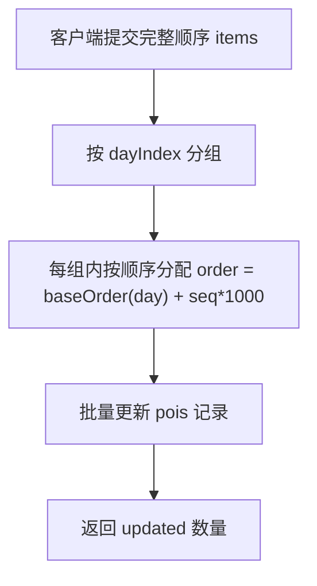

**图表来源**
- [cloudfunctions/api/poi.js:9-13](file://cloudfunctions/api/poi.js#L9-L13)
- [cloudfunctions/api/poi.js:42-51](file://cloudfunctions/api/poi.js#L42-L51)
- [cloudfunctions/api/poi.js:164-191](file://cloudfunctions/api/poi.js#L164-L191)

**章节来源**
- [cloudfunctions/api/poi.js:9-13](file://cloudfunctions/api/poi.js#L9-L13)
- [cloudfunctions/api/poi.js:42-51](file://cloudfunctions/api/poi.js#L42-L51)
- [cloudfunctions/api/poi.js:164-191](file://cloudfunctions/api/poi.js#L164-L191)

### 添加与编辑流程
- 新增：校验行程存在可选天数，限制每天最多地点数，生成唯一 id，分配 `order`，写库后刷新计数。
- 编辑：校验地点存在且未被删除；若换天则重新分配 `order`；写库前原子占位版本号。
- 表单字段：名称必填；地址、坐标、分类、计划时间、时长、事实信息、备注等可选。

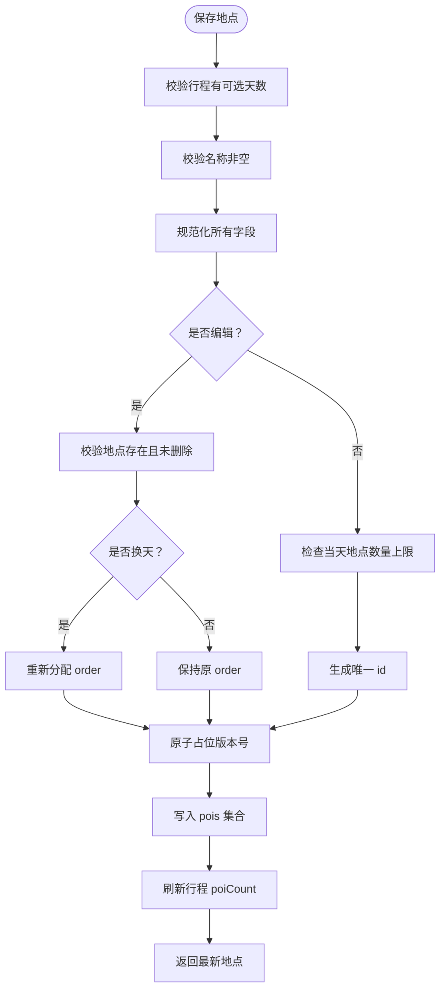

**图表来源**
- [cloudfunctions/api/poi.js:73-143](file://cloudfunctions/api/poi.js#L73-L143)
- [cloudfunctions/api/guard.js:26-42](file://cloudfunctions/api/guard.js#L26-L42)

**章节来源**
- [cloudfunctions/api/poi.js:73-143](file://cloudfunctions/api/poi.js#L73-L143)
- [cloudfunctions/api/guard.js:26-42](file://cloudfunctions/api/guard.js#L26-L42)

### 删除流程
- 软删除：设置 `deletedAt` 与 `updatedAt`，不物理删除。
- 列表查询过滤：只返回 `deletedAt` 为空的数据。
- 删除后刷新行程地点计数。

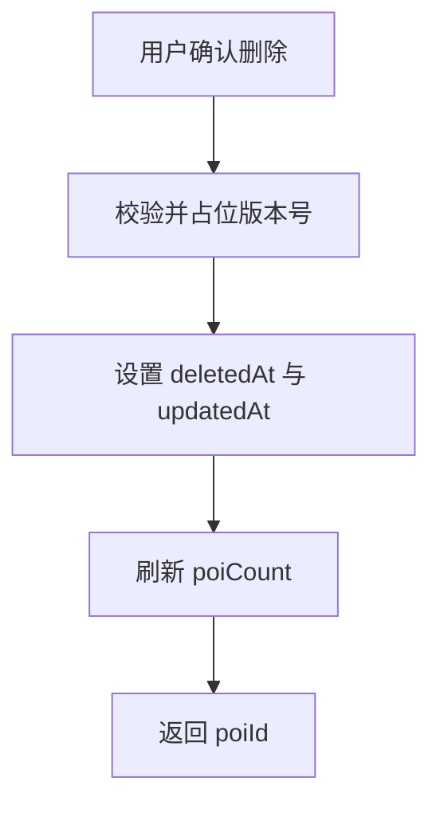

**图表来源**
- [cloudfunctions/api/poi.js:146-160](file://cloudfunctions/api/poi.js#L146-L160)

**章节来源**
- [cloudfunctions/api/poi.js:146-160](file://cloudfunctions/api/poi.js#L146-L160)

### 并发控制与冲突处理
- 乐观锁：客户端携带 `version`，服务端比较并原子递增。
- 冲突错误：当版本不一致时抛出带 `code=conflict` 的错误。
- 前端处理：编辑页与删除页在冲突时提示用户，可刷新最新版本后重试。

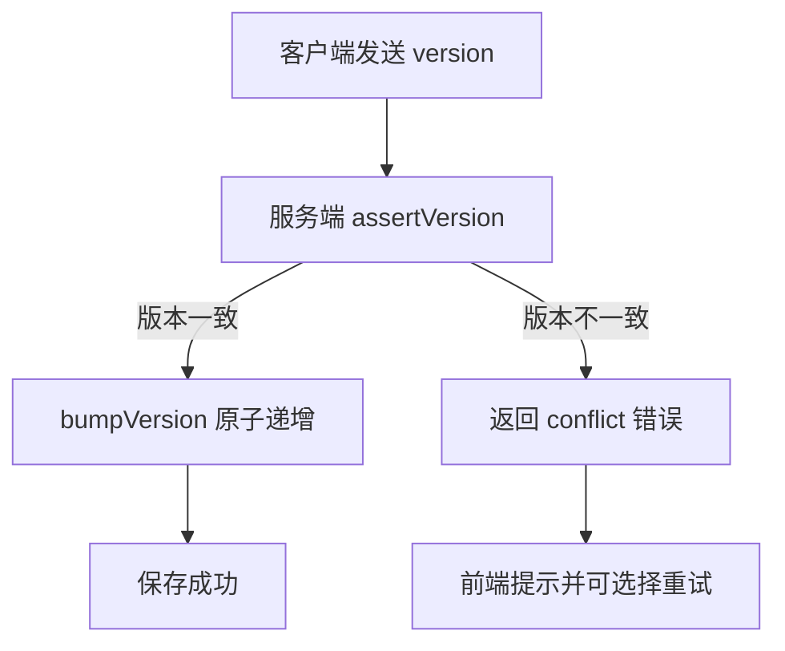

**图表来源**
- [cloudfunctions/api/guard.js:26-42](file://cloudfunctions/api/guard.js#L26-L42)
- [pages/poi/edit.js:296-324](file://pages/poi/edit.js#L296-L324)

**章节来源**
- [cloudfunctions/api/guard.js:26-42](file://cloudfunctions/api/guard.js#L26-L42)
- [pages/poi/edit.js:296-324](file://pages/poi/edit.js#L296-L324)

## 依赖关系分析
- 页面依赖服务层与工具类：
  - [pages/poi/edit.js](file://pages/poi/edit.js) 依赖 [services/poi.js](file://services/poi.js)、[utils/location.js](file://utils/location.js)、[utils/constants.js](file://utils/constants.js)。
- 服务层依赖云函数调用：
  - [services/poi.js](file://services/poi.js) 调用云函数 `poi.list/save/remove/reorder`。
- 云函数依赖权限与工具：
  - [cloudfunctions/api/poi.js](file://cloudfunctions/api/poi.js) 依赖 [cloudfunctions/api/guard.js](file://cloudfunctions/api/guard.js) 与数据库操作。

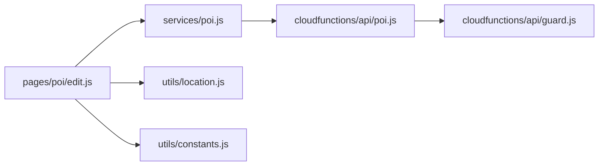

**图表来源**
- [pages/poi/edit.js:1-5](file://pages/poi/edit.js#L1-L5)
- [services/poi.js:1-22](file://services/poi.js#L1-L22)
- [cloudfunctions/api/poi.js:1-3](file://cloudfunctions/api/poi.js#L1-L3)
- [cloudfunctions/api/guard.js:1-76](file://cloudfunctions/api/guard.js#L1-L76)

**章节来源**
- [pages/poi/edit.js:1-5](file://pages/poi/edit.js#L1-L5)
- [services/poi.js:1-22](file://services/poi.js#L1-L22)
- [cloudfunctions/api/poi.js:1-3](file://cloudfunctions/api/poi.js#L1-L3)
- [cloudfunctions/api/guard.js:1-76](file://cloudfunctions/api/guard.js#L1-L76)

## 性能与索引优化建议
- 列表查询优化：
  - 常用查询条件：`tripId`、`deletedAt`、`order`。
  - 建议建立复合索引：`(tripId, deletedAt, order)`，以加速“按行程+未删除+顺序”的排序读取。
- 重排批量更新：
  - 当前实现使用 `Promise.all` 并行更新，注意数据库并发写入限制；必要时可在云函数内分批提交。
- 计数刷新：
  - 每次增删后刷新 `poiCount`，避免额外聚合查询开销。
- 分页与限制：
  - 列表限制 300 条，适合移动端一次性渲染；如需更大规模，应引入分页游标。
- 坐标与地理查询：
  - 当前未实现地理范围查询；若未来需要“附近地点”，应考虑空间索引（如 GeoJSON 或经纬度范围索引）。

[本节为通用性能建议，不直接分析具体代码行]

## 常见问题与排错
- 位置信息验证失败：
  - 现象：地图选点后名称仅为城市或行政区。
  - 原因：微信返回的 `name` 可能只是地址串。
  - 处理：使用模糊地名判断，提示用户手动填写名称。
  - 参考路径：[utils/location.js:6-48](file://utils/location.js#L6-L48)、[pages/poi/edit.js:214-243](file://pages/poi/edit.js#L214-L243)
- 坐标无效：
  - 现象：坐标无法显示在地图。
  - 原因：纬度/经度非数字或缺失。
  - 处理：云函数规范化坐标，无效时置空。
  - 参考路径：[cloudfunctions/api/poi.js:15-21](file://cloudfunctions/api/poi.js#L15-L21)
- 重复地点检测：
  - 现状：当前未实现同名或同坐标的去重逻辑。
  - 建议：在保存前按 `tripId`、`name`、`location` 进行查重；若允许重复，可增加“相似度”提示。
  - 参考路径：[cloudfunctions/api/poi.js:73-143](file://cloudfunctions/api/poi.js#L73-L143)
- 并发冲突：
  - 现象：保存或删除时报 `conflict`。
  - 原因：行程被其他成员修改，版本不一致。
  - 处理：前端提示刷新最新版本后重试。
  - 参考路径：[cloudfunctions/api/guard.js:26-42](file://cloudfunctions/api/guard.js#L26-L42)、[pages/poi/edit.js:296-324](file://pages/poi/edit.js#L296-L324)
- 一天地点过多：
  - 现象：新增地点时报“一天最多放 N 个地点”。
  - 原因：超过每日上限。
  - 处理：拆分到其他天或合并同类地点。
  - 参考路径：[cloudfunctions/api/poi.js:119-123](file://cloudfunctions/api/poi.js#L119-L123)

**章节来源**
- [utils/location.js:6-48](file://utils/location.js#L6-L48)
- [cloudfunctions/api/poi.js:15-21](file://cloudfunctions/api/poi.js#L15-L21)
- [cloudfunctions/api/poi.js:73-143](file://cloudfunctions/api/poi.js#L73-L143)
- [cloudfunctions/api/guard.js:26-42](file://cloudfunctions/api/guard.js#L26-L42)
- [pages/poi/edit.js:296-324](file://pages/poi/edit.js#L296-L324)
- [cloudfunctions/api/poi.js:119-123](file://cloudfunctions/api/poi.js#L119-L123)

## 结论
地点管理模块通过清晰的分层设计与严格的字段规范化，实现了稳定的地点增删改查与排序能力。其关键优势包括：
- 使用 `order` 字段实现“按天+按序”的单字段排序，简化查询与展示。
- 通过乐观锁与原子占位版本号，保障多人协作时的数据一致性。
- 完善的地理位置处理与模糊地名识别，提升用户体验。
- 分类系统与时间规划字段为后续行程规划打下基础。

建议在后续迭代中补充：
- 地点去重与相似度提示。
- 地理范围查询与空间索引。
- 更细粒度的权限控制（如仅编辑者可修改他人创建的地点）。
- 更丰富的时间规划自动化（基于默认出发时间与缓冲时间的自动排程）。

[本节为总结性内容，不直接分析具体代码行]