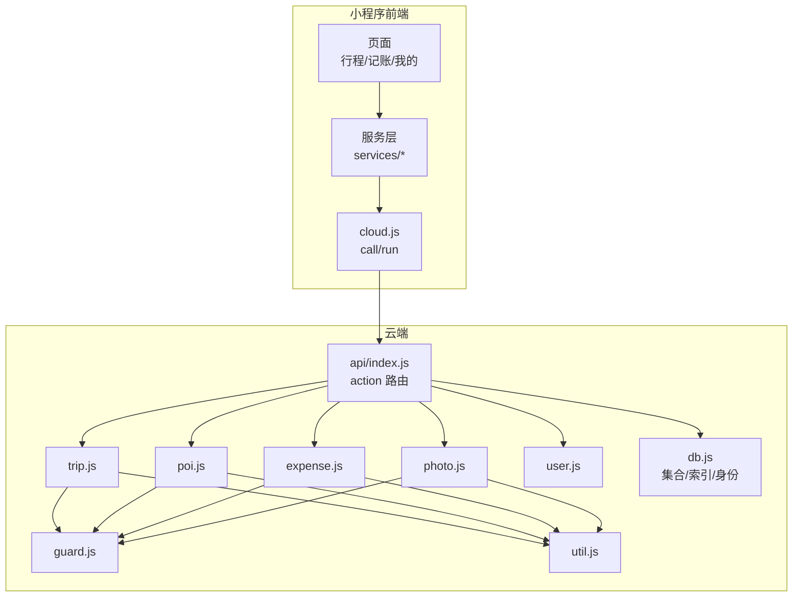
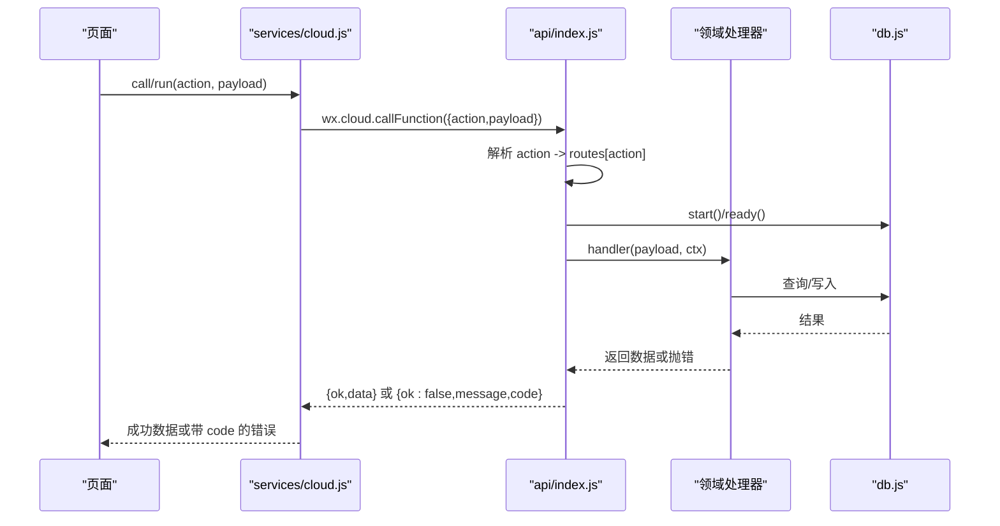
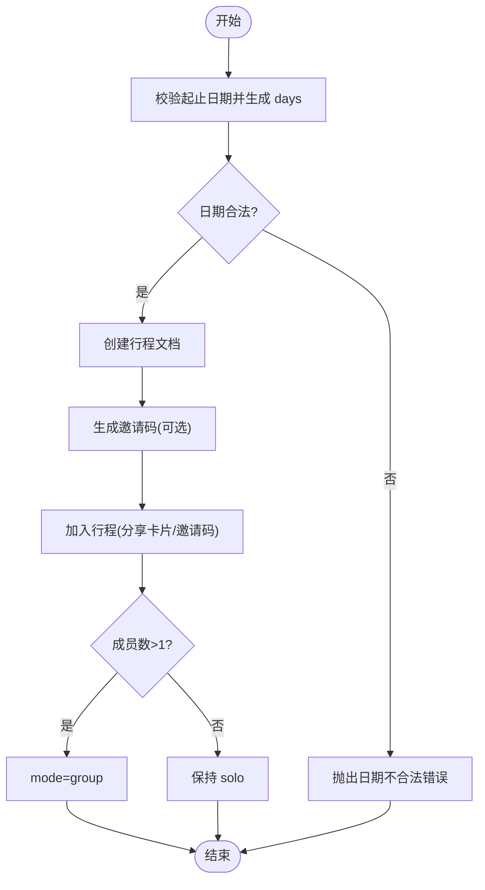
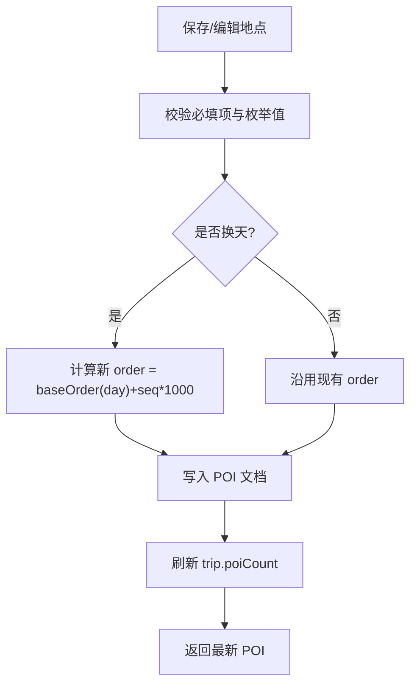
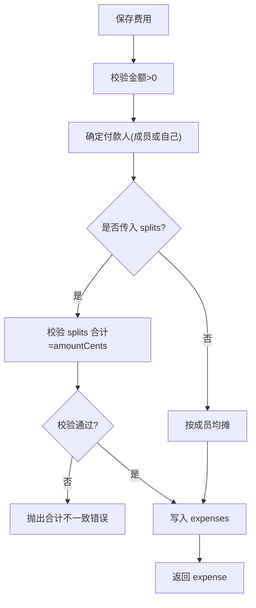
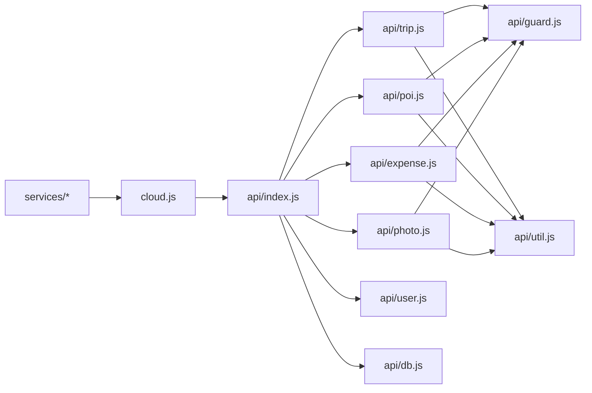
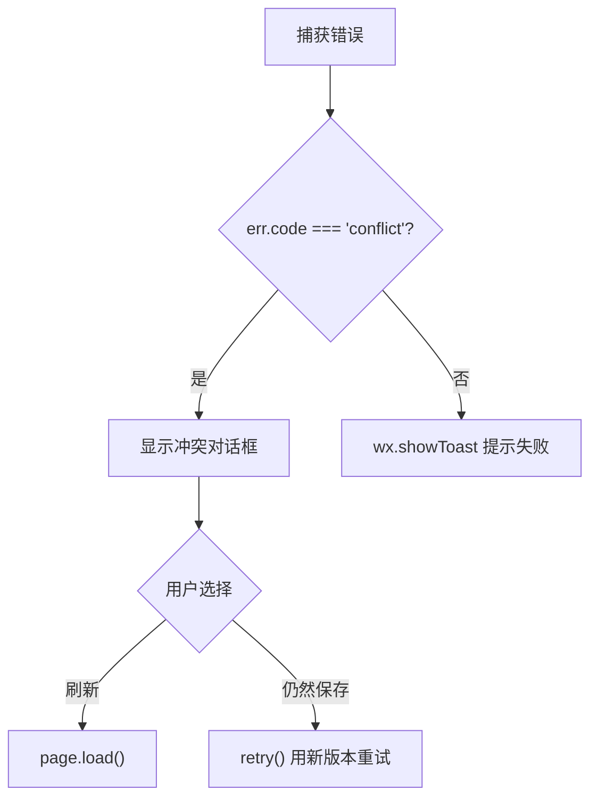

# 核心功能模块

<cite>
**本文引用的文件**   
- [app.json](file://app.json)
- [index.js](file://cloudfunctions\api\index.js)
- [db.js](file://cloudfunctions\api\db.js)
- [guard.js](file://cloudfunctions\api\guard.js)
- [util.js](file://cloudfunctions\api\util.js)
- [trip.js](file://cloudfunctions\api\trip.js)
- [poi.js](file://cloudfunctions\api\poi.js)
- [expense.js](file://cloudfunctions\api\expense.js)
- [photo.js](file://cloudfunctions\api\photo.js)
- [user.js](file://cloudfunctions\api\user.js)
- [cloud.js](file://services\cloud.js)
- [trip.js](file://services\trip.js)
- [poi.js](file://services\poi.js)
- [expense.js](file://services\expense.js)
- [photo.js](file://services\photo.js)
- [user.js](file://services\user.js)
- [conflict.js](file://utils\conflict.js)
</cite>

## 目录
1. [引言](#引言)
2. [项目结构](#项目结构)
3. [核心组件](#核心组件)
4. [架构总览](#架构总览)
5. [详细组件分析](#详细组件分析)
6. [依赖关系分析](#依赖关系分析)
7. [性能与扩展性](#性能与扩展性)
8. [故障排查指南](#故障排查指南)
9. [结论](#结论)

## 引言
本文件面向“旅行计划”小程序的核心功能模块，覆盖行程管理、地点管理、费用管理、照片管理与协作能力。文档从系统架构、数据流、权限与并发控制、错误处理等角度进行分层说明，既帮助初学者快速上手，也为有经验的开发者提供实现细节与优化建议。

## 项目结构
小程序采用“前端服务层 + 统一云函数路由 + 领域云函数”的分层结构：
- 前端页面通过 services 调用 cloud.js，统一封装 wx.cloud.callFunction。
- 所有写操作集中到单一云函数 api，按 action 分发到 trip/poi/expense/photo/user 等领域处理器。
- db/guard/util 为公共基础设施：数据库初始化、权限与乐观锁、通用工具。

**图示来源**
- [index.js:10-41](file://cloudfunctions\api\index.js#L10-L41)
- [cloud.js:5-30](file://services\cloud.js#L5-L30)
- [db.js:1-10](file://cloudfunctions\api\db.js#L1-L10)

**章节来源**
- [app.json:1-16](file://app.json#L1-L16)
- [index.js:10-41](file://cloudfunctions\api\index.js#L10-L41)
- [cloud.js:1-50](file://services\cloud.js#L1-L50)

## 核心组件
- 行程管理：创建、更新、复制、删除、邀请码加入/退出、成员移除；支持单人/多人模式切换与状态流转。
- 地点管理：按天组织 POI，支持新增/编辑/删除/重排，限制每天条目数，维护 order 排序。
- 费用管理：记录花费、分类汇总、AA 结算（实付/应摊/差额/转账建议），支持多成员分摊。
- 照片管理：手帐照片关联行程/地点/日期，仅存储 fileID，软删除保留原图。
- 用户与协作：获取当前用户信息；基于 openid 的访问控制、角色判断、版本冲突处理。

**章节来源**
- [trip.js:50-356](file://cloudfunctions\api\trip.js#L50-L356)
- [poi.js:62-191](file://cloudfunctions\api\poi.js#L62-L191)
- [expense.js:88-320](file://cloudfunctions\api\expense.js#L88-L320)
- [photo.js:8-58](file://cloudfunctions\api\photo.js#L8-L58)
- [user.js:1-12](file://cloudfunctions\api\user.js#L1-L12)

## 架构总览
小程序通过统一入口将业务动作映射到后端处理器，所有敏感逻辑在服务端执行，前端只负责展示与交互。

**图示来源**
- [index.js:43-76](file://cloudfunctions\api\index.js#L43-L76)
- [cloud.js:5-47](file://services\cloud.js#L5-L47)
- [db.js:46-58](file://cloudfunctions\api\db.js#L46-L58)

## 详细组件分析

### 行程管理（Trip）
设计目标
- 提供完整的行程生命周期：创建、编辑、复制、删除、邀请加入、退出、移除成员。
- 以“起止日期”推导天数，避免客户端与服务端计算不一致。
- 使用版本号做乐观锁，防止多人同时修改导致覆盖。

关键流程
- 创建：校验标题/目的地/日期范围，生成 days 数组，默认 solo 模式，设置预算（分）。
- 更新：允许改标题、目的地、交通方式、预算、状态、起止日期；若减少天数，需检查后续无悬空地点。
- 删除：仅创建者可删，软删除 trips/pois/expenses，保留历史用于手帐回放。
- 邀请/加入：6 位邀请码 7 天有效；加入后自动转为 group 模式。
- 退出/移除成员：成员可退出；创建者可移除其他成员；人数变化时调整 mode。

并发与一致性
- assertVersion/bumpVersion 保证同一时刻只有一个写落库成功，其余返回 conflict。

**图示来源**
- [trip.js:50-88](file://cloudfunctions\api\trip.js#L50-L88)
- [trip.js:150-204](file://cloudfunctions\api\trip.js#L150-L204)
- [util.js:15-31](file://cloudfunctions\api\util.js#L15-L31)

API 参考（服务端）
- trip.list：返回当前用户参与的行程列表。
- trip.get：返回单份行程详情。
- trip.create：创建新行程，返回 trip。
- trip.update：按 patch 更新，需要 version，返回最新 trip。
- trip.copy：复制行程，重新起算日期，拷贝 POI，成员仅自己。
- trip.remove：软删除行程及其 POI/费用，仅创建者可用。
- trip.invite：生成/复用邀请码，返回 inviteCode 与过期时间。
- trip.join：通过 tripId 或 inviteCode 加入，返回 trip 与 joined 标志。
- trip.leave：成员退出，不改变内容，仅成员列表。
- trip.removeMember：创建者移除其他成员。

参数与返回值要点
- create 输入：title、destination、startDate、endDate、transport、budget、mode。
- update 输入：tripId、patch、version；patch 支持 title/destination/transport/budget/status/startDate/endDate。
- join 输入：tripId 或 code；返回 trip、joined。
- remove/removeMember/leave 均返回简化结果，如 tripId。

**章节来源**
- [trip.js:35-356](file://cloudfunctions\api\trip.js#L35-L356)
- [util.js:15-31](file://cloudfunctions\api\util.js#L15-L31)
- [guard.js:16-42](file://cloudfunctions\api\guard.js#L16-L42)

### 地点管理（POI）
设计目标
- 按天组织地点，支持新增/编辑/删除/重排，限制每天最多条目数。
- 使用 order 字段实现“按天+按序”的单索引排序。
- 在 list 中附带 trip 信息，减少一次往返。

关键流程
- save：校验名称、dayIndex、category、plannedTime/durationMin/facts/note；新增时分配 order，更新时若换天则重新计算 order。
- reorder：一次性提交期望顺序，批量更新 dayIndex/order/plannedTime，避免部分成功。
- remove：软删除 POI，刷新 trip.poiCount。

**图示来源**
- [poi.js:73-144](file://cloudfunctions\api\poi.js#L73-L144)
- [poi.js:162-191](file://cloudfunctions\api\poi.js#L162-L191)

API 参考（服务端）
- poi.list(tripId)：返回 trip 与 items（按 order 升序）。
- poi.save(tripId, poi, version)：新增或更新 POI，返回 poi。
- poi.remove(tripId, poiId, version)：软删除 POI。
- poi.reorder(tripId, items, version)：批量重排，items 为 [{_id, dayIndex, plannedTime}]。

参数与返回值要点
- save 输入：poi.name/address/location/category/plannedTime/durationMin/facts/factsPending/note/_id。
- reorder 输入：items 最大 300 条，服务端会裁剪。
- 返回值包含最新 POI 或 updated 数量。

**章节来源**
- [poi.js:9-191](file://cloudfunctions\api\poi.js#L9-L191)

### 费用管理（Expense）
设计目标
- 记录每笔花费，支持分类汇总与 AA 结算。
- 金额统一以“分”存储，避免浮点误差。
- 支持自定义分摊或默认均摊，服务端计算转账建议。

关键流程
- list：返回 trip、items、summary（totalCents/count/byCategory）。
- overview：聚合用户参与的所有行程花费合计，供“记账”Tab 使用。
- save：校验金额>0，paidBy 必须是成员；splits 校验合计等于 amountCents；否则按成员均摊。
- settle：计算每人 paid/owed/balance，输出最少转账建议。

**图示来源**
- [expense.js:132-184](file://cloudfunctions\api\expense.js#L132-L184)
- [expense.js:51-86](file://cloudfunctions\api\expense.js#L51-L86)

API 参考（服务端）
- expense.list(tripId)：返回 trip、items、summary。
- expense.overview()：返回每个 tripId 的 totalCents 与 count。
- expense.save(tripId, expense)：新增或更新费用，返回 expense。
- expense.remove(tripId, expenseId)：软删除费用。
- expense.settle(tripId)：返回结算结果 members/transfers。

参数与返回值要点
- save 输入：expense.amount/category/spentAt/paidBy/splits/note/_id。
- settle 返回：tripId、memberCount、totalCents、members、transfers。

**章节来源**
- [expense.js:14-320](file://cloudfunctions\api\expense.js#L14-L320)

### 照片管理（Photo）
设计目标
- 手帐照片仅存 fileID，图片地址由小程序端直接用 fileID 渲染。
- 限制每趟行程最多照片数，软删除保留原图以便恢复。

关键流程
- add：校验 trip 权限与上限，插入 files 记录，返回 file。
- remove：软删除 files 记录，不删除云存储原图。

API 参考（服务端）
- photo.list(tripId)：返回 trip 与 items（按 createdAt 升序）。
- photo.add(tripId, fileID, dayIndex)：新增照片记录，返回 file。
- photo.remove(tripId, fileId)：软删除照片记录。

**章节来源**
- [photo.js:8-58](file://cloudfunctions\api\photo.js#L8-L58)

### 用户与协作（User & Guard）
设计目标
- 统一身份获取与用户初始化，拒绝信任前端传来的 openid。
- 提供成员判断、角色判断、创建者校验、版本冲突处理。

关键点
- db.start：确保集合存在，获取 OPENID，确保 users 表存在并返回用户上下文。
- guard.getTripForMember：校验行程存在且当前用户是成员，补全 version 字段，附加 myRole。
- guard.assertVersion/bumpVersion：乐观锁，冲突返回 code='conflict'。

**章节来源**
- [user.js:1-12](file://cloudfunctions\api\user.js#L1-L12)
- [db.js:46-58](file://cloudfunctions\api\db.js#L46-L58)
- [guard.js:1-76](file://cloudfunctions\api\guard.js#L1-L76)

## 依赖关系分析
- 前端 services 依赖 cloud.js 的统一封装，所有写操作走 run(callFunction + loading)。
- 云函数 index.js 作为唯一入口，按 action 路由到具体领域处理器。
- 领域处理器依赖 guard/db/util 完成权限、并发与工具方法。
- 各模块之间通过 tripId 关联：trips 为主实体，pois/expenses/files 为子资源。

**图示来源**
- [index.js:1-41](file://cloudfunctions\api\index.js#L1-L41)
- [cloud.js:1-50](file://services\cloud.js#L1-L50)

**章节来源**
- [index.js:1-77](file://cloudfunctions\api\index.js#L1-L77)
- [cloud.js:1-50](file://services\cloud.js#L1-L50)

## 性能与扩展性
- 单次聚合：overview 使用聚合管道统计多个行程的花费，避免逐条拉取。
- 批量更新：reorder 使用 Promise.all 并行更新多条 POI，减少往返。
- 索引建议：pois(tripId, dayIndex, order)、expenses(tripId, spentAt)，已在注释中标注需在控制台补充。
- 乐观锁：bumpVersion 通过 where(version=current) 原子更新，避免重复写。
- 软删除：trips/pois/expenses/files 均采用 deletedAt 标记，便于恢复与审计。

[本节为通用指导，无需代码引用]

## 故障排查指南
常见问题与定位
- 网络异常：cloud.js 的 fail 分支会返回“网络异常”，请检查网络与微信环境。
- 未知操作：index.js 未匹配到 action，检查前端调用的 action 是否在 routes 中注册。
- 权限不足：guard.requireOwner 或 getTripForMember 会抛出权限相关错误，确认用户是否为成员或创建者。
- 版本冲突：guard.conflictError 返回 code='conflict'，前端应提示刷新并重试。
- 金额校验失败：expense.normalizeSplits 会校验 splits 合计与 amountCents 一致，否则报错。
- 地点超上限：poi.save 对每天 POI 数量做限制，超过 MAX_PER_DAY 会报错。
- 照片超上限：photo.add 对每趟行程照片数量做限制，超过 MAX_PHOTOS 会报错。

前端冲突处理
- utils/conflict.js 提供 handle(err, page, retry)：弹出对话框，选择“刷新”则加载最新版本，“仍然保存”则用新版本重试。

**图示来源**
- [cloud.js:33-47](file://services\cloud.js#L33-L47)
- [conflict.js:1-20](file://utils\conflict.js#L1-L20)

**章节来源**
- [cloud.js:5-47](file://services\cloud.js#L5-L47)
- [conflict.js:1-20](file://utils\conflict.js#L1-L20)
- [guard.js:20-42](file://cloudfunctions\api\guard.js#L20-L42)

## 结论
该小程序通过统一云函数路由与领域处理器清晰划分职责，结合乐观锁、软删除与聚合统计，实现了行程、地点、费用、照片与协作能力的稳定实现。前端通过 services 层屏蔽底层差异，提升可维护性与扩展性。建议在数据量增长后完善索引配置，并在必要时引入缓存与分页策略，进一步提升体验。