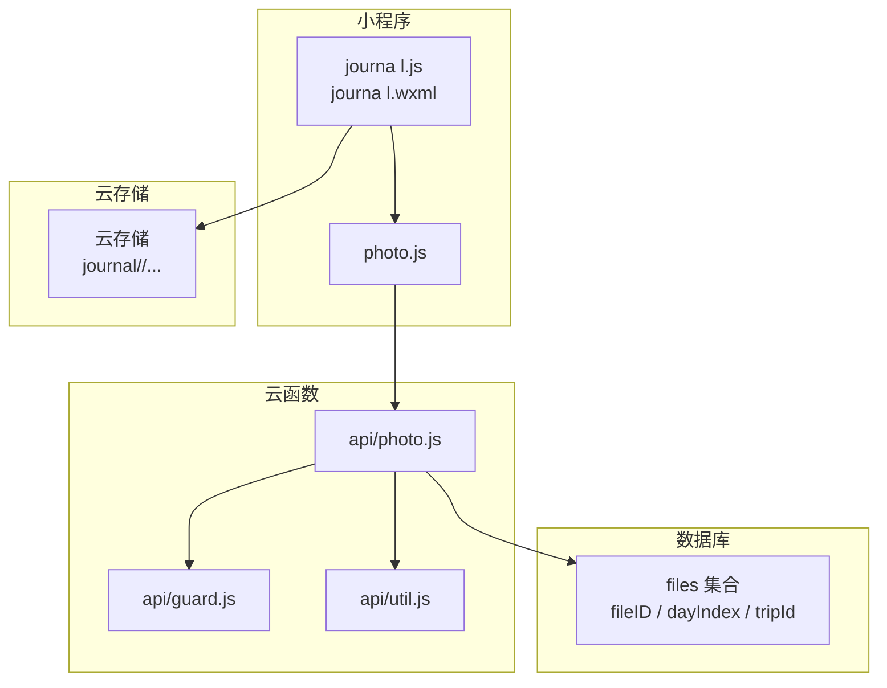
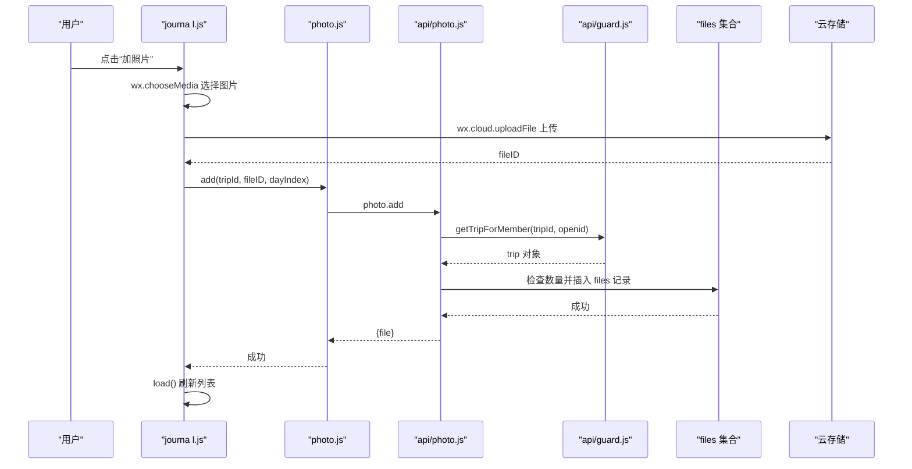
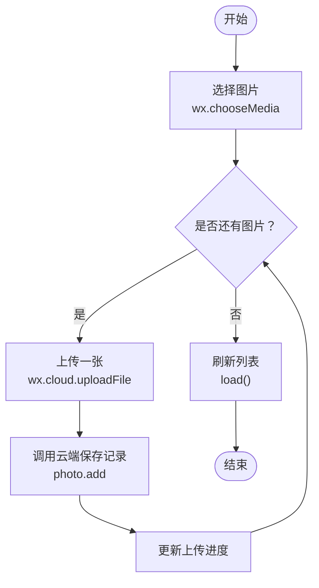
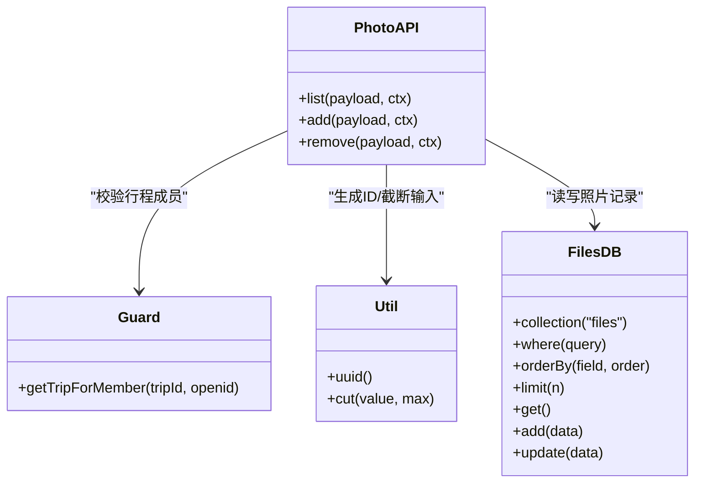
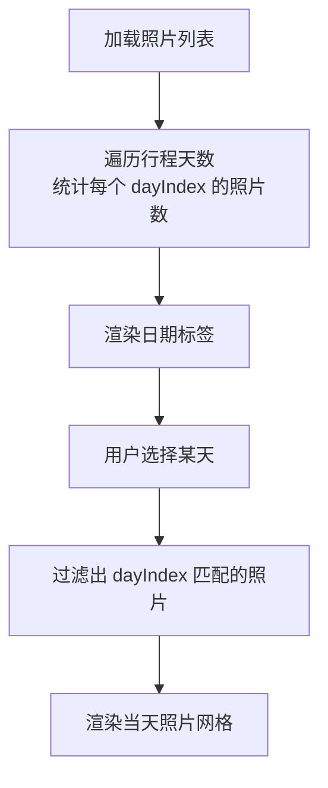
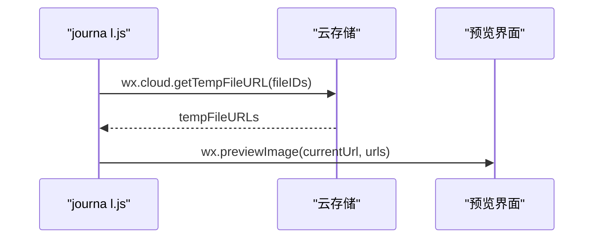
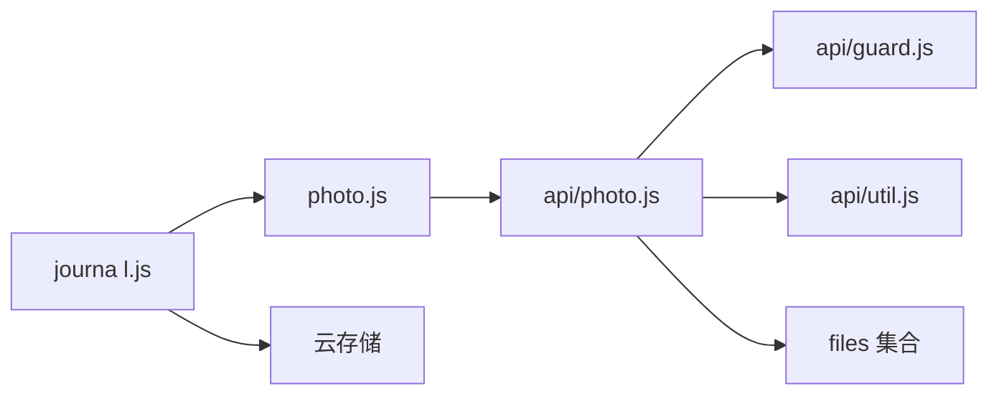

# 照片管理模块

<cite>
**本文引用的文件**   
- [cloudfunctions/api/photo.js](file://cloudfunctions/api/photo.js)
- [services/photo.js](file://services/photo.js)
- [pages/trip/journal.js](file://pages/trip/journal.js)
- [pages/trip/journal.wxml](file://pages/trip/journal.wxml)
- [cloudfunctions/api/guard.js](file://cloudfunctions/api/guard.js)
- [cloudfunctions/api/util.js](file://cloudfunctions/api/util.js)
- [docs/方案.md](file://docs/方案.md)
</cite>

## 目录
1. [简介](#简介)
2. [项目结构中的照片相关位置](#项目结构中的照片相关位置)
3. [核心功能总览](#核心功能总览)
4. [架构总览](#架构总览)
5. [详细组件分析](#详细组件分析)
6. [依赖关系分析](#依赖关系分析)
7. [性能与优化策略](#性能与优化策略)
8. [常见问题排查](#常见问题排查)
9. [扩展：分享与社交集成](#扩展分享与社交集成)
10. [结论](#结论)

## 简介
本模块围绕“行程手帐”的照片能力展开，实现照片上传、云存储、按天组织、预览、删除等核心流程。整体设计遵循“小程序端负责交互与大图预览，云端负责权限校验、数据记录与容量控制”的分工原则。照片在云存储中以 `journal/<tripId>/<文件名>` 的形式存放，数据库仅保存 `fileID`、`dayIndex`、`poiId`、创建时间等元信息，从而兼顾加载性能和存储空间成本。

该模块同时提供按天的手帐浏览体验：用户选择照片后，系统会将其关联到当前选中的行程天数；列表页通过日期标签显示每天的照片数量，点击后可进入当天照片网格进行预览和删除。

## 项目结构中的照片相关位置
照片功能涉及小程序页面、服务层和云函数三层：

- 小程序页面层：`pages/trip/journal.js` 与 `pages/trip/journal.wxml` 负责用户交互、图片选择、预览、删除以及按天分组展示。
- 服务层：`services/photo.js` 封装对云函数的调用，统一错误提示与业务语义。
- 云函数层：`cloudfunctions/api/photo.js` 负责权限校验、照片记录增删查、容量限制与软删除。
- 辅助层：`cloudfunctions/api/guard.js` 提供行程成员权限校验；`cloudfunctions/api/util.js` 提供工具方法，如 `uuid`、`cut`、`buildDays` 等。
- 文档参考：`docs/方案.md` 中记录了照片上传、存储、按天分组、删除策略的总体方案。

**图表来源**
- [pages/trip/journal.js:1-185](file://pages/trip/journal.js#L1-L185)
- [services/photo.js:1-16](file://services/photo.js#L1-L16)
- [cloudfunctions/api/photo.js:1-65](file://cloudfunctions/api/photo.js#L1-L65)
- [cloudfunctions/api/guard.js:1-76](file://cloudfunctions/api/guard.js#L1-L76)
- [cloudfunctions/api/util.js:1-60](file://cloudfunctions/api/util.js#L1-L60)

**章节来源**
- [pages/trip/journal.js:1-185](file://pages/trip/journal.js#L1-L185)
- [pages/trip/journal.wxml:1-48](file://pages/trip/journal.wxml#L1-L48)
- [services/photo.js:1-16](file://services/photo.js#L1-L16)
- [cloudfunctions/api/photo.js:1-65](file://cloudfunctions/api/photo.js#L1-L65)
- [cloudfunctions/api/guard.js:1-76](file://cloudfunctions/api/guard.js#L1-L76)
- [cloudfunctions/api/util.js:1-60](file://cloudfunctions/api/util.js#L1-L60)
- [docs/方案.md:115](file://docs/方案.md#L115)

## 核心功能总览
- 照片上传：用户在小程序中选择图片，逐张上传到云存储，拿到 `fileID` 后调用云端接口写入 `files` 记录，并关联当前行程天数。
- 按天组织：每条照片记录包含 `dayIndex`，前端根据行程天数生成标签，并在标签上显示当天照片数量。
- 照片浏览：列表使用 `fileID` 直接渲染缩略图，开启懒加载以提升首屏性能；点击预览时批量获取临时链接，再调用大图预览。
- 照片删除：采用软删除，只更新记录的 `deletedAt`，不删除云存储原图，避免误删不可恢复。
- 权限控制：所有操作都通过 `getTripForMember` 校验用户是否为行程成员。
- 容量限制：单趟行程最多保留固定数量的照片，超出则拒绝新增。

**章节来源**
- [pages/trip/journal.js:98-141](file://pages/trip/journal.js#L98-L141)
- [pages/trip/journal.js:143-183](file://pages/trip/journal.js#L143-L183)
- [cloudfunctions/api/photo.js:8-40](file://cloudfunctions/api/photo.js#L8-L40)
- [cloudfunctions/api/photo.js:43-58](file://cloudfunctions/api/photo.js#L43-L58)
- [cloudfunctions/api/guard.js:44-65](file://cloudfunctions/api/guard.js#L44-L65)

## 架构总览
照片模块的整体调用链如下：

**图表来源**
- [pages/trip/journal.js:98-141](file://pages/trip/journal.js#L98-L141)
- [services/photo.js:8-10](file://services/photo.js#L8-L10)
- [cloudfunctions/api/photo.js:19-40](file://cloudfunctions/api/photo.js#L19-L40)
- [cloudfunctions/api/guard.js:44-65](file://cloudfunctions/api/guard.js#L44-L65)

## 详细组件分析

### 小程序页面：journa l.js 与 journa l.wxml
- 页面职责：
  - 加载行程照片列表，计算每个日期的照片数量，生成日期标签。
  - 用户选择图片后逐张上传，成功后刷新列表。
  - 点击缩略图批量获取临时链接，调用大图预览。
  - 长按触发删除确认，调用云端软删除接口。
- 关键行为：
  - 使用 `wx.chooseMedia` 选择图片，设置 `sizeType: ['compressed']` 以启用压缩。
  - 使用 `wx.cloud.uploadFile` 将图片上传到 `journal/<tripId>/` 路径下。
  - 使用 `wx.cloud.getTempFileURL` 批量获取临时链接用于大图预览。
  - 使用 `lazy-load` 提升缩略图加载性能。
- 数据结构：
  - `photos`：完整照片列表，每项包含 `fileID`、`dayIndex`、`createdAt`、`timeText` 等。
  - `tabs`：按行程天数生成的标签，包含索引、标签文本和照片数量。
  - `dayPhotos`：当前选中天数的照片子集。

**图表来源**
- [pages/trip/journal.js:98-141](file://pages/trip/journal.js#L98-L141)

**章节来源**
- [pages/trip/journal.js:1-185](file://pages/trip/journal.js#L1-L185)
- [pages/trip/journal.wxml:1-48](file://pages/trip/journal.wxml#L1-L48)

### 服务层：services/photo.js
- 作用：封装对云函数的调用，提供 `list`、`add`、`remove` 三个方法。
- 特点：
  - `add` 与 `remove` 使用 `run` 包装，便于统一错误提示与业务语义。
  - `list` 直接返回云端结果，供页面渲染。

**章节来源**
- [services/photo.js:1-16](file://services/photo.js#L1-L16)

### 云函数：cloudfunctions/api/photo.js
- 主要接口：
  - `list`：查询行程下的未删除照片，按创建时间升序，限制最大数量。
  - `add`：校验权限、校验数量上限、写入 `files` 记录，包含 `tripId`、`poiId`、`dayIndex`、`fileID`、`type`、`createdBy`、`createdAt`、`deletedAt`。
  - `remove`：软删除，仅更新 `deletedAt`，不删除云存储原图。
- 安全与约束：
  - 通过 `getTripForMember` 校验用户是否为行程成员。
  - 单趟行程照片数量上限为固定值，超出则报错。
  - 输入字段使用 `cut` 截断，防止超长字符串。
  - 使用 `uuid` 生成记录主键。

**图表来源**
- [cloudfunctions/api/photo.js:1-65](file://cloudfunctions/api/photo.js#L1-L65)
- [cloudfunctions/api/guard.js:44-65](file://cloudfunctions/api/guard.js#L44-L65)
- [cloudfunctions/api/util.js:33-42](file://cloudfunctions/api/util.js#L33-L42)

**章节来源**
- [cloudfunctions/api/photo.js:1-65](file://cloudfunctions/api/photo.js#L1-L65)
- [cloudfunctions/api/guard.js:1-76](file://cloudfunctions/api/guard.js#L1-L76)
- [cloudfunctions/api/util.js:1-60](file://cloudfunctions/api/util.js#L1-L60)

### 按天组织的手帐逻辑
- 数据来源：
  - 行程天数由后端或工具方法构建，每条照片记录携带 `dayIndex`。
  - 前端根据 `trip.days` 生成标签，并统计每个 `dayIndex` 对应的照片数量。
- 展示方式：
  - 顶部日期标签显示“D1 月/日 · 数量”，点击切换不同天的照片网格。
  - 网格中每张缩略图显示拍摄时间（基于 `createdAt`）。
- 关联关系：
  - 照片与行程天数的关联通过 `dayIndex` 建立，而非硬编码日期字符串，避免前后端计算不一致。

**图表来源**
- [pages/trip/journal.js:60-96](file://pages/trip/journal.js#L60-L96)
- [cloudfunctions/api/util.js:15-31](file://cloudfunctions/api/util.js#L15-L31)

**章节来源**
- [pages/trip/journal.js:60-96](file://pages/trip/journal.js#L60-L96)
- [cloudfunctions/api/util.js:15-31](file://cloudfunctions/api/util.js#L15-L31)

### 预览与批量操作
- 预览：
  - 缩略图直接使用 `fileID` 渲染，减少请求开销。
  - 大图预览通过 `wx.cloud.getTempFileURL` 批量获取临时链接，再调用 `wx.previewImage`。
- 批量操作：
  - 当前实现支持逐张上传与逐张删除；批量预览通过一次性获取多个临时链接完成。
  - 如需批量删除，可在前端增加多选状态，循环调用 `photo.remove`，并统一处理成功与失败计数。

**图表来源**
- [pages/trip/journal.js:143-161](file://pages/trip/journal.js#L143-L161)

**章节来源**
- [pages/trip/journal.js:143-161](file://pages/trip/journal.js#L143-L161)

## 依赖关系分析
- 页面依赖服务层：`pages/trip/journal.js` 通过 `services/photo.js` 调用云函数。
- 服务层依赖云函数：`services/photo.js` 调用 `photo.list`、`photo.add`、`photo.remove`。
- 云函数依赖权限与工具：`cloudfunctions/api/photo.js` 依赖 `guard.js` 做权限校验，依赖 `util.js` 做 ID 生成与输入截断。
- 数据存储依赖：云函数读写 `files` 集合，云存储存放实际图片文件。

**图表来源**
- [pages/trip/journal.js:1-185](file://pages/trip/journal.js#L1-L185)
- [services/photo.js:1-16](file://services/photo.js#L1-L16)
- [cloudfunctions/api/photo.js:1-65](file://cloudfunctions/api/photo.js#L1-L65)
- [cloudfunctions/api/guard.js:1-76](file://cloudfunctions/api/guard.js#L1-L76)
- [cloudfunctions/api/util.js:1-60](file://cloudfunctions/api/util.js#L1-L60)

**章节来源**
- [pages/trip/journal.js:1-185](file://pages/trip/journal.js#L1-L185)
- [services/photo.js:1-16](file://services/photo.js#L1-L16)
- [cloudfunctions/api/photo.js:1-65](file://cloudfunctions/api/photo.js#L1-L65)
- [cloudfunctions/api/guard.js:1-76](file://cloudfunctions/api/guard.js#L1-L76)
- [cloudfunctions/api/util.js:1-60](file://cloudfunctions/api/util.js#L1-L60)

## 性能与优化策略
- 缩略图懒加载：
  - 使用 `lazy-load` 降低首屏压力，提升滚动流畅度。
- 压缩上传：
  - 选择图片时设置 `sizeType: ['compressed']`，减少网络传输体积。
- 批量临时链接：
  - 预览大图前批量获取临时链接，减少多次请求。
- 云端限制：
  - 单趟行程照片数量上限，避免数据库与存储膨胀。
- 建议优化：
  - 缩略图可考虑在云存储侧生成多尺寸，前端按需拉取。
  - 列表分页或虚拟列表，避免一次渲染过多图片。
  - 预取下一页数据，提升翻页体验。
  - 对频繁访问的照片缓存临时链接，但注意过期时间。

[本节为通用性能建议，不直接分析具体代码文件]

## 常见问题排查
- 图片无法预览：
  - 检查是否成功调用 `wx.cloud.getTempFileURL`，并正确传入 `fileID` 列表。
  - 若临时链接失效，重新获取后再预览。
- 上传失败：
  - 检查网络与云存储权限，确认 `wx.cloud.uploadFile` 返回正常。
  - 查看云端是否达到单趟行程照片数量上限。
- 删除无效：
  - 确认调用的是软删除接口，记录会被标记 `deletedAt`，不会立即从云存储移除。
  - 若需要彻底清理，需额外实现云存储文件清理任务。
- 权限问题：
  - 确认用户为行程成员，否则 `getTripForMember` 会抛出权限错误。

**章节来源**
- [pages/trip/journal.js:143-183](file://pages/trip/journal.js#L143-L183)
- [cloudfunctions/api/photo.js:19-58](file://cloudfunctions/api/photo.js#L19-L58)
- [cloudfunctions/api/guard.js:44-65](file://cloudfunctions/api/guard.js#L44-L65)

## 扩展：分享与社交集成
- 分享图片：
  - 可将 `fileID` 转换为临时链接，生成分享卡片或海报。
  - 结合小程序分享能力，将图片链接嵌入分享内容。
- 社交平台对接：
  - 若需分享到第三方平台，可先将图片下载到本地，再调用平台 SDK 上传。
  - 注意隐私与合规，避免未经用户同意上传敏感图片。
- 协作分享：
  - 可基于现有行程成员机制，允许邀请他人查看手帐照片。
  - 可增加“公开链接”模式，通过临时链接让非成员查看。

[本节为概念性扩展指导，不直接分析具体代码文件]

## 结论
照片管理模块以“小程序交互 + 云端权限与数据 + 云存储文件”的分层架构实现了完整的照片上传、按天组织、预览与删除能力。通过 `dayIndex` 与行程天数关联，用户可以在手帐中按天回顾照片；通过软删除与容量限制，系统在易用性与资源控制之间取得平衡。未来可在缩略图多尺寸、分页加载、批量操作与分享能力方面继续优化，进一步提升用户体验与系统可扩展性。

[本节为总结性内容，不直接分析具体代码文件]