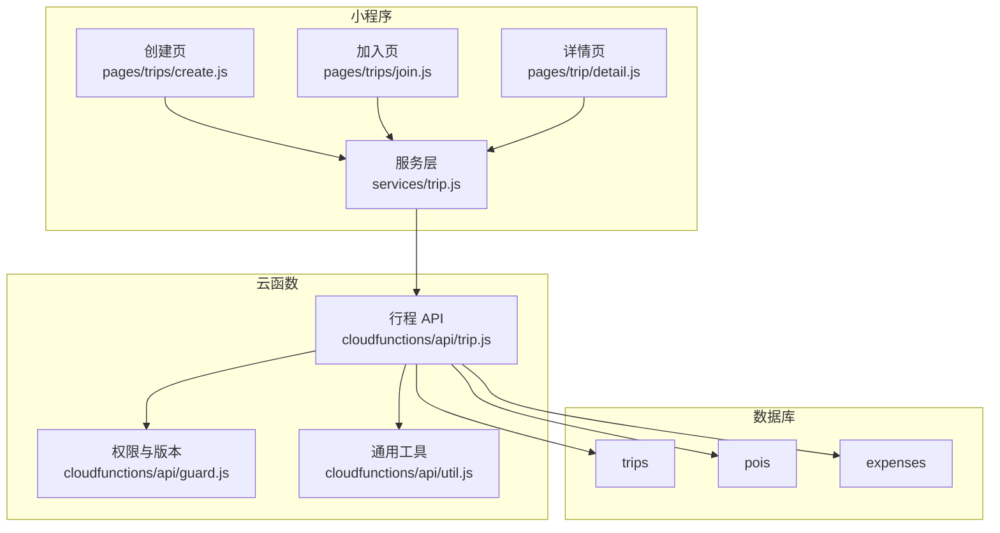
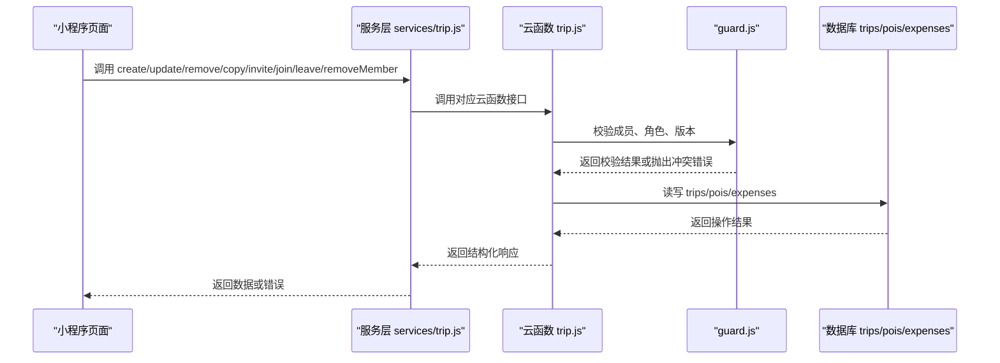
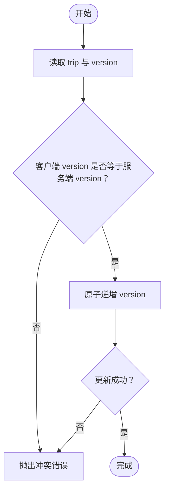
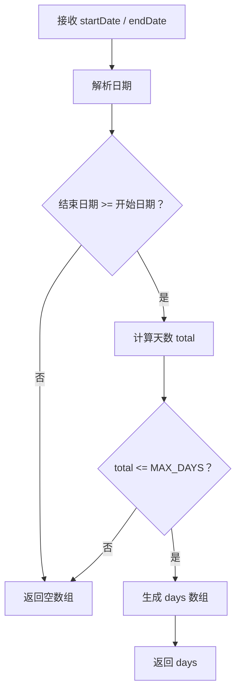
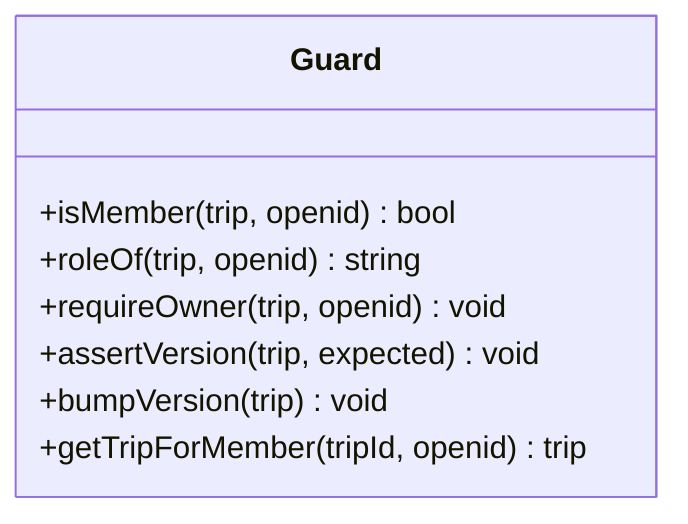
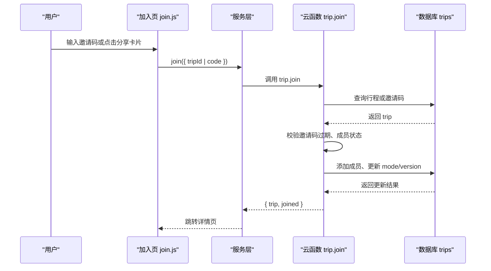
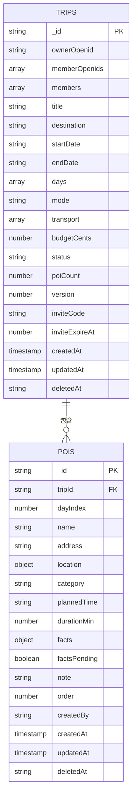

# 行程管理模块

<cite>
**本文引用的文件**   
- [trip.js](file://cloudfunctions/api/trip.js)
- [guard.js](file://cloudfunctions/api/guard.js)
- [util.js](file://cloudfunctions/api/util.js)
- [trip.js](file://services/trip.js)
- [create.js](file://pages/trips/create.js)
- [join.js](file://pages/trips/join.js)
- [detail.js](file://pages/trip/detail.js)
- [constants.js](file://utils/constants.js)
- [format.js](file://utils/format.js)
</cite>

## 目录
1. [简介](#简介)
2. [项目结构中的行程相关位置](#项目结构中的行程相关位置)
3. [核心能力总览](#核心能力总览)
4. [架构与数据流](#架构与数据流)
5. [详细接口说明](#详细接口说明)
6. [状态管理与版本控制](#状态管理与版本控制)
7. [成员协作机制](#成员协作机制)
8. [与其他模块的数据关系](#与其他模块的数据关系)
9. [常见问题与排错](#常见问题与排错)
10. [性能优化建议与最佳实践](#性能优化建议与最佳实践)
11. [结论](#结论)

## 简介
本模块负责“行程”的完整生命周期管理，包括创建、获取、更新、删除、复制，以及邀请加入、退出、移除成员等协作能力。系统通过云函数提供后端逻辑，小程序页面与服务层封装调用，数据库采用云开发集合存储行程、地点、费用等实体。

该模块重点解决以下问题：
- 多端并发修改时的冲突处理（乐观锁 + 版本号）。
- 行程状态流转（规划中、进行中、已结束）与 UI 展示一致性。
- 多人协作时的权限控制（创建者、编辑者）和邀请码机制。
- 行程与地点、费用的关联与级联软删除。
- 日期合法性校验、天数上限约束、悬空地点保护。

## 项目结构中的行程相关位置
- 云函数 API：`cloudfunctions/api/trip.js` 实现所有行程业务逻辑。
- 权限与版本工具：`cloudfunctions/api/guard.js` 提供成员判断、角色判断、版本断言与原子升级。
- 通用工具：`cloudfunctions/api/util.js` 提供日期推导、金额转换、截断等。
- 小程序服务层：`services/trip.js` 封装对云函数的调用。
- 小程序页面：
  - `pages/trips/create.js` 新建/编辑行程。
  - `pages/trips/join.js` 通过分享链接或邀请码加入。
  - `pages/trip/detail.js` 行程详情、状态切换、复制、删减天数、排序等。
- 常量定义：`utils/constants.js` 定义集合名、分类、限制等。
- 格式化工具：`utils/format.js` 提供日期、时间、金额等前端格式化方法。

**图表来源**
- [trip.js:35-368](file://cloudfunctions/api/trip.js#L35-L368)
- [guard.js:3-74](file://cloudfunctions/api/guard.js#L3-L74)
- [util.js:15-49](file://cloudfunctions/api/util.js#L15-L49)
- [trip.js:3-45](file://services/trip.js#L3-L45)
- [create.js:93-138](file://pages/trips/create.js#L93-L138)
- [join.js:31-44](file://pages/trips/join.js#L31-L44)
- [detail.js:349-420](file://pages/trip/detail.js#L349-L420)

**章节来源**
- [trip.js:35-368](file://cloudfunctions/api/trip.js#L35-L368)
- [guard.js:3-74](file://cloudfunctions/api/guard.js#L3-L74)
- [util.js:15-49](file://cloudfunctions/api/util.js#L15-L49)
- [trip.js:3-45](file://services/trip.js#L3-L45)
- [create.js:93-138](file://pages/trips/create.js#L93-L138)
- [join.js:31-44](file://pages/trips/join.js#L31-L44)
- [detail.js:349-420](file://pages/trip/detail.js#L349-L420)

## 核心能力总览
- 列表与详情：按当前用户过滤已加入行程；详情返回完整行程与 myRole。
- 创建：自动生成唯一 ID、初始成员、默认状态 planning、邀请码占位。
- 更新：支持标题、目的地、交通方式、预算、状态、起止日期；日期变更会重建 days 并做悬空地点检查。
- 删除：仅创建者可执行；软删除 trips/pois/expenses；需要版本一致。
- 复制：从源行程复制基本信息与地点；新行程日期从今天起算；成员只保留自己。
- 邀请与加入：生成 7 天有效邀请码；支持通过 tripId 或 inviteCode 加入；自动升级为 group 模式。
- 成员管理：创建者可移除成员；成员可退出；创建者不能退出。
- 状态管理：planning、ongoing、ended；UI 显示中文状态文本。
- 版本控制：客户端携带 version；服务端断言后原子递增，避免覆盖。

**章节来源**
- [trip.js:35-368](file://cloudfunctions/api/trip.js#L35-L368)
- [guard.js:3-74](file://cloudfunctions/api/guard.js#L3-L74)
- [detail.js:15-119](file://pages/trip/detail.js#L15-L119)

## 架构与数据流
### 请求到响应流程

**图表来源**
- [trip.js:35-368](file://cloudfunctions/api/trip.js#L35-L368)
- [guard.js:3-74](file://cloudfunctions/api/guard.js#L3-L74)
- [trip.js:3-45](file://services/trip.js#L3-L45)

**章节来源**
- [trip.js:35-368](file://cloudfunctions/api/trip.js#L35-L368)
- [guard.js:3-74](file://cloudfunctions/api/guard.js#L3-L74)
- [trip.js:3-45](file://services/trip.js#L3-L45)

## 详细接口说明

### 列表与获取
- 列表：返回当前用户 memberOpenids 包含的行程，按 updatedAt 倒序，最多 50 条。
- 获取：根据 tripId 获取行程，要求是成员且未删除；返回 trip 对象。

参数与返回：
- list：无参；返回 { items: Array<trip> }。
- get：{ tripId: string }；返回 { trip: trip }。

**章节来源**
- [trip.js:35-48](file://cloudfunctions/api/trip.js#L35-L48)
- [guard.js:44-64](file://cloudfunctions/api/guard.js#L44-L64)

### 创建行程
行为：
- 校验标题与目的地；自动生成 title（若为空则用 destination）。
- 校验起止日期，构建 days；最大天数由常量与工具共同限制。
- 初始化成员数组、mode（solo/group）、transport、budgetCents、status=planning、version=0、inviteCode=''。
- 写入 trips 集合，返回 trip。

参数与返回：
- 输入：destination、title、startDate、endDate、transport、budget、mode（通常为 solo）。
- 输出：{ trip: trip }。

常见错误：
- 标题为空。
- 日期不合法或超过最大天数。

**章节来源**
- [trip.js:50-88](file://cloudfunctions/api/trip.js#L50-L88)
- [util.js:15-49](file://cloudfunctions/api/util.js#L15-L49)
- [constants.js:26-30](file://utils/constants.js#L26-L30)

### 更新行程
行为：
- 校验成员权限；读取现有 trip。
- 支持 patch 字段：title、destination、transport、budget、status、startDate、endDate。
- 日期变更时重建 days；若减少天数，检查被裁剪日是否有地点，防止孤儿数据。
- 使用 assertVersion 与 bumpVersion 进行乐观锁保护。
- 更新 trips 并返回最新 trip。

参数与返回：
- 输入：{ tripId, patch, version }。
- 输出：{ trip: trip }。

常见错误：
- 标题为空。
- 日期不合法。
- 减少天数但仍有地点在后续天数。
- 版本冲突。

**章节来源**
- [trip.js:90-132](file://cloudfunctions/api/trip.js#L90-L132)
- [guard.js:26-42](file://cloudfunctions/api/guard.js#L26-L42)

### 删除行程
行为：
- 仅创建者可删除；需版本一致。
- 软删除 trips、pois、expenses（标记 deletedAt）。
- 返回 tripId。

参数与返回：
- 输入：{ tripId, version }。
- 输出：{ tripId: string }。

常见错误：
- 非创建者。
- 版本冲突。

**章节来源**
- [trip.js:134-147](file://cloudfunctions/api/trip.js#L134-L147)
- [guard.js:16-18](file://cloudfunctions/api/guard.js#L16-L18)

### 复制行程
行为：
- 校验成员权限；计算新行程起止日期（从今天起，保持原天数）。
- 复制基本信息与 transport、budgetCents；members 重置为当前用户。
- 复制 pois（最多 300 条），重新计算 order 与 dayIndex。
- 更新 poiCount；返回新 trip。

参数与返回：
- 输入：{ tripId }。
- 输出：{ trip: trip }。

常见错误：
- 复制后日期超出上限。

**章节来源**
- [trip.js:280-356](file://cloudfunctions/api/trip.js#L280-L356)

### 邀请与加入
邀请：
- 仅创建者可生成邀请码。
- 若已有未过期邀请码直接返回；否则生成唯一 inviteCode，设置 7 天过期时间。
- 返回 inviteCode、inviteExpireAt、trip。

加入：
- 支持通过 tripId 或 inviteCode 加入。
- 校验行程存在、未删除、邀请码未过期。
- 若已是成员返回 joined=false；否则将 openid 加入 memberOpenids 与 members，role=editor，name=同行，mode=group，version+1。
- 返回 trip 与 joined=true/false。

参数与返回：
- invite：{ tripId } → { inviteCode, inviteExpireAt, trip }。
- join：{ tripId | code } → { trip, joined }。

常见错误：
- 缺少邀请信息。
- 行程不存在或已被删除。
- 邀请码无效或过期。

**章节来源**
- [trip.js:149-204](file://cloudfunctions/api/trip.js#L149-L204)

### 成员管理
移除成员：
- 仅创建者可移除；不能移除自己或创建者。
- 从 memberOpenids 与 members 中移除目标 openid；若成员数<=1，mode=solo；version+1。
- 返回 trip 与被移除 openid。

退出：
- 成员可退出；创建者不能退出（应删除行程）。
- 从 memberOpenids、members、reminders 中移除自身；mode 可能变回 solo；version+1。
- 返回 tripId。

参数与返回：
- removeMember：{ tripId, openid } → { trip, openid }。
- leave：{ tripId } → { tripId }。

常见错误：
- 非创建者。
- 移除自己或创建者。
- 创建者尝试退出。

**章节来源**
- [trip.js:206-272](file://cloudfunctions/api/trip.js#L206-L272)

### 状态管理
状态枚举：
- planning：规划中。
- ongoing：进行中。
- ended：已结束。

UI 展示：
- 详情页根据 status 显示中文状态文本，并提供“标记为已结束”或“重新打开这趟”的操作。

状态切换：
- 通过 update 接口传入 status 字段；需版本一致。

**章节来源**
- [trip.js:7](file://cloudfunctions/api/trip.js#L7)
- [detail.js:15-119](file://pages/trip/detail.js#L15-L119)

## 状态管理与版本控制

### 乐观锁机制
- 客户端每次写操作携带 version。
- 服务端先断言 expected === trip.version，再原子递增 version。
- 若并发导致 where 条件不匹配，bumpVersion 抛出版本冲突错误。

**图表来源**
- [guard.js:26-42](file://cloudfunctions/api/guard.js#L26-L42)

**章节来源**
- [guard.js:26-42](file://cloudfunctions/api/guard.js#L26-L42)

### 日期与天数校验
- buildDays 根据 startDate 与 endDate 推导 days；若结束早于开始或超过 MAX_DAYS，返回空数组。
- 更新时若减少天数，检查 poIs 是否存在 dayIndex >= 新天数的记录，若有则拒绝以减少悬空地点。

**图表来源**
- [util.js:15-31](file://cloudfunctions/api/util.js#L15-L31)

**章节来源**
- [util.js:15-31](file://cloudfunctions/api/util.js#L15-L31)
- [trip.js:104-125](file://cloudfunctions/api/trip.js#L104-L125)

## 成员协作机制

### 邀请码
- 邀请码长度固定，字符集排除易混淆字符。
- uniqueCode 循环生成直到不重复；有效期 7 天。
- 邀请成功后 trip.inviteCode 与 inviteExpireAt 更新。

**章节来源**
- [trip.js:11-26](file://cloudfunctions/api/trip.js#L11-L26)
- [trip.js:149-169](file://cloudfunctions/api/trip.js#L149-L169)

### 权限控制
- isMember：判断 openid 是否在 memberOpenids。
- roleOf：优先取 members 中 role，否则 ownerOpenid 为 owner，其余为 editor。
- requireOwner：非 owner 抛错。

**图表来源**
- [guard.js:3-74](file://cloudfunctions/api/guard.js#L3-L74)

**章节来源**
- [guard.js:3-18](file://cloudfunctions/api/guard.js#L3-L18)
- [guard.js:44-64](file://cloudfunctions/api/guard.js#L44-L64)

### 加入与退出流程

**图表来源**
- [join.js:31-44](file://pages/trips/join.js#L31-L44)
- [trip.js:171-204](file://cloudfunctions/api/trip.js#L171-L204)

**章节来源**
- [join.js:31-44](file://pages/trips/join.js#L31-L44)
- [trip.js:171-204](file://cloudfunctions/api/trip.js#L171-L204)

## 与其他模块的数据关系

### 与地点模块（POI）
- 行程包含 days 与 poiCount；poi 通过 tripId 关联。
- 删除行程时级联软删除 pois。
- 复制行程时会复制 pois，并重新计算 order 与 dayIndex。

**图表来源**
- [trip.js:280-356](file://cloudfunctions/api/trip.js#L280-L356)
- [trip.js:134-147](file://cloudfunctions/api/trip.js#L134-L147)

**章节来源**
- [trip.js:134-147](file://cloudfunctions/api/trip.js#L134-L147)
- [trip.js:280-356](file://cloudfunctions/api/trip.js#L280-L356)

### 与费用模块（Expense）
- 删除行程时级联软删除 expenses。
- 费用集合名在常量中定义，便于集中管理。

**章节来源**
- [trip.js:134-147](file://cloudfunctions/api/trip.js#L134-L147)
- [constants.js:5-10](file://utils/constants.js#L5-L10)

## 常见问题与排错

### 日期验证失败
现象：
- 创建或更新时报“日期不合法”。

原因：
- 结束日期早于开始日期。
- 天数超过 MAX_DAYS（默认 15）。

处理：
- 前端使用 format.addDays 与 dayCount 辅助校验。
- 后端 buildDays 严格校验并返回空数组。

**章节来源**
- [trip.js:55-58](file://cloudfunctions/api/trip.js#L55-L58)
- [trip.js:104-110](file://cloudfunctions/api/trip.js#L104-L110)
- [util.js:15-31](file://cloudfunctions/api/util.js#L15-L31)
- [format.js:61-66](file://utils/format.js#L61-L66)

### 成员权限冲突
现象：
- 非创建者尝试删除或生成邀请码时报错。

原因：
- requireOwner 校验失败。

处理：
- 前端根据 trip.myRole 控制按钮可见性。
- 后端统一拦截。

**章节来源**
- [guard.js:16-18](file://cloudfunctions/api/guard.js#L16-L18)
- [trip.js:136-147](file://cloudfunctions/api/trip.js#L136-L147)
- [trip.js:149-169](file://cloudfunctions/api/trip.js#L149-L169)

### 版本冲突
现象：
- 保存时报“conflict”，提示刷新后再试。

原因：
- 客户端 version 与服务端不一致。

处理：
- 前端捕获 conflict 错误，重新拉取 trip 并更新本地 version，再次保存。
- 后端 bumpVersion 使用 where version=current 保证原子性。

**章节来源**
- [create.js:125-137](file://pages/trips/create.js#L125-L137)
- [detail.js:376-382](file://pages/trip/detail.js#L376-L382)
- [guard.js:26-42](file://cloudfunctions/api/guard.js#L26-L42)

### 减少天数但仍有地点
现象：
- 更新行程减少天数时报错，提示还有地点在后几天。

原因：
- 为防止孤儿地点，后端检查被裁剪日期的地点数量。

处理：
- 先将地点移动到前面或删除，再减少天数。

**章节来源**
- [trip.js:111-120](file://cloudfunctions/api/trip.js#L111-L120)

### 邀请码无效或过期
现象：
- 加入时报“邀请码不对”或“邀请码已过期”。

原因：
- 邀请码不存在或 inviteExpireAt 已过。

处理：
- 让创建者重新生成邀请码。

**章节来源**
- [trip.js:177-183](file://cloudfunctions/api/trip.js#L177-L183)

## 性能优化建议与最佳实践

- 列表分页与限制：
  - 列表接口已限制 50 条，适合移动端首屏加载；如需更多，可增加分页参数。
- 批量复制地点：
  - 复制 poi 时限制 300 条，避免单次写入过多；必要时分批次写入。
- 乐观锁最小化写放大：
  - 仅在关键写路径使用 bumpVersion；成员进出虽也 version+1，但属于轻量元数据变更。
- 前端缓存与弱网体验：
  - 详情页在 commit 前本地更新 UI，网络失败时回滚或重试；冲突时引导刷新。
- 日期与天数计算：
  - 前后端共用 buildDays 逻辑，避免两边不一致；前端只做展示与校验。
- 金额存储：
  - 统一以“分”存储，避免浮点误差；展示时再转元。
- 索引建议：
  - trips 上对 memberOpenids、deletedAt、updatedAt 建立索引以提升列表查询效率。
  - pois 上对 tripId、dayIndex、order 建立索引以提升排序与筛选效率。
  - expenses 上对 tripId、deletedAt 建立索引。

[本节为通用指导，不直接分析具体文件]

## 结论
行程管理模块通过清晰的分层结构与严格的权限、版本控制，实现了多人协作下的稳定 CRUD 能力。其设计重点在于：
- 以版本号为核心的乐观锁机制，确保并发安全。
- 以成员数组与角色判断为核心的权限模型，支持创建者与编辑者协作。
- 以邀请码为核心的低门槛加入机制，提升分享与协作效率。
- 以日期推导与悬空地点保护为核心的数据一致性保障。
- 与地点、费用模块的松耦合关联，便于扩展与维护。

在实际使用中，建议前端做好冲突提示与版本同步，后端持续监控并发冲突率，并根据业务增长调整分页与索引策略。

[本节为总结性内容，不直接分析具体文件]