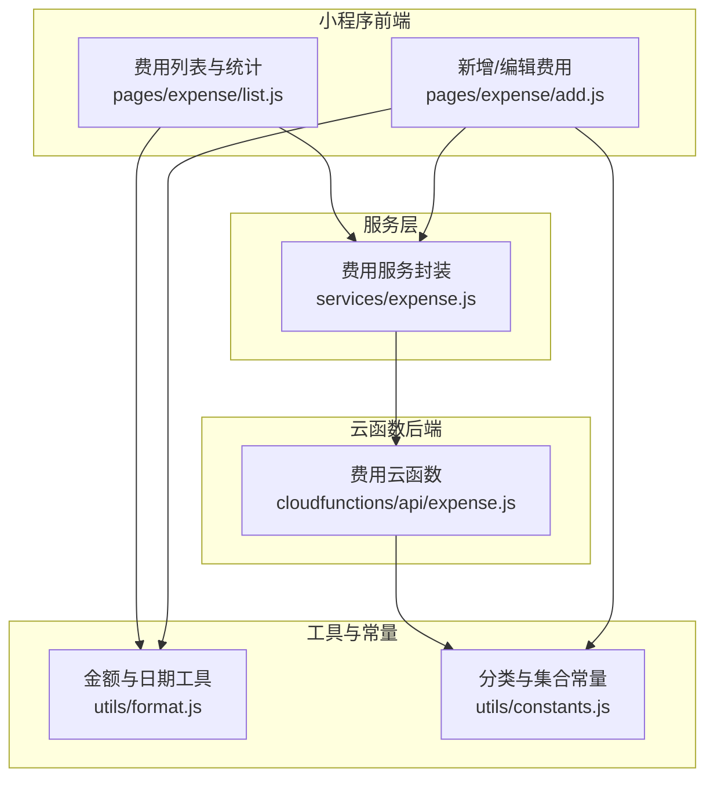
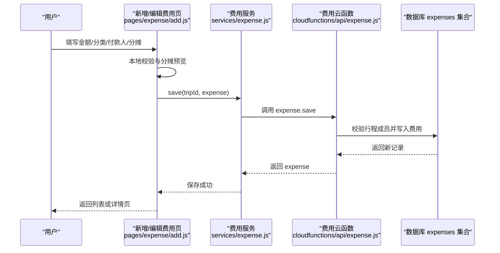
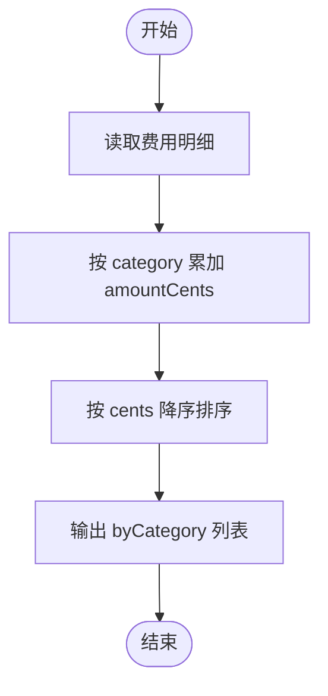
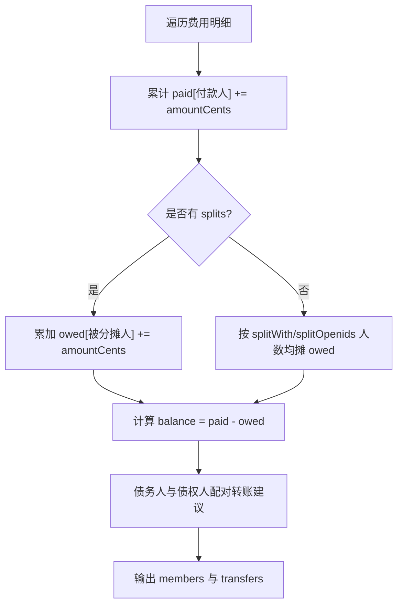
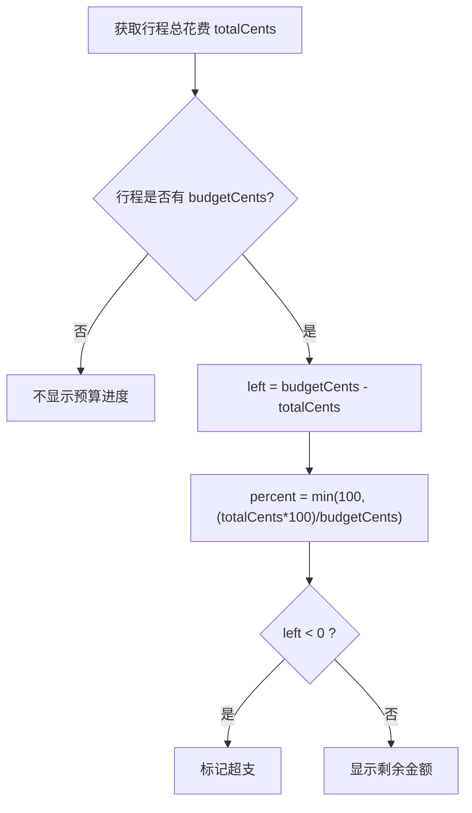
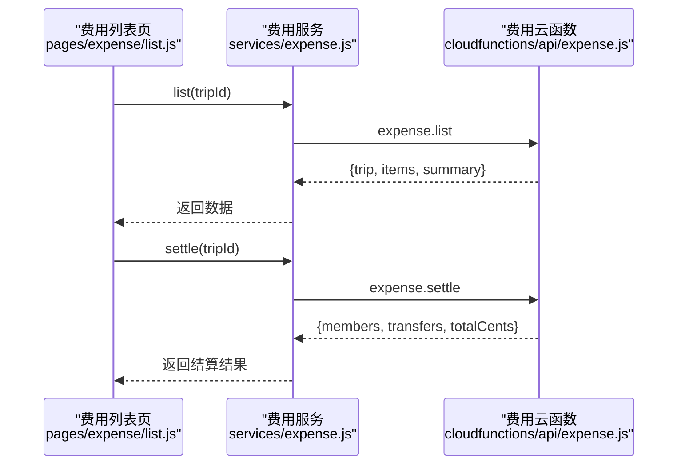
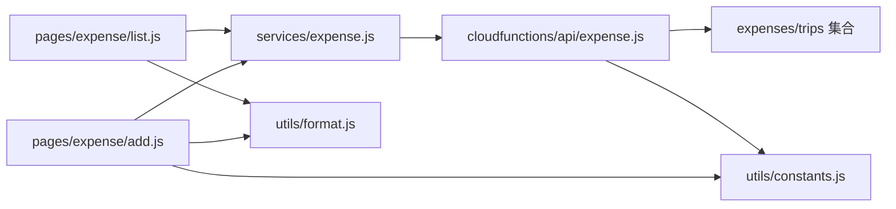

# 费用管理模块

<cite>
**本文引用的文件**   
- [cloudfunctions/api/expense.js](file://cloudfunctions/api/expense.js)
- [services/expense.js](file://services/expense.js)
- [pages/expense/add.js](file://pages/expense/add.js)
- [pages/expense/list.js](file://pages/expense/list.js)
- [utils/constants.js](file://utils/constants.js)
- [utils/format.js](file://utils/format.js)
- [docs/方案.md](file://docs/方案.md)
</cite>

## 目录
1. [引言](#引言)
2. [项目结构](#项目结构)
3. [核心组件](#核心组件)
4. [架构总览](#架构总览)
5. [详细组件分析](#详细组件分析)
6. [依赖关系分析](#依赖关系分析)
7. [性能与精度考量](#性能与精度考量)
8. [故障排查指南](#故障排查指南)
9. [结论](#结论)
10. [附录：接口与数据模型](#附录接口与数据模型)

## 引言
本模块面向旅行行程中的“费用记账、查询、统计、AA结算”等核心场景，提供从前端录入到云端聚合计算的一体化实现。重点包括：
- 费用记录的增删改查与按日分组展示
- 费用分类体系与分类占比统计
- AA分账算法（均摊、零头处理、分摊校验）
- 预算对比与超支提示
- 费用与行程、成员的关系映射
- 多币种支持现状与扩展建议
- 常见问题处理与报表导出指导

## 项目结构
费用模块涉及小程序前端页面、服务层封装以及云函数后端逻辑，整体组织如下：
- 前端页面
  - 新增/编辑费用：`pages/expense/add.js`
  - 费用列表与统计：`pages/expense/list.js`
- 服务层
  - 费用 API 封装：`services/expense.js`
- 云函数
  - 费用业务逻辑：`cloudfunctions/api/expense.js`
- 工具与常量
  - 金额格式化与精度转换：`utils/format.js`
  - 分类常量与集合名：`utils/constants.js`
- 设计文档
  - 接口约定与行为说明：`docs/方案.md`



**图表来源**
- [pages/expense/add.js:1-264](file://pages/expense/add.js#L1-L264)
- [pages/expense/list.js:1-176](file://pages/expense/list.js#L1-L176)
- [services/expense.js:1-26](file://services/expense.js#L1-L26)
- [cloudfunctions/api/expense.js:1-329](file://cloudfunctions/api/expense.js#L1-L329)
- [utils/format.js:1-116](file://utils/format.js#L1-L116)
- [utils/constants.js:1-48](file://utils/constants.js#L1-L48)

**章节来源**
- [pages/expense/add.js:1-264](file://pages/expense/add.js#L1-L264)
- [pages/expense/list.js:1-176](file://pages/expense/list.js#L1-L176)
- [services/expense.js:1-26](file://services/expense.js#L1-L26)
- [cloudfunctions/api/expense.js:1-329](file://cloudfunctions/api/expense.js#L1-L329)
- [utils/format.js:1-116](file://utils/format.js#L1-L116)
- [utils/constants.js:1-48](file://utils/constants.js#L1-L48)

## 核心组件
- 费用云函数 `cloudfunctions/api/expense.js`
  - 负责权限校验（通过行程成员）、数据入库、汇总统计、AA结算。
- 费用服务 `services/expense.js`
  - 统一调用云函数，对外暴露 list、overview、save、remove、settle 等方法。
- 新增/编辑费用页 `pages/expense/add.js`
  - 负责费用录入、分类选择、付款人选择、AA分摊计算与校验。
- 费用列表页 `pages/expense/list.js`
  - 负责按日分组展示、预算对比、分类占比、AA结算结果展示。
- 工具与常量
  - `utils/format.js`：金额以“分”存储、元转分、文本格式化。
  - `utils/constants.js`：费用分类、集合名等常量。

**章节来源**
- [cloudfunctions/api/expense.js:1-329](file://cloudfunctions/api/expense.js#L1-L329)
- [services/expense.js:1-26](file://services/expense.js#L1-L26)
- [pages/expense/add.js:1-264](file://pages/expense/add.js#L1-L264)
- [pages/expense/list.js:1-176](file://pages/expense/list.js#L1-L176)
- [utils/format.js:1-116](file://utils/format.js#L1-L116)
- [utils/constants.js:1-48](file://utils/constants.js#L1-L48)

## 架构总览
费用模块采用“前端页面 + 服务层 + 云函数”的分层架构。前端负责交互与本地计算（如分摊预览），服务端负责权限控制、数据持久化与关键计算（汇总、AA结算）。



**图表来源**
- [pages/expense/add.js:224-262](file://pages/expense/add.js#L224-L262)
- [services/expense.js:13-15](file://services/expense.js#L13-L15)
- [cloudfunctions/api/expense.js:132-184](file://cloudfunctions/api/expense.js#L132-L184)

## 详细组件分析

### 费用分类系统
- 分类定义
  - 前端与后端共用同一套分类：交通、餐饮、门票、住宿、购物、其它。
  - 前端常量来自 `utils/constants.js`，后端在云函数中硬编码相同数组用于校验。
- 分类统计
  - 服务端对费用明细进行归类求和，并按金额降序输出分类占比，供前端绘制条形图。



**图表来源**
- [cloudfunctions/api/expense.js:14-33](file://cloudfunctions/api/expense.js#L14-L33)
- [utils/constants.js:15-16](file://utils/constants.js#L15-L16)

**章节来源**
- [cloudfunctions/api/expense.js:5-33](file://cloudfunctions/api/expense.js#L5-L33)
- [utils/constants.js:15-16](file://utils/constants.js#L15-L16)

### AA分账算法
- 分摊规则
  - 默认按勾选人数均摊；除不尽的零头归到第一个人的份额，保证合计等于总金额。
  - 支持手动修改每人份额，但服务端会校验分摊合计必须等于金额。
- 数据结构
  - 新字段 `splits`：[{openid, amountCents}]，精确到分。
  - 兼容旧字段 `splitWith` / `splitOpenids`：仅保留成员 openid 列表，由服务端按人数均摊。
- 结算逻辑
  - 计算每人实付 `paid` 与应摊 `owed`，差额 `balance = paid - owed`。
  - 生成最少转账建议：债务人向债权人转账，直到余额清零。



**图表来源**
- [cloudfunctions/api/expense.js:51-86](file://cloudfunctions/api/expense.js#L51-L86)
- [cloudfunctions/api/expense.js:218-319](file://cloudfunctions/api/expense.js#L218-L319)

**章节来源**
- [cloudfunctions/api/expense.js:51-86](file://cloudfunctions/api/expense.js#L51-L86)
- [cloudfunctions/api/expense.js:218-319](file://cloudfunctions/api/expense.js#L218-L319)

### 预算对比功能
- 预算数据来源
  - 预算存储在行程对象中（budgetCents），列表页根据当前行程总花费计算剩余与超支状态。
- 显示策略
  - 未设置预算时不显示进度条，避免“预算为 0 已超支”的歧义。
  - 当有预算时，显示预算总额、剩余金额、是否超支、使用百分比。



**图表来源**
- [pages/expense/list.js:37-48](file://pages/expense/list.js#L37-L48)

**章节来源**
- [pages/expense/list.js:37-48](file://pages/expense/list.js#L37-L48)

### 费用与行程、成员的关系映射
- 费用属于某个行程（tripId），且只能由该行程的成员访问与操作。
- 付款人（paidBy）必须是行程成员；未传则默认为当前用户。
- 成员标签（paidByName）基于角色与 openid 后四位生成，避免昵称混淆。
- 分摊成员（splits）也需是行程成员，否则会被忽略。

```mermaid
classDiagram
class Trip {
+string _id
+array memberOpenids
+number budgetCents
}
class Expense {
+string tripId
+number amountCents
+string currency
+string category
+string paidBy
+string paidByName
+array splits
+string spentAt
+string note
}
class Member {
+string openid
+string role
}
Trip ||--o{ Expense : "包含"
Member ||--o{ Trip : "参与"
Expense --> Member : "paidBy / splits.openid"
```

**图表来源**
- [cloudfunctions/api/expense.js:35-49](file://cloudfunctions/api/expense.js#L35-L49)
- [cloudfunctions/api/expense.js:132-184](file://cloudfunctions/api/expense.js#L132-L184)

**章节来源**
- [cloudfunctions/api/expense.js:35-49](file://cloudfunctions/api/expense.js#L35-L49)
- [cloudfunctions/api/expense.js:132-184](file://cloudfunctions/api/expense.js#L132-L184)

### 多币种支持的处理逻辑
- 当前实现
  - 费用记录固定使用人民币（currency: 'CNY'），金额统一以“分”存储。
- 扩展建议
  - 若未来需要多币种，可在保存时传入 currency，并在统计与结算时按汇率换算为基准币种后再计算。
  - 建议在云端增加汇率表与换算函数，确保所有金额在计算前统一到最小单位（如分）。

**章节来源**
- [cloudfunctions/api/expense.js:147-149](file://cloudfunctions/api/expense.js#L147-L149)
- [utils/format.js:42-59](file://utils/format.js#L42-L59)

### 费用数据的CRUD操作与统计分析接口
- 新增/更新
  - 前端调用 `expenseService.save(tripId, expense)`，后端校验金额、分类、付款人与分摊，写入 expenses 集合。
- 删除
  - 前端调用 `expenseService.remove(tripId, expenseId)`，后端软删（设置 deletedAt）。
- 查询
  - 前端调用 `expenseService.list(tripId)`，后端返回明细、行程信息与汇总统计。
- 概览
  - 前端调用 `expenseService.overview()`，后端聚合用户所有行程的花费合计。
- AA结算
  - 前端调用 `expenseService.settle(tripId)`，后端计算成员差额与转账建议。



**图表来源**
- [services/expense.js:3-24](file://services/expense.js#L3-L24)
- [cloudfunctions/api/expense.js:88-130](file://cloudfunctions/api/expense.js#L88-L130)
- [cloudfunctions/api/expense.js:200-215](file://cloudfunctions/api/expense.js#L200-L215)

**章节来源**
- [services/expense.js:3-24](file://services/expense.js#L3-L24)
- [cloudfunctions/api/expense.js:88-130](file://cloudfunctions/api/expense.js#L88-L130)
- [cloudfunctions/api/expense.js:200-215](file://cloudfunctions/api/expense.js#L200-L215)

## 依赖关系分析
- 前端页面依赖服务层方法，服务层通过云开发 SDK 调用云函数。
- 云函数依赖数据库集合 `expenses` 与 `trips`，并通过 guard 校验成员权限。
- 工具模块 `format.js` 提供金额与日期格式化，`constants.js` 提供分类与集合名。



**图表来源**
- [pages/expense/add.js:1-10](file://pages/expense/add.js#L1-L10)
- [pages/expense/list.js:1-3](file://pages/expense/list.js#L1-L3)
- [services/expense.js:1-26](file://services/expense.js#L1-L26)
- [cloudfunctions/api/expense.js:1-6](file://cloudfunctions/api/expense.js#L1-L6)
- [utils/format.js:1-116](file://utils/format.js#L1-L116)
- [utils/constants.js:1-48](file://utils/constants.js#L1-L48)

**章节来源**
- [pages/expense/add.js:1-10](file://pages/expense/add.js#L1-L10)
- [pages/expense/list.js:1-3](file://pages/expense/list.js#L1-L3)
- [services/expense.js:1-26](file://services/expense.js#L1-L26)
- [cloudfunctions/api/expense.js:1-6](file://cloudfunctions/api/expense.js#L1-L6)
- [utils/format.js:1-116](file://utils/format.js#L1-L116)
- [utils/constants.js:1-48](file://utils/constants.js#L1-L48)

## 性能与精度考量
- 金额精度
  - 所有金额以“分”存储，避免浮点误差；展示时再转为元。
  - 输入转换使用 `toCents`，非法值视为 0，防止脏数据入库。
- 汇总与统计
  - 分类占比与服务端汇总在服务端一次性计算，保证前端与明细一致。
  - 概览接口使用聚合查询，避免逐条拉取明细，提升性能。
- 分页与限制
  - 列表与结算最多返回 300 条，避免大数据量导致卡顿。
- 预算计算
  - 仅在行程设置了预算时才计算进度条，减少无效渲染。

**章节来源**
- [utils/format.js:42-59](file://utils/format.js#L42-L59)
- [cloudfunctions/api/expense.js:14-33](file://cloudfunctions/api/expense.js#L14-L33)
- [cloudfunctions/api/expense.js:105-130](file://cloudfunctions/api/expense.js#L105-L130)
- [cloudfunctions/api/expense.js:6-6](file://cloudfunctions/api/expense.js#L6-L6)
- [pages/expense/list.js:37-48](file://pages/expense/list.js#L37-L48)

## 故障排查指南
- 分摊合计与金额不一致
  - 现象：保存时报错“分摊合计和金额不一致”。
  - 原因：手动输入的每人份额之和与总金额不符。
  - 解决：调整分摊金额使合计等于总金额，或使用自动均摊。
- 金额小于等于 0
  - 现象：保存时报错“请填写大于 0 的金额”。
  - 原因：金额为空或非正数。
  - 解决：填写有效金额。
- 记录不存在或已被删除
  - 现象：编辑时报错“这笔记录不存在或已被删除”。
  - 原因：expenseId 无效或已被软删。
  - 解决：重新选择记录或新建一笔。
- 缺少账目 id
  - 现象：删除时报错“缺少账目 id”。
  - 原因：未传入 expenseId。
  - 解决：确认传入正确的 expenseId。
- 预算显示异常
  - 现象：预算为 0 时出现“已超支”提示。
  - 原因：未设置预算却显示了进度条。
  - 解决：确保只在有预算时显示进度条。

**章节来源**
- [cloudfunctions/api/expense.js:82-84](file://cloudfunctions/api/expense.js#L82-L84)
- [cloudfunctions/api/expense.js:135-136](file://cloudfunctions/api/expense.js#L135-L136)
- [cloudfunctions/api/expense.js:170-170](file://cloudfunctions/api/expense.js#L170-L170)
- [cloudfunctions/api/expense.js:189-189](file://cloudfunctions/api/expense.js#L189-L189)
- [pages/expense/list.js:37-48](file://pages/expense/list.js#L37-L48)

## 结论
费用管理模块通过前后端协作实现了完整的费用记账、查询、统计与AA结算能力。金额精度以“分”为单位保障计算准确性；分类统计与预算对比帮助旅行者掌握支出结构；AA结算提供最少转账建议，简化多人出行后的清账流程。未来可在此基础上扩展多币种支持与更丰富的报表导出能力。

## 附录：接口与数据模型

### 接口定义
- 费用列表
  - 请求：`list(tripId)`
  - 响应：`{ trip, items, summary }`
- 费用概览
  - 请求：`overview()`
  - 响应：`{ items: [{ tripId, totalCents, count }] }`
- 保存费用
  - 请求：`save(tripId, expense)`
  - 响应：`{ expense }`
- 删除费用
  - 请求：`remove(tripId, expenseId)`
  - 响应：`{ expenseId }`
- AA结算
  - 请求：`settle(tripId)`
  - 响应：`{ tripId, memberCount, totalCents, members, transfers }`

**章节来源**
- [services/expense.js:3-24](file://services/expense.js#L3-L24)
- [cloudfunctions/api/expense.js:88-130](file://cloudfunctions/api/expense.js#L88-L130)
- [cloudfunctions/api/expense.js:132-184](file://cloudfunctions/api/expense.js#L132-L184)
- [cloudfunctions/api/expense.js:186-197](file://cloudfunctions/api/expense.js#L186-L197)
- [cloudfunctions/api/expense.js:200-215](file://cloudfunctions/api/expense.js#L200-L215)

### 数据模型
- 费用记录
  - 关键字段：tripId、amountCents、currency、category、paidBy、paidByName、splits、spentAt、note
- 行程
  - 关键字段：_id、memberOpenids、budgetCents、days
- 成员
  - 关键字段：openid、role

```mermaid
erDiagram
TRIP {
uuid _id PK
array memberOpenids
number budgetCents
array days
}
EXPENSE {
uuid _id PK
uuid tripId FK
number amountCents
string currency
string category
string paidBy
string paidByName
json splits
string spentAt
string note
}
MEMBER {
string openid PK
string role
}
TRIP ||--o{ EXPENSE : "contains"
MEMBER ||--o{ TRIP : "participates_in"
EXPENSE --> MEMBER : "paidBy / splits.openid"
```

**图表来源**
- [cloudfunctions/api/expense.js:132-184](file://cloudfunctions/api/expense.js#L132-L184)
- [cloudfunctions/api/expense.js:218-319](file://cloudfunctions/api/expense.js#L218-L319)

### 报表生成与数据导出指导
- 分类占比报表
  - 使用服务端返回的 `summary.byCategory`，在前端绘制条形图或表格。
- 每日花费报表
  - 前端按 `spentAt` 分组，计算每日总额与平均花费。
- 预算执行报表
  - 结合行程预算与总花费，计算使用率与剩余金额。
- 导出建议
  - 将上述数据序列化为 CSV/JSON，提供下载链接或通过分享卡片导出。
  - 注意金额以“分”存储，导出时需转换为元并保留两位小数。

**章节来源**
- [cloudfunctions/api/expense.js:14-33](file://cloudfunctions/api/expense.js#L14-L33)
- [pages/expense/list.js:4-35](file://pages/expense/list.js#L4-L35)
- [pages/expense/list.js:70-97](file://pages/expense/list.js#L70-L97)
- [utils/format.js:42-59](file://utils/format.js#L42-L59)