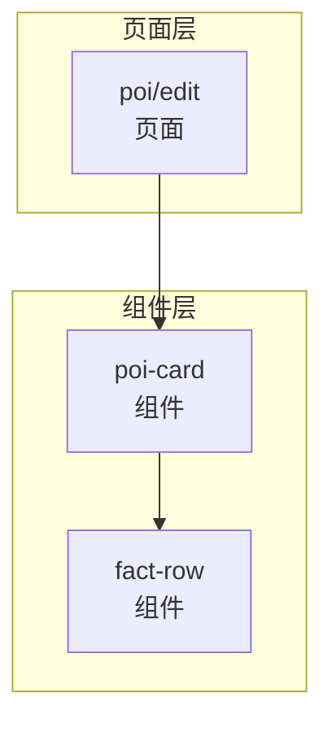
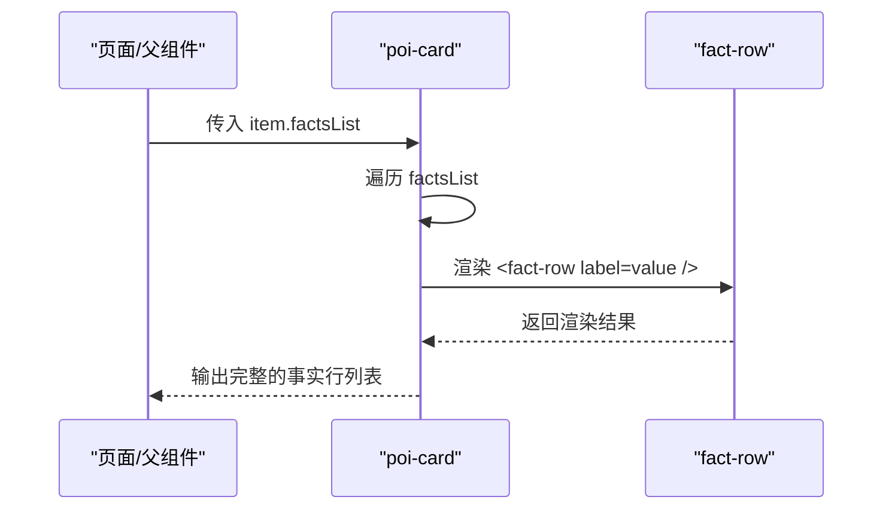
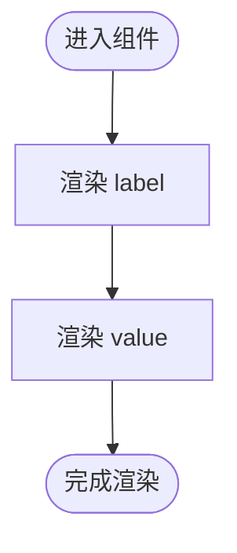
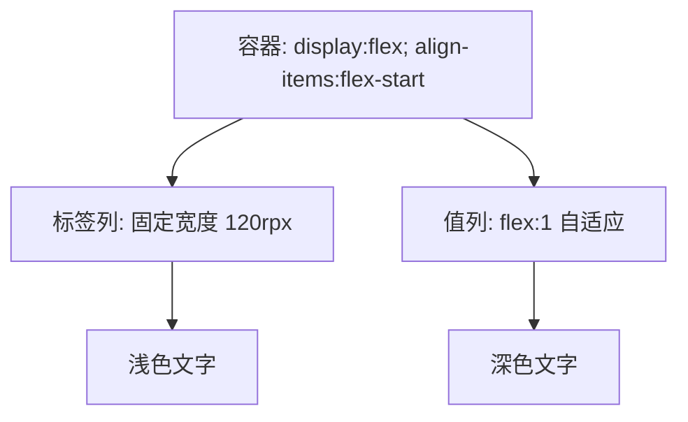
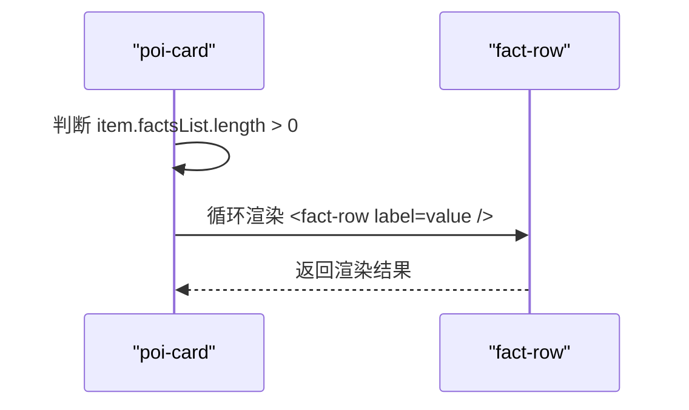
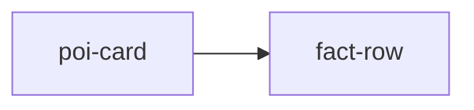

# 事实行组件 (fact-row)

<cite>
**本文引用的文件**   
- [components/fact-row/fact-row.js](file://components/fact-row/fact-row.js)
- [components/fact-row/fact-row.wxml](file://components/fact-row/fact-row.wxml)
- [components/fact-row/fact-row.wxss](file://components/fact-row/fact-row.wxss)
- [components/fact-row/fact-row.json](file://components/fact-row/fact-row.json)
- [components/poi-card/poi-card.wxml](file://components/poi-card/poi-card.wxml)
</cite>

## 目录
1. [简介](#简介)
2. [项目结构](#项目结构)
3. [核心组件](#核心组件)
4. [架构总览](#架构总览)
5. [详细组件分析](#详细组件分析)
6. [依赖关系分析](#依赖关系分析)
7. [性能与可访问性](#性能与可访问性)
8. [故障排查指南](#故障排查指南)
9. [结论](#结论)
10. [附录：使用示例与最佳实践](#附录使用示例与最佳实践)

## 简介
事实行组件用于以“键值对”的形式展示信息行，常用于地点详情页中展示地址、电话、评分等结构化事实信息。该组件提供简洁的标签与值的两列布局，支持样式隔离共享、基础文本显示与响应式宽度分配，便于在卡片或列表中以一致风格呈现各类事实数据。

## 项目结构
本仓库为微信小程序工程，事实行组件位于 components/fact-row 目录下，包含组件脚本、模板、样式与注册配置。poi-card 组件作为典型的使用方，通过循环渲染 factsList 来展示多条事实行。

图表来源
- [components/fact-row/fact-row.js:1-11](file://components/fact-row/fact-row.js#L1-L11)
- [components/fact-row/fact-row.wxml:1-5](file://components/fact-row/fact-row.wxml#L1-L5)
- [components/fact-row/fact-row.wxss:1-18](file://components/fact-row/fact-row.wxss#L1-L18)
- [components/poi-card/poi-card.wxml:17-31](file://components/poi-card/poi-card.wxml#L17-L31)

章节来源
- [components/fact-row/fact-row.js:1-11](file://components/fact-row/fact-row.js#L1-L11)
- [components/fact-row/fact-row.wxml:1-5](file://components/fact-row/fact-row.wxml#L1-L5)
- [components/fact-row/fact-row.wxss:1-18](file://components/fact-row/fact-row.wxss#L1-L18)
- [components/fact-row/fact-row.json:1-5](file://components/fact-row/fact-row.json#L1-L5)
- [components/poi-card/poi-card.wxml:17-31](file://components/poi-card/poi-card.wxml#L17-L31)

## 核心组件
- 组件名称：fact-row
- 用途：以“标签 + 值”的两列形式展示单条事实信息
- 属性
  - label：String，默认空字符串，表示键名（如“地址”、“电话”）
  - value：String，默认空字符串，表示对应值（如具体地址、电话号码）
- 样式隔离策略：apply-shared，允许组件样式被外部覆盖，便于主题定制
- 模板结构：外层容器包裹两个文本节点，分别绑定 label 与 value
- 样式要点：
  - 容器采用 Flex 布局，左对齐，内边距适中，字号与行高统一
  - 标签列固定宽度，颜色较浅；值列自适应剩余空间，颜色更深

章节来源
- [components/fact-row/fact-row.js:1-11](file://components/fact-row/fact-row.js#L1-L11)
- [components/fact-row/fact-row.wxml:1-5](file://components/fact-row/fact-row.wxml#L1-L5)
- [components/fact-row/fact-row.wxss:1-18](file://components/fact-row/fact-row.wxss#L1-L18)

## 架构总览
事实行组件由 poi-card 组件在“已知信息”区块中循环渲染，每条事实项传入 label 与 value，形成统一的键值对展示。

图表来源
- [components/poi-card/poi-card.wxml:17-31](file://components/poi-card/poi-card.wxml#L17-L31)
- [components/fact-row/fact-row.wxml:1-5](file://components/fact-row/fact-row.wxml#L1-L5)

## 详细组件分析

### 组件 API 与数据格式
- 属性定义
  - label：String，必填语义上建议非空，默认空串
  - value：String，必填语义上建议非空，默认空串
- 数据格式要求
  - 父组件应保证传入的是字符串类型；若为空，将显示占位符或留白
  - 建议在父层对数据进行清洗与格式化（例如去除首尾空白、统一单位）

章节来源
- [components/fact-row/fact-row.js:6-9](file://components/fact-row/fact-row.js#L6-L9)

### 模板结构与渲染逻辑
- 外层容器类名为 fact，内部包含两个 text 节点
- 左侧 text 绑定 label，右侧 text 绑定 value
- 无复杂条件渲染或交互逻辑，纯展示型组件

图表来源
- [components/fact-row/fact-row.wxml:1-5](file://components/fact-row/fact-row.wxml#L1-L5)

章节来源
- [components/fact-row/fact-row.wxml:1-5](file://components/fact-row/fact-row.wxml#L1-L5)

### 样式与布局适配
- 布局
  - 容器使用 Flex 布局，垂直方向顶部对齐，适合多行事实信息的整齐排列
  - 标签列固定宽度（120rpx），值列 flex: 1 自适应剩余空间
- 视觉
  - 标签色浅，值色深，层次清晰
  - 字号与行高统一，提升可读性
- 适配
  - 基于 rpx 的单位在不同屏幕尺寸下自动缩放
  - 当值内容过长时，当前未启用文本截断，可能换行显示

图表来源
- [components/fact-row/fact-row.wxss:1-18](file://components/fact-row/fact-row.wxss#L1-L18)

章节来源
- [components/fact-row/fact-row.wxss:1-18](file://components/fact-row/fact-row.wxss#L1-L18)

### 样式自定义与扩展点
- 由于 styleIsolation 设置为 apply-shared，外部可通过覆盖 .fact、.fact-label、.fact-value 的样式实现主题定制
- 常见定制场景
  - 调整标签列宽度以容纳更长的键名
  - 修改字体大小、颜色、行高以匹配整体设计语言
  - 增加边框、背景或分隔线以区分不同区块

章节来源
- [components/fact-row/fact-row.js:2-4](file://components/fact-row/fact-row.js#L2-L4)
- [components/fact-row/fact-row.wxss:1-18](file://components/fact-row/fact-row.wxss#L1-L18)

### 在 poi-card 中的使用方式
- 父组件 poi-card 在“已知信息”区块中，根据 item.factsList 的长度决定是否展示
- 通过 wx:for 遍历 factsList，并将每项的 label 与 value 传递给 fact-row
- 同时提供折叠/展开控制与状态徽章（待核实/已核实）

图表来源
- [components/poi-card/poi-card.wxml:17-31](file://components/poi-card/poi-card.wxml#L17-L31)

章节来源
- [components/poi-card/poi-card.wxml:17-31](file://components/poi-card/poi-card.wxml#L17-L31)

## 依赖关系分析
- 组件自身无外部依赖（usingComponents 为空）
- 被 poi-card 组件引用，属于展示型子组件
- 样式通过 apply-shared 暴露给外部覆盖，耦合度低

图表来源
- [components/poi-card/poi-card.wxml:24-30](file://components/poi-card/poi-card.wxml#L24-L30)
- [components/fact-row/fact-row.json:1-5](file://components/fact-row/fact-row.json#L1-L5)

章节来源
- [components/fact-row/fact-row.json:1-5](file://components/fact-row/fact-row.json#L1-L5)
- [components/poi-card/poi-card.wxml:24-30](file://components/poi-card/poi-card.wxml#L24-L30)

## 性能与可访问性
- 性能
  - 组件结构简单，仅渲染两个文本节点，开销极低
  - 大量事实行时建议使用分页或折叠以减少首屏渲染压力
- 可访问性
  - 当前为纯展示组件，不包含交互元素
  - 如需增强无障碍体验，可在未来版本引入 aria-* 属性或语义化标签（如 <label>/）

[本节为通用指导，不直接分析具体文件]

## 故障排查指南
- 问题：值内容过长导致溢出或换行影响阅读
  - 现象：值列内容超出容器宽度后换行
  - 处理建议：在父组件中对长文本进行截断或省略；或在 fact-row 样式中增加文本截断规则（如 overflow:hidden; text-overflow:ellipsis; white-space:nowrap）
- 问题：样式未被正确覆盖
  - 现象：外部样式无法生效
  - 处理建议：确认组件 options.styleIsolation 为 apply-shared，并确保外部样式选择器优先级更高
- 问题：数据为空显示异常
  - 现象：label 或 value 为空时显示空白
  - 处理建议：在父组件中提供默认文案或隐藏该行

章节来源
- [components/fact-row/fact-row.js:2-4](file://components/fact-row/fact-row.js#L2-L4)
- [components/fact-row/fact-row.wxss:1-18](file://components/fact-row/fact-row.wxss#L1-L18)

## 结论
事实行组件是一个轻量、易用的键值对展示组件，适用于地点详情页等需要结构化事实信息的场景。其两列布局清晰直观，样式可通过 apply-shared 灵活定制。结合 poi-card 的使用方式，能够快速构建一致的“已知信息”区块。后续可根据业务需求扩展文本截断、图标前缀、点击复制等功能。

[本节为总结性内容，不直接分析具体文件]

## 附录：使用示例与最佳实践

### 在 poi-card 中展示事实信息
- 数据源：item.factsList，数组中每项包含 label 与 value
- 渲染方式：wx:for 遍历并传入 <fact-row label=value />
- 展示条件：仅在 factsList 非空时显示“已知信息”区块

章节来源
- [components/poi-card/poi-card.wxml:17-31](file://components/poi-card/poi-card.wxml#L17-L31)

### 常见事实项示例
- 地址：label="地址", value="具体街道与门牌号"
- 电话：label="电话", value="联系电话"
- 评分：label="评分", value="4.5/5"
- 营业时间：label="营业时间", value="周一至周日 09:00-21:00"

[本节为概念性示例，不直接分析具体文件]

### 布局与文本截断建议
- 短值：保持默认不换行，确保一行显示
- 长值：在父组件中进行截断或省略，避免破坏两列布局
- 标签长度：若键名较长，可在外部样式中适当增大标签列宽度

[本节为概念性建议，不直接分析具体文件]

### 样式自定义清单
- 调整标签列宽度：修改 .fact-label 的固定宽度
- 调整字体与颜色：修改 .fact-label 与 .fact-value 的颜色与字号
- 增加分隔线：在 .fact 容器底部添加 border-bottom

章节来源
- [components/fact-row/fact-row.wxss:1-18](file://components/fact-row/fact-row.wxss#L1-L18)