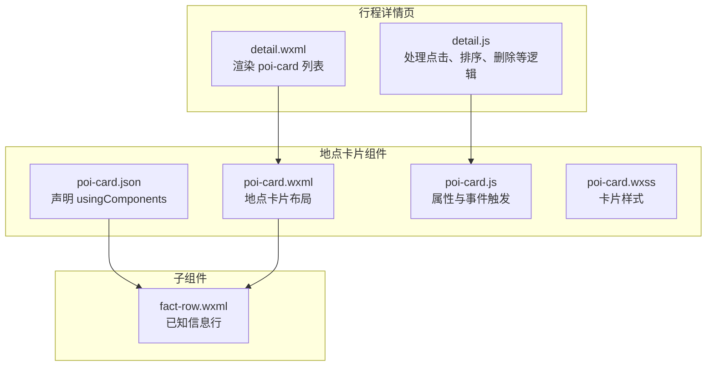
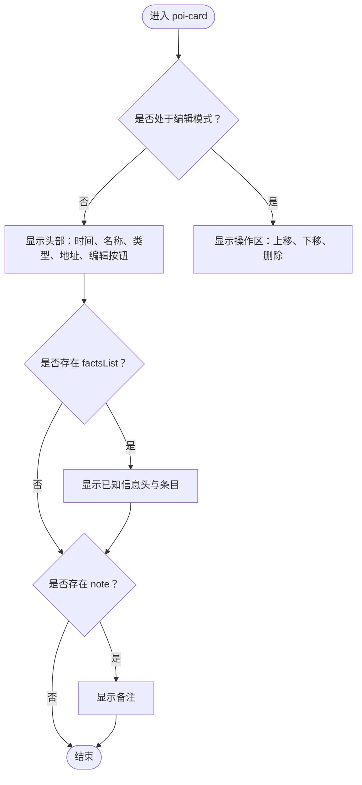
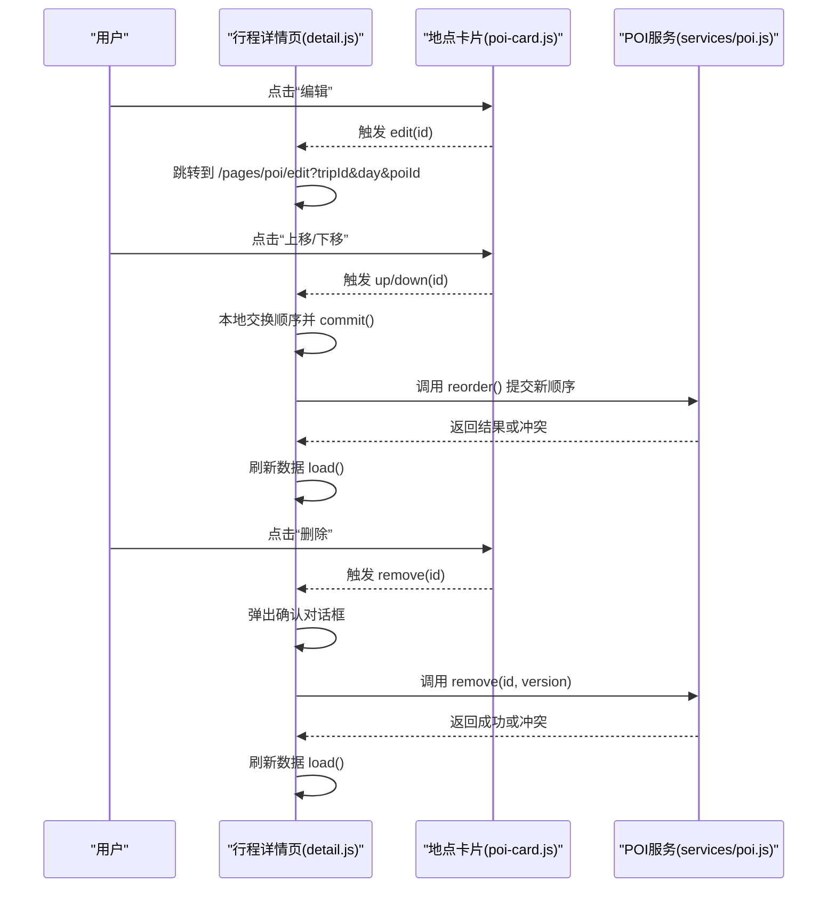
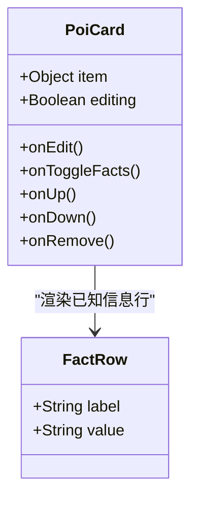
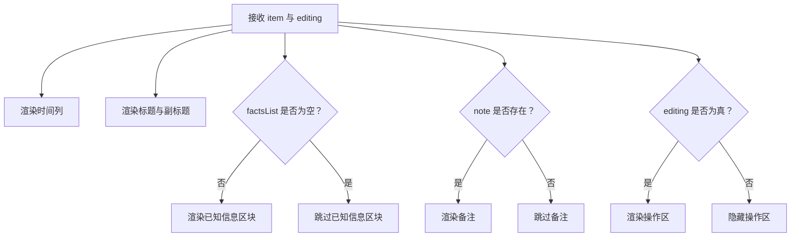
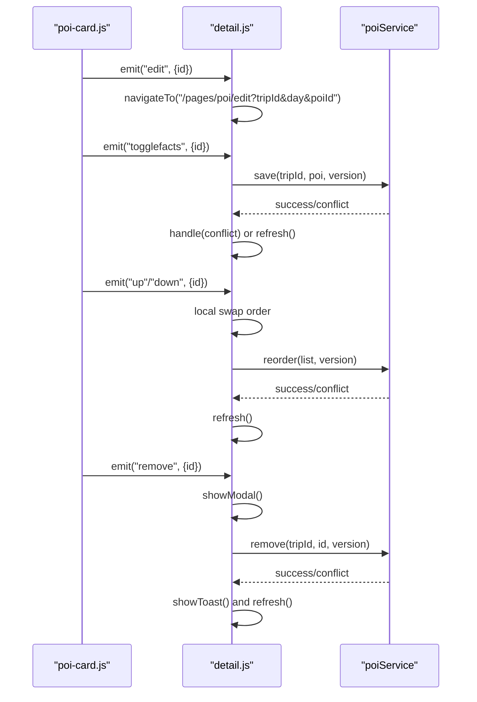
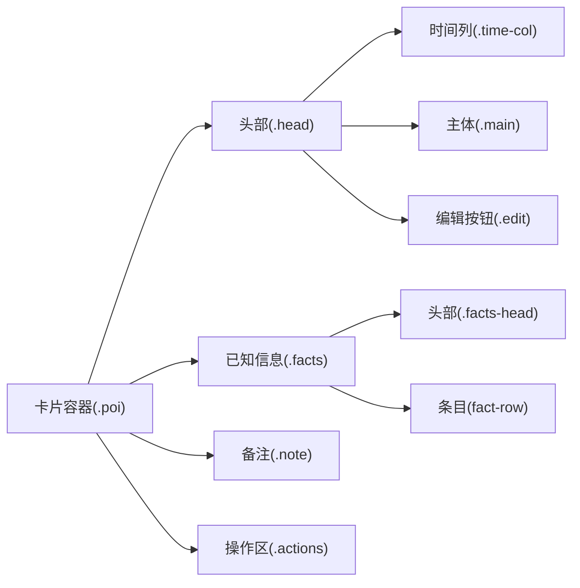
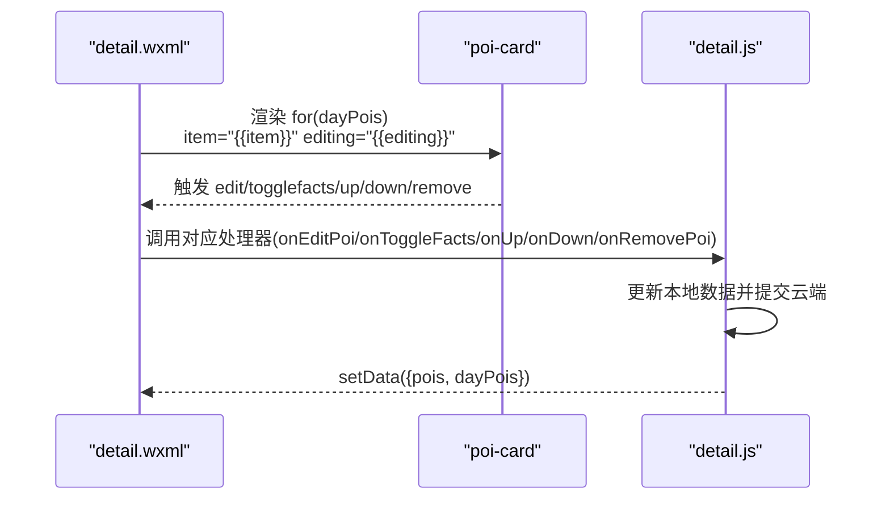
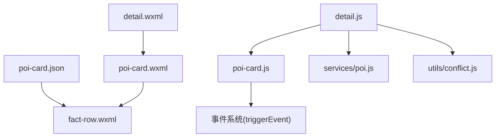

# 地点卡片组件 (poi-card)

<cite>
**本文引用的文件**   
- [poi-card.js](file://components/poi-card/poi-card.js)
- [poi-card.wxml](file://components/poi-card/poi-card.wxml)
- [poi-card.wxss](file://components/poi-card/poi-card.wxss)
- [poi-card.json](file://components/poi-card/poi-card.json)
- [fact-row.wxml](file://components/fact-row/fact-row.wxml)
- [detail.js](file://pages/trip/detail.js)
- [detail.wxml](file://pages/trip/detail.wxml)
</cite>

## 目录
1. [简介](#简介)
2. [项目结构中的位置](#项目结构中的位置)
3. [核心功能与数据模型](#核心功能与数据模型)
4. [架构总览](#架构总览)
5. [详细组件分析](#详细组件分析)
6. [依赖关系分析](#依赖关系分析)
7. [性能与渲染优化建议](#性能与渲染优化建议)
8. [可访问性与无障碍支持](#可访问性与无障碍支持)
9. [常见问题排查](#常见问题排查)
10. [结论](#结论)

## 简介
地点卡片组件用于在行程详情页中展示单个旅行地点的卡片式界面。它负责呈现地点名称、类型标签、地址、计划时间、停留时长、已知信息条目和备注，并提供编辑入口以及编辑模式下的上移、下移、删除等交互操作。该组件通过事件向父页面传递用户操作，由父页面完成数据更新与云端同步。

## 项目结构中的位置
- 组件位于 `components/poi-card`，包含逻辑、模板、样式和组件配置四个文件。
- 组件内部复用 `fact-row` 子组件来展示“已知信息”的键值对行。
- 组件被 `pages/trip/detail` 页面使用，用于渲染当前天的地点列表。

**图表来源**
- [detail.wxml:55-65](file://pages/trip/detail.wxml#L55-L65)
- [poi-card.json:1-7](file://components/poi-card/poi-card.json#L1-L7)
- [poi-card.wxml:1-41](file://components/poi-card/poi-card.wxml#L1-L41)
- [poi-card.js:1-33](file://components/poi-card/poi-card.js#L1-L33)
- [fact-row.wxml:1-5](file://components/fact-row/fact-row.wxml#L1-L5)

**章节来源**
- [poi-card.json:1-7](file://components/poi-card/poi-card.json#L1-L7)
- [poi-card.wxml:1-41](file://components/poi-card/poi-card.wxml#L1-L41)
- [poi-card.js:1-33](file://components/poi-card/poi-card.js#L1-L33)
- [detail.wxml:55-65](file://pages/trip/detail.wxml#L55-L65)

## 核心功能与数据模型
- 展示字段：
  - 计划时间与停留时长：来自 `item.plannedTime` 与 `item.durationText`。
  - 地点名称：`item.name`。
  - 类型标签：`item.category`。
  - 地址：`item.address`（可选）。
  - 已知信息：`item.factsList`，每项含 `label` 与 `value`。
  - 待核实状态：`item.factsPending`，控制徽章文案。
  - 备注：`item.note`（可选）。
- 交互能力：
  - 编辑：触发 `edit` 事件，携带地点 `_id`。
  - 切换已知信息状态：触发 `togglefacts` 事件。
  - 调整顺序：触发 `up`/`down` 事件。
  - 删除：触发 `remove` 事件。
- 编辑模式：
  - 当父页面传入 `editing=true` 时，显示上移、下移、删除操作区。

**图表来源**
- [poi-card.wxml:1-41](file://components/poi-card/poi-card.wxml#L1-L41)

**章节来源**
- [poi-card.wxml:1-41](file://components/poi-card/poi-card.wxml#L1-L41)
- [poi-card.js:6-30](file://components/poi-card/poi-card.js#L6-L30)

## 架构总览
地点卡片作为独立组件，仅负责 UI 展示与事件派发；所有业务逻辑（如跳转编辑页、重排顺序、删除确认）由父页面 `pages/trip/detail` 处理。这种职责分离使组件具备高复用性，同时便于统一处理冲突与网络错误。

**图表来源**
- [poi-card.js:11-30](file://components/poi-card/poi-card.js#L11-L30)
- [detail.js:167-171](file://pages/trip/detail.js#L167-L171)
- [detail.js:258-310](file://pages/trip/detail.js#L258-L310)
- [detail.js:324-347](file://pages/trip/detail.js#L324-L347)

## 详细组件分析

### 组件属性与事件契约
- 输入属性：
  - `item`：对象，承载地点数据。
  - `editing`：布尔值，控制是否显示编辑操作区。
- 输出事件：
  - `edit`：携带 `{ id }`，用于打开编辑页。
  - `togglefacts`：携带 `{ id }`，用于切换“待核实/已核实”。
  - `up`：携带 `{ id }`，用于将地点上移一位。
  - `down`：携带 `{ id }`，用于将地点下移一位。
  - `remove`：携带 `{ id }`，用于删除地点。

**图表来源**
- [poi-card.js:1-33](file://components/poi-card/poi-card.js#L1-L33)
- [fact-row.wxml:1-5](file://components/fact-row/fact-row.wxml#L1-L5)

**章节来源**
- [poi-card.js:1-33](file://components/poi-card/poi-card.js#L1-L33)
- [poi-card.wxml:1-41](file://components/poi-card/poi-card.wxml#L1-L41)

### 数据绑定与展示逻辑
- 时间列：
  - 主时间：`item.plannedTime`，若为空则显示占位文本。
  - 停留时长：`item.durationText`，存在时才显示。
- 主体区域：
  - 标题：`item.name`。
  - 副标题：类型标签 `item.category` 与地址 `item.address`（可选）。
- 已知信息区块：
  - 当 `item.factsList.length > 0` 时显示。
  - 头部包含“已知信息”标题与徽章，徽章文案根据 `item.factsPending` 切换。
  - 使用 `fact-row` 子组件循环渲染每条已知信息。
- 备注：
  - 当 `item.note` 存在时显示。
- 编辑操作区：
  - 当 `editing=true` 时显示“上移”“下移”“删除”三个按钮。

**图表来源**
- [poi-card.wxml:1-41](file://components/poi-card/poi-card.wxml#L1-L41)

**章节来源**
- [poi-card.wxml:1-41](file://components/poi-card/poi-card.wxml#L1-L41)

### 点击事件处理流程
- 编辑：
  - 组件触发 `edit` 事件，父页面监听后跳转到编辑页，并携带 `tripId`、`day`、`poiId`。
- 切换已知信息：
  - 组件触发 `togglefacts` 事件，父页面调用保存接口，并在冲突时使用冲突处理工具重试。
- 上移/下移：
  - 组件触发 `up`/`down` 事件，父页面在本地交换顺序后立即提交，弱网下先本地生效再同步。
- 删除：
  - 组件触发 `remove` 事件，父页面弹出确认框，确认后调用删除接口，成功后提示并刷新。

**图表来源**
- [poi-card.js:11-30](file://components/poi-card/poi-card.js#L11-L30)
- [detail.js:167-171](file://pages/trip/detail.js#L167-L171)
- [detail.js:232-256](file://pages/trip/detail.js#L232-L256)
- [detail.js:258-310](file://pages/trip/detail.js#L258-L310)
- [detail.js:324-347](file://pages/trip/detail.js#L324-L347)

**章节来源**
- [poi-card.js:11-30](file://components/poi-card/poi-card.js#L11-L30)
- [detail.js:167-171](file://pages/trip/detail.js#L167-L171)
- [detail.js:232-256](file://pages/trip/detail.js#L232-L256)
- [detail.js:258-310](file://pages/trip/detail.js#L258-L310)
- [detail.js:324-347](file://pages/trip/detail.js#L324-L347)

### 样式定制要点
- 卡片容器：
  - 背景白色、圆角、内边距与底部外边距，形成清晰的卡片视觉层次。
- 头部布局：
  - 左侧时间列固定宽度，右侧主体自适应，右侧保留“编辑”按钮。
- 标签与地址：
  - 标签采用浅灰背景与圆角，地址文字颜色较浅且允许换行。
- 已知信息区块：
  - 顶部边框分隔，标题与徽章水平排列，徽章根据状态切换样式类。
- 操作区：
  - 右对齐按钮组，危险操作（删除）使用红色背景与文字。

**图表来源**
- [poi-card.wxss:1-124](file://components/poi-card/poi-card.wxss#L1-L124)

**章节来源**
- [poi-card.wxss:1-124](file://components/poi-card/poi-card.wxss#L1-L124)

### 图标显示逻辑
- 组件未直接引入图标资源，而是通过文本与样式类表达状态与操作：
  - “待核实/已核实”徽章通过 `badge-pending` 与 `badge-done` 区分。
  - 删除按钮通过 `is-danger` 类强调危险操作。
- 如需扩展图标，可在 WXML 中引入图标组件或在 WXSS 中使用背景图，但需保持语义清晰与可访问性。

**章节来源**
- [poi-card.wxml:17-23](file://components/poi-card/poi-card.wxml#L17-L23)
- [poi-card.wxss:120-123](file://components/poi-card/poi-card.wxss#L120-L123)

### 使用示例：在行程列表中渲染多个地点卡片
- 在行程详情页中，使用 `wx:for` 遍历当前天的地点数组 `dayPois`，为每个地点渲染一个 `poi-card`。
- 绑定以下事件：
  - `bind:edit="onEditPoi"`
  - `bind:togglefacts="onToggleFacts"`
  - `bind:up="onUp"`
  - `bind:down="onDown"`
  - `bind:remove="onRemovePoi"`
- 同时传入 `item` 与 `editing` 属性，以控制展示与交互模式。

**图表来源**
- [detail.wxml:55-65](file://pages/trip/detail.wxml#L55-L65)
- [detail.js:167-171](file://pages/trip/detail.js#L167-L171)
- [detail.js:232-256](file://pages/trip/detail.js#L232-L256)
- [detail.js:258-310](file://pages/trip/detail.js#L258-L310)
- [detail.js:324-347](file://pages/trip/detail.js#L324-L347)

**章节来源**
- [detail.wxml:55-65](file://pages/trip/detail.wxml#L55-L65)
- [detail.js:167-171](file://pages/trip/detail.js#L167-L171)
- [detail.js:232-256](file://pages/trip/detail.js#L232-L256)
- [detail.js:258-310](file://pages/trip/detail.js#L258-L310)
- [detail.js:324-347](file://pages/trip/detail.js#L324-L347)

## 依赖关系分析
- 组件配置：
  - `poi-card.json` 声明组件并使用 `fact-row` 子组件。
- 组件内部依赖：
  - `poi-card.wxml` 依赖 `fact-row` 渲染已知信息行。
  - `poi-card.js` 通过 `triggerEvent` 向父页面派发事件。
- 父页面依赖：
  - `detail.js` 处理所有业务逻辑，包括跳转编辑页、切换已知信息状态、重排顺序、删除确认与云端同步。
- 外部服务：
  - `services/poi.js` 提供 POI 的增删改查与重排接口。
  - `utils/conflict.js` 处理并发冲突，提供重试机制。

**图表来源**
- [poi-card.json:1-7](file://components/poi-card/poi-card.json#L1-L7)
- [poi-card.wxml:1-41](file://components/poi-card/poi-card.wxml#L1-L41)
- [poi-card.js:1-33](file://components/poi-card/poi-card.js#L1-L33)
- [detail.wxml:55-65](file://pages/trip/detail.wxml#L55-L65)
- [detail.js:1-8](file://pages/trip/detail.js#L1-L8)

**章节来源**
- [poi-card.json:1-7](file://components/poi-card/poi-card.json#L1-L7)
- [poi-card.wxml:1-41](file://components/poi-card/poi-card.wxml#L1-L41)
- [poi-card.js:1-33](file://components/poi-card/poi-card.js#L1-L33)
- [detail.wxml:55-65](file://pages/trip/detail.wxml#L55-L65)
- [detail.js:1-8](file://pages/trip/detail.js#L1-L8)

## 性能与渲染优化建议
- 列表渲染：
  - 使用 `wx:key="_id"` 提升列表渲染性能，避免重复计算与不必要的重建。
- 条件渲染：
  - 合理使用 `wx:if` 控制已知信息与备注的显隐，减少无意义节点渲染。
- 样式隔离：
  - 组件启用 `styleIsolation: 'apply-shared'`，有利于共享样式但需注意命名冲突风险。
- 数据预处理：
  - 父页面在加载 POI 时对数据进行增强（如计算 `durationText`、构造 `factsList`），避免在 WXML 中进行复杂运算。
- 弱网体验：
  - 重排顺序采用“本地先生效，再提交云端”的策略，提升即时反馈。
- 事件委托与节流：
  - 对于频繁触发的交互（如快速点击上移/下移），建议在父页面做防抖或节流，防止重复提交。

**章节来源**
- [detail.wxml:55-65](file://pages/trip/detail.wxml#L55-L65)
- [poi-card.js:2-4](file://components/poi-card/poi-card.js#L2-L4)
- [detail.js:23-34](file://pages/trip/detail.js#L23-L34)
- [detail.js:281-310](file://pages/trip/detail.js#L281-L310)

## 可访问性与无障碍支持
- 语义化结构：
  - 使用 `view` 与 `text` 构建清晰的层级，便于屏幕阅读器解析。
- 状态可读性：
  - “待核实/已核实”徽章文案明确，有助于辅助技术理解状态变化。
- 操作可感知：
  - 编辑模式下的操作按钮具有明确的文案与视觉差异（如删除按钮的危险样式）。
- 改进建议：
  - 为关键交互元素添加 `aria-label` 或 `aria-describedby`，提升读屏体验。
  - 为动态变化的徽章增加 `role="status"` 或 `aria-live`，确保状态变更被及时播报。
  - 为长地址文本提供折叠或展开选项，降低阅读负担。

**章节来源**
- [poi-card.wxml:17-23](file://components/poi-card/poi-card.wxml#L17-L23)
- [poi-card.wxss:120-123](file://components/poi-card/poi-card.wxss#L120-L123)

## 常见问题排查
- 地点不显示：
  - 检查 `item.name` 与 `item.plannedTime` 是否正确传入。
  - 确认父页面 `dayPois` 过滤逻辑是否匹配当前天。
- 已知信息不显示：
  - 检查 `item.factsList` 是否为空数组。
  - 确认 `fact-row` 子组件的 `label` 与 `value` 是否正确绑定。
- 编辑按钮无效：
  - 确认父页面是否监听 `edit` 事件并正确跳转编辑页。
- 上移/下移无效：
  - 检查父页面 `onUp`/`onDown` 是否找到目标索引并执行交换。
  - 确认 `commit()` 是否正确合并并排序 `pois`。
- 删除失败：
  - 检查父页面是否弹出确认框并调用删除接口。
  - 关注冲突处理逻辑，必要时刷新数据后重试。

**章节来源**
- [detail.wxml:55-65](file://pages/trip/detail.wxml#L55-L65)
- [detail.js:167-171](file://pages/trip/detail.js#L167-L171)
- [detail.js:258-310](file://pages/trip/detail.js#L258-L310)
- [detail.js:324-347](file://pages/trip/detail.js#L324-L347)

## 结论
地点卡片组件以简洁的数据绑定与清晰的事件契约，实现了旅行地点信息的卡片式展示与基础交互。其设计将展示与业务逻辑解耦，便于在行程详情页中高效复用。通过合理的样式组织、条件渲染与弱网优化，组件具备良好的可用性与可扩展性。未来可在可访问性与图标体系方面进一步增强，以提升整体用户体验。