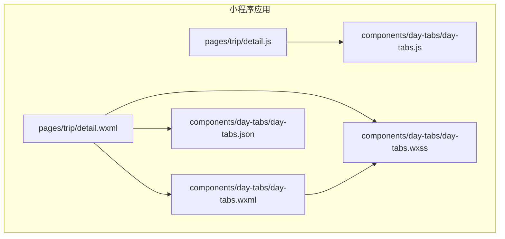
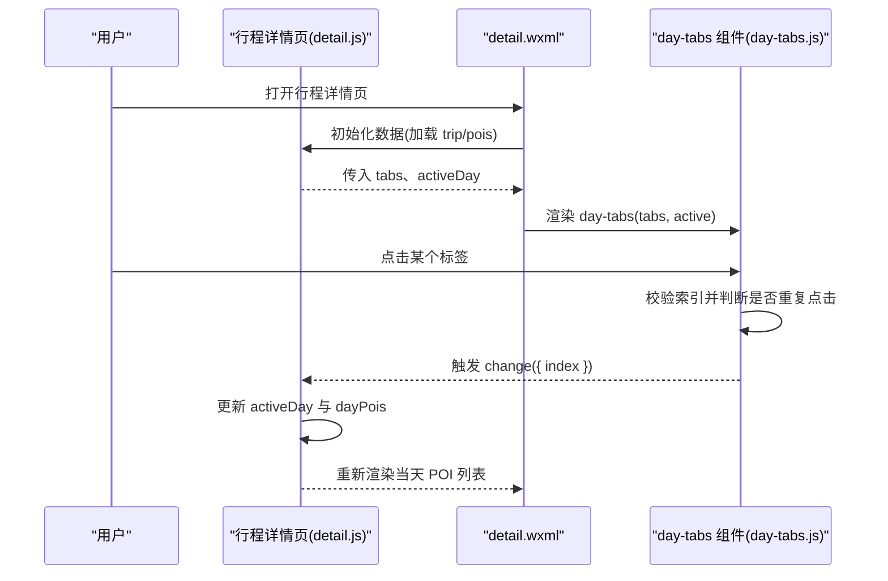
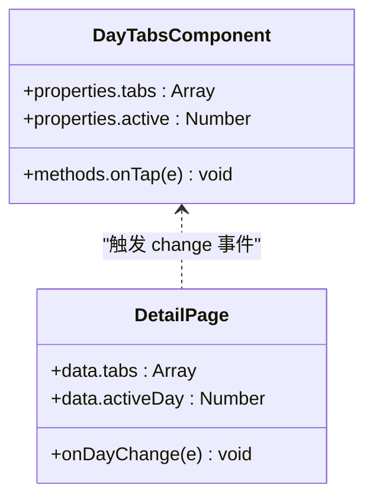
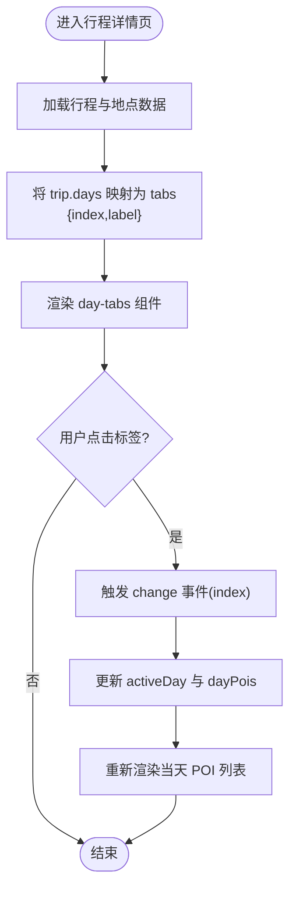
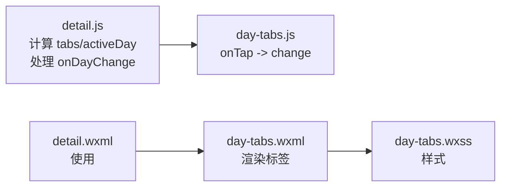

# 日期标签组件 (day-tabs)

<cite>
**本文引用的文件**   
- [components/day-tabs/day-tabs.js](file://components/day-tabs/day-tabs.js)
- [components/day-tabs/day-tabs.wxml](file://components/day-tabs/day-tabs.wxml)
- [components/day-tabs/day-tabs.wxss](file://components/day-tabs/day-tabs.wxss)
- [components/day-tabs/day-tabs.json](file://components/day-tabs/day-tabs.json)
- [pages/trip/detail.wxml](file://pages/trip/detail.wxml)
- [pages/trip/detail.js](file://pages/trip/detail.js)
</cite>

## 目录
1. [简介](#简介)
2. [项目结构](#项目结构)
3. [核心组件](#核心组件)
4. [架构总览](#架构总览)
5. [详细组件分析](#详细组件分析)
6. [依赖关系分析](#依赖关系分析)
7. [性能与体验](#性能与体验)
8. [故障排查](#故障排查)
9. [结论](#结论)
10. [附录：使用示例与最佳实践](#附录使用示例与最佳实践)

## 简介
日期标签组件 day-tabs 是一个用于按天切换显示旅行计划中“当天地点列表”的小程序自定义组件。它提供横向可滚动的标签栏，支持高亮当前选中日，并在用户点击时向父页面触发 change 事件，由父页面更新 activeDay 并过滤出对应天的 POI 列表进行渲染。该组件在行程详情页中被集成，作为“按天浏览”的入口控件。

## 项目结构
day-tabs 组件位于 components/day-tabs 目录下，包含组件脚本、模板、样式和配置文件；其使用方为 pages/trip/detail 页面。

图表来源
- [pages/trip/detail.wxml:48-48](file://pages/trip/detail.wxml#L48-L48)
- [components/day-tabs/day-tabs.wxml:1-10](file://components/day-tabs/day-tabs.wxml#L1-L10)
- [components/day-tabs/day-tabs.js:1-14](file://components/day-tabs/day-tabs.js#L1-L14)
- [components/day-tabs/day-tabs.wxss:1-31](file://components/day-tabs/day-tabs.wxss#L1-L31)
- [components/day-tabs/day-tabs.json:1-4](file://components/day-tabs/day-tabs.json#L1-L4)

章节来源
- [components/day-tabs/day-tabs.js:1-14](file://components/day-tabs/day-tabs.js#L1-L14)
- [components/day-tabs/day-tabs.wxml:1-10](file://components/day-tabs/day-tabs.wxml#L1-L10)
- [components/day-tabs/day-tabs.wxss:1-31](file://components/day-tabs/day-tabs.wxss#L1-L31)
- [components/day-tabs/day-tabs.json:1-4](file://components/day-tabs/day-tabs.json#L1-L4)
- [pages/trip/detail.wxml:48-48](file://pages/trip/detail.wxml#L48-L48)
- [pages/trip/detail.js:92-136](file://pages/trip/detail.js#L92-L136)

## 核心组件
- 视觉外观
  - 横向滚动标签栏，每个标签为圆角胶囊形状，默认浅色背景与深色文字。
  - 激活态标签使用强调色背景与白色文字，并加粗字体以突出当前选中日。
  - 标签最小宽度固定，保证短文本也能有足够点击区域；标签之间有一定间距。
- 交互行为
  - 点击任意标签触发 onTap，内部校验索引有效性且避免重复点击同一标签。
  - 通过 triggerEvent('change', { index }) 将选中索引上报给父页面。
- 数据属性
  - tabs：数组，元素需包含 index 与 label，分别表示天的序号与展示文案。
  - active：数字，表示当前激活标签的索引。
- 事件
  - change：当用户点击非当前标签时触发，携带 detail.index。

章节来源
- [components/day-tabs/day-tabs.js:2-12](file://components/day-tabs/day-tabs.js#L2-L12)
- [components/day-tabs/day-tabs.wxml:1-10](file://components/day-tabs/day-tabs.wxml#L1-L10)
- [components/day-tabs/day-tabs.wxss:1-31](file://components/day-tabs/day-tabs.wxss#L1-L31)

## 架构总览
day-tabs 组件与行程详情页之间的协作流程如下：

图表来源
- [pages/trip/detail.wxml:48-48](file://pages/trip/detail.wxml#L48-L48)
- [pages/trip/detail.js:127-136](file://pages/trip/detail.js#L127-L136)
- [components/day-tabs/day-tabs.js:8-12](file://components/day-tabs/day-tabs.js#L8-L12)

## 详细组件分析

### 组件结构与职责
- day-tabs.js
  - 定义 properties：tabs（Array）、active（Number）。
  - 实现 onTap：从 data-index 读取目标索引，校验有效性后触发 change 事件。
- day-tabs.wxml
  - 使用 scroll-view 实现横向滚动，禁用滚动条。
  - 遍历 tabs 渲染多个 view 标签，根据 item.index === active 动态添加 is-active 类名。
- day-tabs.wxss
  - 设置容器高度、内边距与不换行布局。
  - 标签胶囊样式、激活态样式（强调色背景、白色文字、加粗）。
- day-tabs.json
  - 声明组件类型，无额外 usingComponents。

图表来源
- [components/day-tabs/day-tabs.js:1-14](file://components/day-tabs/day-tabs.js#L1-L14)
- [pages/trip/detail.js:36-50](file://pages/trip/detail.js#L36-L50)
- [pages/trip/detail.js:127-136](file://pages/trip/detail.js#L127-L136)

章节来源
- [components/day-tabs/day-tabs.js:1-14](file://components/day-tabs/day-tabs.js#L1-L14)
- [components/day-tabs/day-tabs.wxml:1-10](file://components/day-tabs/day-tabs.wxml#L1-L10)
- [components/day-tabs/day-tabs.wxss:1-31](file://components/day-tabs/day-tabs.wxss#L1-L31)
- [components/day-tabs/day-tabs.json:1-4](file://components/day-tabs/day-tabs.json#L1-L4)

### 状态管理
- 组件自身不维护业务状态，仅接收 tabs 与 active 两个属性，并通过事件向上汇报变更。
- 父页面 detail.js 负责：
  - 将 trip.days 映射为 tabs（每项含 index 与 label）。
  - 根据 activeDay 过滤 pois 得到 dayPois 并渲染到页面。
  - 监听 day-tabs 的 change 事件，更新 activeDay 与 dayPois。

图表来源
- [pages/trip/detail.js:92-124](file://pages/trip/detail.js#L92-L124)
- [pages/trip/detail.js:127-136](file://pages/trip/detail.js#L127-L136)
- [components/day-tabs/day-tabs.js:8-12](file://components/day-tabs/day-tabs.js#L8-L12)

章节来源
- [pages/trip/detail.js:92-136](file://pages/trip/detail.js#L92-L136)

### 样式与主题定制
- 可通过覆盖 day-tabs.wxss 中的 .tabs、.tab、.tab.is-active 等选择器调整：
  - 容器高度、内边距、标签最小宽度、圆角、颜色、字号、字重等。
- 建议保持标签最小宽度与点击区域一致，确保触摸友好。
- 激活态建议使用品牌强调色，保证对比度与可读性。

章节来源
- [components/day-tabs/day-tabs.wxss:1-31](file://components/day-tabs/day-tabs.wxss#L1-L31)

### 响应式与可用性
- 横向滚动：scroll-view 启用横向滚动，隐藏滚动条，适配不同屏幕宽度。
- 标签尺寸：固定最小宽度与高度，保证在小屏设备上仍可点击。
- 无障碍：标签文本清晰，激活态有明显视觉差异。

章节来源
- [components/day-tabs/day-tabs.wxml:1-10](file://components/day-tabs/day-tabs.wxml#L1-L10)
- [components/day-tabs/day-tabs.wxss:1-31](file://components/day-tabs/day-tabs.wxss#L1-L31)

## 依赖关系分析
- 组件对外暴露
  - 属性：tabs(Array)、active(Number)
  - 事件：change({ index })
- 父页面依赖
  - detail.wxml 引入 day-tabs 组件并绑定 change 事件。
  - detail.js 计算 tabs 与 activeDay，并在 onDayChange 中更新 dayPois。

图表来源
- [pages/trip/detail.js:92-136](file://pages/trip/detail.js#L92-L136)
- [pages/trip/detail.wxml:48-48](file://pages/trip/detail.wxml#L48-L48)
- [components/day-tabs/day-tabs.js:8-12](file://components/day-tabs/day-tabs.js#L8-L12)
- [components/day-tabs/day-tabs.wxml:1-10](file://components/day-tabs/day-tabs.wxml#L1-L10)
- [components/day-tabs/day-tabs.wxss:1-31](file://components/day-tabs/day-tabs.wxss#L1-L31)

章节来源
- [pages/trip/detail.js:92-136](file://pages/trip/detail.js#L92-L136)
- [pages/trip/detail.wxml:48-48](file://pages/trip/detail.wxml#L48-L48)
- [components/day-tabs/day-tabs.js:1-14](file://components/day-tabs/day-tabs.js#L1-L14)
- [components/day-tabs/day-tabs.wxml:1-10](file://components/day-tabs/day-tabs.wxml#L1-L10)
- [components/day-tabs/day-tabs.wxss:1-31](file://components/day-tabs/day-tabs.wxss#L1-L31)

## 性能与体验
- 渲染优化
  - tabs 仅在数据加载或行程天数变化时重建，避免频繁重排。
  - dayPois 基于 activeDay 过滤，减少无关节点渲染。
- 交互优化
  - 组件内部对重复点击与非法索引进行保护，降低无效事件开销。
- 滚动体验
  - 横向滚动隐藏滚动条，界面更简洁；标签固定最小宽度，避免拥挤。

[本节为通用指导，无需具体文件引用]

## 故障排查
- 问题：点击标签无反应
  - 检查 tabs 是否为空或元素缺少 index/label。
  - 确认 active 与 tabs[index] 匹配，避免索引越界。
- 问题：切换天后 POI 列表未更新
  - 检查父页面是否监听 change 事件并更新 activeDay 与 dayPois。
  - 确认 poi.dayIndex 与 activeDay 一致。
- 问题：样式异常
  - 检查是否覆盖了 .tabs/.tab/.tab.is-active 导致布局错乱。
  - 注意容器高度与内容溢出关系，必要时调整 padding 与 height。

章节来源
- [components/day-tabs/day-tabs.js:8-12](file://components/day-tabs/day-tabs.js#L8-L12)
- [pages/trip/detail.js:127-136](file://pages/trip/detail.js#L127-L136)
- [components/day-tabs/day-tabs.wxss:1-31](file://components/day-tabs/day-tabs.wxss#L1-L31)

## 结论
day-tabs 组件以极简的数据契约（tabs、active）与单一事件（change）完成“按天切换”的核心能力，配合行程详情页的状态管理与 POI 过滤逻辑，形成清晰的父子协作模式。其样式与交互设计兼顾了移动端触控体验与视觉一致性，适合在旅行计划类应用中复用。

[本节为总结性内容，无需具体文件引用]

## 附录：使用示例与最佳实践

### 在行程详情页集成 day-tabs
- 在 WXML 中引入并使用组件，传入 tabs 与 activeDay，并绑定 change 事件处理器。
- 在 JS 中：
  - 将 trip.days 映射为 tabs，每项包含 index 与 label。
  - 维护 activeDay，并在 onDayChange 中更新 activeDay 与 dayPois。

章节来源
- [pages/trip/detail.wxml:48-48](file://pages/trip/detail.wxml#L48-L48)
- [pages/trip/detail.js:92-124](file://pages/trip/detail.js#L92-L124)
- [pages/trip/detail.js:127-136](file://pages/trip/detail.js#L127-L136)

### 组件组合模式
- day-tabs 通常与 POI 卡片列表组合使用：
  - day-tabs 控制 activeDay。
  - 列表根据 dayPois 渲染当天地点。
- 可在其他需要“按天切换”的场景复用 day-tabs，例如手帐、日程视图等。

章节来源
- [pages/trip/detail.wxml:48-73](file://pages/trip/detail.wxml#L48-L73)

### 最佳实践
- 数据准备
  - 确保 tabs 中每个元素都有唯一且有效的 index，以及可读的 label。
  - 若 days 为空，应提供空状态提示或引导用户添加第一天。
- 事件处理
  - 在父页面统一处理 change 事件，避免在子组件中直接操作业务数据。
- 样式定制
  - 通过覆盖组件样式实现主题化，但保持激活态的高对比度与可识别性。
- 可访问性
  - 为标签提供清晰的语义与足够的点击区域，便于触摸操作。

[本节为通用指导，无需具体文件引用]