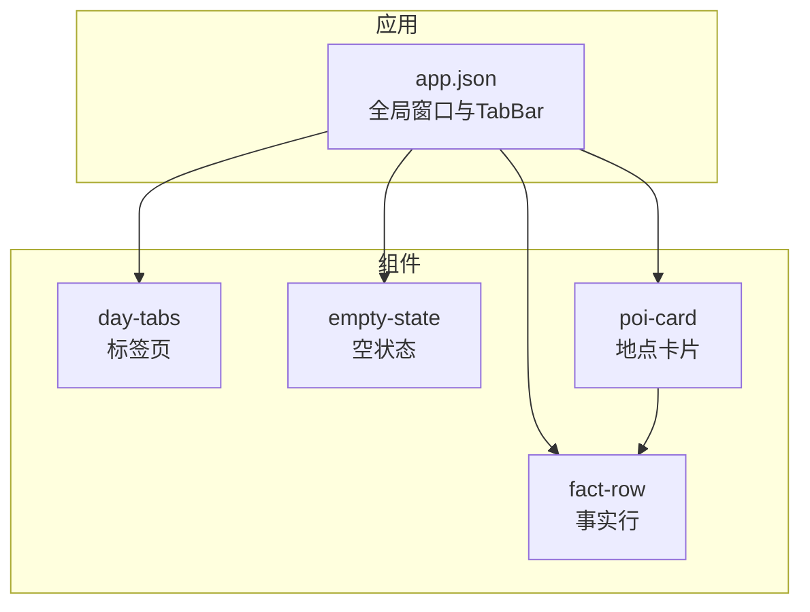
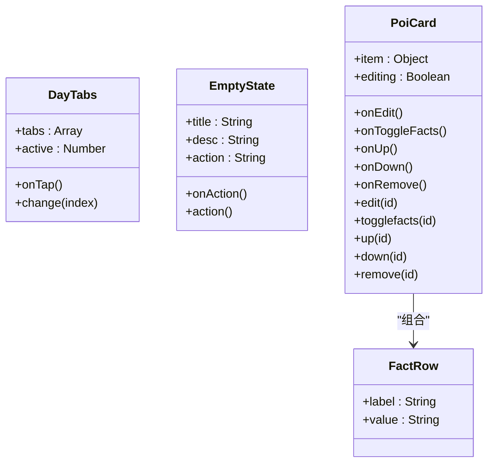
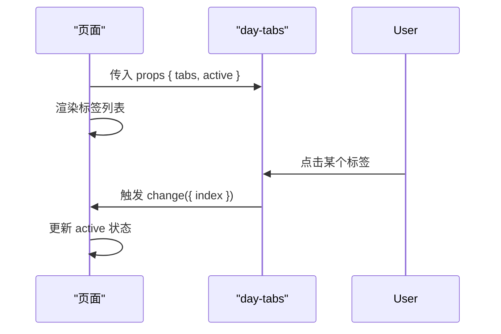
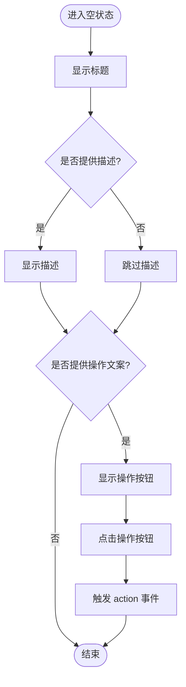
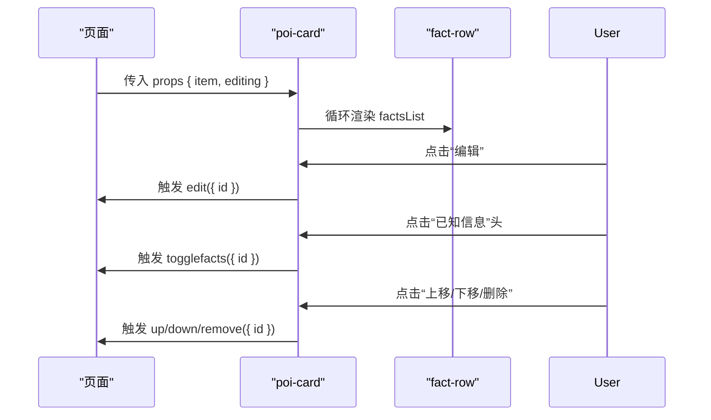
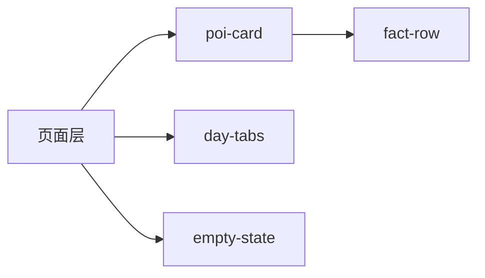

# 用户界面组件

<cite>
**本文引用的文件**   
- [app.json](file://app.json)
- [components/day-tabs/day-tabs.js](file://components/day-tabs/day-tabs.js)
- [components/day-tabs/day-tabs.wxml](file://components/day-tabs/day-tabs.wxml)
- [components/day-tabs/day-tabs.wxss](file://components/day-tabs/day-tabs.wxss)
- [components/empty-state/empty-state.js](file://components/empty-state/empty-state.js)
- [components/empty-state/empty-state.wxml](file://components/empty-state/empty-state.wxml)
- [components/empty-state/empty-state.wxss](file://components/empty-state/empty-state.wxss)
- [components/fact-row/fact-row.js](file://components/fact-row/fact-row.js)
- [components/fact-row/fact-row.wxml](file://components/fact-row/fact-row.wxml)
- [components/fact-row/fact-row.wxss](file://components/fact-row/fact-row.wxss)
- [components/poi-card/poi-card.js](file://components/poi-card/poi-card.js)
- [components/poi-card/poi-card.wxml](file://components/poi-card/poi-card.wxml)
- [components/poi-card/poi-card.wxss](file://components/poi-card/poi-card.wxss)
</cite>

## 目录
1. [简介](#简介)
2. [项目结构](#项目结构)
3. [核心组件](#核心组件)
4. [架构总览](#架构总览)
5. [组件详细分析](#组件详细分析)
6. [依赖关系分析](#依赖关系分析)
7. [性能与可访问性](#性能与可访问性)
8. [样式与主题定制](#样式与主题定制)
9. [故障排查指南](#故障排查指南)
10. [结论](#结论)

## 简介
本文件为小程序项目的用户界面组件文档，覆盖以下组件：
- 日期标签页（day-tabs）
- 空状态占位（empty-state）
- 事实行（fact-row）
- 地点卡片（poi-card）

文档从视觉外观、交互行为、属性/事件/插槽、响应式与可访问性、动画与过渡、样式与主题、跨浏览器兼容性与性能优化等维度进行系统化说明，并提供使用示例路径与最佳实践。

## 项目结构
本项目采用小程序标准结构，UI 组件集中在 components 目录下，页面在 pages 下，全局配置在 app.json。

图表来源
- [app.json:17-42](file://app.json#L17-L42)
- [components/poi-card/poi-card.wxml:24-30](file://components/poi-card/poi-card.wxml#L24-L30)

章节来源
- [app.json:1-56](file://app.json#L1-L56)

## 核心组件
本节概述各组件的职责、对外接口与典型用法。

- day-tabs：横向滚动标签栏，支持选中态切换并向上层触发 change 事件。
- empty-state：展示无数据时的标题、描述与操作按钮，点击触发 action 事件。
- fact-row：键值对展示行，用于呈现“已知信息”等结构化文本。
- poi-card：行程地点卡片，包含时间、名称、分类、地址、备注、已知信息与编辑操作区，向父级暴露 edit/togglefacts/up/down/remove 等事件。

章节来源
- [components/day-tabs/day-tabs.js:1-15](file://components/day-tabs/day-tabs.js#L1-L15)
- [components/empty-state/empty-state.js:1-14](file://components/empty-state/empty-state.js#L1-L14)
- [components/fact-row/fact-row.js:1-11](file://components/fact-row/fact-row.js#L1-L11)
- [components/poi-card/poi-card.js:1-33](file://components/poi-card/poi-card.js#L1-L33)

## 架构总览
下图展示组件间的组合关系与数据流向：poi-card 组合 fact-row 以渲染“已知信息”，day-tabs 提供顶部导航，empty-state 作为通用空态占位。

图表来源
- [components/day-tabs/day-tabs.js:1-15](file://components/day-tabs/day-tabs.js#L1-L15)
- [components/empty-state/empty-state.js:1-14](file://components/empty-state/empty-state.js#L1-L14)
- [components/fact-row/fact-row.js:1-11](file://components/fact-row/fact-row.js#L1-L11)
- [components/poi-card/poi-card.js:1-33](file://components/poi-card/poi-card.js#L1-L33)

## 组件详细分析

### 日期标签页（day-tabs）
- 视觉外观
  - 横向滚动容器，内部为圆角胶囊型标签项；选中态背景色加深、文字加粗。
- 行为与交互
  - 点击标签触发 change 事件，携带 index 参数；重复点击或非法索引会被忽略。
- 属性
  - tabs：Array，标签列表，每项含 index 与 label。
  - active：Number，当前选中索引，默认 0。
- 事件
  - change：当选中项变化时触发，payload 为 { index }。
- 插槽
  - 无。
- 自定义选项
  - 通过 CSS 类 .tab 与 .is-active 调整尺寸、颜色与字体。
- 响应式与可访问性
  - 使用 scroll-view 实现横向滚动；建议为标签添加 aria-label 以提升读屏体验（由宿主页面补充）。
- 动画与过渡
  - 未定义显式动画；可通过 CSS transition 平滑切换选中态。
- 使用示例
  - 在页面中引入组件，传入 tabs 数组与 active 索引，监听 change 事件更新父级状态。
  - 参考路径：[components/day-tabs/day-tabs.wxml:1-11](file://components/day-tabs/day-tabs.wxml#L1-L11)、[components/day-tabs/day-tabs.js:1-15](file://components/day-tabs/day-tabs.js#L1-L15)

图表来源
- [components/day-tabs/day-tabs.wxml:1-11](file://components/day-tabs/day-tabs.wxml#L1-L11)
- [components/day-tabs/day-tabs.js:7-13](file://components/day-tabs/day-tabs.js#L7-L13)

章节来源
- [components/day-tabs/day-tabs.js:1-15](file://components/day-tabs/day-tabs.js#L1-L15)
- [components/day-tabs/day-tabs.wxml:1-11](file://components/day-tabs/day-tabs.wxml#L1-L11)
- [components/day-tabs/day-tabs.wxss:1-31](file://components/day-tabs/day-tabs.wxss#L1-L31)

### 空状态（empty-state）
- 视觉外观
  - 块级容器，显示标题、可选描述与可选操作按钮。
- 行为与交互
  - 点击操作区域触发 action 事件。
- 属性
  - title：String，默认“还没有内容”。
  - desc：String，可选描述文案。
  - action：String，可选按钮文案。
- 事件
  - action：点击操作区时触发。
- 插槽
  - 无。
- 自定义选项
  - 通过宿主页面的样式覆盖 .empty、.empty-title、.empty-desc、.empty-action 等类名。
- 响应式与可访问性
  - 组件根节点为 block 布局；建议在宿主页面为按钮元素添加 aria-label。
- 动画与过渡
  - 未定义显式动画。
- 使用示例
  - 根据业务数据为空时渲染该组件，并绑定 action 处理新增等操作。
  - 参考路径：[components/empty-state/empty-state.wxml:1-6](file://components/empty-state/empty-state.wxml#L1-L6)、[components/empty-state/empty-state.js:1-14](file://components/empty-state/empty-state.js#L1-L14)

图表来源
- [components/empty-state/empty-state.wxml:1-6](file://components/empty-state/empty-state.wxml#L1-L6)
- [components/empty-state/empty-state.js:8-12](file://components/empty-state/empty-state.js#L8-L12)

章节来源
- [components/empty-state/empty-state.js:1-14](file://components/empty-state/empty-state.js#L1-L14)
- [components/empty-state/empty-state.wxml:1-6](file://components/empty-state/empty-state.wxml#L1-L6)
- [components/empty-state/empty-state.wxss:1-4](file://components/empty-state/empty-state.wxss#L1-L4)

### 事实行（fact-row）
- 视觉外观
  - 左右两列的键值行，左侧固定宽度标签，右侧自适应值。
- 行为与交互
  - 纯展示，无交互。
- 属性
  - label：String，标签文案。
  - value：String，值文案。
- 事件
  - 无。
- 插槽
  - 无。
- 自定义选项
  - 通过 .fact、.fact-label、.fact-value 类名调整布局与颜色。
- 响应式与可访问性
  - 使用 flex 布局；建议在宿主页面为语义化文本添加 aria-label（如需）。
- 动画与过渡
  - 未定义显式动画。
- 使用示例
  - 在 poi-card 的“已知信息”区块中循环渲染多条事实行。
  - 参考路径：[components/fact-row/fact-row.wxml:1-5](file://components/fact-row/fact-row.wxml#L1-L5)、[components/fact-row/fact-row.js:1-11](file://components/fact-row/fact-row.js#L1-L11)

章节来源
- [components/fact-row/fact-row.js:1-11](file://components/fact-row/fact-row.js#L1-L11)
- [components/fact-row/fact-row.wxml:1-5](file://components/fact-row/fact-row.wxml#L1-L5)
- [components/fact-row/fact-row.wxss:1-18](file://components/fact-row/fact-row.wxss#L1-L18)

### 地点卡片（poi-card）
- 视觉外观
  - 卡片包含头部（时间、时长、名称、分类、地址）、“已知信息”折叠区、备注与编辑操作区（上移、下移、删除）。
- 行为与交互
  - 点击“编辑”触发 edit 事件；点击“已知信息”头触发 togglefacts；编辑模式下显示上移/下移/删除操作，分别触发 up/down/remove。
- 属性
  - item：Object，包含 name、category、address、plannedTime、durationText、note、factsList 等字段。
  - editing：Boolean，是否处于编辑模式。
- 事件
  - edit：{ id }
  - togglefacts：{ id }
  - up：{ id }
  - down：{ id }
  - remove：{ id }
- 插槽
  - 无。
- 自定义选项
  - 通过 .poi、.head、.time-col、.main、.tag、.sub-text、.edit、.facts、.actions、.act、.is-danger 等类名进行样式定制。
- 响应式与可访问性
  - 使用 flex 布局与换行；长地址自动换行；建议在宿主页面为可点击元素添加 aria-label。
- 动画与过渡
  - 未定义显式动画；可通过 CSS transition 增强交互反馈。
- 使用示例
  - 在行程列表中渲染 poi-card，根据 editing 控制编辑操作区的显示，并处理各事件以更新数据源。
  - 参考路径：[components/poi-card/poi-card.wxml:1-41](file://components/poi-card/poi-card.wxml#L1-L41)、[components/poi-card/poi-card.js:1-33](file://components/poi-card/poi-card.js#L1-L33)

图表来源
- [components/poi-card/poi-card.wxml:1-41](file://components/poi-card/poi-card.wxml#L1-L41)
- [components/poi-card/poi-card.js:11-30](file://components/poi-card/poi-card.js#L11-L30)

章节来源
- [components/poi-card/poi-card.js:1-33](file://components/poi-card/poi-card.js#L1-L33)
- [components/poi-card/poi-card.wxml:1-41](file://components/poi-card/poi-card.wxml#L1-L41)
- [components/poi-card/poi-card.wxss:1-124](file://components/poi-card/poi-card.wxss#L1-L124)

## 依赖关系分析
- 组件内聚与耦合
  - poi-card 组合 fact-row，形成“卡片-行”的组合模式，职责清晰、耦合度低。
  - day-tabs 与 empty-state 为独立展示型组件，几乎无外部依赖。
- 直接依赖
  - poi-card -> fact-row（模板引用）。
- 间接依赖
  - 页面层通过事件回调维护数据源，组件本身不持有业务状态。
- 外部依赖
  - 全局 TabBar 与窗口样式由 app.json 管理，影响整体视觉基调。

图表来源
- [components/poi-card/poi-card.wxml:24-30](file://components/poi-card/poi-card.wxml#L24-L30)
- [app.json:24-42](file://app.json#L24-L42)

章节来源
- [components/poi-card/poi-card.wxml:24-30](file://components/poi-card/poi-card.wxml#L24-L30)
- [app.json:24-42](file://app.json#L24-L42)

## 性能与可访问性
- 性能
  - 列表渲染：在 poi-card 中循环 factsList 时，确保 wx:key 稳定且唯一，避免重排。
  - 滚动优化：day-tabs 使用 scroll-view 横向滚动，避免频繁重绘；必要时可开启 will-change 提升滚动流畅度（由宿主页面按需添加）。
  - 样式隔离：fact-row 与 poi-card 启用 styleIsolation: 'apply-shared'，减少样式冲突的同时降低渲染开销。
- 可访问性
  - 为可点击元素（如编辑、操作按钮）提供 aria-label 或 role="button"，便于读屏器识别。
  - 对比度：组件默认配色满足基本可读性，主题替换时需保证文本与背景对比度符合 WCAG 2.1 AA。
  - 键盘导航：在宿主页面为交互元素提供 tabindex 与键盘事件支持（如 Enter/Space 触发点击）。

章节来源
- [components/fact-row/fact-row.js:1-11](file://components/fact-row/fact-row.js#L1-L11)
- [components/poi-card/poi-card.js:1-9](file://components/poi-card/poi-card.js#L1-L9)

## 样式与主题定制
- 全局主题
  - app.json 中 window 与 tabBar 定义了主色调与背景色，可作为主题基线。
- 组件级样式
  - day-tabs：通过 .tab 与 .is-active 调整选中态颜色与字号。
  - poi-card：通过 .tag、.act.is-danger 等类名调整标签与危险操作的颜色。
  - fact-row：通过 .fact-label/.fact-value 调整标签与值的颜色与宽度。
- 主题扩展建议
  - 将品牌色抽离为 CSS 变量（宿主页面），在组件样式中引用，便于一键换肤。
  - 保持深色模式下的可读性，注意阴影与边框在暗色背景下的可见性。

章节来源
- [app.json:17-42](file://app.json#L17-L42)
- [components/day-tabs/day-tabs.wxss:10-30](file://components/day-tabs/day-tabs.wxss#L10-L30)
- [components/poi-card/poi-card.wxss:50-58](file://components/poi-card/poi-card.wxss#L50-L58)
- [components/poi-card/poi-card.wxss:120-123](file://components/poi-card/poi-card.wxss#L120-L123)
- [components/fact-row/fact-row.wxss:9-17](file://components/fact-row/fact-row.wxss#L9-L17)

## 故障排查指南
- day-tabs 点击无效
  - 检查传入的 tabs 每项是否包含 index 与 label；确认 active 为有效数字。
  - 参考：[components/day-tabs/day-tabs.js:7-13](file://components/day-tabs/day-tabs.js#L7-L13)
- empty-state 按钮不触发
  - 确认 action 属性已设置，并在宿主页面绑定对应事件处理器。
  - 参考：[components/empty-state/empty-state.js:8-12](file://components/empty-state/empty-state.js#L8-L12)
- poi-card 操作无响应
  - 检查 editing 是否为 true；确认宿主页面对 edit/togglefacts/up/down/remove 事件有处理逻辑。
  - 参考：[components/poi-card/poi-card.js:11-30](file://components/poi-card/poi-card.js#L11-L30)
- 样式异常或冲突
  - 检查是否误覆盖了组件关键类名；必要时使用更具体的选择器或在宿主页面增加作用域前缀。
  - 参考：[components/poi-card/poi-card.wxss:1-124](file://components/poi-card/poi-card.wxss#L1-L124)

章节来源
- [components/day-tabs/day-tabs.js:7-13](file://components/day-tabs/day-tabs.js#L7-L13)
- [components/empty-state/empty-state.js:8-12](file://components/empty-state/empty-state.js#L8-L12)
- [components/poi-card/poi-card.js:11-30](file://components/poi-card/poi-card.js#L11-L30)
- [components/poi-card/poi-card.wxss:1-124](file://components/poi-card/poi-card.wxss#L1-L124)

## 结论
本组 UI 组件职责明确、组合灵活，适合在行程与记账等业务场景中复用。通过清晰的属性/事件契约、可扩展的样式体系与良好的组合模式，可在不同页面中快速拼装出一致的界面体验。建议在宿主页面统一注入主题变量与可访问性增强，进一步提升一致性与可用性。