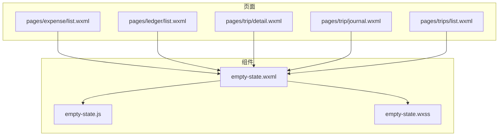
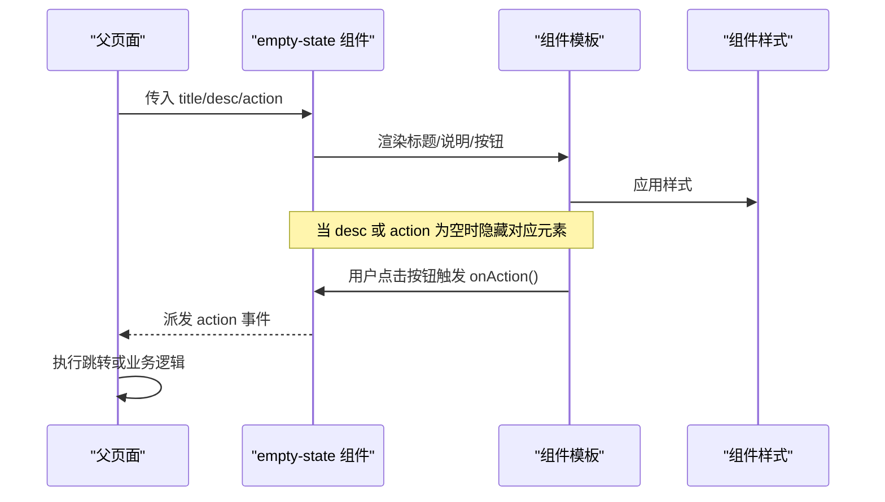
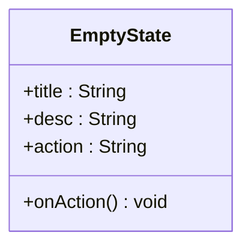
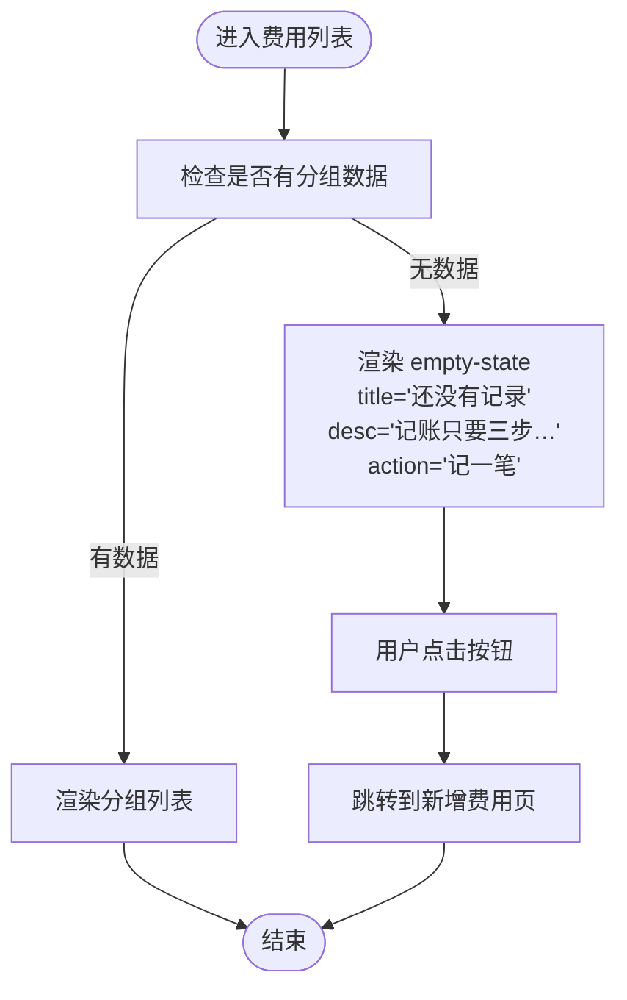
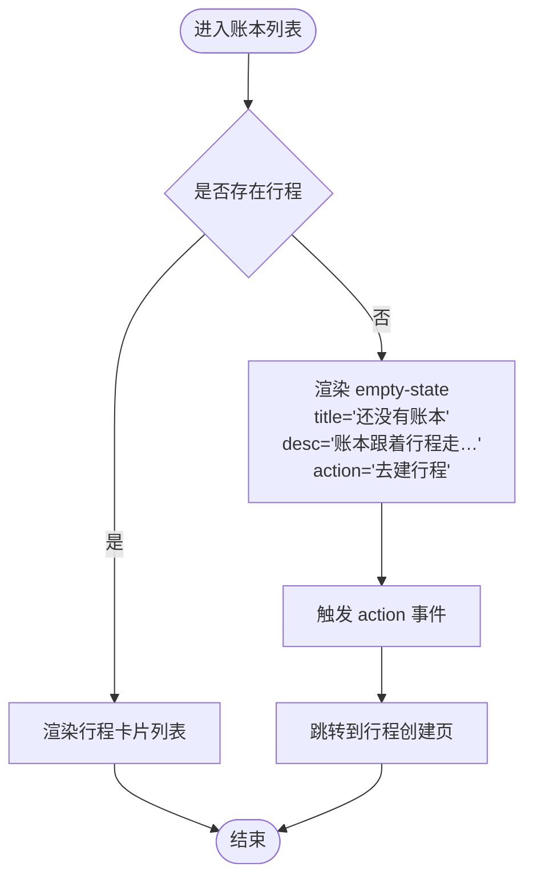
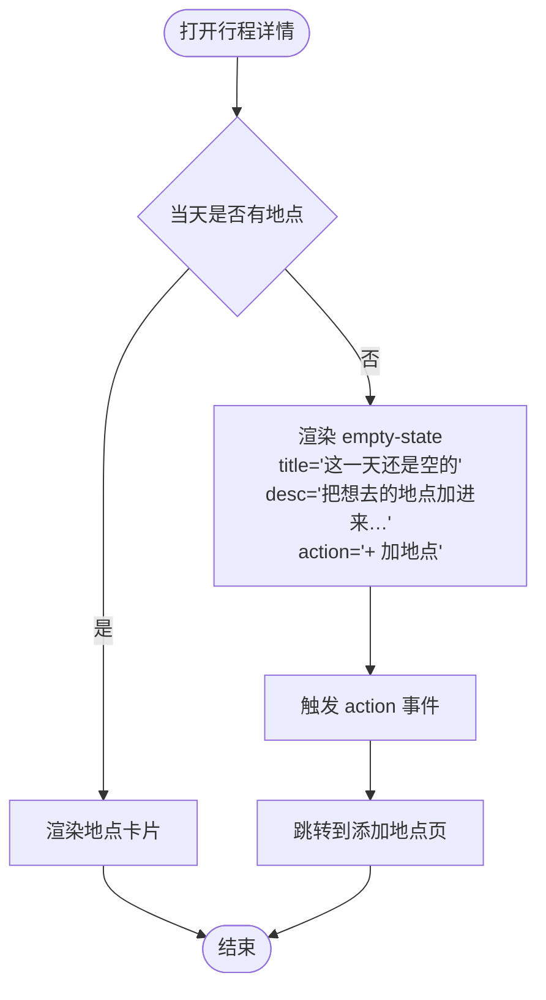
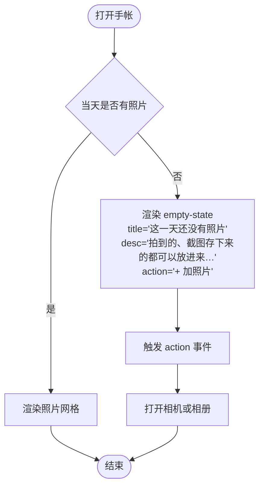
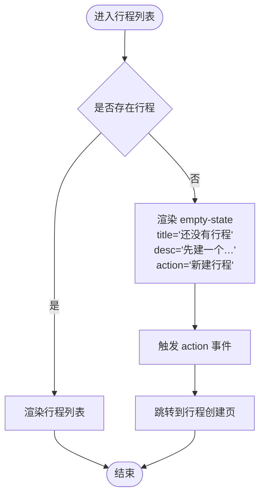
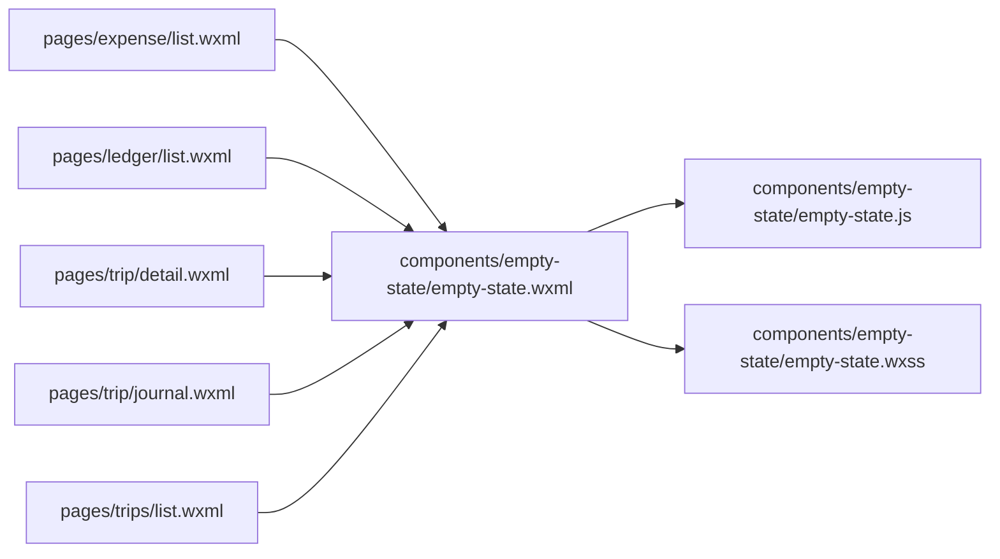

# 空状态组件 (empty-state)

<cite>
**本文引用的文件**   
- [components/empty-state/empty-state.js](file://components/empty-state/empty-state.js)
- [components/empty-state/empty-state.wxml](file://components/empty-state/empty-state.wxml)
- [components/empty-state/empty-state.wxss](file://components/empty-state/empty-state.wxss)
- [pages/expense/list.wxml](file://pages/expense/list.wxml)
- [pages/ledger/list.wxml](file://pages/ledger/list.wxml)
- [pages/trip/detail.wxml](file://pages/trip/detail.wxml)
- [pages/trip/journal.wxml](file://pages/trip/journal.wxml)
- [pages/trips/list.wxml](file://pages/trips/list.wxml)
</cite>

## 目录
1. [简介](#简介)
2. [项目结构](#项目结构)
3. [核心组件](#核心组件)
4. [架构总览](#架构总览)
5. [详细组件分析](#详细组件分析)
6. [依赖关系分析](#依赖关系分析)
7. [性能与体验](#性能与体验)
8. [故障排查](#故障排查)
9. [结论](#结论)
10. [附录：使用示例与最佳实践](#附录使用示例与最佳实践)

## 简介
空状态组件用于在列表或内容区域没有数据时，展示一个简洁的占位界面。它包含提示标题、可选说明文案和可选操作按钮，并通过事件将用户操作回传给父页面。该组件适用于费用列表、行程列表、地点列表、照片手帐等场景，帮助用户理解“当前为空”的状态并引导下一步操作。

## 项目结构
空状态组件位于 components/empty-state 目录下，由小程序组件三件套组成：逻辑层、模板层与样式层。多个业务页面通过条件渲染引入该组件，以统一空状态的视觉与交互体验。

图表来源
- [components/empty-state/empty-state.js:1-14](file://components/empty-state/empty-state.js#L1-L14)
- [components/empty-state/empty-state.wxml:1-6](file://components/empty-state/empty-state.wxml#L1-L6)
- [components/empty-state/empty-state.wxss:1-4](file://components/empty-state/empty-state.wxss#L1-L4)
- [pages/expense/list.wxml:74-80](file://pages/expense/list.wxml#L74-L80)
- [pages/ledger/list.wxml:35-41](file://pages/ledger/list.wxml#L35-L41)
- [pages/trip/detail.wxml:67-73](file://pages/trip/detail.wxml#L67-L73)
- [pages/trip/journal.wxml:29-35](file://pages/trip/journal.wxml#L29-L35)
- [pages/trips/list.wxml:38-44](file://pages/trips/list.wxml#L38-L44)

章节来源
- [components/empty-state/empty-state.js:1-14](file://components/empty-state/empty-state.js#L1-L14)
- [components/empty-state/empty-state.wxml:1-6](file://components/empty-state/empty-state.wxml#L1-L6)
- [components/empty-state/empty-state.wxss:1-4](file://components/empty-state/empty-state.wxss#L1-L4)
- [pages/expense/list.wxml:74-80](file://pages/expense/list.wxml#L74-L80)
- [pages/ledger/list.wxml:35-41](file://pages/ledger/list.wxml#L35-L41)
- [pages/trip/detail.wxml:67-73](file://pages/trip/detail.wxml#L67-L73)
- [pages/trip/journal.wxml:29-35](file://pages/trip/journal.wxml#L29-L35)
- [pages/trips/list.wxml:38-44](file://pages/trips/list.wxml#L38-L44)

## 核心组件
空状态组件提供以下能力：
- 显示空状态标题与可选说明文案
- 显示可选操作按钮
- 触发 action 事件，供父页面处理跳转或业务动作
- 默认值友好，便于快速接入

配置属性（properties）
- title：字符串，空状态主标题，默认值为“还没有内容”
- desc：字符串，辅助说明文案，默认空字符串；当为空时不显示
- action：字符串，按钮文案，默认空字符串；当为空时不显示按钮

回调事件
- action：当用户点击按钮时触发，由父页面监听并处理具体逻辑

章节来源
- [components/empty-state/empty-state.js:1-14](file://components/empty-state/empty-state.js#L1-L14)
- [components/empty-state/empty-state.wxml:1-6](file://components/empty-state/empty-state.wxml#L1-L6)

## 架构总览
空状态组件作为纯展示型子组件，通过 properties 接收文案，通过事件向父页面传递用户操作。父页面根据数据状态决定是否渲染该组件，并在事件回调中执行导航或业务逻辑。

图表来源
- [components/empty-state/empty-state.js:8-12](file://components/empty-state/empty-state.js#L8-L12)
- [components/empty-state/empty-state.wxml:1-6](file://components/empty-state/empty-state.wxml#L1-L6)

## 详细组件分析

### 组件结构与行为
- 模板结构
  - 外层容器承载标题、说明与按钮
  - 说明文案仅在 desc 非空时显示
  - 按钮仅在 action 非空时显示，点击后调用内部方法并派发事件
- 逻辑层
  - 定义三个可配置属性，均带默认值
  - 暴露 onAction 方法，统一派发 action 事件
- 样式层
  - 设置宿主为块级元素，保证与其他组件并列时的布局一致性

图表来源
- [components/empty-state/empty-state.js:1-14](file://components/empty-state/empty-state.js#L1-L14)
- [components/empty-state/empty-state.wxml:1-6](file://components/empty-state/empty-state.wxml#L1-L6)
- [components/empty-state/empty-state.wxss:1-4](file://components/empty-state/empty-state.wxss#L1-L4)

章节来源
- [components/empty-state/empty-state.js:1-14](file://components/empty-state/empty-state.js#L1-L14)
- [components/empty-state/empty-state.wxml:1-6](file://components/empty-state/empty-state.wxml#L1-L6)
- [components/empty-state/empty-state.wxss:1-4](file://components/empty-state/empty-state.wxss#L1-L4)

### 在费用列表中的应用
- 使用位置：费用列表页在存在汇总数据但无明细分组时显示空状态
- 文案策略：标题强调“还没有记录”，说明引导三步记账流程，按钮文案为“记一笔”
- 交互流程：点击按钮跳转到新增费用页面

图表来源
- [pages/expense/list.wxml:74-80](file://pages/expense/list.wxml#L74-L80)

章节来源
- [pages/expense/list.wxml:74-80](file://pages/expense/list.wxml#L74-L80)

### 在账本列表中的应用
- 使用位置：账本列表页在无行程数据时显示空状态
- 文案策略：标题“还没有账本”，说明引导先建行程再记账，按钮文案“去建行程”
- 交互流程：点击按钮跳转到行程列表创建入口

图表来源
- [pages/ledger/list.wxml:35-41](file://pages/ledger/list.wxml#L35-L41)

章节来源
- [pages/ledger/list.wxml:35-41](file://pages/ledger/list.wxml#L35-L41)

### 在行程详情中的应用
- 使用位置：当天景点为空时显示空状态
- 文案策略：标题“这一天还是空的”，说明引导添加地点并可编辑顺序、停留时长等，按钮文案“+ 加地点”
- 交互流程：点击按钮跳转到添加地点流程

图表来源
- [pages/trip/detail.wxml:67-73](file://pages/trip/detail.wxml#L67-L73)

章节来源
- [pages/trip/detail.wxml:67-73](file://pages/trip/detail.wxml#L67-L73)

### 在手帐相册中的应用
- 使用位置：当天无照片时显示空状态
- 文案策略：标题“这一天还没有照片”，说明引导按天归档照片，按钮文案“+ 加照片”
- 交互流程：点击按钮触发上传或选择照片流程

图表来源
- [pages/trip/journal.wxml:29-35](file://pages/trip/journal.wxml#L29-L35)

章节来源
- [pages/trip/journal.wxml:29-35](file://pages/trip/journal.wxml#L29-L35)

### 在行程列表中的应用
- 使用位置：用户尚无行程时显示空状态
- 文案策略：标题“还没有行程”，说明引导新建行程，按钮文案“新建行程”
- 交互流程：点击按钮跳转到行程创建页

图表来源
- [pages/trips/list.wxml:38-44](file://pages/trips/list.wxml#L38-L44)

章节来源
- [pages/trips/list.wxml:38-44](file://pages/trips/list.wxml#L38-L44)

## 依赖关系分析
- 组件对页面的依赖
  - 组件本身不直接依赖任何页面逻辑，仅通过事件向上抛出 action
  - 各页面负责决定何时渲染组件以及如何处理 action 回调
- 组件内部依赖
  - 模板依赖 properties 提供的 title、desc、action
  - 样式仅影响宿主容器显示方式，不影响业务逻辑

图表来源
- [pages/expense/list.wxml:74-80](file://pages/expense/list.wxml#L74-L80)
- [pages/ledger/list.wxml:35-41](file://pages/ledger/list.wxml#L35-L41)
- [pages/trip/detail.wxml:67-73](file://pages/trip/detail.wxml#L67-L73)
- [pages/trip/journal.wxml:29-35](file://pages/trip/journal.wxml#L29-L35)
- [pages/trips/list.wxml:38-44](file://pages/trips/list.wxml#L38-L44)
- [components/empty-state/empty-state.js:1-14](file://components/empty-state/empty-state.js#L1-L14)
- [components/empty-state/empty-state.wxss:1-4](file://components/empty-state/empty-state.wxss#L1-L4)

章节来源
- [components/empty-state/empty-state.js:1-14](file://components/empty-state/empty-state.js#L1-L14)
- [components/empty-state/empty-state.wxml:1-6](file://components/empty-state/empty-state.wxml#L1-L6)
- [components/empty-state/empty-state.wxss:1-4](file://components/empty-state/empty-state.wxss#L1-L4)
- [pages/expense/list.wxml:74-80](file://pages/expense/list.wxml#L74-L80)
- [pages/ledger/list.wxml:35-41](file://pages/ledger/list.wxml#L35-L41)
- [pages/trip/detail.wxml:67-73](file://pages/trip/detail.wxml#L67-L73)
- [pages/trip/journal.wxml:29-35](file://pages/trip/journal.wxml#L29-L35)
- [pages/trips/list.wxml:38-44](file://pages/trips/list.wxml#L38-L44)

## 性能与体验
- 渲染性能
  - 组件结构简单，条件渲染基于 props，开销极低
  - 建议在父页面避免频繁切换 data 导致不必要的重渲染
- 动画效果
  - 当前未实现入场动画或按钮动效
  - 可在 wxss 中增加淡入、上移等过渡，提升空状态出现时的平滑感
- 主题适配
  - 当前样式仅设置宿主为块级元素，建议扩展支持深色模式、品牌色按钮等主题变量
- 无障碍与可访问性
  - 可为按钮增加 aria-label 或语义化标签，提升读屏体验
- 用户引导设计
  - 文案应明确下一步动作，按钮文案动词化，减少认知成本
  - 说明文案聚焦“为什么为空”和“如何开始”，避免冗长

[本节为通用指导，不涉及具体文件分析]

## 故障排查
- 按钮不显示
  - 检查是否传入了 action 属性；若为空则不会渲染按钮
- 说明文案不显示
  - 检查是否传入了 desc 属性；若为空则不会渲染说明
- 点击按钮无响应
  - 确认父页面是否正确绑定 bind:action 并实现对应回调
- 布局异常
  - 检查父容器是否限制了高度或宽度，确保组件能正常撑开
- 国际化缺失
  - 当前文案硬编码在页面中，如需多语言，应将文案抽离到资源文件并按语言切换

章节来源
- [components/empty-state/empty-state.wxml:1-6](file://components/empty-state/empty-state.wxml#L1-L6)
- [components/empty-state/empty-state.js:8-12](file://components/empty-state/empty-state.js#L8-L12)

## 结论
空状态组件以最小接口提供了统一的空数据占位能力，配合各业务页面的条件渲染与事件回调，能够清晰传达“当前为空”的状态并引导用户完成关键操作。后续可在动画、主题、无障碍与国际化方面进一步增强，以提升整体用户体验。

[本节为总结性内容，不涉及具体文件分析]

## 附录：使用示例与最佳实践

### 在费用列表中使用
- 当费用分组为空时，渲染空状态
- 标题强调“还没有记录”，说明引导记账步骤，按钮文案“记一笔”
- 在父页面监听 action 事件并跳转到新增费用页

章节来源
- [pages/expense/list.wxml:74-80](file://pages/expense/list.wxml#L74-L80)

### 在行程列表中使用
- 当用户尚无行程时，渲染空状态
- 标题“还没有行程”，说明引导新建行程，按钮文案“新建行程”
- 在父页面监听 action 事件并跳转到行程创建页

章节来源
- [pages/trips/list.wxml:38-44](file://pages/trips/list.wxml#L38-L44)

### 在账本列表中使用
- 当无行程数据时，渲染空状态
- 标题“还没有账本”，说明引导先建行程再记账，按钮文案“去建行程”
- 在父页面监听 action 事件并跳转到行程列表创建入口

章节来源
- [pages/ledger/list.wxml:35-41](file://pages/ledger/list.wxml#L35-L41)

### 在行程详情中使用
- 当天景点为空时，渲染空状态
- 标题“这一天还是空的”，说明引导添加地点并可编辑顺序、停留时长等，按钮文案“+ 加地点”
- 在父页面监听 action 事件并跳转到添加地点流程

章节来源
- [pages/trip/detail.wxml:67-73](file://pages/trip/detail.wxml#L67-L73)

### 在手帐相册中使用
- 当天无照片时，渲染空状态
- 标题“这一天还没有照片”，说明引导按天归档照片，按钮文案“+ 加照片”
- 在父页面监听 action 事件并触发上传或选择照片流程

章节来源
- [pages/trip/journal.wxml:29-35](file://pages/trip/journal.wxml#L29-L35)

### 可扩展性与国际化方案
- 可扩展点
  - 图标插槽：预留图片节点，支持不同场景的插图
  - 样式主题：支持浅色/深色主题、品牌色按钮
  - 动画：入场淡入、按钮微动效
  - 无障碍：增加语义化标签与读屏文本
- 国际化
  - 将 title、desc、action 文案从页面抽离至语言包
  - 根据系统语言或用户设置动态切换文案
  - 组件保持只读属性，不感知语言变化，由父页面注入本地化后的文案

[本节为概念性指导，不涉及具体文件分析]