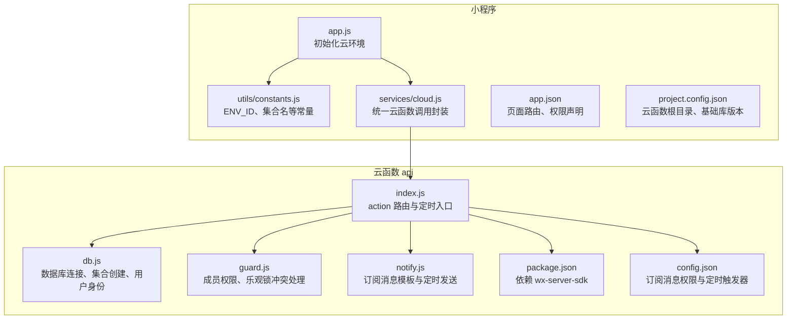
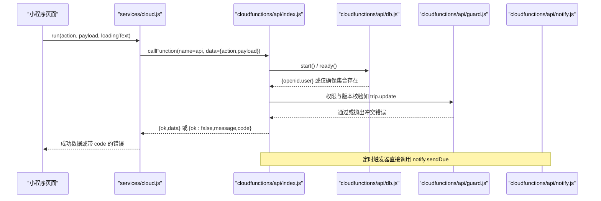
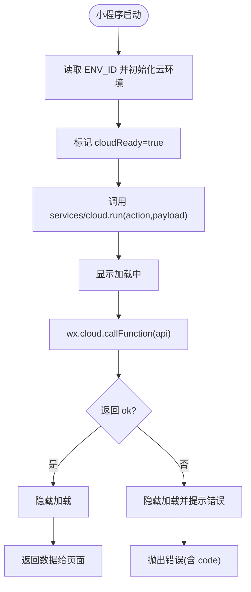
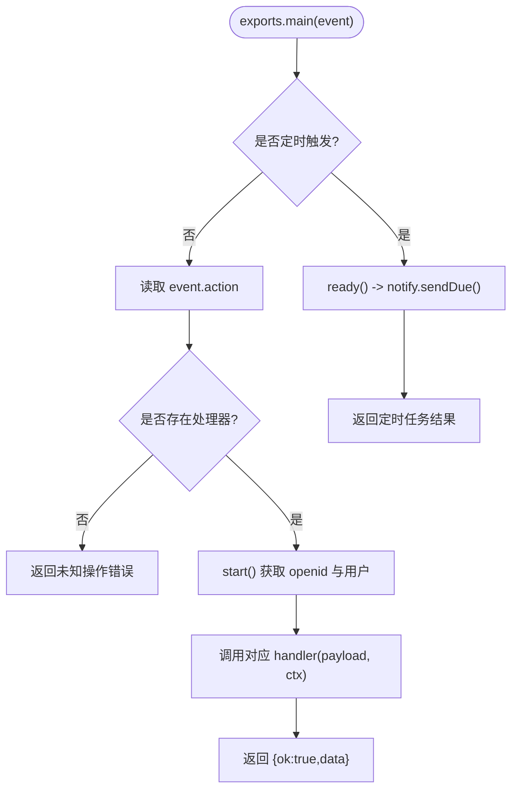
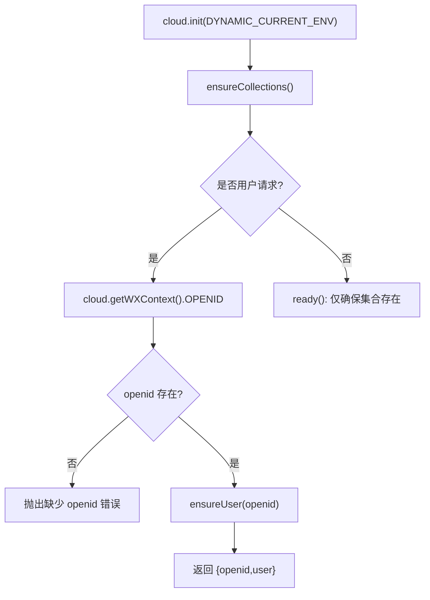
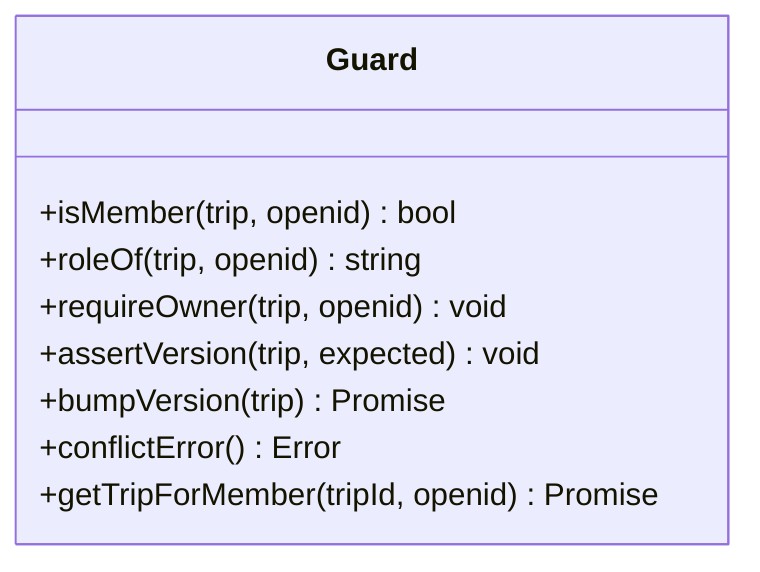
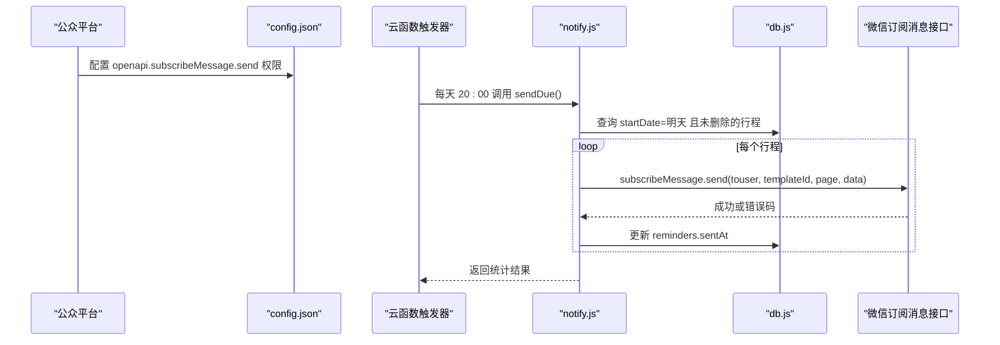
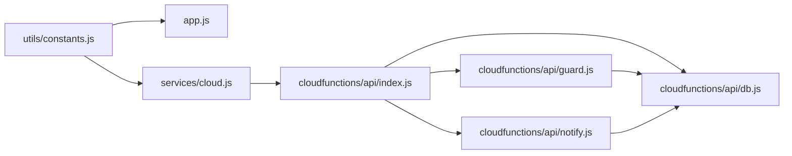

# 部署与配置

<cite>
**本文引用的文件**   
- [app.json](file://app.json)
- [project.config.json](file://project.config.json)
- [app.js](file://app.js)
- [utils/constants.js](file://utils/constants.js)
- [services/cloud.js](file://services/cloud.js)
- [cloudfunctions/api/index.js](file://cloudfunctions/api/index.js)
- [cloudfunctions/api/db.js](file://cloudfunctions/api/db.js)
- [cloudfunctions/api/guard.js](file://cloudfunctions/api/guard.js)
- [cloudfunctions/api/notify.js](file://cloudfunctions/api/notify.js)
- [cloudfunctions/api/config.json](file://cloudfunctions/api/config.json)
- [cloudfunctions/api/package.json](file://cloudfunctions/api/package.json)
</cite>

## 目录
1. [简介](#简介)
2. [项目结构](#项目结构)
3. [核心组件](#核心组件)
4. [架构总览](#架构总览)
5. [详细组件分析](#详细组件分析)
6. [依赖关系分析](#依赖关系分析)
7. [性能与容量规划](#性能与容量规划)
8. [运维监控与日志](#运维监控与日志)
9. [故障排除指南](#故障排除指南)
10. [结论](#结论)
11. [附录：环境变量与配置清单](#附录环境变量与配置清单)

## 简介
本指南面向开发者与运维人员，说明如何在微信云开发环境中完成旅行计划小程序的开发环境搭建、项目配置、云函数部署、数据库初始化与权限配置，并提供运维监控、日志管理、性能调优建议以及常见问题的排查方法。

本项目采用“前端通过统一云函数入口访问后端”的架构：小程序侧不直连数据库，所有写操作都经由一个名为 api 的云函数进行鉴权、校验与业务处理；定时任务通过触发器调用同一云函数执行提醒发送。

## 项目结构
- 小程序工程根目录包含页面、组件、服务层与工具模块。
- 云函数位于 cloudfunctions/api，使用 wx-server-sdk 接入微信云开发数据库与订阅消息能力。
- 环境与集合名集中在 utils/constants.js，便于统一切换环境。
- 项目构建与云函数路径由 project.config.json 管理。

**图表来源**
- [app.js:1-22](file://app.js#L1-L20)
- [utils/constants.js:1-48](file://utils/constants.js#L1-L48)
- [services/cloud.js:1-50](file://services/cloud.js#L1-L50)
- [cloudfunctions/api/index.js:1-77](file://cloudfunctions/api/index.js#L1-L77)
- [cloudfunctions/api/db.js:1-61](file://cloudfunctions/api/db.js#L1-L61)
- [cloudfunctions/api/guard.js:1-76](file://cloudfunctions/api/guard.js#L1-L76)
- [cloudfunctions/api/notify.js:1-102](file://cloudfunctions/api/notify.js#L1-L102)
- [cloudfunctions/api/package.json:1-10](file://cloudfunctions/api/package.json#L1-L10)
- [cloudfunctions/api/config.json:1-15](file://cloudfunctions/api/config.json#L1-L15)

**章节来源**
- [project.config.json:1-53](file://project.config.json#L1-L53)
- [app.json:1-56](file://app.json#L1-L56)

## 核心组件
- 小程序应用初始化：在 app.js 中读取 ENV_ID 并初始化云开发环境，设置 traceUser 以便云端追踪用户上下文。
- 常量与环境配置：ENV_ID、CLOUD_FUNCTION、COLLECTIONS、MESSAGE_TEMPLATES 等集中定义，便于统一维护。
- 云函数统一入口：index.js 将 action 路由到具体处理器，同时支持定时触发器直接调用 notify.sendDue。
- 数据库与身份：db.js 负责初始化数据库、确保集合存在、从服务端上下文获取 openid 并确保用户记录存在。
- 权限与并发控制：guard.js 提供成员判断、角色推导、版本断言与原子版本号提升，避免并发覆盖。
- 通知与订阅消息：notify.js 实现订阅消息授权记录与每日定时发送逻辑。

**章节来源**
- [app.js:1-22](file://app.js#L1-L22)
- [utils/constants.js:1-48](file://utils/constants.js#L1-L48)
- [cloudfunctions/api/index.js:1-77](file://cloudfunctions/api/index.js#L1-L77)
- [cloudfunctions/api/db.js:1-61](file://cloudfunctions/api/db.js#L1-L61)
- [cloudfunctions/api/guard.js:1-76](file://cloudfunctions/api/guard.js#L1-L76)
- [cloudfunctions/api/notify.js:1-102](file://cloudfunctions/api/notify.js#L1-L102)

## 架构总览
小程序通过 services/cloud.js 调用统一的云函数 api，传入 action 与 payload。云函数根据 action 分发到对应处理器，并在 db.js 中建立数据库连接、确保集合存在并从服务端上下文获取 openid。涉及行程写入时，guard.js 进行成员权限校验与乐观锁版本检查，防止并发覆盖。定时任务通过 config.json 配置的触发器每天 20:00 调用 notify.sendDue，向即将出发的行程成员发送订阅消息。

**图表来源**
- [services/cloud.js:1-50](file://services/cloud.js#L1-L50)
- [cloudfunctions/api/index.js:1-77](file://cloudfunctions/api/index.js#L1-L77)
- [cloudfunctions/api/db.js:1-61](file://cloudfunctions/api/db.js#L1-L61)
- [cloudfunctions/api/guard.js:1-76](file://cloudfunctions/api/guard.js#L1-L76)
- [cloudfunctions/api/notify.js:1-102](file://cloudfunctions/api/notify.js#L1-L102)

## 详细组件分析

### 小程序端环境与云函数调用
- 环境初始化：app.js 从 constants.js 读取 ENV_ID 并调用 wx.cloud.init，启用 traceUser。
- 云函数调用封装：services/cloud.js 统一包装 wx.cloud.callFunction，返回标准化结果；失败时显示 toast，并将特定 code（如 conflict）透传以让页面做差异化处理。
- 常量集中：ENV_ID、CLOUD_FUNCTION、COLLECTIONS、MESSAGE_TEMPLATES 等集中在 constants.js，修改环境只需改一处。

**图表来源**
- [app.js:1-22](file://app.js#L1-L22)
- [services/cloud.js:1-50](file://services/cloud.js#L1-L50)
- [utils/constants.js:1-48](file://utils/constants.js#L1-L48)

**章节来源**
- [app.js:1-22](file://app.js#L1-L22)
- [services/cloud.js:1-50](file://services/cloud.js#L1-L50)
- [utils/constants.js:1-48](file://utils/constants.js#L1-L48)

### 云函数入口与路由
- index.js 定义 routes 映射 action 到处理器，支持 user、trip、poi、expense、photo、notify 等模块。
- 定时触发器不走 action 路由，直接调用 notify.sendDue。
- 请求流程：先 ensureCollections，再从服务端上下文取 openid，调用对应 handler，捕获异常并返回结构化响应。

**图表来源**
- [cloudfunctions/api/index.js:1-77](file://cloudfunctions/api/index.js#L1-L77)
- [cloudfunctions/api/db.js:1-61](file://cloudfunctions/api/db.js#L1-L61)
- [cloudfunctions/api/notify.js:1-102](file://cloudfunctions/api/notify.js#L1-L102)

**章节来源**
- [cloudfunctions/api/index.js:1-77](file://cloudfunctions/api/index.js#L1-L77)

### 数据库初始化与用户身份
- db.js 初始化 wx-server-sdk，使用 DYNAMIC_CURRENT_ENV 自动匹配当前云环境。
- ensureCollections 幂等创建 users、trips、pois、expenses、files 集合；首次调用后复用 Promise。
- ensureUser 基于 openid 创建默认用户记录，包含昵称、默认货币与时间戳。
- start 保证集合存在、从服务端上下文取 openid、确保用户存在，返回 ctx。
- ready 用于无用户身份的定时任务，仅确保集合存在。

**图表来源**
- [cloudfunctions/api/db.js:1-61](file://cloudfunctions/api/db.js#L1-L61)

**章节来源**
- [cloudfunctions/api/db.js:1-61](file://cloudfunctions/api/db.js#L1-L61)

### 权限模型与并发控制
- guard.js 提供 isMember、roleOf、requireOwner 等方法，兼容老数据 ownerOpenid 与新版 members.role。
- assertVersion 与 bumpVersion 实现乐观锁：客户端携带 version，服务端用 where version=current 原子更新，若被抢先则抛冲突错误。
- getTripForMember 校验成员权限，并为旧数据补全 version 字段，同时返回 myRole 供前端展示。

**图表来源**
- [cloudfunctions/api/guard.js:1-76](file://cloudfunctions/api/guard.js#L1-L76)

**章节来源**
- [cloudfunctions/api/guard.js:1-76](file://cloudfunctions/api/guard.js#L1-L76)

### 订阅消息与定时提醒
- notify.js 定义 FIELDS 与 TIP_TEXT，subscribe 将模板 id 与 openid 写入 trips.reminders，去重保留最新授权。
- sendDue 查找明天出发的行程，遍历未发送的提醒项，调用 subscribeMessage.send，记录 sentAt 并回写 trips.reminders。
- config.json 配置 openapi 权限与 dailyReminder 定时器（cron 表达式）。

**图表来源**
- [cloudfunctions/api/notify.js:1-102](file://cloudfunctions/api/notify.js#L1-L102)
- [cloudfunctions/api/config.json:1-15](file://cloudfunctions/api/config.json#L1-L15)
- [cloudfunctions/api/db.js:1-61](file://cloudfunctions/api/db.js#L1-L61)

**章节来源**
- [cloudfunctions/api/notify.js:1-102](file://cloudfunctions/api/notify.js#L1-L102)
- [cloudfunctions/api/config.json:1-15](file://cloudfunctions/api/config.json#L1-L15)

## 依赖关系分析
- 小程序依赖 utils/constants.js 中的 ENV_ID 与 COLLECTIONS。
- services/cloud.js 依赖 constants.js 的 CLOUD_FUNCTION。
- 云函数 api 依赖 wx-server-sdk，并通过 index.js 聚合多个业务模块。
- db.js 为其他模块提供数据库连接与集合管理。
- guard.js 依赖 db.js 提供的数据库命令对象。
- notify.js 依赖 db.js 与 guard.js，并使用 wx-server-sdk 的 openapi 能力。

**图表来源**
- [utils/constants.js:1-48](file://utils/constants.js#L1-L48)
- [app.js:1-22](file://app.js#L1-L22)
- [services/cloud.js:1-50](file://services/cloud.js#L1-L50)
- [cloudfunctions/api/index.js:1-77](file://cloudfunctions/api/index.js#L1-L77)
- [cloudfunctions/api/db.js:1-61](file://cloudfunctions/api/db.js#L1-L61)
- [cloudfunctions/api/guard.js:1-76](file://cloudfunctions/api/guard.js#L1-L76)
- [cloudfunctions/api/notify.js:1-102](file://cloudfunctions/api/notify.js#L1-L102)

**章节来源**
- [cloudfunctions/api/package.json:1-10](file://cloudfunctions/api/package.json#L1-L10)

## 性能与容量规划
- 集合索引：pois 建议按 tripId、dayIndex、order 建复合索引；expenses 建议按 tripId、spentAt 建索引以提升列表与汇总查询性能。
- 批量操作：定时发送提醒时已限制 MAX_TRIPS，避免单次扫描过多数据；建议在数据量增长后对 trips.startDate 建索引。
- 并发控制：通过 optimistic locking（version 字段）减少覆盖写风险；在高并发场景下可考虑增加重试与退避策略。
- 资源上限：关注云函数内存与超时配置，合理拆分热点 action 或引入缓存层（如 Redis）以降低数据库压力。

[本节为通用性能建议，不直接分析具体文件]

## 运维监控与日志
- 云函数日志：index.js 与 notify.js 中使用 console.error 输出关键错误信息，可在云开发控制台查看运行日志。
- 用户追踪：app.js 初始化云环境时开启 traceUser，便于在云端关联用户行为。
- 权限与触发器：在云开发控制台检查 openapi.subscribeMessage.send 权限是否开通，确认 dailyReminder 触发器状态与 cron 表达式。
- 告警建议：对定时任务的失败计数进行监控，当 failed > 0 时触发告警，排查模板字段或授权问题。

**章节来源**
- [app.js:1-22](file://app.js#L1-L22)
- [cloudfunctions/api/index.js:1-77](file://cloudfunctions/api/index.js#L1-L77)
- [cloudfunctions/api/notify.js:1-102](file://cloudfunctions/api/notify.js#L1-L102)
- [cloudfunctions/api/config.json:1-15](file://cloudfunctions/api/config.json#L1-L15)

## 故障排除指南
- 网络异常：services/cloud.js 在 fail 分支返回“网络异常，请检查网络后重试”，需检查小程序网络与云函数连通性。
- 未知操作：index.js 在未找到对应 action 时返回“未知操作”，检查前端传入的 action 是否在 routes 中。
- 缺少用户身份：db.js 在无法获取 openid 时抛出错误，需在微信环境中打开小程序并正确登录。
- 版本冲突：guard.js 的 conflictError 会返回 code=conflict，services/cloud.js 不会弹出 toast，页面应引导用户刷新数据。
- 订阅消息失败：notify.js 捕获订阅消息发送错误并记录日志，常见原因为模板字段不匹配或授权额度用完；检查模板字段与授权记录。
- 权限不足：guard.js 的 requireOwner 与 getTripForMember 会拒绝非成员或非所有者操作，需确认成员列表与角色。

**章节来源**
- [services/cloud.js:1-50](file://services/cloud.js#L1-L50)
- [cloudfunctions/api/index.js:1-77](file://cloudfunctions/api/index.js#L1-L77)
- [cloudfunctions/api/db.js:1-61](file://cloudfunctions/api/db.js#L1-L61)
- [cloudfunctions/api/guard.js:1-76](file://cloudfunctions/api/guard.js#L1-L76)
- [cloudfunctions/api/notify.js:1-102](file://cloudfunctions/api/notify.js#L1-L102)

## 结论
本项目通过统一云函数入口与集中式常量配置，实现了清晰的前后端边界与一致的权限、并发控制与通知机制。部署与配置的关键在于正确设置 ENV_ID、开通订阅消息权限、配置定时触发器，并在数据库层面补充必要索引以提升查询性能。结合日志与告警，可实现稳定的生产运维。

[本节为总结性内容，不直接分析具体文件]

## 附录：环境变量与配置清单
- 小程序环境 ID：ENV_ID（utils/constants.js），在 app.js 中用于初始化云环境。
- 云函数名称：CLOUD_FUNCTION（utils/constants.js），services/cloud.js 使用该名称调用云函数。
- 集合名：COLLECTIONS（utils/constants.js），包括 users、trips、pois、expenses。
- 订阅消息模板 ID：MESSAGE_TEMPLATES（utils/constants.js），需在公众平台申请并填入。
- 云函数依赖：wx-server-sdk（cloudfunctions/api/package.json）。
- 云函数权限：openapi.subscribeMessage.send（cloudfunctions/api/config.json）。
- 定时触发器：dailyReminder，cron 表达式 0 0 20 * * * *（cloudfunctions/api/config.json）。
- 小程序页面与权限：app.json 中声明 pages、tabBar 与 location 相关权限。
- 项目构建配置：project.config.json 中指定云函数根目录、基础库版本与打包忽略规则。

**章节来源**
- [utils/constants.js:1-48](file://utils/constants.js#L1-L48)
- [app.js:1-22](file://app.js#L1-L22)
- [cloudfunctions/api/package.json:1-10](file://cloudfunctions/api/package.json#L1-L10)
- [cloudfunctions/api/config.json:1-15](file://cloudfunctions/api/config.json#L1-L15)
- [app.json:1-56](file://app.json#L1-L56)
- [project.config.json:1-53](file://project.config.json#L1-L53)