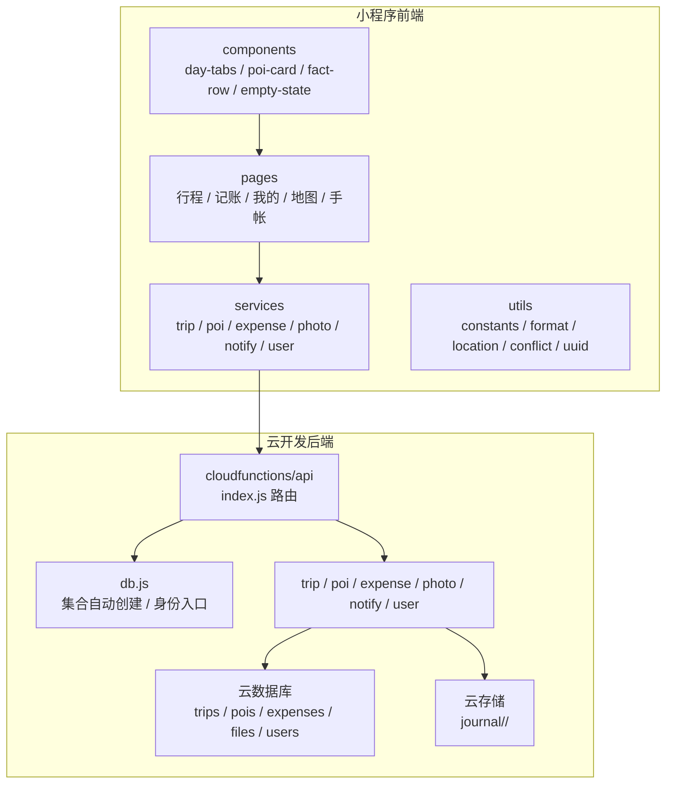
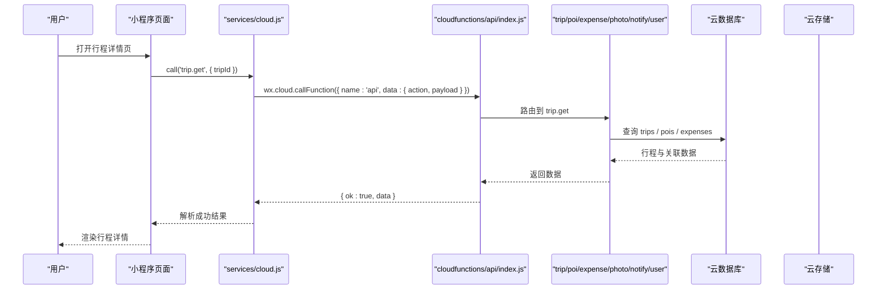
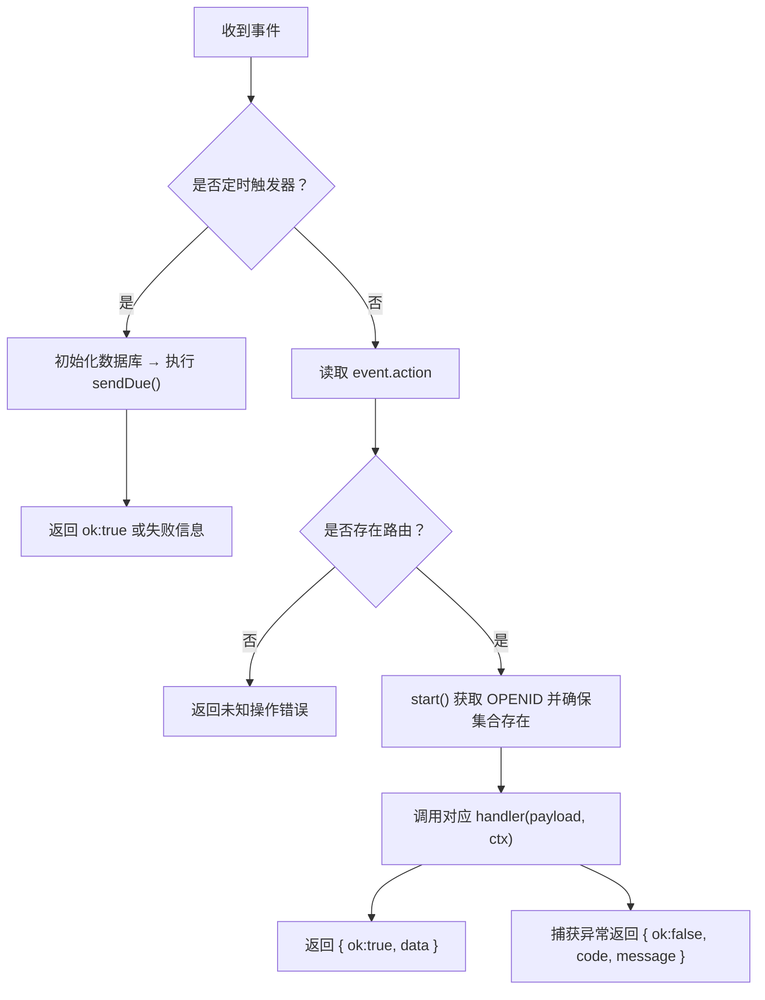
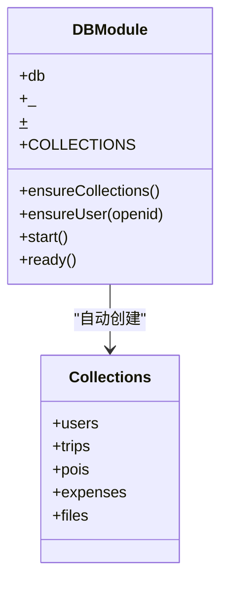
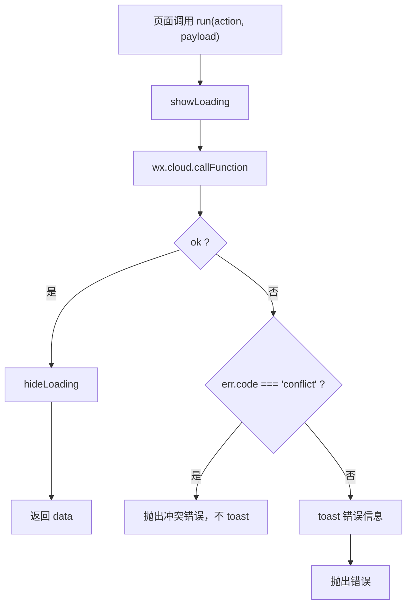
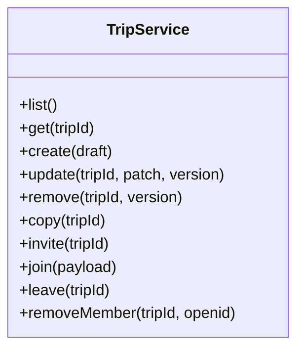
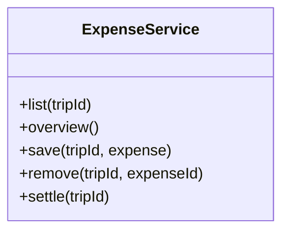
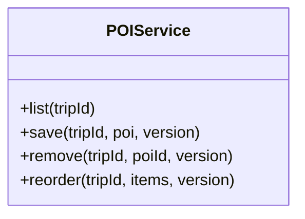
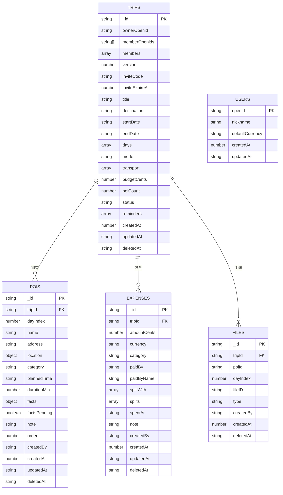

# 项目概述

<cite>
**本文引用的文件**   
- [app.json](file://app.json)
- [方案.md](file://docs/方案.md)
- [cloudfunctions/api/package.json](file://cloudfunctions/api/package.json)
- [cloudfunctions/api/index.js](file://cloudfunctions/api/index.js)
- [cloudfunctions/api/db.js](file://cloudfunctions/api/db.js)
- [services/cloud.js](file://services/cloud.js)
- [services/trip.js](file://services/trip.js)
- [services/expense.js](file://services/expense.js)
- [services/poi.js](file://services/poi.js)
</cite>

## 目录
1. [简介](#简介)
2. [项目结构](#项目结构)
3. [核心功能](#核心功能)
4. [技术架构](#技术架构)
5. [关键组件分析](#关键组件分析)
6. [数据模型与接口总览](#数据模型与接口总览)
7. [快速开始](#快速开始)
8. [使用场景示例](#使用场景示例)
9. [性能与限制](#性能与限制)
10. [故障排查](#故障排查)
11. [结论](#结论)

## 简介
本项目是一个基于微信小程序云开发的旅行计划应用，目标是帮助用户在出发前把“每天去哪、几点到、待多久”排清楚，现场用地图看点位关系并一键跳转导航，随手记账，旅行结束后有据可查。它支持行程管理、地点记录、费用记账、协作邀请和手帐记录等核心特性，面向个人出行者和小型同行群体，强调“先可用、再协同”，避免一开始就陷入复杂实时编辑或 AI 生成带来的不确定性。

从产品定位看，项目聚焦四个真实痛点：
- 攻略收藏多但到现场不知道先去哪；
- 陌生城市里不清楚点位距离、容易走回头路；
- 旅行花销记不住，回来算不清花了多少；
- 攻略信息不可靠，需要统一标记“待核实”。

项目当前版本已实现 V1.0 的单人闭环，并在 V1.5 中补充了邀请码协同、AA 分账、行程编辑与复制、手帐照片以及订阅消息等能力。

**章节来源**
- [方案.md:19-44](file://docs/方案.md#L19-L44)

## 项目结构
小程序前端采用页面 + 服务层 + 工具层的分层组织方式：
- `pages`：按业务域划分页面，如行程列表、行程详情、地图、手帐、记账、我的等；
- `components`：复用 UI 组件，如日切换标签、地点卡片、事实行、空状态等；
- `services`：封装所有云函数调用，包括行程、地点、记账、照片、通知和用户；
- `utils`：纯函数工具，如常量、格式化、位置、冲突处理、UUID、订阅消息等；
- `cloudfunctions/api`：统一的 Node.js 云函数入口，通过 action 路由分发到具体业务模块；
- `cloudfunctions/ping`：用于健康检查或其他轻量用途（本概述不深入）。

**图表来源**
- [app.json:2-15](file://app.json#L2-L15)
- [cloudfunctions/api/index.js:10-41](file://cloudfunctions/api/index.js#L10-L41)
- [cloudfunctions/api/db.js:9-10](file://cloudfunctions/api/db.js#L9-L10)

**章节来源**
- [方案.md:48-95](file://docs/方案.md#L48-L95)
- [app.json:2-15](file://app.json#L2-L15)

## 核心功能
项目的核心功能围绕“行程 — 地点 — 记账 — 协作 — 手帐”展开：

| 功能 | 说明 | 典型用户价值 |
|---|---|---|
| 行程管理 | 新建行程、按天安排地点、调整顺序、重排时间、加减天数、删除行程（软删除） | 把零散攻略变成可执行的每日计划 |
| 地点记录 | 名称、地址、分类、计划到达时间、停留时长、已知信息、备注、坐标 | 明确“去哪、待多久、是否已核实” |
| 地图与导航 | 内嵌地图只读展示点位，点击标记跳转微信原生导航，支持显示当前位置 | 减少走回头路，现场直接导航 |
| 费用记账 | 金额存“分”，分类占比、按日期分组明细、预算与剩余、AA 结算建议 | 旅行后能看清花了多少、谁付了多少钱 |
| 协作功能 | 邀请码加入、成员列表、移除同行、自行退出、乐观锁防并发冲突 | 多人一起规划、一起记账 |
| 手帐记录 | 上传照片、按天分组、预览、长按软删记录 | 旅行结束后有图有真相 |
| 订阅提醒 | 授权订阅消息，定时触发器发送“明天出发”提醒 | 减少忘记出发的风险 |

这些功能在前端通过 `services` 层统一调用云函数，后端通过 `api` 云函数集中鉴权、校验和落库，保证权限和数据一致性。

**章节来源**
- [方案.md:48-119](file://docs/方案.md#L48-L119)
- [方案.md:211-244](file://docs/方案.md#L211-L244)

## 技术架构
项目采用“小程序前端 + 云函数后端 + 云数据库 + 云存储”的云开发架构：

- 前端：微信小程序框架，页面负责交互与展示，`services` 负责调用云函数；
- 后端：单个 `api` 云函数作为统一入口，通过 `action` 路由分发到 trip、poi、expense、photo、notify、user 等业务模块；
- 数据：云数据库集合包括 trips、pois、expenses、files、users，首次请求由云函数自动创建；
- 存储：手帐照片上传到云存储 `journal/<tripId>/`，记录落在 `files` 集合；
- 身份：云函数通过 `wx-server-sdk` 获取 OPENID，前端不传递 openid，服务端统一做成员鉴权；
- 并发：行程内容写操作使用版本号乐观锁，冲突时返回 `code:'conflict'`，客户端提示刷新或覆盖；
- 部署：云函数依赖 `wx-server-sdk`，通过 `package.json` 声明，部署后由控制台触发定时任务。

**图表来源**
- [services/cloud.js:5-29](file://services/cloud.js#L5-L29)
- [cloudfunctions/api/index.js:43-75](file://cloudfunctions/api/index.js#L43-L75)
- [cloudfunctions/api/db.js:46-53](file://cloudfunctions/api/db.js#L46-L53)

**章节来源**
- [cloudfunctions/api/package.json:1-10](file://cloudfunctions/api/package.json#L1-L10)
- [cloudfunctions/api/index.js:10-75](file://cloudfunctions/api/index.js#L10-L75)
- [cloudfunctions/api/db.js:1-61](file://cloudfunctions/api/db.js#L1-L61)

## 关键组件分析

### 云函数统一入口与路由
`cloudfunctions/api/index.js` 是后端唯一对外暴露的云函数入口，职责清晰：
- 定义 action 路由表，将 `user.me`、`trip.*`、`poi.*`、`expense.*`、`photo.*`、`notify.subscribe` 映射到对应处理器；
- 区分普通请求与定时触发器请求，定时任务不走 action，而是直接调用通知逻辑；
- 从服务端上下文取 OPENID，不信任前端传入的身份；
- 统一捕获异常，返回 `{ ok, data, code, message }`，其中 `code` 可用于客户端特殊处理（如 `conflict`）。

**图表来源**
- [cloudfunctions/api/index.js:10-75](file://cloudfunctions/api/index.js#L10-L75)

**章节来源**
- [cloudfunctions/api/index.js:10-75](file://cloudfunctions/api/index.js#L10-L75)

### 数据库与身份入口
`cloudfunctions/api/db.js` 提供两个关键能力：
- 集合自动创建：首次请求时确保 `users`、`trips`、`pois`、`expenses`、`files` 存在，幂等且复用 Promise；
- 身份入口：每个请求通过 `cloud.getWXContext().OPENID` 获取身份，不存在则抛错，同时自动创建或查找用户记录。

**图表来源**
- [cloudfunctions/api/db.js:9-61](file://cloudfunctions/api/db.js#L9-L61)

**章节来源**
- [cloudfunctions/api/db.js:1-61](file://cloudfunctions/api/db.js#L1-L61)

### 前端服务层封装
`services/cloud.js` 是所有云函数调用的统一封装：
- `call(action, payload)`：发起 `wx.cloud.callFunction`，成功返回 `data`，失败抛出带 `code` 的错误；
- `run(action, payload, loadingText)`：带 loading 的统一调用，失败时统一 toast，但 `conflict` 不弹 toast，交给页面特殊处理。

这种设计让页面代码保持简洁：页面只关心成功分支和冲突分支，网络异常和服务错误统一在服务层处理。

**图表来源**
- [services/cloud.js:5-47](file://services/cloud.js#L5-L47)

**章节来源**
- [services/cloud.js:1-50](file://services/cloud.js#L1-L50)

### 行程服务
`services/trip.js` 封装行程相关接口：
- 列表、详情、创建、更新、删除、复制；
- 邀请、加入、退出、移除成员；
- 更新和删除携带 `version`，体现乐观锁语义。

**图表来源**
- [services/trip.js:3-46](file://services/trip.js#L3-L46)

**章节来源**
- [services/trip.js:1-47](file://services/trip.js#L1-L47)

### 记账服务
`services/expense.js` 封装记账相关接口：
- 按行程查看明细与服务端汇总；
- “我的”页查看所有行程花费概览；
- 保存、删除记账；
- AA 结算：服务端计算实付、应摊、差额与转账建议。

**图表来源**
- [services/expense.js:3-25](file://services/expense.js#L3-L25)

**章节来源**
- [services/expense.js:1-26](file://services/expense.js#L1-L26)

### 地点服务
`services/poi.js` 封装地点相关接口：
- 按行程拉取地点列表；
- 保存、删除地点；
- 批量重排顺序或换天，一次提交避免部分成功。

**图表来源**
- [services/poi.js:3-21](file://services/poi.js#L3-L21)

**章节来源**
- [services/poi.js:1-22](file://services/poi.js#L1-L22)

## 数据模型与接口总览

### 数据模型
项目使用 5 个核心集合，首次请求由云函数自动创建：
- `trips`：行程主数据，包含创建者、成员、版本、邀请码、日期范围、天数、预算、状态、订阅记录等；
- `pois`：地点数据，归属行程、按天排序、含名称、地址、坐标、分类、计划时间、停留时长、已知信息、备注；
- `expenses`：记账数据，归属行程、金额存分、分类、付款人、分摊份额、消费日期、备注；
- `files`：手帐照片记录，归属行程、可选挂地点或天、云存储 fileID、类型、审计字段；
- `users`：用户基础信息，openid、昵称、默认币种、创建更新时间。

设计原则包括：
- 一切挂 `tripId`；
- `_id` 由客户端 UUID 生成，具备幂等性；
- `order` 进位到“天”，单字段排序即得“按天 + 按序”；
- 软删除 `deletedAt`；
- 成员用数组，为协同预留。

**图表来源**
- [方案.md:123-207](file://docs/方案.md#L123-L207)

**章节来源**
- [方案.md:123-207](file://docs/方案.md#L123-L207)

### 接口总览
云函数通过单一 `api` 暴露 action 接口，前端统一通过 `services/cloud.js` 调用。主要 action 包括：

| action | 作用 | 关键约束 |
|---|---|---|
| `user.me` | 当前用户 | 首次调用自动建用户 |
| `trip.list` / `trip.get` | 我的行程、单个行程 | 只返回成员命中的行程 |
| `trip.create` / `trip.update` / `trip.remove` | 建 / 改 / 删 | 改日期重建 days；减天前校验孤儿点位；删除连带软删点位与账目；更新/删除带 version |
| `trip.invite` | 生成/复用邀请码 | 限创建者；未过期直接返回原码 |
| `trip.join` | 加入行程 | `tripId` 或 `code` 二选一；已是成员返回 joined:false；码过期拒绝 |
| `trip.removeMember` | 移除同行 | 限创建者；不能移除自己或创建者 |
| `trip.leave` | 同行自己退出 | 创建者不能退；清订阅授权；不校验版本号 |
| `trip.copy` | 复制行程 | 日期从今天重算同天数；点位整份复制并重排 order；成员只留自己 |
| `poi.list` | 一次拿 trip + 全部点位 | 详情页 / 地图页 / 编辑页共用 |
| `poi.save` | 增 / 改点位 | 名称必填；一天最多 20 个；换天重排 order；带 version |
| `poi.remove` | 软删 | 同步回写 trip.poiCount；带 version |
| `poi.reorder` | 顺序 / 换天 / 重排时间一次提交 | 最多 300 条；带 version |
| `expense.list` | 明细 + 服务端汇总 | 分类占比在服务端算 |
| `expense.overview` | 我所有行程的花费聚合 | aggregate + group，不拉明细 |
| `expense.save` / `expense.remove` | 记账 / 改账 / 删账 | 金额必须 > 0；带 _id 即更新；paidBy 必须是成员；splits 合计必须等于金额 |
| `expense.settle` | AA 结算 | 实付/应摊/差额 + 贪心最少转账建议；老数据按 splitWith 均摊 |
| `photo.list` / `photo.add` / `photo.remove` | 手帐照片 | 限成员；单行程 ≤100 张；只软删记录 |
| `notify.subscribe` | 记录订阅授权 | 无模板 id 直接报错；一次授权只对应一条推送 |

**章节来源**
- [cloudfunctions/api/index.js:10-41](file://cloudfunctions/api/index.js#L10-L41)
- [方案.md:211-244](file://docs/方案.md#L211-L244)

## 快速开始

### 环境准备
- 安装并登录微信开发者工具；
- 在小程序项目中启用云开发，选择或创建云开发环境；
- 在云开发控制台确认 `api` 云函数已部署；
- 确认数据库集合 `users`、`trips`、`pois`、`expenses`、`files` 可在首次请求时自动创建；
- 如需地图与选点功能，确认已开通 `chooseLocation`、`getLocation` 权限，并在隐私协议中声明位置信息。

### 基本使用流程
1. 打开小程序，底部 Tab 进入“行程”；
2. 新建行程，填写标题、目的地、开始与结束日期；
3. 在行程详情页添加地点，设置分类、计划到达时间、停留时长；
4. 进入地图页查看当天点位分布，点击标记跳转微信原生导航；
5. 切换到“记账”Tab，记录每笔花费，查看合计、日均、分类占比；
6. 多人同行时，创建者在详情页生成邀请码或转发卡片，对方加入后共同编辑行程与记账；
7. 旅行结束后，在手帐页上传照片，按天分组回顾；
8. 如需出发提醒，授权订阅消息，定时触发器会在指定时间发送提醒。

**章节来源**
- [app.json:24-42](file://app.json#L24-L42)
- [方案.md:48-68](file://docs/方案.md#L48-L68)
- [方案.md:282-294](file://docs/方案.md#L282-L294)

## 使用场景示例

### 单人短途旅行
用户计划 3 天城市游：
- 在“行程”新建行程，设置 3 天；
- 每天添加景点、餐饮、交通等地点，调整顺序并一键重排时间；
- 地图页查看点位分布，点击标记跳转导航；
- 每天记账，分类统计帮助了解消费结构；
- 结束后在手帐上传照片，形成旅行回忆。

### 双人协作旅行
A 创建行程并生成邀请码，B 通过卡片或手动输入加入：
- A 和 B 都可添加地点、调整顺序；
- 两人分别记账，A 付交通费，B 付住宿费；
- 在记账页展开 AA 结算，查看谁该给谁多少钱；
- 若两人同时修改行程，后写的一方会看到冲突提示，可选择刷新或覆盖；
- B 可自行退出行程，A 也可移除 B。

### 家庭旅行预算控制
用户在行程设置预算，记账时查看“已花 / 剩余 / 是否超支”进度条：
- 分类占比帮助识别高消费项；
- 按日期分组明细帮助复盘每天开销；
- 手帐照片配合文字记录，便于后续分享或复盘。

**章节来源**
- [方案.md:23-32](file://docs/方案.md#L23-L32)
- [方案.md:99-119](file://docs/方案.md#L99-L119)
- [方案.md:322-333](file://docs/方案.md#L322-L333)

## 性能与限制

### 性能特点
- 单云函数统一入口，部署简单，权限与校验集中；
- 前端不直连数据库，所有写操作经过云函数，便于扩展成员与权限；
- 金额一律存“分”，服务端计算汇总，保证明细与合计一致；
- 地点顺序通过 `order` 字段实现“按天 + 按序”排序，减少前端排序复杂度；
- 集合索引建议在数据量增长后补建，提升查询性能。

### 已知限制
- 无分页、无增量同步，单行程超过 300 点位或账目会被截断；
- 冲突策略是整趟粒度，两人同时改不同地点也会互相冲突；
- 成员没有昵称，列表只显示 openid 后四位；
- 单云函数 action 增长可能导致体积与冷启动变慢；
- 无离线能力，山区无网不可用；
- 数据仅软删除、无导出；
- 地图与定位依赖网络与权限；
- 订阅消息字段名必须与模板一致；
- 定时触发器依赖配置文件，部署方式需确保触发器创建；
- 手帐照片无体积限制，大量原图持续占空间；
- 删除照片只软删记录，云存储原图仍在。

**章节来源**
- [方案.md:337-351](file://docs/方案.md#L337-L351)

## 故障排查

### 常见问题
- **云函数返回未知操作**：检查前端调用的 action 是否在路由表中；
- **没有用户身份**：确认在微信环境中打开小程序，云函数从服务端上下文取 OPENID；
- **集合不存在**：首次请求会自动创建，若仍失败，检查云开发权限与网络；
- **地图选点无效**：开发者工具中模拟位置固定，需用真机验收；
- **订阅消息收不到**：检查模板 id 配置、字段名是否与公众平台一致、定时触发器是否创建；
- **AA 结算不一致**：确认每笔记的 `splits` 合计等于金额，付款人与分摊成员正确；
- **行程冲突提示**：后写的一方收到 `code:'conflict'`，可选择刷新或覆盖；
- **手帐照片无法显示**：检查云存储 fileID 是否正确、权限是否允许访问。

### 调试建议
- 优先查看云函数日志，确认 action、payload、错误码；
- 使用小程序控制台查看 `wx.cloud.callFunction` 的返回；
- 对地图与定位功能务必真机复测；
- 对订阅消息与定时触发器，先在控制台测试触发器并核对日志；
- 对并发冲突，模拟双人同时修改，验证冲突提示与刷新逻辑。

**章节来源**
- [cloudfunctions/api/index.js:43-75](file://cloudfunctions/api/index.js#L43-L75)
- [cloudfunctions/api/db.js:46-53](file://cloudfunctions/api/db.js#L46-L53)
- [方案.md:248-266](file://docs/方案.md#L248-L266)
- [方案.md:322-333](file://docs/方案.md#L322-L333)

## 结论
旅行计划小程序以“行程 — 地点 — 记账 — 协作 — 手帐”为主线，用小程序前端 + 云函数后端 + 云数据库 + 云存储的技术栈，实现了从出发前规划到旅行中记录、旅行后复盘的完整闭环。V1.0 满足单人可用，V1.5 补充了协作、AA 分账、行程编辑与复制、手帐照片与订阅提醒等能力，使小团队出行也能高效协作。

对于初学者，建议从“新建行程 → 添加地点 → 地图导航 → 记账 → 手帐”逐步上手；对于有经验的开发者，可重点关注云函数路由、乐观锁冲突处理、AA 结算算法、订阅消息触发器以及云存储与数据库的联动。未来可在分页、增量同步、离线缓存、AI 助手、路线优化等方面继续演进，但应以真实用户需求与成本可控为前提。